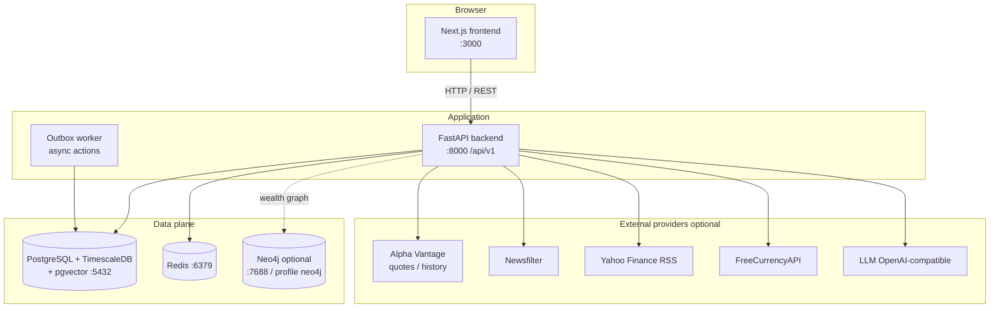
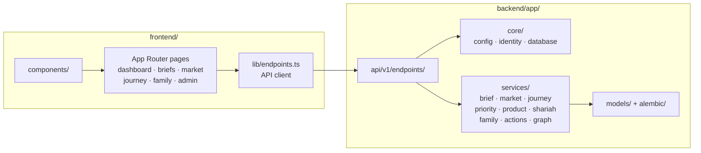
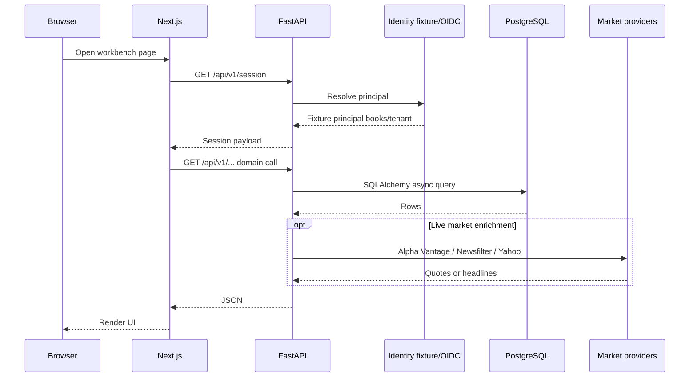
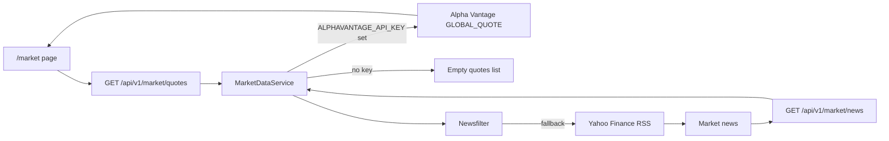

# Wealth Workbench

Relationship-manager workbench for wealth management: client books, briefs, priorities, workflows, market data, Shariah tools, and related admin surfaces.

## Architecture

### System overview



### Runtime components



### Request / data flow

Typical authenticated read (fixture mode for local demos):



Market quotes path (Tiger Broker removed):



## Prerequisites

- **Docker** and **Docker Compose** (PostgreSQL + Redis; optional full stack)
- **Node.js** 18+ (frontend, when running on the host)
- **[uv](https://docs.astral.sh/uv/)** (Python deps; `start.sh` installs it if missing)
- **Python** 3.11–3.13 (managed by uv)

## Quick start (recommended)

Runs Postgres and Redis in Docker, and the API + Next.js app from source:

```bash
git clone https://github.com/alancapco/wealth-workbench.git
cd wealth-workbench

cp .env.example .env
# Demo defaults already work locally:
#   AUTH_MODE=fixture, APP_ENV=development
#   POSTGRES_* / DATABASE_URL use demo_password_123 (matches Compose)
# Add optional API keys (LLM, Alpha Vantage, news) as needed.

./start.sh
```

`start.sh` will: start Postgres/Redis, `uv sync`, run `alembic upgrade head`, seed demo data (idempotent), then start API + UI.

| Service  | URL                            |
| -------- | ------------------------------ |
| Frontend | http://localhost:3000          |
| Backend  | http://localhost:8000          |
| API docs | http://localhost:8000/api/docs |
| Ready    | http://localhost:8000/health/ready |

Stop:

```bash
./stop.sh
```

Logs:

```bash
tail -f backend.log frontend.log
docker compose logs -f postgres redis
```

## Full Docker stack

Build and run Postgres, Redis, backend, and frontend containers:

```bash
cp .env.example .env
docker compose --profile full up -d --build
# or: ./setup.sh full
```

Optional Neo4j (wealth graph):

```bash
# In .env: NEO4J_ENABLED=true, NEO4J_PASSWORD=changeme
docker compose --profile full --profile neo4j up -d --build
```

Infra only:

```bash
docker compose up -d postgres redis
```

## Environment

| File | Purpose |
| ---- | ------- |
| `.env.example` | Committed template — copy to `.env` |
| `.env` | Local secrets (gitignored) |
| `frontend/.env.local` | Optional Next overrides (gitignored) |
| `docker-compose.yml` | Postgres/Redis always; `full` / `neo4j` profiles for app/graph |

Important keys:

- `AUTH_MODE=fixture` + `APP_ENV=development` — required for local/demo (OIDC is not implemented)
- `POSTGRES_*` / `DATABASE_URL` — must share the same password
- `EXPECTED_SCHEMA_HEAD=j0urn3y0001` — Alembic head for `/health/ready`
- `NEO4J_ENABLED=false` — portable default; enable with the `neo4j` Compose profile
- `LLM_*`, `ALPHAVANTAGE_API_KEY`, `NEWSFILTER_*` — optional integrations
- `NEXT_PUBLIC_API_URL` — browser → API base URL
- `FORCE_SEED=true` — wipe and re-seed demo clients

## Manual install

```bash
docker compose up -d postgres redis

cd backend
uv sync
uv run alembic upgrade head
uv run python -m app.scripts.seed_demo_data
uv run uvicorn app.main:app --host 0.0.0.0 --port 8000 --reload

cd ../frontend
npm install
npm run dev
```

## Project layout

```
backend/      FastAPI + Alembic + uv (api, services, models)
frontend/     Next.js App Router (pages, components, lib)
demo_data/    Seed / fixture CSVs
mockup/       Static HTML prototypes
deliverables/ Specs and audit notes
```

See **Architecture** above for Mermaid system, component, and data-flow diagrams.

## Notes

- Real credentials and `*.log` files are gitignored. Do not commit `.env` or key material.
- Compose demo passwords are for local/shared demos only — change them before any real production deploy.
- Timescale image is pinned to `timescale/timescaledb:2.28.3-pg15` (includes `pgvector`).
