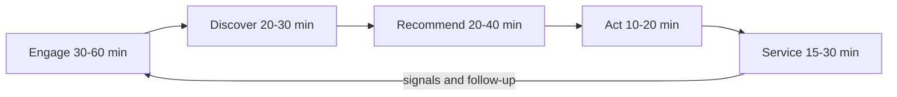
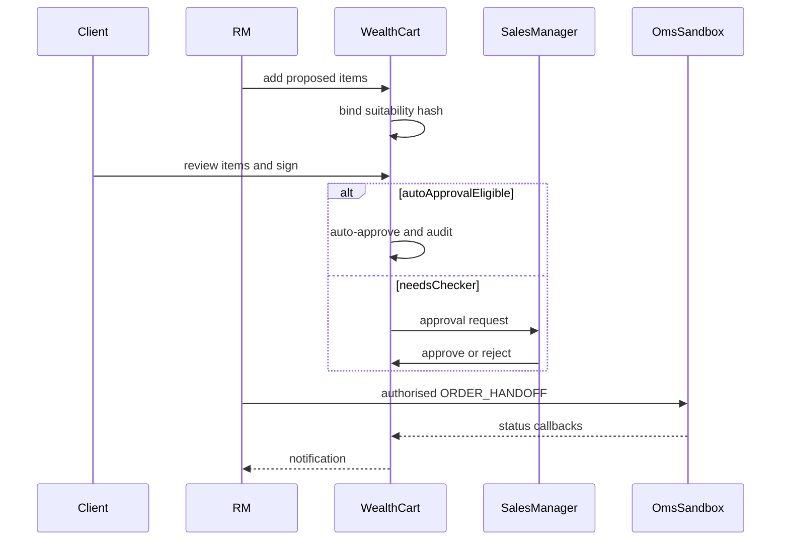

# RM Workbench — Product Requirements Document v3.0

**Document status:** Current baseline (20 November 2026)
**Feature IDs frozen:** ENG, DSC, REC, ACT, SVC, PLT
**Supersedes:** the 8 November 2026 draft of this file (archived as `03_PRD_Comprehensive_2026_2026-11-08.md`) and `02_PRD_Refreshed_2026.md`

The body below is the journey-structured PRD. Stage time boxes, feature IDs and out-of-scope boundaries are the implementation contract.

---

# RM Workbench PRD v3.0 — Features by journey

**Date:** 20 November 2026
**Status:** Draft for review
**Supersedes:** [deliverables/03_PRD_Comprehensive_2026.md](deliverables/03_PRD_Comprehensive_2026.md) (8 Nov), [deliverables/02_PRD_Refreshed_2026.md](deliverables/02_PRD_Refreshed_2026.md)
**Brief:** `wealth-journey/` plus the stage contract below
**Code baseline:** working tree 20 Nov 2026

The product is organised as **one journey, five stages**. Features are named, owned, and delivered by stage. Platform features exist only to serve those stages.

On execute, this lands as [deliverables/03_PRD_Comprehensive_2026.md](deliverables/03_PRD_Comprehensive_2026.md) (8 Nov file archived).

**Stage contract (normative)**

1. **Engage (30–60 min).** The RM sees prioritized leads and client signals, prepares for the meeting, and contacts the client.
2. **Discover (20–30 min).** The client confirms their circumstances and goals. The RM updates the investor and financial profile, with the aim of reducing repeated questions and paperwork.
3. **Recommend (20–40 min).** The system helps narrow suitable products using the client’s profile, preferences, and suitability checks. The RM explains the recommendation.
4. **Act (10–20 min).** The client reviews and signs through a wealth shopping cart. Eligible orders move through approvals and trade execution, with automation intended to reduce manual checking.
5. **Service (15–30 min).** The client and RM can see portfolio information, receive relevant notifications, and follow up on rebalancing or other needs.

The journey is modular. A returning client with a current profile can enter at Recommend. A service notification can open Engage.

**Closed decisions**

- Singapore is first-class alongside Hong Kong
- Act execution is an **OMS sandbox hand-off**, not a live broker submit
- Client review and sign is **in-meeting on the shared cart** (same screens, RM device or shared screen). A separate client portal remains out of scope
- Maker cannot be checker when a second person is required

**Status labels:** Live / Live (empty until seeded) / Partial / Planned / External / Out of scope

---

## Principles (apply to every stage)

- The copilot prepares; the RM decides. No auto-send, no silent write.
- Grounded or omitted. No material AI statement without source and as-of.
- Fail closed on compliance. Expired RPQ/KYC cannot be GREEN. HARD MISSING is not ticket-eligible. DNC blocks contact.
- Versioned rules, never hardcoded thresholds.
- Demo data labelled `SYNTHETIC DEMO DATA`. OMS labelled `DEMO SINK — not submitted`.

---

## Feature map

Each feature has an ID, the job it does, the primary screen, and current code status. IDs are the build contract.

### Stage 1 — Engage

**Job.** Prioritized leads and client signals, meeting prep, contact the client.
**Time box.** 30–60 min today; instrument actuals; target about −40%.
**Who.** RM. Sales Manager sees team roll-up of the same queues.

**ENG-01 My Day.** Landing screen: what to focus on. Today’s meetings as a list, focus queue, signal strip, pipeline snapshot, market news for names the book holds. Honest empty state when ranking is UNCONFIGURED.
Screen: [`frontend/app/dashboard/page.tsx`](frontend/app/dashboard/page.tsx)
Status: Partial — KPI tiles and news exist; meetings are a count not a list; ranking is not scored; `market_signals` is always `[]`.

**ENG-02 Prioritized leads.** Score every entitled, non-DNC client from approved RANKING config. Default Top view capped at 10. Reasons with evidence (risk / opportunity / retention). Pin, snooze, dismiss **change subsequent order**. Contact outcomes persist.
Screen: [`frontend/app/priorities/page.tsx`](frontend/app/priorities/page.tsx)
Status: Live (empty until seeded). Rank is currently `enumerate(order_by=external_id)` in [`ranking_service.py`](backend/app/services/priority/ranking_service.py). Controls persist but do not reorder.

**ENG-03 Client signals.** Typed signals that feed ENG-02 and My Day: RPQ/KYC expiry inside 30 days, market move on holdings, SAA drift, product maturity inside 90 days, inactivity, open opportunity value. Signal store with as-of and source.
Status: Planned as a store. Fragments exist (`detect_market_signal`, suitability expiry on the profile, unmounted KYC-expiry CSV).

**ENG-04 Meeting preparation (AI Prepare).** Five-section brief from the client record: portfolio, material changes, recent interactions, market context, proposed agenda. Auto-include RPQ state, open opportunities, maturing products, and Shariah notes when relevant. Provenance on every fact.
Screens: [`frontend/app/brief/[clientId]/page.tsx`](frontend/app/brief/[clientId]/page.tsx), [`frontend/app/briefs/page.tsx`](frontend/app/briefs/page.tsx)
Status: Partial — deterministic generator Live; missing RPQ/opportunity/maturity sections; LLM rewrite optional later.

**ENG-05 Contact the client.** Grounded outreach draft from the lead reason. DNC and channel consent fail closed. RM edits and approves before send (demo sink until a provider is agreed). Log outcome back onto the lead.
Screens: [`frontend/app/messages/page.tsx`](frontend/app/messages/page.tsx), priorities outcome actions
Status: Partial — template drafts; recipient often placeholder; DNC checks not wired on the send path.

**ENG-06 Opportunity pipeline.** Book of work across the journey, stages: Actionable → Contacted and Engaged → Discovery and Recommendation → Client Acceptance → Trade Execution → Sales Realized. Value, probability, source. Auto-advance from later stages. Weighted forecast.
Screen: new `/pipeline`
Status: Planned. Unmounted JSON overlay only; stages do not match this list.

**ENG-07 Book search and cohorts.** Filter the book (AUM, risk, RPQ state, jurisdiction, holdings, pipeline stage). Save a cohort for ENG-05 batch outreach (each send still approved).
Screen: extend [`frontend/app/clients/page.tsx`](frontend/app/clients/page.tsx)
Status: Partial — substring search only.

Engage out of this version: Symphony monitoring, team league table (nice-to-have after Service).

---

### Stage 2 — Discover

**Job.** Client confirms circumstances and goals. RM updates investor and financial profile. Reduce repeated questions and paperwork.
**Time box.** 20–30 min; confirm-no-change path under 5 min.
**Who.** RM with the client in the room (or on a call).

**DSC-01 Confirm circumstances.** Returning client sees last accepted profile. **Confirm no change** writes an audit event, extends validity, and skips re-keying. Change path opens DSC-02/03 only for the fields that moved.
Status: Planned.

**DSC-02 Investor Profile.** Versioned RPQ (questions, answers, score, band), CKA, CAR, Accredited / Professional / Retail status with evidence and expiry. T-30 creates an ENG-03 signal and a task. Expired profile cannot produce GREEN later.
Screen: new `/clients/[id]/investor-profile`
Status: Planned. Only `client_suitability_profiles.expiry_date` exists today.

**DSC-03 Financial profile.** Four mandatory fields (names frozen by DEC-FP-01). Everything else optional. Prepopulate from Client, holdings, and last profile.
Status: Planned. No `FinancialProfile` table. `clients` has only `name` as non-null.

**DSC-04 Goals.** Writable goals: name, target, date, contribution, status, product tags. Progress computed. Feeds Recommend projection and Service tracking.
Screen: extend [`frontend/app/portfolio/future-planner/page.tsx`](frontend/app/portfolio/future-planner/page.tsx) so it **reads and writes** goals rather than one-off form defaults.
Status: Partial — Future Planner takes up to three free-text goals and does not persist them. `client_financial_plans` is read-only and unseeded.

**DSC-05 AI Assist.** After recorded consent, capture the conversation. Extract proposed profile fields, goals, risk statements, amounts. RM accepts item by item. Nothing lands on the profile until accepted.
Screens: [`frontend/app/capture/page.tsx`](frontend/app/capture/page.tsx) plus a review panel on the profile
Status: Partial — consent and session exist; extractor has no callers; no transcript text path.

**DSC-06 Less paperwork.** Prefill from DSC-01. Document requests and vault (KYC, statements, tax forms) so the RM is not chasing paper during the meeting. W-8BEN **upload** lives here; auto-decision of W-8BEN is out of scope.
Status: Planned. Unmounted file-backed documents in extensions.

Discover out of this version: full planning engine, insurance fact-find (2027 on the brief).

---

### Stage 3 — Recommend

**Job.** Narrow suitable products from profile, preferences, and suitability. RM explains the recommendation.
**Time box.** 20–40 min.
**Who.** RM with the client. Compliance owns the rule packs, not the screen.

**REC-01 Suitability engine (SG + HK).** Versioned jurisdiction rules. HK pack stays. SG / MAS pack added. Factors: risk match, complexity, disclosure, objective, concentration, investor-status eligibility, CKA for complex products, vulnerable client, high-risk segment, cross-border (booking centre vs residence vs product), unsuitable sale. HARD MISSING is not ticket-eligible. Green labelled “pre-screen, not compliance approval”. Soft override with rationale; hard stops never overridable.
Status: Partial — HK `evaluate_hk` is real; SG clients get UNAVAILABLE; several new factors absent; HARD MISSING can still be ticket-eligible.

**REC-02 Narrowed product list.** Catalogue fields: CIO rating, rationale, share class, SAA bucket, complexity, jurisdiction eligibility. Default view is the CIO-narrowed, suitability-filtered shortlist — not the universe. NL query shows interpreted filters the RM can correct.
Screen: replace raw JSON on [`frontend/app/advice/page.tsx`](frontend/app/advice/page.tsx) with product cards
Status: Partial — search → compare → select → assess exists; catalogue has no CIO/share-class/SAA; `/advice` is a JSON explorer.

**REC-03 Explain the recommendation.** Side-by-side of client need vs product. Grounded sales pitch with evidence and required disclosures. Suitability traffic light per factor, readable without colour alone.
Status: Planned as a screen. Pitch today is a template message.

**REC-04 CIO SAA in front of picking.** Per risk band, strategic asset allocation. Client vs SAA with drift % per class, shown **before** product picking.
Status: Planned. `allocation_targets.csv` used only by unmounted extensions.

**REC-05 One-click proposal (optimiser v1).** Given SAA + constraints (cash, exclusions, Shariah flag, min ticket), produce a proposed holding set and **seed the cart**. One click means “proposal artifact + cart items”, not “submit to OMS”. Output labelled illustrative. Method versioned in config.
Status: Planned.

**REC-06 Wealth projection.** Future Planner reads saved DSC-04 goals and current holdings. Deterministic fallback if the model is down. Probability and recommendations stay planning illustrations, on-screen.
Screen: [`frontend/app/portfolio/future-planner/page.tsx`](frontend/app/portfolio/future-planner/page.tsx)
Status: Live as a one-off calculator; not wired to saved goals.

**REC-07 Stress / scenario (explain “what if”).** Market, FX, sector shocks → impact on total and per class. Assumptions itemized.
Status: Planned. Unmounted hardcoded sensitivity table.

**REC-08 AI Protect.** In-meeting Q&A over sales policy and cross-border rules, citations required. No citation → no answer. Feature-gated. Reuse AAOIFI hybrid RAG pattern.
Status: Planned. Only AAOIFI RAG exists.

**REC-09 AI Search.** Natural language to REC-02 filters and to ENG-07 book search.
Status: Partial — keyword stub only.

Recommend out of this version: insurance product journey (2027), live CIO feed (seeded ratings until CIO signs DEP-04).

---

### Stage 4 — Act

**Job.** Client reviews and signs through a wealth shopping cart. Eligible orders move through approvals and trade execution. Automation reduces manual checking.
**Time box.** 10–20 min; in-limit GREEN Bond hand-off under 5 min.
**Who.** Client (review/sign), RM (maker), Sales Manager (checker when required), Compliance (when policy says so).

**ACT-01 Wealth shopping cart.** `WealthCart` + `CartItem`. Delivery order of types: Bond; Unit Trust and Structured Notes; DCI; sell / switch / redeem. Per-type validators (min size, share class, currency, cooling-off). Cart is not a trade until hand-off. Assessment hash bound to the cart; stale suitability blocks hand-off.
Screen: new `/cart` and a panel on client 360
Status: Planned. `candidate_selections` is explicitly “no trade intent”.

**ACT-02 Client review and sign.** In-meeting shared cart: items, fees, suitability summary, required disclosures. Client acknowledges / signs (captured consent + signature artifact). This is the “client reviews and signs through a wealth shopping cart” requirement, without a client portal. Unsigned cart cannot hand off.
Status: Planned. Meeting consent exists; document e-sign does not.

**ACT-03 Approvals with less manual checking.** Roles: RM maker, Sales Manager checker, Compliance when required. `decided_by != created_by` unless auto-approved. **Auto-approve** only when all of: GREEN, not vulnerable, not HRS, not cross-border restricted, not complex-without-CKA, notional under configured limit, client signed. Discount above threshold always needs Sales Manager.
Screen: new `/approvals`
Status: Planned. One fixture actor currently creates and approves. No roles.

**ACT-04 Approvals dashboard.** Queues: pending my approval; vulnerable clients; unsuitable-sale attempts; SLA breach. Approve, reject with reason, request information. Every decision audited.
Status: Planned.

**ACT-05 Trade execution (hand-off).** Action class `ORDER_HANDOFF` (CHECK-constraint migration). Outbox dispatcher **registered**. Sandbox OMS: accept ticket, return mock order id, drive accepted → routed → completed | rejected. Payload cannot differ from the authorised preview. Live broker submit is out of scope.
Status: Planned. `set_action_dispatcher` has no callers; actions stay PENDING.

**ACT-06 Order notification.** When sandbox status becomes completed or rejected, notify the RM (and show on the shared Service surface). Stands in for “order has gone through”.
Status: Planned.

Act out of this version: live OMS, client-led mobile cart, W-8BEN auto-approval, insurance in the cart.

---

### Stage 5 — Service

**Job.** Client and RM see portfolio information, receive relevant notifications, follow up on rebalancing or other needs.
**Time box.** 15–30 min.
**Who.** RM and client on the **same portfolio screens** (in-meeting or RM-shared). No separate client app.

**SVC-01 Shared portfolio view.** Holdings in one place, gain/loss, asset class, currency exposure, Shariah markers, Investors-Like-Me as a conversation aid. This is the screen the client is looking at with the RM.
Screens: [`frontend/app/portfolio/page.tsx`](frontend/app/portfolio/page.tsx), [`frontend/app/portfolio/currency/page.tsx`](frontend/app/portfolio/currency/page.tsx), [`frontend/app/portfolio/investors-like-me/page.tsx`](frontend/app/portfolio/investors-like-me/page.tsx)
Status: Live (demo data). Split across `demo_clients` vs `clients` — Foundation must merge.

**SVC-02 Client 360.** One GET and one page: profile, RPQ state, holdings, goals, interactions, documents, transactions, suitability, open workflows, open opportunities. Heatmap of the book is the RM’s way into 360.
Screens: extend [`frontend/app/clients/[clientId]/page.tsx`](frontend/app/clients/[clientId]/page.tsx); new heatmap on clients
Status: Partial — profile + JSON panels; no aggregate endpoint mounted; no transactions/documents/heatmap.

**SVC-03 Notifications.** In-app centre: read/unread, deep link to client / opportunity / cart / portfolio. Types: RPQ T-30, SAA drift / rebalance, goal shortfall, maturity 90 days, order completed/rejected, document expiry.
Status: Planned. Symphony is External; this centre does not pretend to be Symphony.

**SVC-04 Rebalancing and follow-up.** Background evaluator writes an ENG-03 signal and an ENG-06 Actionable opportunity when drift, goal shortfall, or maturity fires. RM (or the next My Day) picks it up — that is the path from Service back to Engage. Goal progress visible on 360 and My Day. Cart items can be tagged to a goal.
Status: Planned. Legacy ranker has a 90-day rebalance bonus; nothing persists a nudge.

**SVC-05 Transactions and realised P&L.** History the RM can walk through with the client. Demo-derived until a custodian feed exists; labelled as such.
Status: Planned. Unmounted derivation in extensions.

Service out of this version: client-push notifications, insurance holdings, team coaching pack (optional later).

---

### Foundation — not a sixth stage

These features have no user-facing “stage”. Every stage above fails without them. Deliver **before** Engage.

**PLT-01 One client universe.** Merge `clients`, `demo_clients`, and [`demo_data/`](demo_data/) (42 synthetic: 29 SG, 7 HK, 6 SG/USD). One selector in the UI.

**PLT-02 Seed that makes “Live” true.** Approved RANKING, product universe, HK+SG policy, `client_assignments`, `skill_versions`. Fix `clients` migration drift, dashboard status case-match, audit `previous_hash`.

**PLT-03 Roles.** RM, Sales Manager, Compliance, Admin. Permissions enforced on Engage contact, Recommend override, Act approve, Admin gates.

**PLT-04 Action outbox.** Register the sandbox OMS dispatcher so authorised actions leave PENDING.

**PLT-05 Promote extensions.** Aggregate, documents, transactions, opportunities, stress, drift, KYC expiry, exports — DB models + migrations, then mount. Do not mount the file JSON stores as-is.

**PLT-06 Journey telemetry.** Stage start/end so the 30–60 / 20–30 / 20–40 / 10–20 / 15–30 boxes are measurable.

**PLT-07 Shariah and family (pilots).** Keep gated. Shariah RAG Live (pilot). Person-to-person family graph Live (basic). Legal entities / look-through stay after Service unless a UHNW demo forces a slice.

---

## Golden paths (acceptance journeys)

### New to Wealth — first trade

1. ENG-01 My Day
2. ENG-04 Prepare
3. REC-08 Protect (policy for this client)
4. DSC-05 Assist into the profile
5. DSC-02 Investor Profile
6. DSC-04 Goals
7. REC-02 / REC-03 shortlist and explain
8. ACT-01 / ACT-02 cart, client signs
9. ACT-03 / ACT-05 approvals and hand-off
10. ACT-06 / SVC-03 RM notified

### Existing to Wealth — optimise the book

1. ENG-01 My Day
2. ENG-02 / ENG-06 propensity and pipeline
3. ENG-07 search (optional ENG-05 batch)
4. SVC-02 / SVC-01 overview and portfolio with the client
5. REC-04 / REC-05 SAA and one-click proposal
6. ACT-01 cart
7. ENG-06 pipeline auto-advances toward Sales Realized
8. SVC-03 / SVC-04 notifications and rebalance follow-up

---

## What the current code already covers

Reuse, do not rebuild:

- ENG-04 brief generator, ENG-02 control persistence, ENG-05 draft shell
- REC-01 HK skeleton, REC-06 Future Planner, REC-09 search chain (JSON)
- SVC-01 holdings, currency, Investors-Like-Me
- Market news for ENG-01
- Consent records for DSC-05 and ACT-02
- DEC gates, artifact lineage, action preview hash
- AAOIFI RAG as the REC-08 template
- `demo_data/` pack as PLT-01 input
- Unmounted extensions as the PLT-05 starting point

Must be true before any stage demo: PLT-01 and PLT-02. Several screens that look “Live” return empty on a fresh database.

---

## Out of scope

- Live order submission, allocation, settlement
- Separate client portal or client-led mobile cart
- Auto-send of client communications
- Autonomous advice or a general chatbot
- W-8BEN auto-decision, Symphony monitoring
- Full planning engine, insurance holdings, wealth lending, AI Coach (brief 2027)
- Production OIDC
- Family-office legal-entity look-through (after Service)

---

## Delivery (same shape as the journey)

**Phase 0 — Foundation (PLT-01..06), about 2 weeks.**
Exit: 42 clients load; My Day ranking is non-empty; product search returns the seeded universe; audit chain verifies; actions can leave PENDING.

**Phase 1 — Engage (ENG-01..07).**
Exit: scored leads with reasons; pin/snooze reorder; T-30 RPQ appears as a signal; pipeline board exists; a meeting brief includes RPQ and opportunities; contact is DNC-safe.

**Phase 2 — Discover (DSC-01..06).**
Exit: confirm-no-change is audited and under 5 minutes; Investor Profile and four-field financial profile save; goals persist; Assist proposals apply only when accepted.

**Phase 3 — Recommend (REC-01..09).**
Exit: a Singapore client evaluates through the SG pack; shortlist is the default; RM can explain with a pitch and traffic light; optimiser seeds the cart; Protect refuses answers without citations.

**Phase 4 — Act (ACT-01..06).**
Exit: client sign is required; in-limit GREEN Bond auto-approves and completes in the sandbox with an RM notification; a vulnerable-client ticket cannot auto-approve.

**Phase 5 — Service (SVC-01..05).**
Exit: shared portfolio is the 360; a synthetic drift event creates a notification, a signal, and an Actionable opportunity; Client 360 is one request.

**Phase 6 — Hardening.**
Exit: both golden paths pass e2e (skipping out-of-scope client-app steps); journey-stage timings emit; orphans (`CanonicalBriefView`, `PolicyCheckPanel`, `ResponsiveShell`) are wired or deleted.

---

## Metrics

Baselines are the stage time boxes. Capture actuals from PLT-06 before claiming −40%.

- Confirm-no-change Discover path under 5 min
- In-limit GREEN Bond Act path under 5 min
- Carried from v1.1: meeting prep 45→10; post-meeting admin 20→5
- New: % opportunities with a current stage timestamp; auto-approval rate on eligible tickets; T-30 RPQ closed before expiry; optimiser proposals that land in a cart

Guardrails: no DNC leakage, no auto-approved RED, no unsigned hand-off.

---

## Dependencies (content engineering cannot invent)

- **DEC-FP-01** — the four mandatory financial-profile fields
- **DEP-01** RPQ / CKA / CAR questions and bands — Compliance + Product
- **DEP-02** SG MAS pack — Compliance
- **DEP-03** HK pack sign-off — Compliance
- **DEP-04** CIO SAA and product ratings — CIO / Product
- **DEP-05** Auto-approval limits and discount thresholds — Sales + Compliance
- **DEP-06** OMS ticket schema even for sandbox — Operations
- **DEP-07** Ranking weights — Business + Compliance
- **DEP-08** Consent and sign wording — Legal
- Shariah board, communications provider, family entitlements — External / later

Still open: whether insurance ever enters the cart (default no); whether RM mobile chrome is mounted in hardening or stays desktop-first; 42-client pack vs a saved “focus eight” cohort as the walkthrough (recommend 42).

---

## Glossary

- **ENG / DSC / REC / ACT / SVC / PLT** — feature ID prefixes for the five stages and foundation
- **RPQ / CKA / CAR** — investor-profile artefacts (MAS-relevant)
- **SAA** — CIO strategic asset allocation
- **Cart** — proposed items plus client sign; not a trade until ACT-05
- **Hand-off** — authorised payload to the OMS sandbox
- **Shared screen** — RM and client looking at the same workbench view; not a client login
