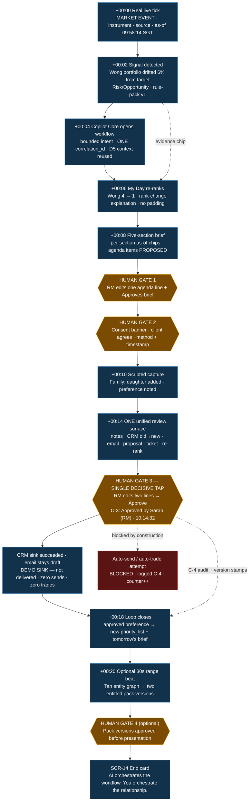
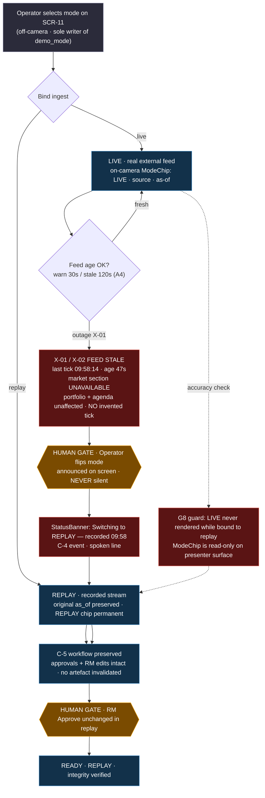
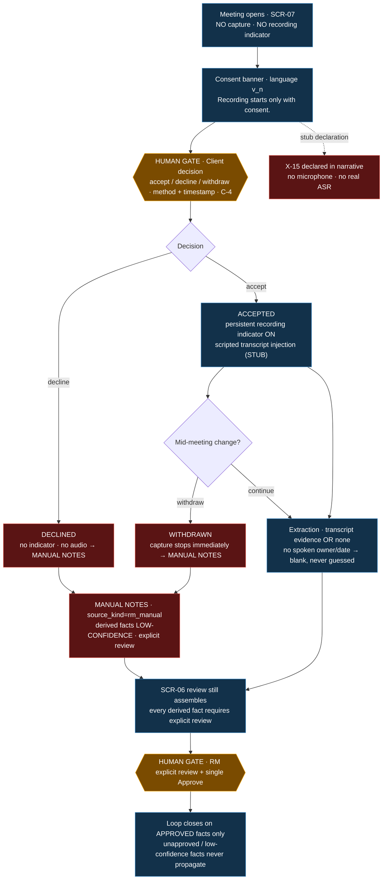
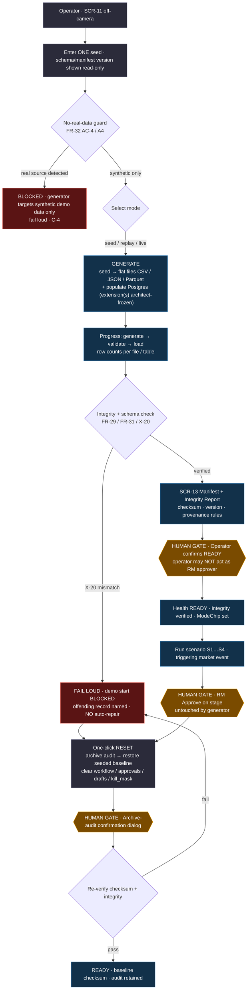

# Product Design Specification — RM Workbench MVP (Leadership Demo)

**Phase 2 deliverable · Author:** Jian Yiyong (简宜用), Product Designer, software-dev-team
**Consumers (verbatim hand-off):** Qi Huolin (team lead) → solution-architect (Phase 3), feature-planner (Phase 4), Phase N assembly.
**Frozen input:** `01_Requirements_Specification.md` (MVP-FR-01…34, C-1…5, X-01…20, G1…G11, roles §3, golden path §5.1), `00_Shared_Design_Brief.md`, `RM_Workbench_Video_Treatment.md`.
**Status:** Design only. No application code, no schema DDL, no API payloads, no technology selection, no runnable scripts. **Language:** English.

---

## 0. Reading note and stable ID legend

This document designs **only** what Phase 1 froze. It does not re-derive requirements, add product scope, or specify technology. Anything I propose that Phase 1 did not state is labelled **`[DESIGN PROPOSAL]`** with a justification. Physical data models, interface contracts, Postgres extension selection and dataflow belong to the architect (Phase 3). Where a value is not yet decided (e.g. the feed source name, Q1), the UI shows a `<placeholder>` and I say so — I do not invent a vendor.

| Prefix | Meaning | Range |
|---|---|---|
| `SCR-` | Screen / surface | SCR-01…14 |
| `CMP-` | Public shared component | CMP-01…16 |
| `ST-` | Interaction state (defined once in §9, reused in every screen spec) | ST-LOAD…ST-SUPER |
| `MVP-FR-`, `C-`, `X-`, `G-`, `NFR-`, `A`, `Q`, `S1…S4`, `F1/F2`, `D1…D10` | Phase 1 IDs, cited verbatim | — |

**Screen-spec template used throughout §5.** *Field table* columns: **Field** (exact on-screen label) | **Example value / copy** | **Data source** (logical artefact + C-1 `source_kind`) | **Chip** (CMP-01 variant; mandatory on every AI statement unless noted) | **Validation / default**. *Actions table* columns: **Action** | **Who** | **Type** | **Result / C-2 transition** | **C-3 gate?** *State table* lists all eight states from §9 with exact copy; a state that cannot occur is written `N/A — <why>` rather than omitted, so every screen spec is state-complete.

---

## 1. Design principles for a leadership demo

Seven opinionated principles. Each resolves a real trade-off rather than stating a virtue.

| # | Principle | Trade-off it resolves |
|---|---|---|
| P1 | **Provenance is a first-class visual element, not a tooltip.** Every AI statement carries a visible source/timestamp chip; click-through opens the originating record. | Visual density vs. hover-to-reveal cleanliness. Chose density: a banking audience must *see* trust without interacting. Depth goes into CMP-02 `SourceDrawer`, not into the chip. |
| P2 | **One approval moment, not five.** Per-item accept/edit/reject are *edits to one pending artefact*; a single **Approve** tap commits everything and writes one C-3 token. | Granular control vs. a single legible human tap on a projector. Chose the single tap: "one review, one Approve" is the emotional centre (FR-18, video §4 Seq2). |
| P3 | **Honest degradation is a feature.** F1 (feed outage) and F2 (consent declined) are rehearsed, labelled beats, not hidden errors. | A seamless-looking happy path vs. showing stale/unavailable/declined states. Chose to show them: `FEED STALE` and `MANUAL NOTES` are arguably the stronger trust proof (§5.2). |
| P4 | **Mode / labelling is always visible.** `LIVE`, `REPLAY — recorded <time>`, `SYNTHETIC DEMO DATA`, `DEMO SINK — not delivered` are permanent chrome, never cuttable by config (FR-33 boundary). | Immersion vs. permanent honesty labels. Chose honesty: a sceptical executive's "is that real?" must be answerable from the frame itself. |
| P5 | **Density for the RM, legibility for the room.** The RM gets five brief sections, per-item diffs and audit tables; the room gets one-line rationales, oversized chips and one decision per screen. | Operator productivity vs. a 16:9 image read from the back of a room. Resolved by progressive disclosure: dense data lives on the review surface and in drawers; every *on-camera claim* is large, sourced and singular. |
| P6 | **No dark patterns, no fake liveness.** Never imply the AI decided, never show `LIVE` in replay, never pad Top N, never show `sent` for a demo sink, never show `0` for unavailable, never fabricate a tick, never auto-advance past a gate. | Spectacle vs. credibility. Chose credibility; the demo's claim is orchestration + approval, not magic. |
| P7 | **Motion is causal, never decorative.** Motion connects one thing visibly flowing into the next and **stops at the approval gate**. No pulsing "thinking", no typewriter text, no ambient glow, no auto-scroll. | Liveliness vs. motion that could be mistaken for an autonomous AI action. Chose a hard stop: *motion ends where human judgement begins*. |

**What the camera sees.** This is a **projected, single 16:9 screen** (assumed 1920×1080, viewed from 3–8 m, A2). Therefore: chip/state text ≥24 px, body claims ≥28 px, headings ≥32 px, nothing below 18 px on the projected surface; contrast ≥4.5:1 (aim ≥7:1 for chips/states); no light-weight or condensed typefaces; transient states held ≥2.5 s and never auto-dismissed when blocked or in error; no motion faster than the eye can read. The **Demo Operator Console is on a second, non-projected output** (§2, §13). Type sizes, focus visibility and reduced-motion are specified in §11.

---

## 2. Information architecture

### 2.1 Surface map

```
Projected presenter window (ONE 16:9 frame, never a tab explosion)
│
├── SCR-01  Persistent Copilot Frame  [persistent chrome on EVERY presenter screen]
│     ├── ModeChip (CMP-07) · SYNTHETIC DEMO DATA · SGT clock
│     ├── WorkflowStageTrace (CMP-09) · correlation_id
│     └── HealthBar anchor (SCR-10 / CMP-08) · footer disclaimer
│
├── SCR-02  My Day home  ................................. ENTRY / HUB
│     ├── SCR-04  Live Market Event & Signal Evidence Drawer   [overlay]
│     ├── SCR-05  Reason Code & Rank-Change Drill-down         [overlay]
│     ├── CMP-02  SourceDrawer (click-through of ANY chip)     [overlay]
│     ├── SCR-03  Client Workspace & Five-Section Brief
│     │     └── CMP-02 SourceDrawer in `correctable` mode (FR-07 memory correction)
│     ├── SCR-07  Consent Banner & Capture State
│     ├── SCR-06  Unified Post-Meeting Review & Approve
│     │     └── SCR-08  Outreach Draft & Approved Send (from an approved reason)
│     ├── SCR-09  Family Entity Graph & Entitled Pack Versions  [range beat]
│     └── SCR-12  Compliance / Audit Viewer  [ROLE-SWITCHED, on request]
│
├── SCR-10  Demo Health / Status Bar  [persistent, projected]
├── SCR-11  Demo Operator Console  ──── SECOND, NON-PROJECTED OUTPUT (backstage)
│     └── SCR-13  Generator Manifest / Integrity Report View [drill-down]
└── SCR-14  Tagline / End Card  [full-screen terminal state]

Observer view  = the SAME presenter screens rendered read-only (actions disabled).
                 NOT a duplicate screen (global rule 1).
Compliance view = SCR-12; read-only; every view emits a C-4 read-access event.
```

### 2.2 Presenter / backstage / projected classification

| Surface | Owner role | Presenter-facing | Observer / backstage | Projected |
|---|---|---|---|---|
| SCR-01…09, SCR-14 | RM ("Sarah") | Yes | Read-only role-switched copy | **Y** |
| SCR-10 Health Bar | Operator owns accuracy; visible to all | Yes (compact) | Yes | **Y** |
| SCR-12 Audit Viewer | Compliance Viewer | On request | Yes | On request (§13) |
| SCR-11 Operator Console | Demo Operator / Data Steward | No | **Backstage** | **N** |
| SCR-13 Manifest / Integrity Report | Demo Operator | No | Backstage | **N** (on request) |

### 2.3 Navigation model

Single-window, state-driven, in-place. No global nav bar with 14 links. Entry is SCR-02. A priority card → SCR-03 → SCR-07 → SCR-06 → (loop closes) back to SCR-02 re-ranked. Drawers (SCR-04/05, CMP-02) are right-side overlays over the current screen, never new pages. Back navigation never discards RM edits (FR-18 boundary, X-07). The operator console has its own backstage navigation on the second output; it never appears inside the projected window.

### 2.4 Resolution: off-camera console, on-camera mode chip

This is the one IA decision the brief asks to be explicit about. Four mechanisms, one source of truth:

1. **One shared state.** `demo_mode` is a single logical state (FR-04). SCR-11 is the only *writer*; SCR-01/SCR-10 `ModeChip` is a **read-only projection** of it. There is no second copy that can drift.
2. **Physical separation.** SCR-11 and SCR-13 live on a **second, non-projected output** (operator laptop / secondary monitor). The projector output contains only the presenter frame. The operator never moves a window onto the projector.
3. **Separation of duties is enforced in the UI contract.** The operator console exposes **no Approve control** (the operator may not act as RM approver, §3.1); conversely the presenter frame exposes **no mode control**. Changing mode from the presenter surface is impossible, so a stage mistake cannot silently relabel the demo.
4. **Every switch is announced on-camera.** A CMP-16 `StatusBanner` renders `Switching to REPLAY — recorded 09:58` on the projected frame for ≥2.5 s, a C-4 event is written (FR-27), and the label updates **before** the next artefact (X-07). G8 (never `LIVE` while bound to `replay`) is a read-only property of the shared state, not an operator discipline.

> `[DESIGN PROPOSAL]` A2 assumes *one* 16:9 desktop screen. If only one physical output exists, a truly off-camera console is impossible. Fallback: a **presenter-safe console overlay** toggled by an operator-only hotkey, auto-hiding on any RM interaction, still writing the same on-camera `ModeChip`. Justification: preserves the off-camera requirement's *intent* (audience never sees controls, only the honest label) without a second monitor. **Alan must decide single- vs dual-output (§13).**

---

## 3. User flows

**Legend for all four diagrams:** hexagon `{{…}}` = **human approval / decision gate**; `:::gate` amber = gate; `:::sys` = copilot/system action; `:::op` = operator action; `:::warn` = honest-degradation / blocked state. No edge crosses a gate into a client-facing write without that gate.

### 3.1 (a) Golden path — live event → loop → re-rank



**Numbered sequence.** 1 Operator has loaded S1 in `LIVE`, health `READY`. 2 Tick chip appears on SCR-02, held ≥2.5 s. 3 Signal drawer (SCR-04) opens with rule-pack version. 4 Workflow trace (CMP-09) shows one `correlation_id`. 5 Wong's row moves 4→1 with an explanation chip. 6 RM opens SCR-03, edits one agenda line, taps Approve (Gate 1). 7 Meeting: consent banner → client agrees (Gate 2) → recording indicator → memory chip. 8 SCR-06 assembles one surface; RM accepts/edits/rejects items (edits, not approvals), taps **one** Approve (Gate 3). 9 Confirmation + sync statuses render; email remains `draft`. 10 Re-ranked list and tomorrow's brief show the approved preference, linked by the same `correlation_id`. 11 Optional range beat, packs approved (Gate 4). 12 End card.

### 3.2 (b) Live ↔ replay mode switch, including F1 outage



**Numbered sequence.** 1 Operator binds `live`; on-camera chip reads `LIVE · <source> · as-of <time>`. 2 Feed age crosses warn → amber `STALE` chips on affected facts; portfolio/agenda sections untouched. 3 Age crosses stale → market section `unavailable`, numeric value removed, no substitution. 4 Operator flips to `replay` (Gate). 5 On-camera announcement ≥2.5 s + C-4. 6 All subsequent chips carry `REPLAY — recorded 09:58`; no artefact claims a live source. 7 The same workflow resumes with RM edits preserved (X-07). 8 Approvals are still required (Gate 2) — replay changes the label, not the governance.

### 3.3 (c) Consent accept / decline / withdraw (F2)



**Numbered sequence.** 1 Meeting opens with zero capture; banner visible. 2 Client decision recorded with method + timestamp (Gate). 3 Accept → indicator on, scripted injection enabled. 4 Decline, or withdraw mid-meeting → indicator off, capture stops, `MANUAL NOTES`. 5 Extraction links each item to transcript evidence where it exists; absent owner/due stay blank. 6 Without transcript, all derived facts are `low-confidence` and flagged for explicit review. 7 SCR-06 assembles regardless; RM reviews explicitly and taps one Approve (Gate 2). 8 Only approved facts propagate into the re-rank.

### 3.4 (d) Generator / reset operator flow



**Numbered sequence.** 1 Enter one seed; schema/manifest version displayed read-only (frozen, global rule 3). 2 No-real-data guard rejects any real target. 3 Choose `seed` / `replay` / `live`. 4 Generate → validate → load with visible progress and row counts. 5 Integrity/schema mismatch → fail loud, demo start blocked, offending record named, no auto-repair. 6 Success → SCR-13 manifest + checksum report. 7 Operator confirms `READY` (Gate 1 — not an RM approval). 8 Run scenario; on-stage approvals are untouched (Gate 2). 9 One-click reset → archive-audit confirmation (Gate 3) → re-verify → `READY`.

---

## 4. Screen inventory

| ID | Name | Owner role | Purpose | Projected? | Phase-1 FR IDs |
|---|---|---|---|---|---|
| SCR-01 | Persistent Copilot Frame | RM (visible to all) | Single-screen chrome: mode chip, synthetic label, workflow trace, health anchor, navigation state | **Y** | 04, 26, 27, 33, 34 |
| SCR-02 | My Day home | RM | Top N priorities, live event banner, reason codes, proactive cards, loop re-rank | **Y** | 11, 12, 13, 21, 26, 28, 34 |
| SCR-03 | Client Workspace & Five-Section Brief | RM | Sourced brief, per-section status, regeneration/versioning, memory correction | **Y** | 05, 07, 14, 15, 26, 28 |
| SCR-04 | Live Market Event & Signal Evidence Drawer | RM / Observer / Compliance | Tick, normalisation, signal, news, provenance chain | **Y** | 01, 02, 03, 26, 28 |
| SCR-05 | Reason Code & Rank-Change Drill-down | RM / Observer / Compliance | Contributing signals, rank-change explanation, policy feature list | **Y** | 12, 13, 26, 28 |
| SCR-06 | Unified Post-Meeting Review & Approve | RM | ONE surface, old→new preview, per-item disposition, single Approve, loop closure | **Y** | 18, 19, 20, 21, 26, 27, 28 |
| SCR-07 | Consent Banner & Capture State | RM | Consent gate, recording indicator, scripted capture, manual notes | **Y** | 16, 17, 26 |
| SCR-08 | Outreach Draft & Approved Send | RM | Grounded editable draft, policy checks, approved send to demo sink | **Y** | 22, 23, 26, 27 |
| SCR-09 | Family Entity Graph & Entitled Pack Versions | RM | Range moment: graph, consolidated view, per-attendee entitled packs | **Y** (30 s beat) | 06, 24, 25, 26 |
| SCR-10 | Demo Health / Status Bar | Operator owns accuracy; all see | Eight health fields + mode chip + synthetic label | **Y** | 02, 09, 27, 31, 34 |
| SCR-11 | Demo Operator Console | Demo Operator / Data Steward | Scenario, mode, seed/generate, reset, flags, config versions, kill switch, legend | **N** (backstage) | 10, 29, 30, 31, 32, 33, 34 |
| SCR-12 | Compliance / Audit Viewer | Compliance Viewer | Append-only audit, consent records, versions, blocked attempts, leakage results | On request | 06, 16, 23, 27, 28 |
| SCR-13 | Generator Manifest / Integrity Report View | Demo Operator | Manifest, flat-file listing, Postgres load status, checksum, fail-loud record | **N** (on request) | 29, 30, 31, 32 |
| SCR-14 | Tagline / End Card | All | Locked tagline; honesty labels persist to the last frame | **Y** | Video §5 (locked) |

**No duplicates:** 14 screens, one frame, one hub, one review surface, one console. FR-07 (memory correction) is **not** a 15th screen — it is CMP-02 `SourceDrawer` in `correctable` mode, reached from any memory chip. Observer and compliance views are role-switched renderings of existing screens, not new screens.

---

## 5. Detailed screen specs

### 5.1 SCR-02 · My Day home *(deep)*

**Layout regions.** R1 persistent frame header (SCR-01). R2 day-summary strip. R3 live-event banner (transient → collapses to a chip). R4 priority list (Top N ≤10 rows). R5 proactive cards. R6 workflow stage trace (compact). R7 HealthBar anchor. R8 footer disclaimer.

| Field | Example value / copy | Data source | Chip (mandatory) | Validation / default |
|---|---|---|---|---|
| Synthetic label | `SYNTHETIC DEMO DATA` | global (FR-30/32) | Permanent text badge, never a chip | Always on; cannot be disabled |
| Mode + as-of | `LIVE · <source> · as-of 09:58:14 SGT` | `demo_mode` (FR-04) | CMP-07 ModeChip | Source name pending Q1 — placeholder, not invented |
| Day summary | `3 meetings today · Tue 16 Mar · Sarah (RM)` | seeded calendar (stub) | `Calendar (stub), as of 07:45` | — |
| Ranking meta | `Updated 10:00:02 · ranking policy v3` | `priority_list` (derived) | `Derived · policy v3 · 10:00:02` | N≤10 default (A4) |
| Live event banner | `MARKET EVENT · <instrument> · <source> · as-of 09:58:14 SGT` | `market_tick` (live_feed, FR-01) | `LIVE · <source> · as-of 09:58:14 SGT` | Held ≥2.5 s; no invented tick |
| Row · rank | `1` | derived | `Ranked · policy v3 · 10:00:02` | Unique, sorted |
| Row · rank delta | `↑ 3 (from 4)` | derived, prior list version | `Rank change · opens evidence` → SCR-05 | Old rank, new rank, trigger, policy version shown |
| Row · client | `Mr. Wong · 10:00` | seeded client + calendar | `Client record, verified` / `Calendar (stub), as of 07:45` | Ambiguous attendee → RM selection, never auto-merge (FR-14) |
| Row · reason code | `Opportunity — rebalancing` | derived from `market_signal` | `Signal · tick as-of 09:58:14 · rule-pack v1` | ≥1 reason per row; no protected attributes (FR-12) |
| Row · contributing signal | `Portfolio drifted 6% from target` | live_feed + seeded allocation | `Portfolio, as of 09:58` | Stale → `STALE · as-of 09:58:14 · age 47s` |
| Row · confidence | `High` / `Low — review required` | derived (FR-05) | `Low confidence — review required` when below threshold | Low-confidence facts suppressed from client-facing text |
| Row · status | `DNC — excluded` / `STALE` / `PINNED` | consent/DNC state, RM action | CMP-05 StateBadge, non-colour-only | DNC excluded even if ranked (X-17) |
| Proactive card | `2 clients flagged for retention risk — outreach drafts queued` | derived | `Derived · policy v3 · 10:00:02` | `Review later` only; no auto-send |
| Workflow trace | `rank.clients → brief.generate → outreach.draft · corr_id 8f21…` | C-5 (FR-09) | CMP-09, one `correlation_id` | — |
| Tomorrow preview | `Wong 1 (↑3) · daughter to join` | approved re-rank (FR-21) | `Re-rank · approved 10:14:32` | Only after approval |

**Actions.**

| Action | Who | Type | Result / C-2 transition | C-3 gate? |
|---|---|---|---|---|
| Open brief | RM | Primary | → SCR-03 (brief `pending_review`) | No |
| Drill into reason / rank change | RM / Observer / Compliance | Secondary | → SCR-05; C-4 view event | No |
| Open source chip | RM / Observer / Compliance | Secondary | → CMP-02 SourceDrawer; C-4 view event | No |
| Pin / Snooze / Dismiss-with-reason / Mark contacted | RM | Row control | Persist `rm_manual` action; next ranking applies published rule; original evidence preserved (FR-13) | No (RM action, not outbound) |
| Review later | RM | Secondary | Dismiss proactive card | No |
| Request re-rank | RM | Secondary | Opens FR-21 workflow | No |
| View audit | RM / Observer / Compliance | Secondary | → SCR-12 | No |

**C-2 / C-3.** `priority_list` state = `derived`, reviewable but **not an outbound artefact**; no approval gate on this screen (C-3 applies to the brief, review and send, not to ranking).

**States (exact copy).**

| State | What renders |
|---|---|
| ST-LOAD | `Assembling your day…` + 3 skeleton rows; HealthBar `workflow stage: rank.clients` |
| ST-OK | ≤10 unique clients, each with rank, reason code, timestamp, chips; `3 meetings today` |
| ST-EMPTY | `No high-priority clients right now. Criteria: material signal + permission + no DNC · Last evaluated 10:00:02` — **never padded** (X-13) |
| ST-PART | Affected row `STALE · as-of 09:58:14 · age 47s`; conflicting records block only affected rows (X-08); live-event banner `UNAVAILABLE · feed outage — priorities from last confirmed state` |
| ST-ERR | `Priorities unavailable — <reason>. Your briefs and notes are unaffected. Retry` (X-02) |
| ST-BLOCK | `BLOCKED · DNC — outreach not attempted` on any attempted send; `DNC — excluded` row status |
| ST-REPLAY | Header `REPLAY — recorded 09:58`; every chip gains `REPLAY`; **no chip claims a live source**; no row claims `LIVE` |
| ST-SUPER | `This list was superseded at 10:14:32 by an approved outcome · corr_id 8f21… → View new version` |

---

### 5.2 SCR-03 · Client Workspace & Five-Section Brief *(deep)*

**Layout regions.** R1 client header + entitlement scope. R2 brief meta bar (version, state, versions, `correlation_id`). R3 five section blocks, each with a per-section status badge. R4 evidence chips on every material fact. R5 editable agenda field(s). R6 ApprovalBar. R7 feedback. R8 section actions / version history. R9 memory chips panel. R10 HealthBar anchor.

| Field | Example value / copy | Data source | Chip | Validation / default |
|---|---|---|---|---|
| Client + book | `Mr. Wong · Sarah's book · Household: Wong` | seeded (FR-05) | `Client record, verified` | Entitled book enforced server-side |
| Entitlement scope | `Entitled nodes: 4 of 6` | entitlement matrix (FR-06) | `Entitlement matrix v2 · as-of 2026-03-01` | Ambiguous attendee → RM selection, no auto-merge |
| Brief meta | `Brief v3 · pending_review · generated 10:00:08 · data-as-of 09:58` | `meeting_brief` (derived) | `Derived · brief v3` | Version stamped (C-4) |
| Version stamps | `model v1 · prompt v4 · template v2 · rule-pack v1` | version registry (FR-27/33) | `Version stamps · inspect` → SCR-12 | Always present on generated artefact |
| §1 Portfolio / AUM | `AUM SGD 12.4M · Equities 68% / target 62%` | seeded, `as_of` prior close | `Portfolio, as of prior close` | Missing → `UNAVAILABLE`, never `0` |
| §2 Material changes & risk alerts | `Wong portfolio drifted 6% from target` | `market_signal` (live_feed) | `Portfolio, as of 09:58` + `LIVE · <source> · as-of 09:58:14 SGT` | Drift figure + tick `as_of` + respected preference (FR-28) |
| §3 Recent interactions & open actions | `Last review 12 Feb · Open action: send consolidated statement` | seeded CRM | `CRM (seeded), as of 07:45` | — |
| §4 Entitled market news | `<headline> · <source> · 09:55` | licensed news (FR-03) | `News · <source> · as-of 09:55` | Unlicensed item excluded; feed failure → section `unavailable` |
| §5 Proposed agenda | `Discuss rebalancing options aligned to stated preferences` | derived (FR-14) | `PROPOSED · copilot · rule-pack v1` + visible `AI-GENERATED` tag | **Distinct from recorded facts**; editable |
| Section status (each) | `available` / `stale` / `unavailable` | section source status (FR-15) | CMP-05 StateBadge | Explicit state, never a blank that looks like zero |
| Memory chip | `Client preference, verified` / `Family: daughter added · preference noted` | D5 fact (seeded / rm_manual / transcript) | `Client preference, verified` / `Transcript · 10:06:12 · confidence 0.92` | Click → CMP-02 `correctable` mode (FR-07) |
| Feedback | `Helpful` / `Not helpful — <structured reason>` | RM input (`rm_manual`) | C-4 event, attributable to brief v3 | Optional |
| Approval | `Approve brief` | C-3 | `Approved by Sarah (RM) · 10:14:32` | Single tap; disabled until `pending_review` |

**Actions.**

| Action | Who | Type | Result / C-2 transition | C-3 gate? |
|---|---|---|---|---|
| Edit agenda line | RM | Primary edit | `pending_review` → `edited` → back to `pending_review` | No |
| **Approve brief** | RM | **Primary** | `pending_review` → `approved`; C-3 token + C-4 written | **Yes (Gate 1)** |
| Regenerate / Retry section | RM | Secondary | New brief version `v_n+1`; prior `superseded`; zero CRM duplication | No |
| View version history | RM / Observer | Secondary | v1/v2/v3 list with actor + timestamp | No |
| Open source chip | RM / Observer / Compliance | Secondary | → CMP-02 SourceDrawer; C-4 view event | No |
| Correct / delete memory fact | RM | Secondary | New fact version `rm_manual`; old `superseded`; downstream skills re-read | No (C-3-style attribution) |
| Capture feedback | RM | Secondary | Feedback linked to RM + brief version | No |

**States.**

| State | What renders |
|---|---|
| ST-LOAD | `Assembling brief · 5 sections` with five labelled skeletons; each section shows its own spinner |
| ST-OK | All five `available`; every material fact, alert and news item has a resolvable chip; agenda items tagged `PROPOSED` |
| ST-EMPTY | `No brief generated for this client. Select a client or Regenerate.` |
| ST-PART | §4 news `UNAVAILABLE · market news feed unavailable · last attempt 09:57 · portfolio and agenda unaffected`; §2 `STALE · as-of 09:58:14 · age 47s`; **no inferred values** (X-02, FR-15) |
| ST-ERR | `Brief generation failed — <reason>. Your edits are preserved. Retry` |
| ST-BLOCK | Unauthorised client → `Access denied · logged (C-4)`; conflicting records → `Conflicting records linked · suitability / ticket handoff blocked` (X-08) |
| ST-REPLAY | Every chip gains `REPLAY — recorded 09:58`; §2 no longer claims `LIVE`; `data-as-of` preserved as recorded |
| ST-SUPER | `Brief v3 superseded by v4 at 10:14:32 · View v3` — old version still queryable; no duplicate CRM records |

---

### 5.3 SCR-06 · Unified Post-Meeting Review & Approve *(deep — the centrepiece)*

**Layout regions.** ONE surface, six blocks (FR-18): B1 notes/extracted items, B2 CRM old→new, B3 tasks, B4 follow-up email draft, B5 rebalancing proposal + trade-ticket handoff, B6 tomorrow's re-ranked priorities. Header: `correlation_id`, consent state, capture state, `pending_review` badge. Footer: **one** ApprovalBar.

| Field | Example value / copy | Data source | Chip | Validation / default |
|---|---|---|---|---|
| Header | `Meeting review · Wong 10:00 · corr_id 8f21… · pending_review` | C-5 (FR-09) | `Consent: accepted 10:00:41 · Capture: scripted transcript` | — |
| B1 Preference | `Family: daughter added · preference noted` | transcript evidence (seeded stub) | `Transcript · 10:06:12 · confidence 0.92` | Low-confidence → `Low confidence — review required`, suppressed from client-facing text |
| B1 Action item | `Send consolidated statement · owner: — · due: —` | extracted | `Transcript · 10:07:03` | Owner/due blank when unspoken, never guessed (FR-17) |
| B1 Manual note | `Client asked daughter to join next review` | `rm_manual` (F2) | `RM manual · Sarah · 10:09:12` | — |
| B2 CRM diff | `Next review date 2026-04-10 → 2026-03-20` | seeded CRM + approved extraction | `CRM (seeded), as of 07:45` on both sides | CMP-04 DiffField; per-item Accept/Edit/Reject |
| B3 Task | `Prepare family meeting pack` | extracted | `Transcript · 10:07:40` | — |
| B4 Email draft | `Dear Mr Wong, following our conversation…` | derived (FR-22) | `Draft · template v2 · model v1 · DEMO SINK — not delivered` | Fully editable; state `draft`; recipients confirmed by RM |
| B5 Rebalancing proposal | `Reduce equities 68% → 62%` | `market_signal` (live_feed) | `Signal · tick as-of 09:58:14 · rule-pack v1` | Faithful explanation: drift figure + tick `as_of` + respected preference (FR-28) |
| B5 Ticket fields | `Product / Account / Amount` (pre-filled) | approved meeting evidence | `Evidence · transcript 10:07:22` | Pre-filled only; **no submit/execute/approve action exists** |
| B5 Suitability | `Suitability current · execution disabled` or `Yellow — suitability expired` | suitability state (`as_of`) | `Suitability, as of 2026-03-01` | Missing/expired → `HANDOFF BLOCKED` (X-19); conflicts → blocked, both sources linked (X-08) |
| B6 Tomorrow's priorities | `Wong 1 (↑3) · daughter to join` | approved re-rank (FR-21) | `Re-rank preview · pending approval` | Preview only before the tap |
| Sync status | `succeeded` / `pending` / `failed` | demo sink (FR-19) | CMP-05 StateBadge | Idempotent; never false success |
| Approval token | `Approved by Sarah (RM) · 10:14:32` | C-3 | — | `final_content_hash` shown in SCR-12, not on projector |

**Actions.**

| Action | Who | Type | Result / C-2 transition | C-3 gate? |
|---|---|---|---|---|
| Accept / Edit / Reject **per item** | RM | Row edit | Edits the single pending artefact; **not** an approval tap (P2) | No |
| Edit any draft line | RM | Primary edit | Edited text becomes the version subject to approval (FR-22 AC-4) | No |
| Reject all | RM | Secondary | No downstream artefact created (FR-18 AC-4) | No |
| **Approve** (single tap) | RM | **Primary** | `pending_review` → `approved`; C-3 token + C-4; CRM write; email stays `draft`; re-rank opens | **Yes (Gate 3, the decisive gate)** |
| View evidence / source | RM / Observer / Compliance | Secondary | → CMP-02 / SCR-04; C-4 view event | No |
| View audit | Compliance / Observer | Secondary | → SCR-12 | No |
| Safe retry | RM | Secondary (on `failed`) | Idempotent retry, no duplicate write | No |

**Governance proof.** Before the tap: **zero CRM writes, zero sends, zero ticket submissions** (FR-18 AC-1). After: CRM `succeeded` (sink, idempotent), email `draft · DEMO SINK — not delivered`, ticket `ready_for_manual_handoff` or `blocked`, new `priority_list` version. Per-item dispositions are edits; **one** Approve commits all — this is the "one approval moment, not five" rule made buildable.

**States.**

| State | What renders |
|---|---|
| ST-LOAD | `Assembling one review from 5 sources…`; six block skeletons; `pending_review` badge |
| ST-OK | Six blocks populated; every item has evidence; old→new preview always shown |
| ST-EMPTY | F2 case: `No transcript evidence. Derived facts come from RM manual notes and require explicit review.` + `MANUAL NOTES` badge |
| ST-PART | `CRM sink unavailable — changes retained as editable draft · status pending` (X-09); low-confidence items `Low confidence — review required`; a block `unavailable` with reason |
| ST-ERR | `Review assembly failed — <reason>. Your edits are preserved. Retry` (X-12/X-14) |
| ST-BLOCK | `BLOCKED · DNC — send not attempted`; `BLOCKED · suitability expired — ticket handoff disabled`; `BLOCKED · auto-submit attempt · logged · counter++` (X-16/X-17/X-19). No bypass control exists. |
| ST-REPLAY | All chips `REPLAY — recorded 09:58`; **Approve is still required** — replay changes the label, not governance |
| ST-SUPER | `Review v1 superseded by v2 at 10:12:40 after consent withdrawal · View v1` |

---

### 5.4 SCR-10 · Demo Health / Status Bar *(deep)*

Persistent, projected, read-only on the presenter surface. Owns the eight FR-34 / NFR-8 fields plus the honesty labels.

| Field | Example value / copy | Data source | Indicator | Validation / default |
|---|---|---|---|---|
| Ready badge | `READY` | FR-32 | CMP-05 StateBadge (Green + text `READY`) | `NOT READY` on integrity failure |
| mode | `LIVE` / `REPLAY` | `demo_mode` (FR-04) | CMP-07 ModeChip | **G8**: never `LIVE` while bound to replay |
| source | `<vendor sandbox> · entitled` | feed config (FR-33) | `LIVE · <source>` / `REPLAY — recorded 09:58` | Q1 pending — placeholder |
| last tick as-of | `09:58:14 SGT` | FR-01/02 | timestamp + `as_of` | Always shown, even when stale |
| feed age | `3s` / `47s` / `>120s outage` | FR-02 | `FEED STALE · last tick 09:58:14 · age 47s` (amber + `⚠ STALE`) | warn 30s / stale 120s (A4) |
| scenario | `S1 Wong Drift` | FR-34 | CMP-13 mirror | ≥3 seeded |
| workflow stage | `rank.clients → brief.generate → … (corr_id 8f21…)` | C-5 (FR-09) | CMP-09 | One `correlation_id` per workflow |
| blocked-attempt count | `0` → `1` | FR-27 / X-16 | `BLOCKED ATTEMPTS: 1 · last: auto-submit 10:14:31` | Increments, never resets silently |
| integrity state | `verified` / `failed` | FR-31 | `INTEGRITY VERIFIED · checksum 9f3a…` | Failure blocks demo start (X-20) |
| global label | `SYNTHETIC DEMO DATA` | §1.1 | Permanent text badge | Cannot be disabled (FR-33) |

**Actions.** Operator-only, from SCR-11 (mode switch, reset, scenario load); the presenter bar exposes **no action** except `Inspect` → SCR-12/SCR-13 on request (read-only).

**C-2 / C-3.** The bar is a status surface, not an artefact; no C-2 state, no approval gate. Every value change emits C-4 (FR-27).

**States.**

| State | What renders |
|---|---|
| ST-LOAD | `Checking feed, workflow, integrity…` |
| ST-OK | `READY · LIVE · <source> · last tick 09:58:14 SGT · age 3s · S1 · rank.clients · blocked 0 · integrity verified` |
| ST-EMPTY | `No scenario loaded — operator must load S1` (pre-run) |
| ST-PART | `FEED STALE · last tick 09:58:14 · age 47s` while workflow stage and `integrity verified` remain; portfolio/agenda unaffected |
| ST-ERR | `INTEGRITY FAILED — demo start blocked · see SCR-13` |
| ST-BLOCK | `BLOCKED ATTEMPTS: 1 · last: auto-submit 10:14:31` |
| ST-REPLAY | `REPLAY — recorded 09:58 · source: recorded stream · last tick 09:58:14 (recorded) · age n/a`; **never LIVE** |
| ST-SUPER | `N/A — the bar always shows current state; prior health snapshots are queryable as C-4 events in SCR-12.` |

---

### 5.5 SCR-11 · Demo Operator Console *(deep, backstage)*

**Layout regions.** C1 header + separation notice. C2 ScenarioPicker. C3 seed & schema. C4 mode control. C5 generate/progress. C6 reset. C7 feature flags. C8 config versions. C9 kill switch. C10 what-is-real legend. C11 no-real-data guard. C12 health mirror. C13 locked controls.

| Field | Type / example | Required | Validation | Default | Notes |
|---|---|---|---|---|---|
| Console header | `DEMO OPERATOR CONSOLE · NOT PROJECTED` | — | — | — | Contains **no Approve control** (separation of duties) |
| Seed value | text, `S1-2026-0316-01` | **Yes** | Non-empty; same seed + same schema version → identical manifest checksum (FR-29 AC-1) | Current scenario seed | Single seed only |
| Schema / manifest version | read-only `schema v1.3 · manifest v1.3 · FROZEN` | — | Changes route through architect (FR-29 AC-4, global rule 3) | v1.3 | Not editable here |
| Mode | segmented `seed` / `replay` / `live` | **Yes** | `replay` requires recorded stream; `live` requires feed reachable + entitlement | `replay` pre-run, `live` for golden path | Sole writer of `demo_mode` |
| Scenario | picker S1…S4 | **Yes** | ≥3 seeded (FR-34) | `S1 Wong Drift` | Each declares its triggering market event |
| Thresholds warn / stale | number (s) | **Yes** | `0 < warn < stale` | `30` / `120` (A4) | FR-33 |
| Top N cap | number | **Yes** | 1–20 | `10` | FR-11 |
| Consent language | versioned text | **Yes** | Validated before apply | Illustrative wording (A5) | No legal sign-off; confirm Q5 |
| Source attribution | text | Yes in `live` | Must match entitled source | `<pending Q1>` | Cannot be edited silently; C-4 |
| Feature flag · Shariah beat | toggle | No | — | **OFF** (FR-25, first to cut) | When OFF, no Shariah surface renders |
| Kill switch stages | toggle per stage | No | — | all `ON` | FR-10; `kill_mask` shown |
| Config versions | list v_n with actor + timestamp | — | Old + new both queryable | — | Apply without redeploy (FR-33) |
| Extension in use | read-only `TimescaleDB / pgvector / … · purpose: <stated>` | — | Value frozen by architect (Phase 3) | `<architect-frozen>` | **Display field only** — makes G5 verifiable on request; not a technology decision |
| Locked controls | `provenance chips · approval gates · consent banner · mode chip · Estimate for discussion` | — | Cannot be changed | Always `ON` | FR-33 boundary; G11 |

**Actions.**

| Action | Who | Type | Result | C-3 gate? |
|---|---|---|---|---|
| Load scenario | Operator | Primary | Seed + scenario bound; health → `READY` | No |
| Generate | Operator | Primary | Emits flat files + loads Postgres; progress states | No |
| Validate / Re-validate | Operator | Secondary | Integrity + schema check → SCR-13 | No |
| View manifest / integrity report | Operator | Secondary | → SCR-13 | No |
| Apply config (versioned) | Operator | Primary | Version + validate + C-4; applied without redeploy | No |
| Toggle feature flag / kill switch | Operator | Secondary | C-4 event; `kill_mask` updated | No |
| Switch mode | Operator | Primary | `demo_mode` rewritten; on-camera chip + announcement | No |
| **Reset (one click)** | Operator | Destructive | Archive audit → restore baseline → re-verify → `READY` | **Yes — archive-audit confirmation dialog (Gate 3)** |
| Approve a client artefact | — | — | **Action does not exist on this surface** | Operator may not act as RM approver |

**States.**

| State | What renders |
|---|---|
| ST-LOAD | `Generating world from seed… · 12/18 tables` with progress bar |
| ST-OK | `READY · flat files 18/18 · Postgres 18/18 · integrity verified · checksum 9f3a…` |
| ST-EMPTY | `No dataset generated for this scenario. Enter a seed and Generate.` |
| ST-PART | `Flat files emitted (18/18) · Postgres load 14/18 — status FAILED · demo start blocked` (FR-30 AC-4) |
| ST-ERR | `Postgres unavailable — run failed. No half-loaded world presented as ready.` |
| ST-BLOCK | `BLOCKED · generator targets synthetic demo data only (FR-32 AC-4)`; `BLOCKED · provenance chips cannot be disabled (FR-33)`; `SCHEMA MISMATCH · <offending record> · demo start BLOCKED · no auto-repair` (X-20) |
| ST-REPLAY | Mode `REPLAY`; preview copy `Presenter chip will read REPLAY — recorded 09:58` so the operator sees the on-camera effect before committing |
| ST-SUPER | `Config v7 superseded by v8 at 10:02:11 by <operator> · both queryable` |

*The generator interaction contract (progress, guard, fail-loud, manifest, legend) is in §8. This table is the screen spec; §8 is the behaviour contract. They cross-reference, they do not duplicate.*

---

### 5.6 SCR-01 · Persistent Copilot Frame

**Regions.** Header rail · mode-chip zone · main stage (hosts SCR-02…09, 14) · workflow trace strip · health anchor · footer disclaimer.

| Field | Example | Source | Chip |
|---|---|---|---|
| ModeChip | `LIVE · <source> · as-of 09:58:14 SGT` | `demo_mode` | CMP-07 (read-only here) |
| Synthetic label | `SYNTHETIC DEMO DATA` | global | Permanent badge |
| Clock | `10:14 SGT` | wall clock | — |
| Workflow trace | `rank.clients → brief.generate → … · corr_id 8f21…` | C-5 | CMP-09 |
| Scenario | `S1 Wong Drift` | FR-34 | — |
| Footer | `Demo data · not a production system · no client data` | §1.1 | — |

**Actions:** none on the frame (chrome). `View audit` on request → SCR-12. **C-2/C-3:** not an artefact; no gate. **States:** ST-LOAD `Starting workbench…`; ST-OK all chrome; ST-EMPTY `N/A — the frame always renders`; ST-PART frame persists while content degrades; ST-ERR `Surface unavailable — <reason> · health panel still visible`; ST-BLOCK `BLOCKED · unauthorised view · logged`; ST-REPLAY `REPLAY — recorded 09:58` chip changes immediately, all child screens inherit; ST-SUPER `N/A — chrome is stateless; version changes appear as CMP-09/CMP-08 updates`.

### 5.7 SCR-04 · Live Market Event & Signal Evidence Drawer

| Field | Example | Source | Chip |
|---|---|---|---|
| Event line | `MARKET EVENT · <instrument> · <source> · as-of 09:58:14 SGT` | `market_tick` live_feed | `LIVE · <source> · as-of 09:58:14 SGT` |
| Tick detail | price, currency, `source_id`, `as_of`, `ingested_at`, `mode`, licence tag | FR-01/02 | C-1 envelope shown in CMP-02 |
| Signal | `Wong portfolio drifted 6% from target · Risk/Opportunity` | `market_signal` derived | `Signal · tick as-of 09:58:14 · rule-pack v1` |
| News item | `<headline> · <source> · 09:55` | licensed news | `News · <source> · as-of 09:55` |
| Provenance chain | tick → normalise → signal → rank, one `correlation_id` | C-1/C-5 | CMP-09 |

**Actions:** Open originating record (→ CMP-02), Pin to brief, View audit, Close. **C-2:** evidence artefact, state `ingested`/`derived`; **no human review** (FR-01 explicitly: evidence, not client-facing). **No C-3 gate.** **States:** ST-LOAD `Waiting for source record…`; ST-OK full chain; ST-EMPTY `No threshold crossed — no signal emitted` (FR-03 AC-3, no noise); ST-PART `UNAVAILABLE · feed outage — no invented tick` / `STALE · as-of 09:58:14 · age 47s`; ST-ERR `Clock skew flagged — tick withheld from signal detection` (X-04); ST-BLOCK `BLOCKED · unlicensed instrument — excluded, logged C-4` (FR-01 AC-2: appears in no UI surface); ST-REPLAY `REPLAY — recorded 09:58 · source_kind=replay`; ST-SUPER `Signal updated with new evidence set, not duplicated` (FR-03 AC-4).

### 5.8 SCR-05 · Reason Code & Rank-Change Drill-down

| Field | Example | Source | Chip |
|---|---|---|---|
| Reason code | `Opportunity — rebalancing` | derived | CMP-10 |
| Contributing signals | each with `source_id`, `as_of`, confidence | C-1 | CMP-01 per signal |
| Rank change | `Wong 4 → 1 · triggered by tick 09:58:14 · policy v3` | prior list version | `Rank change · policy v3` |
| Policy feature list | features + `policy v3` + `No protected attributes` | FR-12 AC-3 | `Ranking policy v3 · inspect` → SCR-12 |
| Stale flag | `STALE · as-of 09:58:14 · age 47s` | FR-02 | CMP-05 |

**Actions:** One-click client detail (→ SCR-03), Open signal (→ SCR-04), View policy version, Close. **C-2:** read-only evidence; C-4 view event. **No C-3 gate.** **States:** ST-LOAD `Resolving evidence…`; ST-OK every signal resolves to a source record with timestamp; ST-EMPTY `No contributing signals recorded for this reason`; ST-PART one signal `STALE`, others `available`; ST-ERR `Evidence unavailable — <reason> · reason retained, no rationalisation`; ST-BLOCK `BLOCKED · unentitled signal — excluded, logged`; ST-REPLAY `REPLAY — recorded 09:58`; ST-SUPER `This explanation refers to policy v2 · superseded by v3 · View v2`.

### 5.9 SCR-07 · Consent Banner & Capture State

| Field | Example | Source | Chip |
|---|---|---|---|
| Banner | `Recording starts only with consent.` + `Consent language v2` | FR-16/33 | CMP-06 |
| Decision | `Accepted / Declined / Withdrawn · method: verbal · 10:00:41` | `rm_manual` + C-4 | `Consent · 10:00:41` |
| Indicator | `● RECORDING (scripted)` / absent | `capture_state` | Non-colour-only text + icon |
| Transcript stub | `This demo uses a scripted transcript — no microphone, no real ASR` | §1.1 (X-15) | `STUB · declared` |
| Manual notes | RM-typed text | `rm_manual` | `MANUAL NOTES` |
| Memory chip | `Family: daughter added · preference noted` | transcript evidence | `Transcript · 10:06:12 · confidence 0.92` |

**Actions:** Record decision (**Gate 2**), Withdraw (Gate 2), Type manual notes, View consent audit. **C-2:** `consent_state` / `capture_state`; derived facts `pending_review` when low-confidence. **States:** ST-LOAD `Preparing consent banner…`; ST-OK accepted → indicator on, capture enabled; ST-EMPTY `No consent decision yet — no audio captured, no recording indicator`; ST-PART `Last confirmed transcript position 10:06:12 · retry` (X-12, no fabricated "complete"); ST-ERR `Capture state unavailable — manual notes available`; ST-BLOCK `BLOCKED · real microphone/ASR not available in this demo (X-15)`; ST-REPLAY stub declaration still shown, `REPLAY — recorded 09:58`; ST-SUPER `Consent withdrawn 10:08:41 · capture stopped · prior excerpt retained as auditable, not propagated`.

### 5.10 SCR-08 · Outreach Draft & Approved Send

| Field | Example | Source | Chip |
|---|---|---|---|
| Reason for contact | `Portfolio drifted 6% — rebalancing discussion` | approved reason (FR-12) | `Signal · tick as-of 09:58:14 · rule-pack v1` |
| Permitted portfolio facts | `Equities 68% / target 62%` | seeded + live_feed | `Portfolio, as of 09:58` |
| Conversation opener | `You mentioned your daughter may join next time…` | D5 preference | `Client preference, verified` |
| Template / disclosure | `template v2 · disclosure v3` | FR-33 versions | `Template v2 · disclosure v3` |
| Body | fully editable text | derived | `Draft · DEMO SINK — not delivered` |
| Omitted fact | `Omitted — no sourced value available` | FR-22 AC-3 | `insufficient evidence` |
| Send result | `Approved by Sarah (RM) · 10:18:02 · sent to DEMO SINK — not delivered` | C-3 + sink | `DEMO SINK — not delivered` |

**Actions:** Edit, **Approve & Send** (Gate, C-3), View evidence, Safe retry, Cancel. **C-2:** `draft` → `pending_review` → `approved` / `blocked` / `failed`. **States:** ST-LOAD `Drafting from approved reason…`; ST-OK three content elements present, every factual statement linked; ST-EMPTY `No approved reason selected — nothing to draft`; ST-PART a missing fact omitted, never invented; ST-ERR `Sink unavailable — editable draft retained · status failed · Retry` (X-09); ST-BLOCK `BLOCKED · DNC — send not attempted` / `BLOCKED · channel opted out` / `BLOCKED · disclosure check failed` (no bypass); ST-REPLAY `REPLAY — recorded 09:58` on evidence, approval still required; ST-SUPER `Draft v1 superseded by edited v2 — only the edited text is subject to approval`.

### 5.11 SCR-09 · Family Entity Graph & Entitled Pack Versions

| Field | Example | Source | Chip |
|---|---|---|---|
| Graph nodes | `Mr. Tan → trusts → holding entities → daughter's trust` | seeded graph (FR-06/24) | `Entity graph, as of 2026-03-01` |
| Edges / source docs | `Trust deed, reviewed by Sarah` | seeded source-doc refs | `Trust deed, reviewed by Sarah` |
| Entitlement matrix | `matrix v3 · as-of 2026-03-01` | FR-06 | `Entitlement matrix v3` |
| Consolidated view | `One family · 6 nodes` | derived | CMP-11 |
| Pack versions | `Mr. Tan` / `Next-gen (daughter)` | FR-24 | `Pack v1 · entitled to <class> · matrix v3` |
| Leakage test | `Leakage test: PASS · zero cross-node facts` | FR-24 AC-1 | `Verified · matrix v3` |
| Shariah beat (flag OFF) | `Screened to client's stated standard · methodology disclosed` / `Estimate for discussion — confirm with your Shariah advisor` / `Not a fatwa` | FR-25 (P1) | `Estimate for discussion · Not a fatwa` |

**Actions:** Unfold graph, Generate pack, Split into versions, **Approve each pack before presentation** (Gate 4, C-3), View matrix version, Run leakage check. **C-2:** `pending_review` → `approved` per pack. **States:** ST-LOAD `Unfolding entity graph…`; ST-OK two pack versions differing **exactly** on the entitlement boundary; ST-EMPTY `No entity graph seeded for this client`; ST-PART `Node unavailable — source document missing · pack withheld`; ST-ERR `Pack generation failed — <reason> · no version released`; ST-BLOCK `BLOCKED · entitlement leakage detected (X-11) — pack withheld, C-4 written`; ST-REPLAY `REPLAY — recorded 09:58`; ST-SUPER `Pack v1 superseded — entitlement matrix v3 applied at 10:20:11` (FR-06 AC-3).

### 5.12 SCR-12 · Compliance / Audit Viewer

| Field | Example | Source | Chip |
|---|---|---|---|
| Audit row | `event_id · actor · role · timestamp · action · target · outcome · version_stamps · correlation_id` | C-4 (FR-27) | CMP-12, text-first |
| Filters | actor / time / `correlation_id` / target | FR-27 | — |
| Consent records | decision + method + timestamp | FR-16 | `Consent · 10:00:41` |
| Policy / rule-pack versions | `ranking v3 · rule-pack v1 · template v2` | FR-33 | version stamps |
| Blocked attempts | `auto-submit 10:14:31 · auto-send 10:18:01` | X-16 / FR-23 | `BLOCKED` |
| Leakage results | `PASS · zero cross-node facts` | FR-06/24 | `Verified` |
| Read-access events | `Compliance Viewer read brief v3 10:15:02` | §3.3 | C-4 |

**Actions:** Filter, Inspect event, View archived run. **C-2:** read-only; **no C-3 gate**; every *view* emits C-4. **States:** ST-LOAD `Loading audit trail…`; ST-OK full append-only log; ST-EMPTY `No events match this filter`; ST-PART `Audit archive from prior run — view only`; ST-ERR `Audit query failed — <reason> · no data altered`; ST-BLOCK `Modify audit event DENIED · attempt logged` (FR-27 AC-3); ST-REPLAY rows carry `mode=replay`; ST-SUPER `Archived run · R1 (10:00–10:22) · current run R2 live`.

### 5.13 SCR-13 · Generator Manifest / Integrity Report View

| Field | Example | Source | Chip |
|---|---|---|---|
| Manifest header | `seed S1-2026-0316-01 · schema v1.3 · generated 09:52:10 · mode replay` | FR-29 | `SEEDED · schema v1.3` |
| File listing | `clients.csv 42 rows · holdings.csv 310 rows · ticks.parquet 1,200 rows · news.json 60 rows` | FR-30 | `SEEDED · as-of 09:52:10` |
| Postgres status | `18/18 tables loaded · 1,612 rows · extension(s): <architect-frozen> · purpose: <stated>` | FR-30/31 | `LOADED · verified` |
| Integrity report | `Orphan foreign keys: 0 · facts without provenance: 0 · checksum 9f3a… · VERIFIED` | FR-31 | CMP-14 |
| Offending record | `holdings.csv row 118 → unknown client_id` | X-20 | `FAILED · no auto-repair` |
| Config version link | `config v8 active · v7 queryable` | FR-33 | — |

> File/table names and row counts above are **illustrative display copy**, not a schema. The physical schema is frozen by the architect (Phase 3, global rule 3).

**Actions:** Drill to offending record, Re-validate, Compare two run checksums, Back to console. **C-2:** report artefact, state `verified`/`failed`; no C-3 gate. **States:** ST-LOAD `Validating manifest…`; ST-OK `VERIFIED`; ST-EMPTY `No manifest — run Generate first`; ST-PART `Flat files 18/18 · Postgres 14/18 — FAILED`; ST-ERR `Postgres unavailable — no comparison possible`; ST-BLOCK `SCHEMA MISMATCH · <offending record> · demo start BLOCKED · no auto-repair (X-20)`; ST-REPLAY manifest declares `mode=replay` + recorded stream; ST-SUPER `Manifest v1.2 superseded by v1.3 — schema change routed to architect`.

### 5.14 SCR-14 · Tagline / End Card

| Field | Example | Source | Chip |
|---|---|---|---|
| Product line | `WEALTH MANAGEMENT SOLUTION` | video §4 Act 3 | — |
| Locked tagline | `AI orchestrates the workflow. You orchestrate the relationship.` | video §5 | — |
| Locked subline | `Human-approved. Always.` | video §4 | — |
| Honesty labels | `SYNTHETIC DEMO DATA` + ModeChip + compact HealthBar | P4, FR-34 | CMP-07 / CMP-08 |

**Actions:** none on the projected frame; `Reset for next run` exists only on SCR-11. **C-2/C-3:** no artefact, no gate. **States:** ST-OK locked strings ≥6 s; ST-REPLAY `REPLAY — recorded 09:58` remains visible to the last frame (P4); ST-EMPTY/ST-PART/ST-ERR/ST-BLOCK/ST-SUPER `N/A — terminal full-screen state; the health anchor persists so integrity/mode never disappear`.

---

## 6. Provenance & trust component system

All of the following are **shared CMPs** (§7), reused on every screen (global rule 1). No screen implements its own chip, banner or approval control.

### 6.1 CMP-01 `EvidenceChip` — variant contract

| Variant | Trigger (C-1 / state) | Exact chip copy | Non-colour-only encoding | Click-through |
|---|---|---|---|---|
| `LIVE` | `source_kind=live_feed`, `mode=LIVE` | `LIVE · <source> · as-of 09:58:14 SGT` | green + `● LIVE` glyph + text | CMP-02 → tick record |
| `REPLAY` | `mode=REPLAY` | `REPLAY — recorded 09:58` | blue + `⏵ REPLAY` glyph + text | CMP-02 → recorded stream entry |
| `SEEDED` | `source_kind=seeded` | `Portfolio, as of prior close` / `Client record, verified` / `Trust deed, reviewed by Sarah` | grey + `◈ SEEDED` | CMP-02 → seeded row |
| `RM_MANUAL` | `source_kind=rm_manual` | `RM manual · Sarah · 10:14:32` | grey + `✎ MANUAL` | CMP-02 → correction history |
| `DERIVED` | `source_kind=derived` | `Client preference, verified` / `Derived · rule-pack v1 · 10:00:02` | grey + `ƒ DERIVED` | CMP-02 → evidence set + faithful explanation (FR-28) |
| `STALE` | feed age > warn | `STALE · as-of 09:58:14 · age 47s` | amber + `⚠ STALE` + text | CMP-02 → feed status |
| `UNAVAILABLE` | section `unavailable` | `UNAVAILABLE · <reason>` | amber + `⊘ UNAVAILABLE` + text | CMP-02 → source status |

Persistent companions (not chip variants): `SYNTHETIC DEMO DATA`, `DEMO SINK — not delivered`, `PROPOSED / AI-GENERATED`, `insufficient evidence`, `execution disabled`.

**Missing provenance rule (FR-26 boundary — hard).** If the C-1 envelope cannot be resolved for a statement, the statement is **suppressed** and replaced by `insufficient evidence` status text. It is **never rendered bare**, never rendered with a placeholder source, and the suppression is logged as a C-4 event. A developer must not fall back to plain text. This is the single most important guard in the design.

### 6.2 The other trust controls

- **CMP-03 `ApprovalBar` — single Approve.** Disabled until the artefact is `pending_review` and all mandatory policy checks pass. Shows a preview `Approving as Sarah (RM)`. On tap writes one C-3 token (`approver_role`, `approver_id`, `approved_at`, `artefact_id`, `final_content_hash`) + C-4. Per-item dispositions are **edits**, never separate Approve taps (P2). When blocked, the button is replaced by the reason string and **no bypass control exists**. Keyboard-operable (§11).
- **CMP-04 `DiffField` — old/new.** `Next review date 2026-04-10 → 2026-03-20`: struck-through old, emphasised new, a chip on **both** sides, per-item Accept/Edit/Reject. Never auto-applied; old/new preview always shown (FR-18).
- **CMP-05 `StateBadge` — Red/Yellow/Green, stale/empty.** ⚠ **Scope discipline:** Phase 1 §2.1 cuts the full Red/Yellow/Green *suitability assessment* (PRD FR-18/19) and retains **only the hard-stop boundary**. Therefore the traffic-light vocabulary here means: **Green** = `fresh` / `verified` / `succeeded` / `READY`; **Yellow** = `warn` / `pending` / `stale` / `low-confidence` / `suitability expired (Yellow at best)`; **Red** = `outage` / `failed` / `blocked` / `HANDOFF BLOCKED`. There is **no product suitability scoring, no override UI, no hard-stop matrix**. Every badge = colour **+ text label + icon/shape**, never colour alone (WCAG 2.1 AA). Empty is `N/A — no data`, never a blank or a `0`.
- **CMP-06 `ConsentBanner`.** Cannot be cut (video §6) or disabled (FR-33). Shows language version, accept/decline/withdraw, method + timestamp, and the `STUB · declared` line. No capture and no indicator before a decision; withdraw stops capture immediately.
- **CMP-07 `ModeChip`.** Permanent, read-only on the presenter surface, sole writer = SCR-11. `LIVE · <source> · as-of <time>` / `REPLAY — recorded <time>`. Never cuttable; G8 accuracy is structural.
- **CMP-16 blocked-attempt indicator.** `BLOCKED ATTEMPTS: 1 · last: auto-submit 10:14:31` — red + `⊘ BLOCKED` + count, mirrored on SCR-10 and SCR-12.

---

## 7. Public / shared component inventory

Sixteen components, no more. **Merge justifications:** FR-07 memory correction is CMP-02 `SourceDrawer` in `correctable` mode rather than a 17th component; per-section `available`/`stale`/`unavailable` is a composition of CMP-05 + CMP-15 rather than a new component; Toast and StatusBanner are two variants of CMP-16 rather than two components. `[DESIGN PROPOSAL]` — justified by global rule 1 (minimum viable component set, no unused components).

| ID | Name | Purpose | Key props / states | Used on | Accessibility notes |
|---|---|---|---|---|---|
| CMP-01 | EvidenceChip | Source/timestamp on every AI statement | `variant` (7 in §6.1), `source_id`, `as_of`, `source_kind`, `confidence`, `mode`, `version_stamp`; states `ok`/`suppressed` | SCR-01…10, 14 | ≥24 px projected; focusable; text label not colour-only; `aria-label` includes source + time; missing envelope → suppress |
| CMP-02 | SourceDrawer | Universal chip click-through | `record_ref`, `evidence_set`, `explanation`, `mode` (`view`/`correctable`), `version_history` | All presenter screens | Keyboard-reachable; Escape closes; focus trap; no info by colour only; `correctable` mode gated to RM |
| CMP-03 | ApprovalBar | Single Approve (C-3) | `artefact_state` (C-2), `approver_preview`, `checks`, `disabled_reason`, `token` | SCR-03, 06, 08, 09 | Enter/Space operable; ≥3 px focus ring; disabled state announced; no timer-based auto-approve |
| CMP-04 | DiffField | Old→new CRM preview | `old_value`, `new_value`, `old_chip`, `new_chip`, `disposition` | SCR-06, 08 | Old/new text both present (not colour-only); strikethrough + `was/now` labels for screen readers |
| CMP-05 | StateBadge | R/Y/G, stale, empty, blocked, PROPOSED, sync | `state`, `label`, `icon`, `reason`, `as_of` | SCR-01…13 | Colour + text + shape; `aria-live=polite` on transitions; ≥4.5:1 contrast |
| CMP-06 | ConsentBanner | Recording consent gate | `language_version`, `decision`, `method`, `timestamp`, `capture_state`, `stub_declaration` | SCR-07, 06 | Cannot be suppressed; focus moves to decision controls on open; no auto-focus accept |
| CMP-07 | ModeChip | Permanent LIVE/REPLAY label | `mode`, `source`, `recorded_time`, `read_only` | SCR-01, 10, 14, 11 (preview) | Text always present; `aria-live=assertive` on change; never cuttable |
| CMP-08 | HealthBar | Eight health fields + READY | `mode`, `source`, `last_tick_as_of`, `feed_age`, `scenario`, `workflow_stage`, `blocked_count`, `integrity`, `synthetic_label` | SCR-10 (spec), SCR-01, 11, 14 | Compact projected variant ≥24 px; table semantics for screen readers |
| CMP-09 | WorkflowStageTrace | C-5 stage sequence | `stage_sequence`, `current_stage`, `correlation_id`, `kill_mask` | SCR-01, 02, 06, 10 | Ordered list semantics; current stage text + shape, not colour alone |
| CMP-10 | ReasonCodeCard | Risk/Opportunity/Retention reason | `code`, `signals[]`, `policy_version`, `stale`, `confidence` | SCR-02, 05 | Signals as list; each chip focusable; no protected attributes rendered |
| CMP-11 | EntityGraphNode | Family/entity graph node | `node_id`, `class`, `entitled`, `source_doc_ref`, `as_of`, `matrix_version` | SCR-09 | Node + edges have text alternatives; graph has an equivalent list view; entitlement state is text, not colour |
| CMP-12 | AuditTable | Append-only C-4 log | `events[]`, `filters`, `archived_run`, `read_access_events` | SCR-12, 13 | Text-first table, proper `<th>`/scope; sortable by keyboard; no info by colour |
| CMP-13 | ScenarioPicker | S1…S4 with triggering event | `scenario_id`, `trigger_event`, `seed`, `state` | SCR-11, 10 | Radio-group semantics; each option states its triggering market event in text |
| CMP-14 | IntegrityReport | Manifest + checksum + fail-loud | `manifest`, `row_counts`, `postgres_status`, `orphan_count`, `provenance_gaps`, `checksum`, `verdict`, `offending_record` | SCR-13, 11, 10 | Verdict is text (`VERIFIED`/`FAILED`); offending record linkable by keyboard |
| CMP-15 | EmptyState | Honest empty / unavailable / no-result | `title`, `criteria`, `last_evaluated`, `reason`, `action?` | SCR-02, 03, 04, 05, 08, 09, 12, 13 | Never a blank or a `0`; `role="status"`; optional single action |
| CMP-16 | Toast / StatusBanner | Mode-switch announcement, blocked, sync, feedback | `variant` (`info`/`warn`/`blocked`/`success`), `message`, `min_hold_ms`, `dismissible` | SCR-01, 06, 10, 11, 13 | `aria-live`; min hold ≥2.5 s; **never auto-dismisses** when blocked/error; reduced-motion = instant |

---

## 8. Demo Operator Console & generator UX

> **Boundary:** this section is the **UX and interaction contract** for the file/database generator the user explicitly asked for. The architect (Phase 3) designs the implementation, physical schema, extension selection and dataflow. I specify no DDL, no API payloads, no technology choice.

### 8.1 Separation and guards

- SCR-11/SCR-13 run on the **non-projected output**; the projected frame only ever receives the read-only `ModeChip`, `HealthBar` and CMP-16 announcements (§2.4).
- **No-real-data guard (FR-32 AC-4 / A4):** the target binding is fixed to the synthetic demo dataset. Any attempt to point the generator at a real data source is rejected with `BLOCKED · generator targets synthetic demo data only` + C-4, fail loud. The guard is visible as a read-only field on SCR-11 (C11), not a hidden setting.
- **Separation of duties:** the console contains **no Approve control**; the operator may not act as RM approver (§3.1). Conversely the RM frame contains no mode/generate/reset control.
- **Locked controls (FR-33, G11):** provenance chips, approval gates, consent banner, mode chip and `Estimate for discussion` are shown as `LOCKED · non-negotiable`; any attempt to disable them is blocked and logged.

### 8.2 Generator interaction contract (numbered)

1. **Seed.** Operator enters **one** seed. `schema v1.3 · manifest v1.3 · FROZEN` is displayed read-only; a schema change routes through the architect (FR-29 AC-4, global rule 3).
2. **Mode.** `seed` / `replay` / `live` segmented control. `replay` requires a recorded stream; `live` requires the entitled feed reachable. The on-camera effect is previewed before commit (`Presenter chip will read REPLAY — recorded 09:58`).
3. **Generate.** Click `Generate`. Progress renders as `generate → validate → load` with a per-table counter: `Generating world from seed… · 12/18 tables`. No silent background completion.
4. **Flat-file emission.** Listing shows every emitted file with format and row count (CSV / JSON / Parquet — illustrative display copy only): `clients.csv 42 rows`, `holdings.csv 310 rows`, `ticks.parquet 1,200 rows`, `news.json 60 rows`. Row counts come from the manifest, not from a UI guess.
5. **Postgres population.** `18/18 tables loaded · <extension(s) in use> · purpose: <stated>` — the extension value is **architect-frozen**; the field exists so G5 is verifiable on request. Every row carries C-1 provenance in both views (FR-30 AC-1).
6. **Validate.** Referential integrity (zero orphan FKs, zero facts without provenance), as-of + `source_id` + `mode` on every tick, dataset checksum, replay reproducibility from the single seed. Result → SCR-13.
7. **Fail loud (X-20).** On any integrity/schema mismatch: `SCHEMA MISMATCH · <offending file/table/record> · demo start BLOCKED · no auto-repair`. No partial silent load, no invented parent record, no half-loaded world presented as `READY`.
8. **READY.** Operator confirms (Gate 1 — *not* an RM approval) → `READY · LIVE/REPLAY · integrity verified` on SCR-10. On-stage approvals (Gate 2) are untouched by the generator.
9. **Run.** Scenario S1…S4 fires its triggering market event (S1 live drift, S2 entitled news + faith-sensitive holding, S3 family volatility, S4 `feed.outage`).
10. **Reset.** One click → **archive-audit confirmation dialog** (`Archive run R1 audit to the compliance archive? This cannot be undone.`) → restore exact seeded baseline → clear workflow state, approvals, drafts and `kill_mask` → re-verify checksum + integrity → `READY` (FR-32, NFR-9 ≤60 s). The compliance archive is **never** deleted; reproducibility survives repeated resets.

### 8.3 Scenario library, flags, config versions, kill switch

| Control | Copy / behaviour | FR |
|---|---|---|
| ScenarioPicker | `S1 Wong Drift · trigger: live price move → drift >6%`; `S2 Rahman Review · entitled news + price tick`; `S3 Tan Family Pack · volatility on family holding`; `S4 Feed Outage · feed.outage / network loss` | 34 |
| Feature flags | `Shariah propagation beat — OFF (default)`; when ON, FR-25 labels appear; when OFF no Shariah surface renders; first to cut | 25, 33 |
| Config versions | Thresholds, ranking/reason-code policy, templates/disclosures, consent language, field mappings, source attribution. Edit → version + validate → C-4 → apply **without redeploy**; old + new both queryable; invalid config rejected, previous version stays active | 33 |
| Kill switch | Stage-level toggles (`rank.clients`, `brief.generate`, `outreach.draft`, …); disabling `outreach.draft` yields an editable blank `manual fallback` draft with no fabricated text; clearing the switch never auto-releases a queued artefact | 10 |
| What-is-real legend | Four rows, always visible: **REAL** = live feed (in `live`), Postgres store, generator, provenance chips, audit writes, approval gates, re-rank, mode switch · **SIMULATED** = 100% synthetic client data (`SYNTHETIC DEMO DATA`), `replay` stream · **STUBBED** = ASR (scripted transcript), LLM (deterministic + version stamps), CRM/email/SMS (demo sink), SSO/calendar/core banking · **HARD-BLOCKED** = trade execution (no path at all) | §1.1, 30, 32 |

---

## 9. Interaction states & motion rules

### 9.1 Consolidated state matrix

`ST-…` IDs are reused in every screen spec in §5, so a developer implements each state once.

| ID | State | Trigger | What the room sees | Minimum hold | Non-colour-only indicator |
|---|---|---|---|---|---|
| ST-LOAD | Loading | async assemble / generate | Skeleton + `Assembling…` + current stage in CMP-09 | until data | Spinner + text |
| ST-OK | Populated | success | Full fields, all chips, C-2 state visible | persistent | `available` / `VERIFIED` text |
| ST-EMPTY | Empty | no eligible data (X-13) | `No high-priority clients right now. Criteria: … · Last evaluated …` | persistent, no auto-dismiss | `EMPTY` text + CMP-15 |
| ST-PART | Partial / per-section | source failure, stale, low confidence | per-section `available` / `stale` / `unavailable` + own `as_of`; unaffected sections unaffected | persistent | `STALE`/`UNAVAILABLE` + `⚠`/`⊘` |
| ST-ERR | Error | service / model / sink failure | `… failed — <reason>. Your edits are preserved. Retry` | persistent | `FAILED` + `✕` |
| ST-BLOCK | Blocked | DNC, opt-out, suitability, leakage, X-16, X-20 | `BLOCKED · <reason> · logged` + no bypass control | persistent; **never auto-dismiss** | `BLOCKED` + `⊘` + counter |
| ST-REPLAY | Replay | `mode=REPLAY` | `REPLAY — recorded 09:58` on **every** chip; no `LIVE` claim; approvals unchanged | permanent while in mode | `⏵ REPLAY` text |
| ST-SUPER | Superseded | regeneration / version change / withdrawal | `… superseded by v_n+1 at <time> · View old version` | ≥2.5 s banner, then a persistent version link | `SUPERSEDED` + `↷` |

Additional transient: **submitting** — `Approving… · writing to demo sink` held ≥1 s so the tap is legible; **confirmation** — `Approved by Sarah (RM) · 10:14:32` held ≥3 s.

### 9.2 Motion guidance (aligned with the video treatment)

- **Act 1 chaos is NOT in the UI.** The projected demo is the Copilot Day: warm, longer takes, smooth *causal* motion — one thing visibly flows into the next. Hard cuts and piling notifications belong to the pre-roll film, not the workbench.
- **Live tick → re-rank without implying automation of the RM's decision.** Sequence: (1) tick chip appears and holds ≥2.5 s; (2) one thin causal connector travels from the chip to SCR-04 signal drawer; (3) Wong's row moves 4→1 with a `↑ 3 (from 4)` delta and an explanation chip, ≥1.2 s; (4) **motion stops** at SCR-06 — the review surface is a still frame with a stationary `Approve` button. No auto-scroll into the review, no auto-fill-as-decision, no checkmarks appearing on their own. *Motion ends where human judgement begins.* The RM's tap is the only thing that advances the state.
- **Hold times for projection.** Transient chips ≥2.5 s; approval confirmation ≥3 s; state transitions ≥1.2 s; tagline ≥6 s; stale/blocked/error states persistent until resolved. No toast auto-dismisses when blocked or in error.
- **Forbidden motion.** No pulsing "thinking" dots, no typewriter text implying live generation, no confetti, no ambient glow, no parallax, no animated counters that could read as an AI acting. Reduced-motion replaces all transitions with instant state changes plus a persistent chip (§11).
- **Annotation:** the only non-obvious point worth a WHY note in a build spec is the *stop at the approval gate* — motion that continues past it would visually contradict "It drafts; Sarah approves."

---

## 10. Copy & microcopy standard

### 10.1 Locked terms

| Term | Locked usage |
|---|---|
| `Approve` | The single human tap; never `Confirm & send`, never `OK`, never `Submit` |
| `draft` | State of any outbound artefact before approval; email is always `draft` |
| `DEMO SINK — not delivered` | On every CRM/email/SMS result; never `sent` / `delivered` |
| `PROPOSED` / `AI-GENERATED` | On every generated agenda/outreach item, distinct from recorded facts |
| `as-of` | Lowercase, hyphenated; always followed by a timestamp; timezone `SGT` shown |
| `insufficient evidence` | The suppression state when provenance is missing |
| `unavailable` | Explicit per-section state; never `0`, never blank, never `N/A` alone |
| `estimate` | Only ever `Estimate for discussion — confirm with your Shariah advisor` |
| `correlation_id` | One per workflow, shown in CMP-09 and audit rows |

### 10.2 Forbidden terms

| Never say | Why | Use instead |
|---|---|---|
| `AI decided` / `the copilot chose` | Autonomous advice is a permanent non-goal | `Copilot drafted · pending your review` |
| `sent` / `delivered` (for demo sink) | Zero external egress | `sent to DEMO SINK — not delivered` |
| `guaranteed` / `will perform` | No forward-looking claim | `Estimate for discussion` |
| `compliant` without evidence | Shariah/legal posture | `Screened to client's stated standard · methodology disclosed` + `Not a fatwa` |
| `live` in replay | G8 hard gate | `REPLAY — recorded 09:58` |
| `success` / `complete` for `pending`/`failed` | No false success (X-09/X-12) | `pending` / `failed · Retry` |
| `0` or a blank for missing data | Fabrication by omission | `UNAVAILABLE · <reason>` |
| `fatwa` (as an issued ruling) | Permanent non-goal | `Not a fatwa` |
| `AI recommends this product` | E3 is out of scope; hard-stop boundary only | `Proposed agenda · for your review` |

### 10.3 Locked tagline and mandatory disclaimers

**Locked (video §5):** `AI orchestrates the workflow. You orchestrate the relationship.` / `Human-approved. Always.` / `WEALTH MANAGEMENT SOLUTION`. No alternatives.

**Mandatory strings, never removable by config (FR-33, G11):** `SYNTHETIC DEMO DATA` · `DEMO SINK — not delivered` · `REPLAY — recorded <time>` · `FEED STALE · last tick 09:58:14 · age 47s` · `Estimate for discussion — confirm with your Shariah advisor` · `Not a fatwa` · `execution disabled` · `PROPOSED / AI-GENERATED` · `insufficient evidence` · `unavailable` · `Recording starts only with consent.` · `MANUAL NOTES` · `manual fallback` · `Approved by Sarah (RM) · 10:14:32` · `Every fact sourced. Every draft approved by you.` · `45 min prep → 5. 20 min admin → 4.`

**Conventions.** State labels UPPERCASE; prose sentence case; `·` as the field separator; `SGT` always shown on times; reason codes Title Case (`Opportunity — rebalancing`); chips never truncate on the projected surface (wrap instead); a blocked state always names its reason.

---

## 11. Accessibility & legibility for a projected demo

- **WCAG 2.1 AA** on the presenter surface (NFR-7). Contrast ≥4.5:1 for text, ≥7:1 targeted for chips/states on a projected image; no light-weight or condensed fonts.
- **Non-colour-only status.** Every CMP-05 badge = colour + text + icon/shape. `STALE`, `BLOCKED`, `REPLAY`, `UNAVAILABLE` are always words, never just amber/red/blue. Equivalent text is present for the entity graph (CMP-11 list view), workflow trace and audit table.
- **Keyboard-operable approval.** CMP-03 is reachable by Tab, activated by Enter/Space, with a ≥3 px focus ring; drawers (CMP-02) trap focus and close with Escape; no keyboard trap; no timer-based auto-approve; tab order follows the on-screen reading order (never the DOM order of hidden overlays).
- **Minimum type sizes (assumed 1920×1080, §1).** Chips/state text ≥24 px; projected body claims ≥28 px; headings ≥32 px; audit table ≥20 px with a zoom control. The backstage console may be denser but still meets AA for the operator.
- **Focus visibility.** Focus ring ≥3 px, high-contrast, never removed; the currently focused approval button is visually distinct from the enabled-but-unfocused state.
- **Reduced motion.** `[DESIGN PROPOSAL]` An operator toggle (default: respect `prefers-reduced-motion`) replaces all transitions with instant state changes plus a persistent chip; hold times still apply so nothing is skipped. Justification: NFR-7 + P7 — no one should miss a trust label because of motion settings.
- **Compliance viewer equivalence.** SCR-12 is text-first; any chip the RM can click, the Compliance Viewer can open via CMP-02 with the same fields (`source_id`, `as_of`, `confidence`, `mode`, `version_stamp`, `correlation_id`); every compliance *read* emits a C-4 event (§3.3). No information is conveyed by colour, motion or chip-only interaction. The Compliance Viewer can freeze on any state to inspect it.
- **Honesty labels persist.** Even the end card (SCR-14) keeps `SYNTHETIC DEMO DATA`, ModeChip and compact HealthBar — no frame ever drops the honesty chrome.

---

## 12. Design acceptance criteria & traceability

### 12.1 G1…G11 → screen / component → pass/fail UI check

| Gate | Made verifiable by | Pass/fail UI check |
|---|---|---|
| G1 100% sourced statements | CMP-01 + CMP-02 on SCR-01…10 | Sample 10 AI statements → 10/10 show non-empty chips; each click opens a record with `as_of`. Any missing C-1 → statement suppressed with `insufficient evidence`, never bare. |
| G2 zero auto actions | CMP-03 (SCR-03/06/08/09), CMP-05, CMP-16, SCR-10 counter | Before the tap: no `succeeded`/`sent`/`submitted`; email `draft`, ticket `execution disabled`. Any auto attempt → `BLOCKED` + counter++ + C-4. |
| G3 live loop latency + replay parity | SCR-04 tick chip, SCR-02 re-rank, SCR-10 feed age | Tick `as_of` matches wall clock; row 4→1 appears within NFR-1; identical sequence in `replay` with `REPLAY — recorded 09:58`. |
| G4 single-seed reproducibility | SCR-13 CMP-14, SCR-11 CMP-13 | Two runs, one seed → identical manifest checksum displayed side by side. |
| G5 flat-file ↔ Postgres agreement + ≥1 extension | SCR-13 file listing + Postgres status + "extension in use" read-only field | Row counts + key checksums match across both views; ≥1 extension with a **stated purpose** is displayed. |
| G6 referential integrity | SCR-13 CMP-14, SCR-10 | `Orphan foreign keys: 0 · facts without provenance: 0 · VERIFIED`; broken fixture → offending record named, start blocked. |
| G7 entitlement leakage | SCR-09 CMP-11 + two pack versions | Daughter's pack contains zero excluded-node facts **including draft/hidden text**; leakage → `BLOCKED`, pack withheld. |
| G8 mode label accuracy | CMP-07 on SCR-01/10, CMP-16 announcement | `LIVE` never rendered while `demo_mode=REPLAY`; chip read-only on presenter surface; switch announced ≥2.5 s. |
| G9 F1 / F2 honest degradation | SCR-04/03/10 (F1), SCR-07/06 (F2) | F1: stale/unavailable chips, no fabricated number, fallback announced. F2: no indicator, `MANUAL NOTES`, low-confidence explicit review. |
| G10 one-click reset | SCR-11 reset + confirm, SCR-10, SCR-12 archive | `READY · integrity verified · baseline checksum`; prior run's audit still queryable in archive. |
| G11 labels cannot be disabled | SCR-11 locked controls, CMP-01/03/06/07, FR-25 labels | Toggling any locked control → `BLOCKED · non-negotiable (FR-33)`; `Estimate for discussion` + `Not a fatwa` present when flag ON. |

Demo success criteria D1…D10 are covered by G1 (D2), G2 (D3), G3 (D1), G4 (D6), G5/G6 (D5/D6), G7 (D8), G8 (D5), G9 (D9), G10 (D7), G11 + legend (D10), and G3+G2 (D4).

### 12.2 Traceability — all 34 MVP-FR IDs

| FR | Screen(s) | Component(s) | UI proof |
|---|---|---|---|
| 01 | SCR-04, 10 | CMP-01 `LIVE`, CMP-08 | tick chip with source / `as_of` / `ingested_at` / `mode`; unlicensed tick in no surface |
| 02 | SCR-04, 03, 10 | CMP-01 `STALE`/`UNAVAILABLE`, CMP-08 | `FEED STALE · last tick 09:58:14 · age 47s`; market section `unavailable` |
| 03 | SCR-04, 02 | CMP-10, CMP-01 `DERIVED` | signal chip with rule-pack version; no signal when no threshold crossed |
| 04 | SCR-01, 10, 11 | CMP-07, CMP-16, CMP-13 | mode chip + announced switch; workflow preserved |
| 05 | SCR-03, 02, 06 | CMP-02, CMP-01 | same fact ID across skills; low-confidence labelled; no invented fact |
| 06 | SCR-09, 03 | CMP-11, CMP-02 | entitled pack versions + matrix version; no leak in drafts |
| 07 | SCR-03, 06 | CMP-02 `correctable`, CMP-01 `RM_MANUAL` | old + new fact versions with distinct timestamps |
| 08 | SCR-01, 10, 06 | CMP-09 | stage sequence inspectable with one `correlation_id`; gates at `pending_review` |
| 09 | SCR-01, 10 | CMP-09, CMP-08 | current stage + `correlation_id`; resume without regeneration |
| 10 | SCR-11, 06 | CMP-16, CMP-05 | kill switch → editable blank `manual fallback` draft, no fabricated text |
| 11 | SCR-02 | CMP-10, CMP-05 | ≤10 rows, ≥1 reason each, no padding |
| 12 | SCR-05, 02 | CMP-02, CMP-10 | rank-change explanation; policy feature list has no protected attribute |
| 13 | SCR-02 | CMP-05 | pin / snooze / dismiss-with-reason / contacted; evidence preserved |
| 14 | SCR-03 | CMP-01, CMP-05 `PROPOSED`, CMP-02 | five sections; agenda tagged AI-generated, distinct from facts |
| 15 | SCR-03 | CMP-05, CMP-02 | `available`/`stale`/`unavailable`; v_n+1 with zero CRM duplication |
| 16 | SCR-07 | CMP-06, CMP-05 | consent gate; indicator only after accept; no capture before |
| 17 | SCR-07, 06 | CMP-01, CMP-02 | `Family: daughter added · preference noted` + transcript evidence; low-confidence review |
| 18 | SCR-06 | CMP-04, CMP-03 | one surface, old→new, per-item disposition, single Approve, C-3 |
| 19 | SCR-06 | CMP-04, CMP-05 | `succeeded`/`pending`/`failed`; email stays `draft`; idempotent |
| 20 | SCR-06 | CMP-05, CMP-01 | `execution disabled`; no submit action; suitability/conflict blocks |
| 21 | SCR-02, 06, 01 | CMP-10, CMP-09, CMP-01 | re-ranked list + tomorrow's brief linked by one `correlation_id` |
| 22 | SCR-08 | CMP-01, CMP-02, CMP-05 | three content elements; missing facts omitted, never invented |
| 23 | SCR-08 | CMP-03, CMP-01 `DEMO SINK`, CMP-12 | approved send to sink; DNC blocked; full audit |
| 24 | SCR-09 | CMP-11, CMP-02, CMP-03 | two entitled packs + matrix version; leakage test; per-pack approval |
| 25 | SCR-09 (flag OFF), 11 | CMP-05, CMP-01 | `Estimate for discussion` + `Not a fatwa`; zero non-compliant candidates |
| 26 | **All presenter screens** | CMP-01, CMP-02 | 100% chips; missing provenance → suppressed, never bare |
| 27 | SCR-12, 10, 01 | CMP-12, CMP-08, CMP-09 | version stamps; append-only; read-access events |
| 28 | SCR-05, 04, 06 | CMP-02, CMP-10 | faithful summary of evidence used; no chain-of-thought |
| 29 | SCR-11, 13 | CMP-13, CMP-14 | one seed; manifest; schema version frozen |
| 30 | SCR-11, 13 | CMP-14, CMP-05 | flat files + Postgres + three modes; extension displayed with purpose |
| 31 | SCR-13, 10 | CMP-14, CMP-08 | zero orphans; checksum; `integrity verified` |
| 32 | SCR-11, 10, 12 | CMP-16, CMP-08, CMP-12 | reset; audit archived; `READY`; demo-data boundary |
| 33 | SCR-11, 01, 10 | CMP-07 (locked), CMP-05 | config applied without redeploy; locked controls blocked |
| 34 | SCR-10, 11, 01 | CMP-08, CMP-07, CMP-13 | eight health fields; ≥3 scenarios; one-click reset |

---

## 13. Open design decisions for Alan / hand-off notes to the architect

Being critical, not agreeable.

1. **Single-screen vs dual-screen (highest priority).** A2 assumes *one* 16:9 desktop screen, but §2.4 requires the operator console off-camera **and** the mode chip on-camera. These cannot both hold on one physical output. **Recommendation:** dual-output (projector = presenter frame only; console on a second monitor). If Alan confirms one output, adopt the `[DESIGN PROPOSAL]` presenter-safe overlay in §2.4. This must be settled before Phase 3 freezes the windowing/session model.
2. **Compliance/audit view on stage or on request?** Recommend **on request** (SCR-12), with one deliberate ~20 s "open the approval entry" moment to prove D3. Showing the full audit live strengthens banking credibility but costs 60–90 s of a 20-minute run. `[DESIGN PROPOSAL]` — a one-click audit jump from the presenter frame; confirm.
3. **Does the family-graph range beat survive the 20-minute run?** Golden path puts it at +00:20 as optional 30 s (FR-24), alongside FR-25 flag-OFF. With F1/F2 rehearsals, Q&A and the tagline, the window is tight. **Recommendation:** keep FR-24 as the single range moment, default-reachable via a `[DESIGN PROPOSAL]` one-click jump; FR-25 stays first-to-cut. Confirm with Alan (A7).
4. **What the architect must freeze before ANY build.** Physical C-1…C-5 contracts; FR-29 schema/manifest contract; the feed contract (source name, entitlement, attribution — **Q1 still open**, hence the `<source>` placeholder everywhere); the Postgres extension set and justification (**Q2**); component prop contracts CMP-01…16; the C-2/C-3 state-transition contract; the `demo_mode` **state-projection contract** between SCR-11 (sole writer) and SCR-01/10 (read-only) that makes G8 structural. Any change routes through the architect and is synced to Phases 2/4 (global rule 3). I have deliberately specified **no DDL, no API payloads, no technology**.
5. **Where Phase 1 is under-specified for UI design.**
   - **(a) R/Y/G tension.** The Phase 2 brief asks for Red/Yellow/Green indicators, but Phase 1 §2.1 **cuts** the suitability assessment and retains only the hard-stop boundary. I scoped CMP-05 to feed freshness + the single suitability boundary (§6.2). **Confirm no product-level R/Y/G scoring is expected** — otherwise Phase 1 must be reopened with req-analyst, which I will not do unilaterally.
   - **(b) Entity graph topology.** A7 says "seeded 4–6 nodes" but Phase 1 gives no node list or visual topology. CMP-11 is generic (node + edge + entitlement + source-doc ref); the concrete node set is a seed detail for the architect/operator. No invented structure.
   - **(c) "Estimate" beat.** FR-25 is a static propagation beat with **no zakat/giving math**; the video treatment mentions an "annual giving summary". I designed a labelled summary with **no computed numbers** (adding numbers would require methodology sign-off that Phase 1 excludes). Confirm no numeric estimate is expected.
   - **(d) C-3 on stage.** Phase 1 does not say whether `final_content_hash` appears on the projector. I show approver + timestamp on stage and the hash in SCR-12 only (a hash is noise at 3–8 m). Confirm.
   - **(e) Consent wording** is illustrative (A5), no legal sign-off; the banner string is a placeholder. Confirm who signs (Q5).
   - **(f) Observer / compliance views.** Phase 1 defines roles but not whether they are physically separate screens. I chose **role-switched rendering of the same screens** (no duplicate screens, global rule 1). Confirm.
   - **(g) Q1 feed source** — the chip shows `<source>`; the string cannot be frozen until Q1 resolves, and Phase 3's feed contract depends on it.
   - **(h) A4 thresholds (30s/120s, N=10)** are assumptions; the `age 47s` amber copy depends on them. Confirm before build.
   - **(i) Projection baseline** — 1920×1080 and 3–8 m viewing distance are my `[DESIGN PROPOSAL]` reading of A2; §11 type sizes scale from it. Confirm the real room.

---

## 14. Global-rules compliance note

**Simplicity / shared components:** 14 screens, 16 CMPs, one frame, one hub, one review surface, one console, one report — FR-07 memory correction is folded into CMP-02 rather than a 15th screen, per-section status into CMP-05 + CMP-15, Toast and StatusBanner into CMP-16; no duplicate screens and no unused component. **Annotation discipline:** WHY notes appear only at non-obvious points — the off-camera/on-camera resolution (§2.4), the R/Y/G scope discipline (§6.2), missing-provenance suppression (§6.1), motion stopping at the approval gate (§9.2) — never line-by-line filler; `[DESIGN PROPOSAL]` labels mark everything beyond Phase 1. **Contract freeze:** no DDL, no API payloads, no technology selection; C-1…C-5 and FR-29 remain logical and frozen, physical contracts go to the architect, and the sole-writer/read-only `demo_mode` projection is handed over as a contract to freeze (§13.4). **On-disk delivery:** this document is persisted at `deliverables/02_Product_Design_Specification.md`; it contains no application code, no runnable scripts and no shipped system, and it stops before any build work.

---

*End of Phase 2 deliverable. Hand-off: full verbatim text to team-lead for Phase 3/4/N consumption. Stable IDs: `SCR-01…14`, `CMP-01…16`, `ST-LOAD…ST-SUPER`, plus Phase 1 `MVP-FR-01…34`, `C-1…5`, `X-01…20`, `G1…G11`, `D1…D10`, `NFR-1…10`, `A1…A7`, `Q1…Q7`, `S1…S4`, `F1/F2`.*
