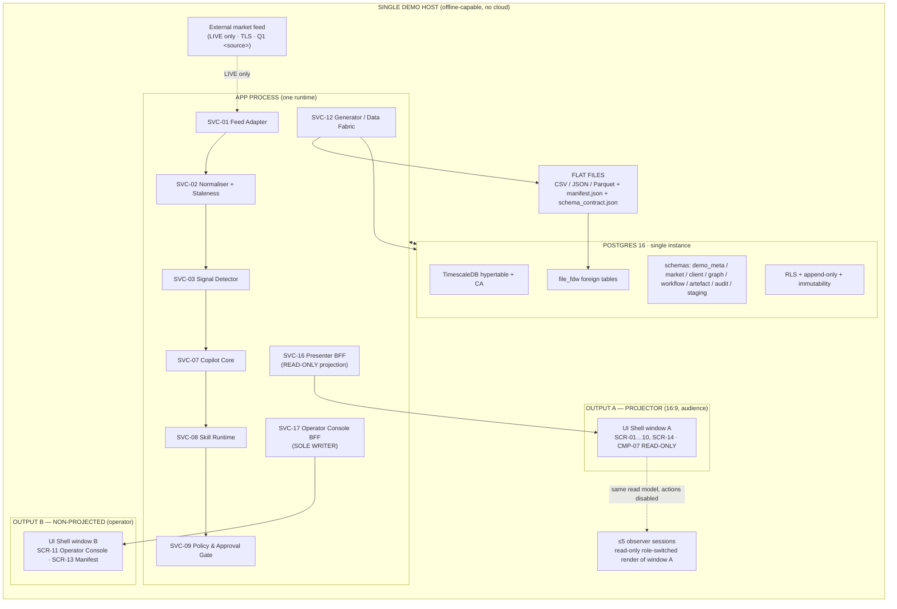
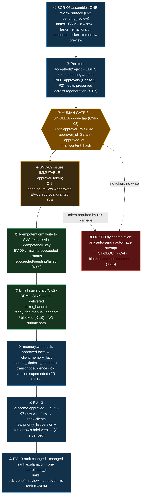
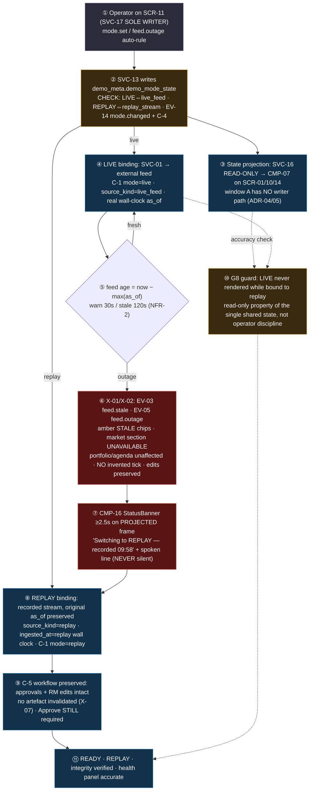
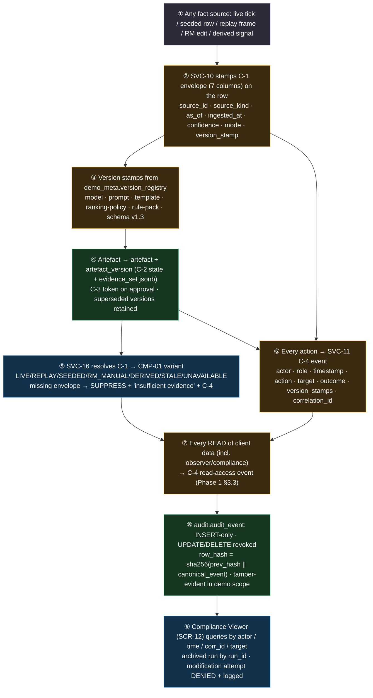
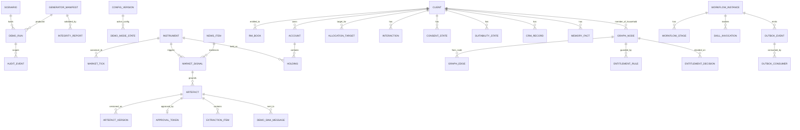
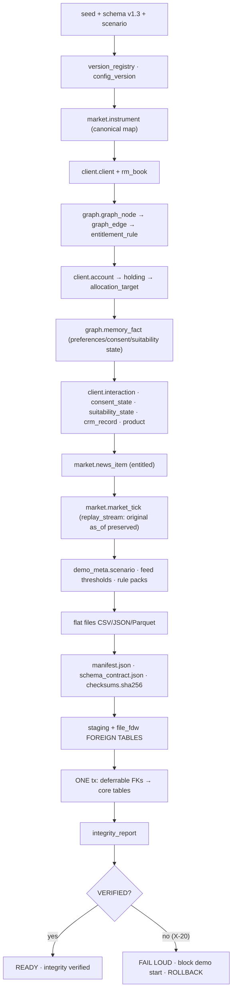
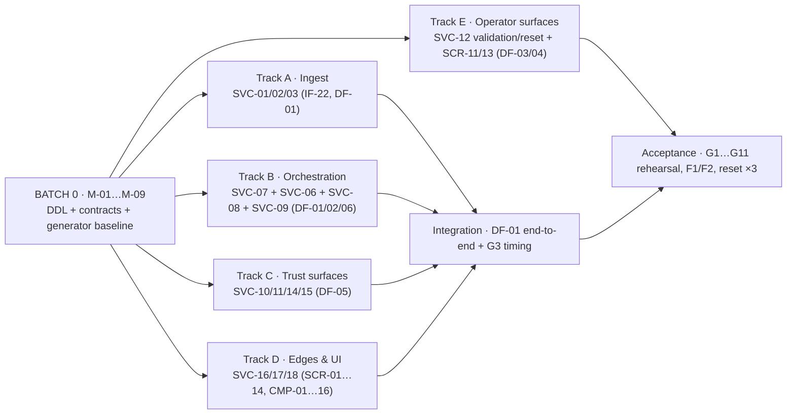

# Technical Solution — RM Workbench MVP (Leadership Demo)

**Phase 3 deliverable · Author:** Gao Jianyuan (高见远), Solution Architect, software-dev-team
**Consumers (verbatim hand-off):** Qi Huolin (team lead) → feature-planner (Phase 4), Phase N assembly; synced back to Phase 2 on all frozen contracts.
**Frozen inputs:** `00_Shared_Design_Brief.md`; `01_Requirements_Specification.md` (MVP-FR-01…34, C-1…5, X-01…20, G1…G11, D1…D10, NFR-1…10, A1…A7, Q1…Q7, S1…S4, F1/F2); `02_Product_Design_Specification.md` (SCR-01…14, CMP-01…16, ST-…, §8 generator UX, §13.4 physical contracts); `RM_Workbench_PRD.md` (§§6/7/8/9/12/14); `RM_Workbench_AI_Copilot_and_Niche_Expansions.md` (L1–L5).
**Status:** **Design only — no application code, no runnable scripts, no shipped system.** DDL, illustrative SQL, interface payload sketches, JSON config examples and Mermaid diagrams in this document are **specification artefacts**, not an implementation.
**Language:** English. **Authority:** this document is the **contract-freeze line** for the physical data model and interface contracts (global rule 3).

> **ID disambiguation (read first).** The team lead's ratified decisions are **D-1…D-5** (hyphenated). Phase 1's demo success criteria are **D1…D10** (no hyphen). They are unrelated sets. Phase 2's UI components are **CMP-01…16**; this document's *system* components are **SVC-01…18** and must never be confused with them. New stable IDs introduced here: **ADR-01…08**, **SVC-01…18**, **DF-01…06**, **IF-01…22**, **EV-01…20**, **NFR-1…18** (restated/owned here, mapping Phase 1's inputs).

---

## 1. Architecture decision record (ADR-lite)

### 1.1 Scope and hard constraints

| # | Constraint | Design consequence |
|---|---|---|
| S1 | DESIGN ONLY | DDL-as-spec, SQL sketches, JSON payloads, Mermaid = allowed; no build artefacts. |
| S2 | MVP = whole advisory loop, depth-thinned (Phase 1 §2) | Architecture must carry the live tick → signal → orchestrate → rank → brief → review → Approve → re-rank chain **end-to-end**; a "brief-only" split would break the headline. |
| S3 | Live market data is REAL in `live` mode | Exactly one external dependency (the feed); everything else must run with zero egress in `replay` (NFR-4). |
| S4 | File/database generator is a repeatable operator tool (D-5) | Generator is a first-class component, not a script; flat files + manifest + Postgres load + reset. |
| S5 | Postgres + Postgres plugin/extension mandatory (D-4) | One Postgres instance; a minimal, purpose-justified extension set (§5). |
| S6 | Senior-leadership demo, 1 presenter + ≤5 observers (A2) | Single-host deployment; dual-output windowing; no production NFRs claimed. |
| S7 | Four global rules | Simplicity; annotation discipline; contract freeze; on-disk delivery. |

### 1.2 The five ratified lead decisions, designed against (not re-litigated)

| Decision | How this document implements it |
|---|---|
| **D-1 Dual-output baseline** | Projector = presenter frame only (SVC-18 window A). Demo Operator Console on a second non-projected output (window B). Session/windowing model frozen in §1.5. A presenter-safe single-output fallback (operator-only hotkey overlay, auto-hiding on RM interaction) is specified as a **degraded topology**, not the baseline. |
| **D-2 R/Y/G scope discipline** | CMP-05 vocabulary = feed freshness / sync / integrity status + **one** retained hard-stop boundary (missing/expired suitability → ticket handoff blocked). No product-level suitability scoring table, no override UI, no hard-stop matrix in the DDL. `suitability_state` exists as a **state record only**, not a scoring engine. |
| **D-3 Feed source OPEN (Q1)** | Pluggable `SVC-01 Live Feed Adapter` with primary + fallback option set; `source_id`, `source_attribution`, `licence_tag` are **versioned config values** in `demo_meta.config_version`; the UI keeps `<source>` as a placeholder. No vendor is named as decided (§6.4). |
| **D-4 "Postgres plugin" = extensions (primary reading)** | Full evaluation of TimescaleDB, pgvector, pg_cron, file_fdw/postgres_fdw + pg_stat_statements, pgaudit, pgcrypto, ltree (§5). Minimal adopted set = **TimescaleDB + file_fdw**. Alternative readings (b) IDE/WorkBuddy connector and (c) BI plugin documented with "what would change" (§5.5). |
| **D-5 Generator = repeatable tool** | `SVC-12` with declared inputs, deterministic algorithm, manifest/schema contract, three modes, integrity validation, reset/restore, no-real-data guard, and an explicit "demo data generator, not a production migration tool" boundary (§7). |

### 1.3 ADR register

| ADR | Decision | Rationale (WHY) | Rejected alternative |
|---|---|---|---|
| **ADR-01** | Single Postgres 16 instance holds **all** state (market, client, graph, workflow, artefact, audit, demo_meta). | One store = one transaction boundary for the generator load, one place for C-1/C-4 enforcement, one thing to reset in ≤60s. A separate search/vector/graph store would add a second consistency boundary the demo cannot prove. | Polyglot persistence (Postgres + Redis + graph DB + object store). |
| **ADR-02** | Event delivery via a **transactional outbox table in the same Postgres**, not a broker. | `tick.accepted`, `signal.raised`, `approval.granted` must be atomic with the row that produced them; a broker adds a distributed failure mode and an extra process on a single host. Supports X-12 (no duplicate/lost events) via `event_key` uniqueness. | Kafka/RabbitMQ/Redis Streams. |
| **ADR-03** | All orchestration is **synchronous, in-process, bounded-intent**; LLM/skills are deterministic stubs with fixed version stamps. | NFR-3 determinism + NFR-4 zero external LLM dependency in `replay`; the demo proves orchestration and provenance, not model quality. | Real LLM router / multi-model evaluation harness (deferred, Phase 1 §2.3). |
| **ADR-04** | **Two BFFs**: `SVC-16 Presenter BFF` (read-only projection) and `SVC-17 Operator Console BFF` (sole writer). | Makes G8 structural: the presenter's `ModeChip` is a read-only projection of `demo_mode_state`; there is no code path from the projected frame to a mode write. Separation of duties (operator ≠ RM approver) becomes an auth boundary, not a UI convention. | One shared BFF with a permission flag. |
| **ADR-05** | `demo_mode_state` is a **single-row, sole-writer table** with a DB-level `CHECK` binding `LIVE`⇔`live_feed` and `REPLAY`⇔`replay_stream`. | "Never show LIVE while bound to replay" is a data constraint, not an operator discipline. | Two copies of mode state (console + frame) that can drift. |
| **ADR-06** | Approval tokens and audit events are **immutable at the DB privilege layer** (revoke UPDATE/DELETE; writes only through SECURITY DEFINER functions requiring a valid C-3 token). | G2 ("zero auto-sends/auto-trades") must hold by construction even if a future developer bypasses the service layer. | Application-only checks. |
| **ADR-07** | Extension set = **TimescaleDB (primary) + file_fdw (supporting)**; pgvector, pg_cron, pgaudit, pgcrypto, ltree, postgres_fdw, pg_stat_statements all DEFER/REJECT. | Every adopted extension maps to a named FR/gate; every rejected one has a one-line WHY (§5). Global rule 1 forbids adopting "for completeness". | "Use all four candidate extensions" reading of the brief. |
| **ADR-08** | Reset = **truncate-and-reload from the frozen flat-file baseline inside one transaction**, audit archive structurally excluded from the truncate list. | Reuses the single generator load path (no duplicate mechanism), re-verifies the checksum (FR-32 AC-1), completes in seconds at demo volume (NFR-9). | `pg_dump`/template-database switch (§7.9 trade-off). |

### 1.4 Technology baseline (recommendations with rationale — NOT frozen)

The framework/runtime is deliberately **not** frozen; only contracts are. Phase 4 may substitute equivalents provided every IF/DDL contract in §4/§8 still holds.

| Layer | Recommendation | Version | Rationale |
|---|---|---|---|
| Database | PostgreSQL | 16.x | `gen_random_uuid()` and `sha256(bytea)` in core (no pgcrypto needed); mature RLS; `COPY`; `jsonb`; `timestamptz`. |
| Time-series extension | TimescaleDB | 2.x | Hypertable for `market.market_tick`, continuous aggregate for drift/freshness, compression + retention (§5). |
| Flat-file bridge | `file_fdw` | PG contrib | Exposes emitted CSV as foreign tables so G5 cross-view agreement is provable in SQL. |
| Backend runtime | Python 3.12 + FastAPI (or Node 20 + TypeScript/NestJS as equivalent) | — | One process, async WebSocket feed client, first-class `asyncpg`/`psycopg` outbox polling, Pydantic/Zod schemas map 1:1 to IF payload sketches. Python tipped for the generator's data/Parquet tooling. |
| Frontend | TypeScript + React (Vite), single-window SPA | — | Phase 2's state-driven, in-place navigation (14 SCR / 16 CMP) maps cleanly to a component tree; strong a11y tooling for WCAG 2.1 AA. |
| Flat-file formats | CSV (relational), JSON (nested/config/news), Parquet (tick stream) | — | CSV is `COPY`/`file_fdw`-native; Parquet for the high-volume recorded tick stream; JSON for human-readable manifest/news. |
| Event transport | In-process async queue over `workflow.outbox_event` | — | See ADR-02. |
| Identity | Demo role-switcher + DB roles (`rm_role`, `observer_role`, `compliance_role`, `operator_role`, `service_role`) | — | RLS policies key off `current_setting('app.role')` / `app.rm_id`; no SSO (stubbed). |
| Deployment | One host, one Postgres, one app process, one static UI bundle, 2 displays | — | NFR-4/NFR-16: no cloud, no container orchestration, no network dependency in `replay`. |

### 1.5 Deployment topology and dual-output session model



**Session/windowing model (frozen).** One UI Shell process renders **two native windows** bound to two role contexts. Window A (projector) holds `rm_role` for the presenter and `observer_role`/`compliance_role` read-only renderings; it exposes **no** mode/generate/reset/flag control and **no** direct DB write path for `demo_mode_state`. Window B (non-projected) holds `operator_role`; it exposes **no** `Approve` control. Both windows read the **same** `demo_meta.demo_mode_state` row through SVC-16; only SVC-17 may write it (ADR-04/05). Observers are role-switched renderings of window A's read model, not a duplicate screen (Phase 2 §2.1, global rule 1). **Single-output fallback** (only if Alan confirms one physical output): an operator-only hotkey overlay in window A, auto-hiding on any RM interaction, still writing through SVC-17 and still projecting only the read-only `ModeChip`; the audience never sees a control. This fallback preserves D-1's intent but is a degraded topology and is called out in §14 as a decision to confirm.

### 1.6 "Not a production system" boundary

This is a **demonstrable design slice**, not a production release and not a deployable system. It has no tenant isolation at scale, no HA/DR, no real integrations, no real PII, no certified controls, no SOC 2 posture, no 1,000-user capacity, no residency, and no longitudinal outcome claims (Phase 1 §7.3). It does **not** replace a system of record, execute trades, send client communications, or issue religious rulings. The only genuinely external runtime dependency is the optional `live` feed; `replay` runs fully offline. Any future build beyond the design package requires a new PRD-level decision (A3).

### 1.7 Contract-freeze statement

**Frozen by this document (global rule 3).** Any change must be authored by the Solution Architect, version-bumped, and synced to Phase 2 (product-designer) and Phase 4 (feature-planner) before any build work; no oral overrides.

1. **Physical data model (§4):** 8 schemas (incl. `staging`); 40 named core/staging tables + manifest-declared FDW foreign tables; the C-1 provenance column set; enum types; PK/FK/unique/idempotency keys; indexes; TimescaleDB hypertable, continuous aggregate, materialised view, retention/compression design; RLS policy shape; append-only and immutability enforcement; versioning and idempotency strategy.
2. **Interface contracts (§8):** `IF-01…IF-22`; event catalogue `EV-01…EV-20` with payload sketches; versioning and error contracts; C-1…C-5 physical mapping.
3. **Feed interface contract (§6.6):** events, fields, error states, payload sketch, transport options.
4. **Manifest / schema contract (§7.5):** `schema v1.3 · manifest v1.3 · FROZEN` — aligned verbatim with Phase 2 SCR-11/SCR-13 read-only display.
5. **Postgres extension set (§5):** TimescaleDB + file_fdw, each with stated purpose and gate.
6. **Component registry (§2):** `SVC-01…18` and the L1–L5 mapping; system↔UI boundary.
7. **Four structural contracts (§8.3/8.4):** `demo_mode` sole-writer/read-only state projection; approval gate (no client-facing write without C-3); evidence-chip (C-1 → CMP-01 variants, missing envelope → suppress); C-1…C-5 implementation.
8. **NFR targets (§9):** the measurable targets and their verification/gate bindings.

**Explicitly NOT frozen (recommendations / open):** language, framework, runtime versions; Phase 2's CMP-01…16 internal implementation; the feed vendor name and `<source>` attribution string (Q1/D-3); exact seeded numeric values; projector hardware and room geometry; the choice of whether the compliance viewer appears live on stage.

### 1.8 Assumption register (A1…A7, Q1…Q7 and lead decisions)

| Ref | Topic | Status in this design |
|---|---|---|
| A1 | No real client data, ever | **Resolved/adopted** — synthetic-only generator with a DB-level no-real-data guard (§7.8); permanent `SYNTHETIC DEMO DATA` label. |
| A2 | 1 presenter, ~15–20 min, SGT, 16:9, ≤5 observers | **Resolved/adopted**, extended by D-1 to dual-output; drives NFR-10/NFR-16. |
| A3 | MVP = demonstrable slice, no build | **Resolved/adopted** — §1.6. |
| A4 | Thresholds 30s/120s, loop ≤10s, reset ≤60s, N=10, ≥3 scenarios | **Resolved** as versioned config defaults in `demo_meta.config_version` (FR-33, no redeploy); NFR-1/2/9 restated in §9. |
| A5 | Consent wording illustrative; no real mic/ASR | **Resolved/adopted** — `meeting.capture` stub; X-15 declared. Wording version is a config value. |
| A6 | "Live" = one genuine external feed + real wall-clock `as_of` + attribution | **Open — Alan decides (Q6)**. Architecture supports both a genuine feed and an explicitly-labelled delayed feed; §6.4 recommends and §14 flags the bar. |
| A7 | Primary range = family entity graph; Shariah flag OFF | **Resolved/adopted** — `household.consolidate` thin, `shariah.screen` flag-off; whether the range beat survives the 20-min run is **open — Alan decides** (§14). |
| Q1 | Feed source / entitlement / on-screen attribution | **Open — Alan decides.** Pluggable adapter + `<source>` versioned config; primary+fallback recommendation in §6.4; no vendor invented. |
| Q2 | "Postgres plugin" interpretation | **Resolved primary = (a) extensions** (D-4). Alternatives (b)/(c) documented in §5.5; **open — Alan confirms**. |
| Q3 | Generator meaning | **Resolved (D-5)** — repeatable operator tool, not a one-off script; not a production migration tool. |
| Q4 | Real client data ever? | **Resolved = No** (A1); guard is structural. |
| Q5 | Recording / consent / ASR posture | **Resolved** — scripted gate + injected transcript; **open — Alan decides** who signs the illustrative wording. |
| Q6 | What "live" must demonstrate | **Open — Alan decides**; §6.4 defines the three-bar test and the honest degraded alternative. |
| Q7 | Scope trade-offs | **Resolved/ratified** by lead (D-2); not reopened. |
| D-1…D-5 | Lead decisions | **Adopted verbatim** (§1.2). |

---

## 2. Component architecture (the "component" ask)

### 2.1 C4 Level-2 container diagram

```mermaid
flowchart TB
  actor RM["RM / Presenter (Sarah)"]
  actor OBS["Observer / Compliance (read-only)"]
  actor OP["Demo Operator / Data Steward"]
  actor FEED["External market feed (LIVE)"]

  subgraph L1["L1 EXPERIENCE — SVC-18 UI Shell (SCR-01…14 / CMP-01…16)"]
    UI["Presenter frame + Operator console + read-only projections"]
  end
  subgraph EDGE["Edge / BFF"]
    BFFP["SVC-16 Presenter BFF (READ-ONLY)"]
    BFFO["SVC-17 Operator Console BFF (SOLE WRITER)"]
  end
  subgraph L2["L2 ORCHESTRATION"]
    CORE["SVC-07 Copilot Core Orchestrator"]
    BUS["SVC-04 Event Bus / Transactional Outbox"]
  end
  subgraph L3["L3 CONTEXT (D5)"]
    D5["SVC-06 Client Memory & Relationship Graph"]
  end
  subgraph L4["L4 SKILLS"]
    SK["SVC-08 Skill Runtime"]
  end
  subgraph L5["L5 TRUST"]
    POL["SVC-09 Policy & Approval Gate"]
    PROV["SVC-10 Provenance / Evidence Service"]
    AUD["SVC-11 Audit Service"]
    CFG["SVC-13 Mode, Scenario & Config Manager"]
    SINK["SVC-14 Demo Sink (CRM/email/SMS)"]
    HLT["SVC-15 Health / Telemetry Aggregator"]
  end
  subgraph INGEST["Live market ingest"]
    AD["SVC-01 Live Feed Adapter"]
    NR["SVC-02 Tick Normaliser + Staleness Monitor"]
    SD["SVC-03 Signal Detector"]
  end
  subgraph DATA["Data plane"]
    GEN["SVC-12 Generator / Demo Data Fabric"]
    PG[("SVC-05 Postgres Store<br/>TimescaleDB + file_fdw")]
    FF["Flat files CSV/JSON/Parquet"]
  end

  FEED -->|"IF-22"| AD --> NR --> SD
  AD & NR & SD --> PG
  SD -->|"EV-04"| BUS --> CORE
  CORE <-->|"IF-07"| D5
  CORE -->|"IF-08"| SK
  SK -->|"IF-09"| PG
  CORE -->|"IF-10"| POL
  POL -->|"IF-11/12"| SINK
  SK & POL --> PROV
  PROV -->|"IF-13"| BFFP
  AUDITALL(["every component"]) -.->|"IF-14"| AUD
  AUD --> PG
  GEN --> FF
  FF --> PG
  GEN -->|"IF-15/16"| PG
  BFFO -->|"IF-17"| CFG
  CFG -->|"IF-18 read-only"| BFFP
  HLT -->|"IF-19"| BFFP
  BFFP <-->|"IF-20"| UI
  BFFO <-->|"IF-21"| UI
  RM --> UI
  OBS --> UI
  OP --> UI
  CFG --> PG
  HLT --> PG

  classDef ui fill:#12314a,stroke:#3f8ecb,color:#fff;
  classDef trust fill:#3a2a10,stroke:#e0a83f,color:#fff;
  classDef data fill:#16361f,stroke:#4caf7d,color:#fff;
  class UI,BFFP,BFFO ui;
  class POL,PROV,AUD,CFG,SINK,HLT trust;
  class PG,FF,GEN data;
```

### 2.2 Component table

Posture legend: **REAL** = genuinely executed; **SIMULATED** = deterministic synthetic/recorded; **STUBBED** = fixed deterministic stand-in; **HARD-BLOCKED** = no path exists.

| ID | Name | Responsibility | Owns (tables / state) | Up → Down | FR IDs | Posture | Scaling / state notes |
|---|---|---|---|---|---|---|---|
| **SVC-01** | Live Feed Adapter | Pluggable provider abstraction (WS/REST/SDK), entitlement + licence tag check, TLS, backoff, heartbeat, recorded-stream capture | `demo_meta.feed_status`, feed config values | FEED → SVC-02 | 01, 02, 04, 33 | REAL in `live`; SIMULATED in `replay` | Stateless; one connection; reconnect state in memory + C-4. |
| **SVC-02** | Tick Normaliser & Staleness Monitor | Canonical instrument mapping, currency/unit conversion, C-1 stamping, clock-skew gate (X-04), dedup key, warn/stale/outage detection | `market.market_tick` (append), `market.instrument`, `demo_meta.feed_status` | SVC-01 → SVC-04 / SVC-03 | 01, 02, 03, 04 | REAL | Stateless; staleness is a derived read over `max(as_of)`, not a timer (no duplicate clock). |
| **SVC-03** | Signal Detector | Drift vs target, threshold breach, price shock, volatility; attaches licensed news; classifies Risk/Opportunity/Retention | `market.market_signal`, `market.news_item` | SVC-02 → SVC-04 | 03, 11, 26, 28 | REAL computation on REAL/SIMULATED inputs | Reads TimescaleDB continuous aggregate; one signal per threshold window (EV dedup). |
| **SVC-04** | Event Bus / Transactional Outbox | Atomic event publication, `event_key` dedup, at-least-once delivery, X-12 duplicate/partial-write handling | `workflow.outbox_event`, `workflow.outbox_consumer` | all producers → CORE / SVC-03 / SVC-15 | 08, 09, 21, 27 | REAL | Table-based polling; no broker process (ADR-02). |
| **SVC-05** | Postgres Store | Single source of truth; extensions; RLS; append-only/immutability; versioning; idempotency | all schemas | — | 05, 06, 27, 29–32 | REAL | One instance; hypertable + CA + MV; FKs deferrable for generator load. |
| **SVC-06** | D5 Client Memory & Relationship Graph | One canonical evidence-backed context per client; graph nodes/edges; **node entitlement filtering in context assembly**; RM correction | `client.memory_fact`, `graph.graph_node/edge/entitlement_rule/entitlement_decision` | SVC-07 → SVC-08 | 05, 06, 07, 17, 24 | SIMULATED data, REAL enforcement | Read-mostly; `context_refs` are pointers, never copies (FR-09). Entitlement enforced here **before** any skill sees a fact (FR-06/G7) — RLS is defence-in-depth only. |
| **SVC-07** | Copilot Core Orchestrator | Bounded intent → decomposition → ordered stage sequence → policy → gate → verify; C-5 workflow state; `context_refs` reuse; `kill_mask`; resume | `workflow.workflow_instance`, `workflow.workflow_stage` | SVC-04 → SVC-06/08/09 | 08, 09, 10, 21 | REAL | Persistent state after each transition; no free-form chat surface. |
| **SVC-08** | Skill Runtime | Typed skill invocations: `brief.generate`, `rank.clients`, `outreach.draft`, `meeting.capture` (stub), `crm.write` (sink), `suitability.check` (boundary-only), `household.consolidate` (thin), `shariah.screen` (flag-off), `actions.extract`, `family.pack.split`, `memory.writeback`, `ticket.handoff` | `artefact.*`, `client.memory_fact` writes | SVC-07 → SVC-09/10/12 | 11–25 | STUBBED deterministic outputs with fixed version stamps | One dispatcher + skill registry; no per-skill service (no duplicate implementations). |
| **SVC-09** | Policy & Approval Gate | DNC / channel-consent / disclosure / suitability-hard-stop / Shariah-flag / entitlement checks; C-2 state machine; **C-3 token issuance on the single Approve** | `artefact.approval_token`, `artefact.artefact.state` transitions, `demo_meta.version_registry` | SVC-07 → SVC-14 | 18, 19, 20, 23, 26, 27, 33 | REAL | Token write is DB-immutable; sink write requires a valid token by DB privilege (ADR-06). |
| **SVC-10** | Provenance / Evidence Service | C-1 envelope stamping and resolution; evidence-chip variant mapping; version stamping; **suppression when envelope missing** | C-1 columns on all fact tables; `artefact_version.evidence_set` | all writers → SVC-16 | 26, 27, 28, 31 | REAL | Shared library, not a network service (global rule 1). |
| **SVC-11** | Audit Service | C-4 append-only events incl. read-access; hash-chain tamper evidence; compliance archive by `run_id` | `audit.audit_event`, `audit.audit_archive` | every component | 27, 32, §3.3 | REAL | Only INSERT granted; SHA-256 chain via core `sha256(bytea)`. |
| **SVC-12** | Generator / Demo Data Fabric | Single-seed deterministic world; flat-file emission; manifest/schema contract; staging → Postgres load; integrity validation; X-20 fail-loud; reset/restore; no-real-data guard | `demo_meta.generator_manifest/integrity_report/demo_run`, `staging.*`, flat files | SVC-17 → SVC-05 / FF | 29, 30, 31, 32 | REAL | Operator-driven, offline; one transaction per load; no auto-repair. |
| **SVC-13** | Mode, Scenario & Config Manager | `demo_mode_state` (sole writer via SVC-17), scenario library S1…S4, versioned config, feature flags, source attribution, kill-switch registry | `demo_meta.demo_mode_state/scenario/config_version/version_registry` | SVC-17 → SVC-16 (read-only) | 04, 10, 25, 33, 34 | REAL | Merged from three "manager" candidates: all are operator-driven, read-mostly, versioned state in one schema with one writer — splitting them would duplicate the versioning mechanism (global rule 1). |
| **SVC-14** | Demo Sink | Local CRM/email/SMS sink; exact final content + provider-style status; idempotent write; **zero external egress** | `artefact.demo_sink_message`, `client.crm_record` | SVC-09 → — | 19, 23 | STUBBED | No outbound adapter exists; `DEMO SINK — not delivered` is a structural status value. |
| **SVC-15** | Health / Telemetry Aggregator | Eight health fields, one `correlation_id`/workflow, blocked-attempt counter, integrity state, app-level latency measurement | read model over `demo_meta`/`workflow`/`artefact`/`audit` | SVC-04/AUD → SVC-16 | 02, 09, 27, 34 | REAL | Derived view, never a second state copy (avoids G8 drift). |
| **SVC-16** | Presenter BFF | Read model projection for window A; **read-only** `ModeChip`/`HealthBar`; evidence resolution; entitlement-scoped queries | none (read-only) | SVC-05/10/15 → SVC-18 | 04, 26, 34 | REAL | `rm_role`/`observer_role`/`compliance_role`; every read emits C-4. |
| **SVC-17** | Operator Console BFF | Sole write path for mode, scenario, config, flags, kill switch, generate, validate, reset | `demo_meta.demo_mode_state` (only writer) | SVC-18 → SVC-12/13/05 | 10, 29–34 | REAL | `operator_role` only; **no Approve endpoint exists** (separation of duties). |
| **SVC-18** | UI Shell | Two windows; SCR-01…14; hosts CMP-01…16; eight ST states; projected honesty chrome | none (client state only) | SVC-16/17 | 26, 34 | REAL | Client state is a projection; no authoritative state held in the browser. |

**Minimum viable component count = 18 logical components.** Mergings, justified against global rule 1: (i) *staleness monitor merged into the normaliser* — both consume the same tick stream and one owns `feed_status`; a separate timer would be a duplicate clock; (ii) *mode + scenario + config + flags + kill-switch registry merged into SVC-13* — one operator, one writer, one `config_version` store; (iii) *provenance + evidence merged into SVC-10* — C-1 stamping and chip resolution are the same envelope; (iv) *event bus + outbox merged into SVC-04* — one delivery mechanism; (v) *all skills share one SVC-08 runtime* — a service per skill would be 12 duplicate dispatchers; (vi) *demo sink is one component for CRM/email/SMS* — all three are the same zero-egress local write. **Two BFFs are deliberately NOT merged** because the read/write split is the structural basis of G8 and separation of duties (ADR-04).

Deployed process count is smaller than 18: SVC-04, 10, 11, 15 are in-process libraries/read models over SVC-05, not separate services. This keeps a single-host demo honest (NFR-16) without collapsing logical ownership.

### 2.3 Boundary between system components (SVC-*) and Phase 2 UI components (CMP-01…16)

There is **no overlap and no duplication**:

| Phase 2 UI component | What it is | Which SVC supplies it | Rule |
|---|---|---|---|
| CMP-01 EvidenceChip | Pure renderer of 7 variants | SVC-10 resolves C-1 → variant; SVC-16 projects | Chip owns no data; missing envelope → SVC-10 suppresses, chip never renders bare text. |
| CMP-02 SourceDrawer | Read-only detail view | SVC-16 (entitlement-scoped query) + SVC-11 (read C-4) | `correctable` mode writes through SVC-06 only. |
| CMP-03 ApprovalBar | Pure input control | SVC-09 (IF-11) | The **only** issuer of C-3; no duplicate approval logic in UI. |
| CMP-04 DiffField | Renderer of old→new | SVC-08 (`crm.write` skill output) | Values are DB records, not UI state. |
| CMP-05 StateBadge | R/Y/G renderer | SVC-15 (health) + SVC-09 (C-2 state) | D-2 scope: freshness/sync/integrity + one suitability hard-stop only. |
| CMP-06 ConsentBanner | Gate UI | SVC-08 `meeting.capture` + SVC-09 | Non-negotiable; config cannot disable (G11). |
| CMP-07 ModeChip | **Read-only** projection | SVC-13 → SVC-16 (IF-18) | No SVC and no UI path writes it from window A. |
| CMP-08 HealthBar | Read model | SVC-15 (IF-19) | Derived, no second state copy. |
| CMP-09 WorkflowStageTrace | C-5 projection | SVC-07 → SVC-16 | One `correlation_id`. |
| CMP-10…16 | Renderers (reason, graph node, audit table, picker, integrity report, empty state, banner) | SVC-08/06/11/12/13/15 | All read-only projections; no business logic in the UI. |

**Rule:** SVC-* own state, enforce contracts, and write DB rows. CMP-01…16 render projections and capture input. No contract is implemented twice.

### 2.4 Mapping the five-layer copilot architecture (L1–L5)

| Layer (PRD §3 / enhancement pack) | Mapped components | Demo-thinning note |
|---|---|---|
| **L1 Experience** — one copilot surface, My Day, proactive cards | SVC-18 (SCR-02 + persistent frame), SVC-16 | Single projected frame; no ambient chat, no mobile parity. |
| **L2 Orchestration (Copilot Core)** — intent→decompose→sequence→policy→gate→verify | **SVC-07** + SVC-04 | Bounded intent enum; verify step writes C-4; no open-ended chatbot (FR-10). |
| **L3 Context (D5)** — client memory + relationship graph, evidence-backed | **SVC-06** (+ `graph.*`, `client.memory_fact` in SVC-05) | Node-level entitlements enforced in context assembly (FR-06), not only RLS/UI. pgvector semantic retrieval DEFERRED (§5) — grounding here is exact-key `context_refs`, not similarity search. |
| **L4 Skills** — composable auditable tools | **SVC-08** | 12 typed skills; deterministic stubs; `product.search`/`zakat.calculate`/`purify.income` **absent** (out of MVP scope). |
| **L5 Trust** — policy packs, citations & audit, model router, eval harness, kill switch, zero retention | **SVC-09, SVC-10, SVC-11, SVC-13, SVC-14, SVC-15** | Multi-model router and eval harness deferred; zero retention trivially satisfied (no real LLM egress); kill switch = `kill_mask` on C-5; version registry replaces "versioned like code" with versioned config rows. |

---

## 3. Dataflow (the "dataflow" ask)

All diagrams use numbered steps. Every step that creates or moves a fact carries a **C-1 envelope**; every artefact step carries a **C-2 state**; every client-facing write carries a **C-3 token**; every step emits a **C-4 event**.

### 3.1 DF-01 — Live market event → visible re-rank (golden path, timing budget vs NFR-1)

```mermaid
flowchart TD
  F["① LIVE feed frame arrives<br/>source_id=&lt;source&gt; · feed_as_of 09:58:14 SGT · licence_tag"]:::ext
  A["② SVC-01 Adapter: entitlement + licence tag + TLS + heartbeat<br/>REJECT if unentitled → EV-02 tick.rejected + C-4"]:::sys
  N["③ SVC-02 Normalise: canonical instrument, currency/unit,<br/>clock-skew gate (X-04), dedup tick_key, C-1 stamp"]:::sys
  W["④ SVC-05 append market.market_tick (hypertable) + SVC-04 outbox<br/>ONE transaction → EV-01 tick.accepted · ingest-to-store ≤2s"]:::store
  S["⑤ SVC-03 Signal Detector: CA drift query vs allocation_target + rule-pack v_n<br/>→ EV-04 signal.raised 'Wong drifted 6%' · source_kind=derived"]:::sys
  C["⑥ SVC-07 Copilot Core: bounded intent → C-5 workflow_instance<br/>stage_sequence rank.clients→brief.generate→outreach.draft · corr_id"]:::sys
  D["⑦ SVC-06 D5: assemble entitled canonical context<br/>context_refs reused (FR-09) · entitlement_decision + C-4 (FR-06)"]:::sys
  K["⑧ SVC-08: rank.clients → Wong 4→1 with reason code;<br/>brief.generate → 5 sections; artefacts pending_review (C-2)"]:::sys
  P["⑨ SVC-10 resolve C-1 → CMP-01 LIVE/SEEDED/DERIVED chips<br/>missing envelope → SUPPRESS 'insufficient evidence' (G1)"]:::trust
  U["⑩ SVC-16 → SVC-18: My Day re-rank visible<br/>EV-19 rank.changed · C-4 · feed age on HealthBar"]:::ui
  G{{"HUMAN GATE — not on this path<br/>(ranking is derived, not an outbound action)"}}:::gate
  F --> A --> N --> W --> S --> C --> D --> K --> P --> U
  U -.-> G

  classDef ext fill:#2b2b3a,stroke:#8b8ba7,color:#fff;
  classDef sys fill:#12314a,stroke:#3f8ecb,color:#fff;
  classDef store fill:#16361f,stroke:#4caf7d,color:#fff;
  classDef trust fill:#3a2a10,stroke:#e0a83f,color:#fff;
  classDef ui fill:#12314a,stroke:#3f8ecb,color:#fff;
  classDef gate fill:#7a4b00,stroke:#f0a500,color:#fff;
```



**Timing budget (p95, measured from feed frame arrival at SVC-01):**

| Step | Budget | Cumulative | Bound |
|---|---:|---:|---|
| ② adapter (entitlement, dedup key) | ≤0.3s | 0.3s | X-02/X-06 |
| ③ normalise + skew + C-1 | ≤0.5s | 0.8s | X-04 |
| ④ append + outbox (1 tx) | ≤0.8s | **1.6s** | **NFR-1 ingest ≤2s** |
| ⑤ signal detect (CA query) | ≤1.4s | 3.0s | X-06 |
| ⑥ workflow start | ≤1.0s | 4.0s | C-5 |
| ⑦ D5 context assembly | ≤1.5s | 5.5s | FR-06 |
| ⑧ rank + brief (deterministic) | ≤2.0s | 7.5s | NFR-3 |
| ⑨ provenance resolve | ≤1.0s | 8.5s | G1 |
| ⑩ BFF projection + render | ≤1.5s | **10.0s** | **NFR-1 loop ≤10s** |

0.5s slack retained for jitter; in `live` the external feed's own network latency is measured separately and reported on the health panel, not charged to this budget. In `replay` the sequence is bit-identical (G3).

### 3.2 DF-02 — Closed loop: single Approve → re-rank (no auto-send / auto-trade path)



**Sequence diagram for the single Approve tap:**

```mermaid
sequenceDiagram
  autonumber
  participant RM as RM (CMP-03)
  participant BFF as SVC-16 Presenter BFF
  participant POL as SVC-09 Policy & Approval Gate
  participant DB as SVC-05 Postgres
  participant SINK as SVC-14 Demo Sink
  participant AUD as SVC-11 Audit
  participant CORE as SVC-07 Copilot Core
  RM->>BFF: IF-11 approve(artefact_id, final_content_hash)
  BFF->>POL: validate C-2=pending_review + policy checks
  POL->>DB: grant_approval() → INSERT approval_token (immutable)
  DB-->>POL: token_id
  POL->>DB: UPDATE artefact state='approved' (transition guard)
  POL->>SINK: IF-12 crm.write(idempotency_key, token_id)
  SINK->>DB: assert_token() → INSERT demo_sink_message
  SINK-->>POL: status=succeeded
  POL->>AUD: IF-14 C-4 approval.granted + crm.write.succeeded
  POL->>CORE: EV-13 outcome.approved(correlation_id)
  CORE->>DB: new workflow_instance → rank.clients → new priority_list
  POL-->>BFF: approved + token + sync statuses
  BFF-->>RM: ST-OK 'Approved by Sarah (RM) · 10:14:32' (≥3s hold)
  Note over SINK,DB: email remains state='draft'; no send/execute endpoint exists
```

### 3.3 DF-03 — Generator / file–database pipeline (D-5, FR-29…32)

```mermaid
flowchart TD
  I["① Inputs: ONE seed · schema v1.3 · manifest v1.3 FROZEN<br/>scenario S1…S4 · mode seed/replay/live · world_as_of anchor"]:::op
  GD{"② No-real-data guard<br/>local demo_* DSN allow-list · synthetic marker"}
  BLK["BLOCKED · generator targets synthetic demo data only · C-4 · fail loud"]:::warn
  GEN["③ Deterministic world: namespaced sub-seeds<br/>splitmix64(seed, domain, idx) → all entities<br/>child keys derived from parent keys = FK-clean by construction"]:::sys
  FF["④ Flat-file emission CSV / JSON / Parquet<br/>NN_schema_table.ext · every row carries C-1 · tick stream original as_of"]:::store
  MAN["⑤ manifest.json + schema_contract.json + checksums.sha256<br/>row counts · field-level provenance rules · dataset_checksum"]:::store
  STG["⑥ staging.* + file_fdw FOREIGN TABLES (CSV)<br/>JSON→jsonb staging · Parquet→generator-side CSV twin"]:::store
  LOAD["⑦ ONE transaction: SET CONSTRAINTS ALL DEFERRED<br/>INSERT…SELECT in FK order → core tables · TimescaleDB hypertable"]:::store
  VAL["⑧ Integrity validation: orphan FK · provenance gaps · as_of presence<br/>cross-view row count + key checksum (SQL EXCEPT vs FDW)<br/>regenerate-to-scratch reproducibility check"]:::trust
  FAIL["⑨ X-20 FAIL LOUD · SCHEMA MISMATCH · offending record named<br/>demo start BLOCKED · NO auto-repair · ROLLBACK · C-4"]:::warn
  OK["⑩ integrity_report verdict=VERIFIED · EV-17 generator.loaded<br/>READY · integrity verified · checksum on SCR-13"]:::trust
  G1{{"⑪ HUMAN GATE — Operator confirms READY<br/>(operator is NOT an RM approver)"}}:::gate
  RUN["⑫ Run scenario · on-stage RM approvals untouched (Gate 2)"]:::ui
  RST["⑬ One-click RESET → archive-audit confirmation dialog"]:::op
  ARCH["⑭ archive audit by run_id (NEVER deleted)<br/>TRUNCATE mutable tables · reload frozen baseline<br/>re-verify checksum + integrity · EV-20 reset.completed · ≤60s"]:::store
  I --> GD
  GD -->|"real source"| BLK
  GD -->|"synthetic"| GEN --> FF --> MAN --> STG --> LOAD --> VAL
  VAL -->|"mismatch"| FAIL --> RST
  VAL -->|"verified"| OK --> G1 --> RUN --> RST --> ARCH
  ARCH -.->|"re-verify"| VAL

  classDef op fill:#2b2b3a,stroke:#8b8ba7,color:#fff;
  classDef sys fill:#12314a,stroke:#3f8ecb,color:#fff;
  classDef store fill:#16361f,stroke:#4caf7d,color:#fff;
  classDef trust fill:#3a2a10,stroke:#e0a83f,color:#fff;
  classDef ui fill:#12314a,stroke:#3f8ecb,color:#fff;
  classDef gate fill:#7a4b00,stroke:#f0a500,color:#fff;
  classDef warn fill:#5a1414,stroke:#e05a4f,color:#fff;
```



### 3.4 DF-04 — Live ↔ replay binding and F1 outage fallback (mode state projection, G8)



### 3.5 DF-05 — Provenance & audit fan-out (C-1 envelope, C-4 append-only, read-access)



### 3.6 Dataflow table

| Flow | Trigger | Source → Sink | Key transformations | State transitions | Latency budget | Failure behaviour (X-IDs) | FR IDs |
|---|---|---|---|---|---|---|---|
| **DF-01** | `tick.raw` (live) / recorded frame (replay) | FEED → SVC-01→02→03→04→07→06→08→10→16→UI | entitlement check, canonical mapping, C-1 stamp, drift vs target, intent decomposition, entitlement filtering, reason codes, chip resolution | `ingested`→`derived`→`pending_review` (brief); `rank.changed` | ≤10s p95 loop, ≤2s ingest | X-01/02/04/06 → stale/unavailable, no invented tick; X-11 → deny+C-4 | 01–04, 05, 06, 08, 09, 11, 14, 26, 28 |
| **DF-02** | single Approve tap | CMP-03 → SVC-09→05/14/06/07→16 | C-3 token, idempotent CRM write, memory write-back, re-rank | `pending_review`→`approved`→`derived` (new list) | ≤3s to confirmation | X-09/12 → pending/failed + safe retry; X-16/17/19 → blocked; X-08 → handoff blocked | 07, 18–21, 23, 27 |
| **DF-03** | operator Generate / Reset | SVC-17→12→FF + SVC-05 | deterministic generation, flat-file emission, staging load, checksum, validation | `generated`→`loaded`→`verified`/`failed`→`ready` | Generate ≤30s (advisory); **reset ≤60s (NFR-9)** | X-20 → fail loud, ROLLBACK, no auto-repair; Postgres down → no half-ready world | 29–32, 34 |
| **DF-04** | operator mode.set / `feed.outage` | SVC-17→13→16→18 | sole-writer state rewrite, binding switch, `as_of` preservation | `demo_mode` LIVE↔REPLAY; C-5 preserved | label updates before next artefact (X-07) | X-01/02/07 → announced fallback, edits preserved | 02, 04, 09, 34 |
| **DF-05** | any write or read | all → SVC-10/11→05→16/12 | C-1 envelope, version stamps, C-4 append, hash chain | append-only; version supersede on regeneration | synchronous with the write | missing envelope → suppress; modify audit → denied + logged | 26, 27, 28, 31, §3.3 |
| **DF-06** | meeting start | SCR-07 → SVC-08/09/06 → SCR-06 | consent decision, scripted transcript injection, extraction, low-confidence review, write-back | `consent_state`/`capture_state`; `pending_review` | n/a (human-paced) | X-05/15 → MANUAL NOTES, no capture, low-confidence explicit review | 16, 17, 18 |

## 4. Postgres data model — DDL as specification

### 4.1 Schema map

| Schema | Purpose | Tables |
|---|---|---|
| `demo_meta` | Demo control plane: mode, scenarios, versioned config, runs, generator output, feed status | `version_registry`, `config_version`, `scenario`, `generator_manifest`, `integrity_report`, `demo_run`, `demo_mode_state`, `feed_status` |
| `market` | Live/replay/seeded market facts | `instrument`, `market_tick` (**hypertable**), `market_signal`, `news_item` |
| `client` | Synthetic client domain (no real PII) | `client`, `rm_book`, `account`, `holding`, `allocation_target`, `product`, `interaction`, `consent_state`, `suitability_state`, `crm_record` |
| `graph` | D5 context: memory + household/entity graph + entitlements | `memory_fact`, `graph_node`, `graph_edge`, `entitlement_rule`, `entitlement_decision` |
| `workflow` | C-5 orchestration + outbox | `workflow_instance`, `workflow_stage`, `skill_invocation`, `outbox_event`, `outbox_consumer` |
| `artefact` | C-2 artefacts, versions, C-3 tokens, extraction, sink | `artefact`, `artefact_version`, `approval_token`, `extraction_item`, `demo_sink_message` |
| `audit` | C-4 append-only log + archive | `audit_event`, `audit_archive` |
| `staging` | Generator transient load tables (declared by manifest, dropped after commit) | `staging.*` (one per emitted file) |

**Three distinct "mode" concepts (non-obvious boundary, WHY):** `demo_meta.demo_mode_state.mode` = audience-visible ingest binding (`LIVE`/`REPLAY`); `demo_meta.demo_run.generator_mode` = how the world was produced (`seed`/`replay`/`live`, SCR-11 control); the **C-1 `mode` column on every fact** = the binding in force when that fact was created (`live`/`replay`/`seed`). Conflating these would break G8 (a `seed`-generated row must still be able to carry a `LIVE` chip when a live tick is attached). This is an architect resolution; see §14 residual risk.

### 4.2 ER diagram (core relationships)



### 4.3 DDL preamble — types, helper, provenance convention

> Per global rule 2, inline SQL annotations below are **Chinese** and appear only at non-obvious boundaries, explaining WHY. English design notes for each are in §4.7.

```sql
CREATE EXTENSION IF NOT EXISTS timescaledb;      -- 采用 TimescaleDB：行情 tick 为时间序列，见 §5
CREATE EXTENSION IF NOT EXISTS file_fdw;         -- 采用 file_fdw：G5 平面文件↔DB 交叉校验，见 §5

CREATE SCHEMA IF NOT EXISTS demo_meta;
CREATE SCHEMA IF NOT EXISTS market;
CREATE SCHEMA IF NOT EXISTS client;
CREATE SCHEMA IF NOT EXISTS graph;
CREATE SCHEMA IF NOT EXISTS workflow;
CREATE SCHEMA IF NOT EXISTS artefact;
CREATE SCHEMA IF NOT EXISTS audit;
CREATE SCHEMA IF NOT EXISTS staging;

-- 枚举集中定义：C-1/C-2 的取值必须唯一，避免各表各写一份 CHECK 造成漂移
CREATE TYPE demo_meta.source_kind_enum AS ENUM
  ('live_feed','seeded','replay','rm_manual','derived');
CREATE TYPE demo_meta.mode_enum AS ENUM ('live','replay','seed');
CREATE TYPE demo_meta.demo_mode_enum AS ENUM ('PREP','LIVE','REPLAY');
CREATE TYPE demo_meta.generator_mode_enum AS ENUM ('seed','replay','live');
CREATE TYPE artefact.artefact_state_enum AS ENUM
  ('draft','pending_review','approved','edited','rejected','blocked','stale','superseded');
CREATE TYPE artefact.artefact_kind_enum AS ENUM
  ('meeting_brief','priority_list','post_meeting_review','outreach_draft','outreach_send',
   'family_pack','extraction_set','ticket_handoff','crm_write','rebalancing_proposal');
CREATE TYPE workflow.workflow_status_enum AS ENUM
  ('running','pending_review','approved','completed','blocked','failed','abandoned');

-- C-1 溯源封套：以下 7 列逐字重复出现在每个事实/工件表中。
-- WHY：不采用复合类型/继承，因为 NULL 复合值会隐藏"部分缺失"的封套，
-- 而 FR-31/G6 要求"零事实缺溯源"可被单表 SQL 直接验证。
-- 约定列（每个事实表必须显式包含）：
--   source_id      text                        NOT NULL
--   source_kind    demo_meta.source_kind_enum NOT NULL
--   as_of          timestamptz                NOT NULL
--   ingested_at    timestamptz                NOT NULL DEFAULT now()
--   confidence     numeric(4,3)               CHECK (confidence BETWEEN 0 AND 1)
--   mode           demo_meta.mode_enum         NOT NULL
--   version_stamp  text                       NOT NULL
--   created_at     timestamptz                NOT NULL DEFAULT now()
```

### 4.4 DDL — `demo_meta` (control plane)

```sql
CREATE TABLE demo_meta.version_registry (
  version_id      uuid PRIMARY KEY DEFAULT gen_random_uuid(),
  component       text NOT NULL,             -- 'model'|'prompt'|'template'|'ranking_policy'|'rule_pack'|'schema'|'manifest'|'consent_lang'|'disclosure'
  version_label   text NOT NULL,             -- e.g. 'v1.3', 'v3'
  content_hash    text NOT NULL,
  active          boolean NOT NULL DEFAULT true,
  created_at      timestamptz NOT NULL DEFAULT now(),
  UNIQUE (component, version_label)
);

CREATE TABLE demo_meta.config_version (
  config_id       bigint GENERATED ALWAYS AS IDENTITY PRIMARY KEY,
  config_key      text NOT NULL,             -- 'feed.source_attribution','threshold.warn_s','rank.top_n', ...
  value_json      jsonb NOT NULL,
  version_no      integer NOT NULL,
  actor           text NOT NULL,
  role            text NOT NULL,
  validated       boolean NOT NULL DEFAULT false,
  is_active       boolean NOT NULL DEFAULT false,
  valid_from      timestamptz NOT NULL DEFAULT now(),
  valid_to        timestamptz,
  version_stamp   text NOT NULL,
  created_at      timestamptz NOT NULL DEFAULT now(),
  UNIQUE (config_key, version_no)
);
CREATE UNIQUE INDEX uq_config_active ON demo_meta.config_version(config_key) WHERE is_active;
-- WHY：部分唯一索引保证同一 key 只能有一个 active 版本，FR-33 的"旧版本仍可查"由 is_active=false 的行提供

CREATE TABLE demo_meta.scenario (
  scenario_id     text PRIMARY KEY,          -- 'S1'..'S4'
  name            text NOT NULL,
  trigger_event   text NOT NULL,
  seed            text NOT NULL,
  tick_stream_ref text,                     -- recorded stream file for replay/fallback
  feature_flags   jsonb NOT NULL DEFAULT '{}'::jsonb,
  world_as_of     timestamptz NOT NULL,
  source_id       text NOT NULL,
  source_kind     demo_meta.source_kind_enum NOT NULL,
  as_of           timestamptz NOT NULL,
  ingested_at     timestamptz NOT NULL DEFAULT now(),
  confidence      numeric(4,3),
  mode            demo_meta.mode_enum NOT NULL,
  version_stamp   text NOT NULL,
  created_at      timestamptz NOT NULL DEFAULT now()
);

CREATE TABLE demo_meta.generator_manifest (
  manifest_id      uuid PRIMARY KEY DEFAULT gen_random_uuid(),
  schema_version   text NOT NULL DEFAULT 'v1.3',
  manifest_version text NOT NULL DEFAULT 'v1.3',
  seed             text NOT NULL,
  seed_algorithm   text NOT NULL,            -- 'splitmix64-namespaced'
  generator_mode   demo_meta.generator_mode_enum NOT NULL,
  scenario_id      text NOT NULL REFERENCES demo_meta.scenario(scenario_id),
  pg_version       text NOT NULL,
  extension_set    jsonb NOT NULL,           -- [{"name":"timescaledb","purpose":"..."},{"name":"file_fdw",...}]
  files_json       jsonb NOT NULL,           -- [{path,format,table,row_count,checksum,provenance_rules}]
  tables_json      jsonb NOT NULL,
  field_provenance_rules jsonb NOT NULL,
  dataset_checksum text NOT NULL,
  generated_at     timestamptz NOT NULL,
  verdict          text NOT NULL DEFAULT 'PENDING' CHECK (verdict IN ('PENDING','VERIFIED','FAILED')),
  offending_record jsonb,
  source_id        text NOT NULL,
  source_kind      demo_meta.source_kind_enum NOT NULL,
  as_of            timestamptz NOT NULL,
  ingested_at      timestamptz NOT NULL DEFAULT now(),
  confidence       numeric(4,3),
  mode             demo_meta.mode_enum NOT NULL,
  version_stamp    text NOT NULL,
  created_at       timestamptz NOT NULL DEFAULT now()
);

CREATE TABLE demo_meta.integrity_report (
  report_id        uuid PRIMARY KEY DEFAULT gen_random_uuid(),
  manifest_id      uuid NOT NULL REFERENCES demo_meta.generator_manifest(manifest_id),
  orphan_fk_count  integer NOT NULL DEFAULT 0,
  provenance_gap_count integer NOT NULL DEFAULT 0,
  as_of_missing_count  integer NOT NULL DEFAULT 0,
  flat_row_counts  jsonb NOT NULL,
  pg_row_counts    jsonb NOT NULL,
  cross_view_agreement boolean NOT NULL DEFAULT false,
  reproducibility_ok boolean NOT NULL DEFAULT false,
  checksum         text NOT NULL,
  verdict          text NOT NULL CHECK (verdict IN ('VERIFIED','FAILED')),
  offending_record jsonb,
  checked_at       timestamptz NOT NULL DEFAULT now(),
  source_id        text NOT NULL,
  source_kind      demo_meta.source_kind_enum NOT NULL,
  as_of            timestamptz NOT NULL,
  ingested_at      timestamptz NOT NULL DEFAULT now(),
  confidence       numeric(4,3),
  mode             demo_meta.mode_enum NOT NULL,
  version_stamp    text NOT NULL,
  created_at       timestamptz NOT NULL DEFAULT now()
);

CREATE TABLE demo_meta.demo_run (
  run_id           uuid PRIMARY KEY DEFAULT gen_random_uuid(),
  run_seq          integer NOT NULL,
  scenario_id      text NOT NULL REFERENCES demo_meta.scenario(scenario_id),
  manifest_id      uuid NOT NULL REFERENCES demo_meta.generator_manifest(manifest_id),
  generator_mode   demo_meta.generator_mode_enum NOT NULL,
  seed             text NOT NULL,
  baseline_checksum text NOT NULL,
  final_checksum   text,
  status           text NOT NULL CHECK (status IN ('prep','ready','running','completed','reset')),
  started_at       timestamptz NOT NULL DEFAULT now(),
  ended_at         timestamptz,
  blocked_count    integer NOT NULL DEFAULT 0,
  source_id        text NOT NULL,
  source_kind      demo_meta.source_kind_enum NOT NULL,
  as_of            timestamptz NOT NULL,
  ingested_at      timestamptz NOT NULL DEFAULT now(),
  confidence       numeric(4,3),
  mode             demo_meta.mode_enum NOT NULL,
  version_stamp    text NOT NULL,
  created_at       timestamptz NOT NULL DEFAULT now(),
  UNIQUE (run_seq)
);

-- 单行表：WHY 用 singleton 主键 + CHECK 把 G8 变成数据库约束，而非操作员纪律
CREATE TABLE demo_meta.demo_mode_state (
  singleton        boolean PRIMARY KEY DEFAULT true CHECK (singleton),
  mode             demo_meta.demo_mode_enum NOT NULL DEFAULT 'PREP',
  ingest_binding   text NOT NULL DEFAULT 'none'
                   CHECK (ingest_binding IN ('none','live_feed','replay_stream')),
  source_id        text,
  source_attribution text,                 -- 版本化配置值；Q1 未决时保持 <source> 占位
  recorded_time    timestamptz,
  scenario_id      text REFERENCES demo_meta.scenario(scenario_id),
  correlation_id   uuid,
  updated_at       timestamptz NOT NULL DEFAULT now(),
  updated_by       text NOT NULL,
  version_stamp    text NOT NULL,
  CONSTRAINT ck_mode_binding CHECK (
       (mode='PREP'   AND ingest_binding='none')
    OR (mode='LIVE'   AND ingest_binding='live_feed'    AND source_id IS NOT NULL)
    OR (mode='REPLAY' AND ingest_binding='replay_stream' AND recorded_time IS NOT NULL)
  )
);
INSERT INTO demo_meta.demo_mode_state (singleton, updated_by, version_stamp)
VALUES (true, 'system', 'schema v1.3') ON CONFLICT DO NOTHING;

CREATE TABLE demo_meta.feed_status (
  feed_status_id   bigint GENERATED ALWAYS AS IDENTITY PRIMARY KEY,
  source_id        text NOT NULL,
  state            text NOT NULL CHECK (state IN ('fresh','warn','stale','outage','recovered')),
  last_tick_as_of  timestamptz,
  feed_age_s       numeric(10,2),
  last_error_code  text,
  evaluated_at     timestamptz NOT NULL DEFAULT now(),
  as_of            timestamptz NOT NULL,
  ingested_at      timestamptz NOT NULL DEFAULT now(),
  confidence       numeric(4,3),
  mode             demo_meta.mode_enum NOT NULL,
  version_stamp    text NOT NULL,
  created_at       timestamptz NOT NULL DEFAULT now()
);
CREATE INDEX ix_feed_status_recent ON demo_meta.feed_status(evaluated_at DESC);
```

### 4.5 DDL — `market`, `client`, `graph`

```sql
-- ============ market ============
CREATE TABLE market.instrument (
  instrument_id    uuid PRIMARY KEY DEFAULT gen_random_uuid(),
  canonical_symbol text NOT NULL UNIQUE,
  venue            text,
  currency         text NOT NULL,
  unit             text NOT NULL DEFAULT 'PRICE',
  source_symbol_map jsonb NOT NULL,         -- {<source>: "raw symbol"} — 版本化 canonical mapping
  licensed         boolean NOT NULL DEFAULT true,
  source_id        text NOT NULL,
  source_kind      demo_meta.source_kind_enum NOT NULL,
  as_of            timestamptz NOT NULL,
  ingested_at      timestamptz NOT NULL DEFAULT now(),
  confidence       numeric(4,3),
  mode             demo_meta.mode_enum NOT NULL,
  version_stamp    text NOT NULL,
  created_at       timestamptz NOT NULL DEFAULT now()
);

-- 追加写、不可变：WHY tick 是证据而非状态，任何 UPDATE 都会破坏 G1 的可信溯源链
CREATE TABLE market.market_tick (
  tick_id          bigint GENERATED ALWAYS AS IDENTITY,
  instrument_id    uuid NOT NULL REFERENCES market.instrument(instrument_id),
  price            numeric(18,6) NOT NULL,
  currency         text NOT NULL,
  feed_seq         bigint,
  feed_as_of       timestamptz NOT NULL,
  tick_key         text NOT NULL,            -- sha256(source_id|instrument|feed_as_of|feed_seq) 幂等键
  licence_tag      text NOT NULL,
  dedup_decision   text NOT NULL DEFAULT 'accepted' CHECK (dedup_decision IN ('accepted','retained_duplicate')),
  source_id        text NOT NULL,
  source_kind      demo_meta.source_kind_enum NOT NULL,
  as_of            timestamptz NOT NULL,    -- 分区维：连续聚合与新鲜度都以 feed 时间表达
  ingested_at      timestamptz NOT NULL DEFAULT now(),
  confidence       numeric(4,3),
  mode             demo_meta.mode_enum NOT NULL,
  version_stamp    text NOT NULL,
  created_at       timestamptz NOT NULL DEFAULT now(),
  PRIMARY KEY (as_of, tick_id),             -- hypertable 要求分区列进入所有唯一索引
  UNIQUE (as_of, tick_key)
);
SELECT create_hypertable('market.market_tick', by_range('as_of', INTERVAL '1 day'),
                         if_not_exists => TRUE);
-- 与常规表之间的 FK 只能单向：hypertable 不可被普通表外键引用，
-- 故 signal→tick 用不可变 tick_key 关联，由生成器/健康检查校验（见 §4.7）

CREATE TABLE market.news_item (
  news_id          uuid PRIMARY KEY DEFAULT gen_random_uuid(),
  headline         text NOT NULL,
  body_ref         text,
  instrument_id    uuid REFERENCES market.instrument(instrument_id),
  entitled         boolean NOT NULL DEFAULT true,
  attribution      text NOT NULL,
  source_id        text NOT NULL,
  source_kind      demo_meta.source_kind_enum NOT NULL,
  as_of            timestamptz NOT NULL,
  ingested_at      timestamptz NOT NULL DEFAULT now(),
  confidence       numeric(4,3),
  mode             demo_meta.mode_enum NOT NULL,
  version_stamp    text NOT NULL,
  created_at       timestamptz NOT NULL DEFAULT now()
);

CREATE TABLE market.market_signal (
  signal_id        uuid PRIMARY KEY DEFAULT gen_random_uuid(),
  instrument_id    uuid NOT NULL REFERENCES market.instrument(instrument_id),
  tick_key         text NOT NULL,            -- 逻辑外键 → market_tick.tick_key
  tick_as_of       timestamptz NOT NULL,
  client_id        uuid NOT NULL,
  classification   text NOT NULL CHECK (classification IN ('Risk','Opportunity','Retention')),
  drift_pct        numeric(8,4),
  statement        text NOT NULL,
  news_id          uuid REFERENCES market.news_item(news_id),
  rule_pack_version text NOT NULL,
  evidence_set     jsonb NOT NULL,
  source_id        text NOT NULL,
  source_kind      demo_meta.source_kind_enum NOT NULL DEFAULT 'derived',
  as_of            timestamptz NOT NULL,
  ingested_at      timestamptz NOT NULL DEFAULT now(),
  confidence       numeric(4,3),
  mode             demo_meta.mode_enum NOT NULL,
  version_stamp    text NOT NULL,
  created_at       timestamptz NOT NULL DEFAULT now(),
  UNIQUE (instrument_id, tick_as_of, client_id, classification)  -- 同一阈值窗口只发一个 signal (FR-03 AC-4)
);
CREATE INDEX ix_signal_client_recent ON market.market_signal(client_id, as_of DESC);

-- ============ client ============
CREATE TABLE client.client (
  client_id        uuid PRIMARY KEY DEFAULT gen_random_uuid(),
  display_name     text NOT NULL,            -- 合成姓名，禁止真实 PII (A1)
  segment          text NOT NULL,
  household_id     uuid,
  dnc              boolean NOT NULL DEFAULT false,
  channel_opt_out  jsonb NOT NULL DEFAULT '{}'::jsonb,
  shariah_sensitive boolean NOT NULL DEFAULT false,  -- FR-25 静态偏好，非筛选引擎
  synthetic_marker text NOT NULL DEFAULT 'SYNTHETIC DEMO DATA',
  source_id        text NOT NULL,
  source_kind      demo_meta.source_kind_enum NOT NULL,
  as_of            timestamptz NOT NULL,
  ingested_at      timestamptz NOT NULL DEFAULT now(),
  confidence       numeric(4,3),
  mode             demo_meta.mode_enum NOT NULL,
  version_stamp    text NOT NULL,
  created_at       timestamptz NOT NULL DEFAULT now()
);

CREATE TABLE client.rm_book (
  rm_book_id       uuid PRIMARY KEY DEFAULT gen_random_uuid(),
  rm_id            uuid NOT NULL,
  client_id        uuid NOT NULL REFERENCES client.client(client_id) DEFERRABLE INITIALLY DEFERRED,
  entitled         boolean NOT NULL DEFAULT true,
  valid_from       timestamptz NOT NULL,
  valid_to         timestamptz,
  source_id        text NOT NULL,
  source_kind      demo_meta.source_kind_enum NOT NULL,
  as_of            timestamptz NOT NULL,
  ingested_at      timestamptz NOT NULL DEFAULT now(),
  confidence       numeric(4,3),
  mode             demo_meta.mode_enum NOT NULL,
  version_stamp    text NOT NULL,
  created_at       timestamptz NOT NULL DEFAULT now(),
  UNIQUE (rm_id, client_id)
);

CREATE TABLE client.account (
  account_id       uuid PRIMARY KEY DEFAULT gen_random_uuid(),
  client_id        uuid NOT NULL REFERENCES client.client(client_id) DEFERRABLE INITIALLY DEFERRED,
  account_ref      text NOT NULL UNIQUE,
  currency         text NOT NULL,
  balance          numeric(20,2),
  source_id        text NOT NULL,
  source_kind      demo_meta.source_kind_enum NOT NULL,
  as_of            timestamptz NOT NULL,     -- prior close for seeded holdings (FR-14)
  ingested_at      timestamptz NOT NULL DEFAULT now(),
  confidence       numeric(4,3),
  mode             demo_meta.mode_enum NOT NULL,
  version_stamp    text NOT NULL,
  created_at       timestamptz NOT NULL DEFAULT now()
);

CREATE TABLE client.holding (
  holding_id       uuid PRIMARY KEY DEFAULT gen_random_uuid(),
  account_id       uuid NOT NULL REFERENCES client.account(account_id) DEFERRABLE INITIALLY DEFERRED,
  instrument_id    uuid NOT NULL REFERENCES market.instrument(instrument_id),
  quantity         numeric(20,6) NOT NULL,
  market_value     numeric(20,2),
  weight_pct       numeric(8,4),
  source_id        text NOT NULL,
  source_kind      demo_meta.source_kind_enum NOT NULL,
  as_of            timestamptz NOT NULL,
  ingested_at      timestamptz NOT NULL DEFAULT now(),
  confidence       numeric(4,3),
  mode             demo_meta.mode_enum NOT NULL,
  version_stamp    text NOT NULL,
  created_at       timestamptz NOT NULL DEFAULT now()
);

CREATE TABLE client.allocation_target (
  target_id        uuid PRIMARY KEY DEFAULT gen_random_uuid(),
  client_id        uuid NOT NULL REFERENCES client.client(client_id) DEFERRABLE INITIALLY DEFERRED,
  asset_class      text NOT NULL,
  target_weight_pct numeric(8,4) NOT NULL,
  threshold_pct    numeric(8,4) NOT NULL,   -- 版本化阈值来自 config_version / rule_pack
  source_id        text NOT NULL,
  source_kind      demo_meta.source_kind_enum NOT NULL,
  as_of            timestamptz NOT NULL,
  ingested_at      timestamptz NOT NULL DEFAULT now(),
  confidence       numeric(4,3),
  mode             demo_meta.mode_enum NOT NULL,
  version_stamp    text NOT NULL,
  created_at       timestamptz NOT NULL DEFAULT now(),
  UNIQUE (client_id, asset_class)
);

CREATE TABLE client.product (
  product_id       uuid PRIMARY KEY DEFAULT gen_random_uuid(),
  name             text NOT NULL,
  shariah_screened boolean,                 -- 静态种子结果；无 SSB 证据不得为 true (FR-25 AC-3)
  screening_ref    text,
  source_id        text NOT NULL,
  source_kind      demo_meta.source_kind_enum NOT NULL,
  as_of            timestamptz NOT NULL,
  ingested_at      timestamptz NOT NULL DEFAULT now(),
  confidence       numeric(4,3),
  mode             demo_meta.mode_enum NOT NULL,
  version_stamp    text NOT NULL,
  created_at       timestamptz NOT NULL DEFAULT now()
);

CREATE TABLE client.interaction (
  interaction_id   uuid PRIMARY KEY DEFAULT gen_random_uuid(),
  client_id        uuid NOT NULL REFERENCES client.client(client_id) DEFERRABLE INITIALLY DEFERRED,
  kind             text NOT NULL,
  summary          text NOT NULL,
  occurred_at      timestamptz NOT NULL,
  source_id        text NOT NULL,
  source_kind      demo_meta.source_kind_enum NOT NULL,
  as_of            timestamptz NOT NULL,
  ingested_at      timestamptz NOT NULL DEFAULT now(),
  confidence       numeric(4,3),
  mode             demo_meta.mode_enum NOT NULL,
  version_stamp    text NOT NULL,
  created_at       timestamptz NOT NULL DEFAULT now()
);

CREATE TABLE client.consent_state (
  consent_id       uuid PRIMARY KEY DEFAULT gen_random_uuid(),
  client_id        uuid NOT NULL REFERENCES client.client(client_id) DEFERRABLE INITIALLY DEFERRED,
  session_id       uuid NOT NULL,
  decision         text NOT NULL CHECK (decision IN ('pending','accepted','declined','withdrawn')),
  method           text,
  decided_at       timestamptz,
  capture_state    text NOT NULL DEFAULT 'off' CHECK (capture_state IN ('off','scripted','manual_notes')),
  language_version text NOT NULL,
  source_id        text NOT NULL,
  source_kind      demo_meta.source_kind_enum NOT NULL,
  as_of            timestamptz NOT NULL,
  ingested_at      timestamptz NOT NULL DEFAULT now(),
  confidence       numeric(4,3),
  mode             demo_meta.mode_enum NOT NULL,
  version_stamp    text NOT NULL,
  created_at       timestamptz NOT NULL DEFAULT now()
);

-- D-2 范围纪律：这是状态记录，不是评分引擎；无 override 列、无 hard-stop 矩阵
CREATE TABLE client.suitability_state (
  suitability_id   uuid PRIMARY KEY DEFAULT gen_random_uuid(),
  client_id        uuid NOT NULL REFERENCES client.client(client_id) DEFERRABLE INITIALLY DEFERRED,
  status           text NOT NULL CHECK (status IN ('current','expired','missing','conflict')),
  assessed_at      timestamptz,
  expires_at       timestamptz,
  conflict_refs    jsonb,
  source_id        text NOT NULL,
  source_kind      demo_meta.source_kind_enum NOT NULL,
  as_of            timestamptz NOT NULL,
  ingested_at      timestamptz NOT NULL DEFAULT now(),
  confidence       numeric(4,3),
  mode             demo_meta.mode_enum NOT NULL,
  version_stamp    text NOT NULL,
  created_at       timestamptz NOT NULL DEFAULT now()
);

CREATE TABLE client.crm_record (
  crm_record_id    uuid PRIMARY KEY DEFAULT gen_random_uuid(),
  client_id        uuid NOT NULL REFERENCES client.client(client_id) DEFERRABLE INITIALLY DEFERRED,
  field_name       text NOT NULL,
  old_value        text,
  new_value        text,
  sync_status      text NOT NULL DEFAULT 'pending' CHECK (sync_status IN ('succeeded','pending','failed')),
  idempotency_key  text UNIQUE,             -- FR-19：同一审批重试只产生一次写入
  approval_token_id uuid,                   -- C-3：无 token 不得写入（见 §4.9 特权约束）
  source_id        text NOT NULL,
  source_kind      demo_meta.source_kind_enum NOT NULL,
  as_of            timestamptz NOT NULL,
  ingested_at      timestamptz NOT NULL DEFAULT now(),
  confidence       numeric(4,3),
  mode             demo_meta.mode_enum NOT NULL,
  version_stamp    text NOT NULL,
  created_at       timestamptz NOT NULL DEFAULT now(),
  UNIQUE (client_id, field_name)
);

-- ============ graph (D5) ============
CREATE TABLE graph.memory_fact (
  fact_id          uuid PRIMARY KEY DEFAULT gen_random_uuid(),
  client_id        uuid NOT NULL REFERENCES client.client(client_id) DEFERRABLE INITIALLY DEFERRED,
  node_id          uuid,                    -- 逻辑外键 → graph_node（循环引用，§4.9 后置声明）
  attribute        text NOT NULL,
  value_text       text NOT NULL,
  is_current       boolean NOT NULL DEFAULT true,
  supersedes_fact_id uuid REFERENCES graph.memory_fact(fact_id),
  evidence_set     jsonb NOT NULL,
  source_id        text NOT NULL,
  source_kind      demo_meta.source_kind_enum NOT NULL,
  as_of            timestamptz NOT NULL,
  ingested_at      timestamptz NOT NULL DEFAULT now(),
  confidence       numeric(4,3),
  mode             demo_meta.mode_enum NOT NULL,
  version_stamp    text NOT NULL,
  created_at       timestamptz NOT NULL DEFAULT now()
);
CREATE UNIQUE INDEX uq_memory_current ON graph.memory_fact(client_id, attribute) WHERE is_current;

CREATE TABLE graph.graph_node (
  node_id          uuid PRIMARY KEY DEFAULT gen_random_uuid(),
  household_id     uuid NOT NULL,
  node_class       text NOT NULL,           -- 'member'|'trust'|'holding_entity'|'spv'
  label            text NOT NULL,
  client_id        uuid REFERENCES client.client(client_id) DEFERRABLE INITIALLY DEFERRED,
  source_doc_ref   text,
  source_id        text NOT NULL,
  source_kind      demo_meta.source_kind_enum NOT NULL,
  as_of            timestamptz NOT NULL,
  ingested_at      timestamptz NOT NULL DEFAULT now(),
  confidence       numeric(4,3),
  mode             demo_meta.mode_enum NOT NULL,
  version_stamp    text NOT NULL,
  created_at       timestamptz NOT NULL DEFAULT now()
);

CREATE TABLE graph.graph_edge (
  edge_id          uuid PRIMARY KEY DEFAULT gen_random_uuid(),
  from_node_id     uuid NOT NULL REFERENCES graph.graph_node(node_id) DEFERRABLE INITIALLY DEFERRED,
  to_node_id       uuid NOT NULL REFERENCES graph.graph_node(node_id) DEFERRABLE INITIALLY DEFERRED,
  relation         text NOT NULL,
  source_doc_ref   text,
  source_id        text NOT NULL,
  source_kind      demo_meta.source_kind_enum NOT NULL,
  as_of            timestamptz NOT NULL,
  ingested_at      timestamptz NOT NULL DEFAULT now(),
  confidence       numeric(4,3),
  mode             demo_meta.mode_enum NOT NULL,
  version_stamp    text NOT NULL,
  created_at       timestamptz NOT NULL DEFAULT now()
);

CREATE TABLE graph.entitlement_rule (
  rule_id          uuid PRIMARY KEY DEFAULT gen_random_uuid(),
  node_id          uuid NOT NULL REFERENCES graph.graph_node(node_id) DEFERRABLE INITIALLY DEFERRED,
  role_id          text NOT NULL,
  attendee_class   text NOT NULL,           -- 'RM'|'patriarch'|'next_gen'
  can_read         boolean NOT NULL DEFAULT false,
  matrix_version   text NOT NULL,
  source_id        text NOT NULL,
  source_kind      demo_meta.source_kind_enum NOT NULL,
  as_of            timestamptz NOT NULL,
  ingested_at      timestamptz NOT NULL DEFAULT now(),
  confidence       numeric(4,3),
  mode             demo_meta.mode_enum NOT NULL,
  version_stamp    text NOT NULL,
  created_at       timestamptz NOT NULL DEFAULT now(),
  UNIQUE (node_id, role_id, attendee_class, matrix_version)
);

CREATE TABLE graph.entitlement_decision (
  decision_id      uuid PRIMARY KEY DEFAULT gen_random_uuid(),
  node_id          uuid NOT NULL,
  role_id          text NOT NULL,
  correlation_id   uuid NOT NULL,
  outcome          text NOT NULL CHECK (outcome IN ('allowed','denied')),
  matrix_version   text NOT NULL,
  decided_at       timestamptz NOT NULL DEFAULT now(),
  source_id        text NOT NULL,
  source_kind      demo_meta.source_kind_enum NOT NULL,
  as_of            timestamptz NOT NULL,
  ingested_at      timestamptz NOT NULL DEFAULT now(),
  confidence       numeric(4,3),
  mode             demo_meta.mode_enum NOT NULL,
  version_stamp    text NOT NULL,
  created_at       timestamptz NOT NULL DEFAULT now()
);
```

### 4.6 DDL — `workflow`, `artefact`, `audit`, `staging`

```sql
-- ============ workflow (C-5 + outbox) ============
CREATE TABLE workflow.workflow_instance (
  workflow_id      uuid PRIMARY KEY DEFAULT gen_random_uuid(),
  intent           text NOT NULL,            -- bounded enum; no free-form chat
  trigger_ref      uuid,                    -- signal_id / artefact_id of approved outcome
  stage_sequence   jsonb NOT NULL,          -- ordered skill names
  current_stage    text NOT NULL,
  status           workflow.workflow_status_enum NOT NULL DEFAULT 'running',
  correlation_id   uuid NOT NULL UNIQUE,    -- one per workflow (NFR-8)
  context_refs     jsonb NOT NULL,          -- D5 pointers, NOT copies (FR-09)
  kill_mask        jsonb NOT NULL DEFAULT '{}'::jsonb,
  mode             demo_meta.mode_enum NOT NULL,
  version_stamp    text NOT NULL,
  created_at       timestamptz NOT NULL DEFAULT now(),
  updated_at       timestamptz NOT NULL DEFAULT now()
);

CREATE TABLE workflow.workflow_stage (
  stage_id         uuid PRIMARY KEY DEFAULT gen_random_uuid(),
  workflow_id      uuid NOT NULL REFERENCES workflow.workflow_instance(workflow_id),
  seq_no           integer NOT NULL,
  skill_name       text NOT NULL,
  status           text NOT NULL CHECK (status IN ('pending','running','pending_review','completed','blocked','skipped','failed','manual_fallback')),
  evidence_refs    jsonb NOT NULL DEFAULT '[]'::jsonb,
  confidence       numeric(4,3),
  started_at       timestamptz,
  completed_at     timestamptz,
  correlation_id   uuid NOT NULL,
  created_at       timestamptz NOT NULL DEFAULT now(),
  UNIQUE (workflow_id, seq_no)
);

CREATE TABLE workflow.skill_invocation (
  invocation_id    uuid PRIMARY KEY DEFAULT gen_random_uuid(),
  workflow_id      uuid NOT NULL REFERENCES workflow.workflow_instance(workflow_id),
  stage_id         uuid NOT NULL REFERENCES workflow.workflow_stage(stage_id),
  skill_name       text NOT NULL,
  input_refs       jsonb NOT NULL,
  output_artefact_id uuid,
  model_version    text NOT NULL,
  prompt_version   text NOT NULL,
  rule_pack_version text NOT NULL,
  confidence       numeric(4,3),
  status           text NOT NULL CHECK (status IN ('ok','blocked','manual_fallback','failed')),
  created_at       timestamptz NOT NULL DEFAULT now()
);

CREATE TABLE workflow.outbox_event (
  event_id         bigint GENERATED ALWAYS AS IDENTITY PRIMARY KEY,
  event_key        text NOT NULL UNIQUE,    -- 幂等：生产者用稳定键，重复投递不产生重复事件 (X-12)
  topic            text NOT NULL,           -- EV-01..EV-20
  payload          jsonb NOT NULL,          -- 内含完整 C-1 封套
  correlation_id   uuid NOT NULL,
  mode             demo_meta.mode_enum NOT NULL,
  version_stamp    text NOT NULL,
  created_at       timestamptz NOT NULL DEFAULT now(),
  published_at     timestamptz
);
CREATE INDEX ix_outbox_unpublished ON workflow.outbox_event(published_at) WHERE published_at IS NULL;

CREATE TABLE workflow.outbox_consumer (
  event_id         bigint NOT NULL REFERENCES workflow.outbox_event(event_id),
  consumer_id      text NOT NULL,
  consumed_at      timestamptz NOT NULL DEFAULT now(),
  PRIMARY KEY (event_id, consumer_id)       -- 消费者去重键：at-least-once 投递下的幂等
);

-- ============ artefact (C-2 / C-3) ============
CREATE TABLE artefact.artefact (
  artefact_id      uuid PRIMARY KEY DEFAULT gen_random_uuid(),
  kind             artefact.artefact_kind_enum NOT NULL,
  client_id        uuid REFERENCES client.client(client_id),
  workflow_id      uuid REFERENCES workflow.workflow_instance(workflow_id),
  correlation_id   uuid NOT NULL,
  state            artefact.artefact_state_enum NOT NULL DEFAULT 'draft',
  current_version_no integer NOT NULL DEFAULT 1,
  section_status   jsonb NOT NULL DEFAULT '{}'::jsonb,  -- per-section available/stale/unavailable (FR-15)
  approval_token_id uuid,
  idempotency_key  text UNIQUE,
  source_id        text NOT NULL,
  source_kind      demo_meta.source_kind_enum NOT NULL,
  as_of            timestamptz NOT NULL,
  ingested_at      timestamptz NOT NULL DEFAULT now(),
  confidence       numeric(4,3),
  mode             demo_meta.mode_enum NOT NULL,
  version_stamp    text NOT NULL,
  created_at       timestamptz NOT NULL DEFAULT now()
);
CREATE INDEX ix_artefact_client_state ON artefact.artefact(client_id, state, created_at DESC);

CREATE TABLE artefact.artefact_version (
  version_id       uuid PRIMARY KEY DEFAULT gen_random_uuid(),
  artefact_id      uuid NOT NULL REFERENCES artefact.artefact(artefact_id),
  version_no       integer NOT NULL,
  content          jsonb NOT NULL,          -- five sections / review blocks / draft body / pack
  evidence_set     jsonb NOT NULL,
  explanation      jsonb,                   -- FR-28 faithful summary, no private CoT
  content_hash     text NOT NULL,
  state            artefact.artefact_state_enum NOT NULL,
  model_version    text NOT NULL,
  prompt_version   text NOT NULL,
  template_version text NOT NULL,
  ranking_policy_version text,
  rule_pack_version text NOT NULL,
  source_id        text NOT NULL,
  source_kind      demo_meta.source_kind_enum NOT NULL,
  as_of            timestamptz NOT NULL,
  ingested_at      timestamptz NOT NULL DEFAULT now(),
  confidence       numeric(4,3),
  mode             demo_meta.mode_enum NOT NULL,
  version_stamp    text NOT NULL,
  created_at       timestamptz NOT NULL DEFAULT now(),
  UNIQUE (artefact_id, version_no)
);

-- C-3 不可变：WHY 审批令牌一旦可改，"谁在何时批准了什么"就不再可证明 (G2/D3)
CREATE TABLE artefact.approval_token (
  token_id         uuid PRIMARY KEY DEFAULT gen_random_uuid(),
  artefact_id      uuid NOT NULL REFERENCES artefact.artefact(artefact_id),
  approver_role    text NOT NULL,
  approver_id      text NOT NULL,
  approved_at      timestamptz NOT NULL DEFAULT now(),
  final_content_hash text NOT NULL,
  correlation_id   uuid NOT NULL,
  created_at       timestamptz NOT NULL DEFAULT now(),
  UNIQUE (artefact_id)                       -- one artefact, one token, one decisive tap
);

CREATE TABLE artefact.extraction_item (
  extraction_id    uuid PRIMARY KEY DEFAULT gen_random_uuid(),
  artefact_id      uuid NOT NULL REFERENCES artefact.artefact(artefact_id),
  item_kind        text NOT NULL CHECK (item_kind IN ('decision','action','preference','commitment','topic')),
  text_value       text NOT NULL,
  transcript_offset text,
  speaker          text,
  owner            text,                    -- 未说出则保持 NULL，绝不猜测 (FR-17 AC-2)
  due_date         timestamptz,
  low_confidence   boolean NOT NULL DEFAULT false,
  disposition      text NOT NULL DEFAULT 'pending' CHECK (disposition IN ('pending','accepted','edited','rejected')),
  source_id        text NOT NULL,
  source_kind      demo_meta.source_kind_enum NOT NULL,
  as_of            timestamptz NOT NULL,
  ingested_at      timestamptz NOT NULL DEFAULT now(),
  confidence       numeric(4,3),
  mode             demo_meta.mode_enum NOT NULL,
  version_stamp    text NOT NULL,
  created_at       timestamptz NOT NULL DEFAULT now()
);

CREATE TABLE artefact.demo_sink_message (
  sink_id          uuid PRIMARY KEY DEFAULT gen_random_uuid(),
  channel          text NOT NULL CHECK (channel IN ('crm','email','sms')),
  artefact_id      uuid NOT NULL REFERENCES artefact.artefact(artefact_id),
  approval_token_id uuid NOT NULL REFERENCES artefact.approval_token(token_id),
  final_content    text NOT NULL,
  final_content_hash text NOT NULL,
  provider_status  text NOT NULL DEFAULT 'DEMO SINK — not delivered',
  idempotency_key  text NOT NULL UNIQUE,
  template_version text,
  model_version    text,
  created_at       timestamptz NOT NULL DEFAULT now()
);

-- ============ audit (C-4) ============
CREATE TABLE audit.audit_event (
  event_id         bigint GENERATED ALWAYS AS IDENTITY PRIMARY KEY,
  run_id           uuid NOT NULL REFERENCES demo_meta.demo_run(run_id),
  actor            text NOT NULL,
  actor_role       text NOT NULL,
  timestamp        timestamptz NOT NULL DEFAULT now(),
  action           text NOT NULL,
  target           text NOT NULL,
  outcome          text NOT NULL,
  version_stamps   jsonb NOT NULL,
  correlation_id   uuid NOT NULL,
  mode             demo_meta.mode_enum NOT NULL,
  payload          jsonb,
  prev_hash        bytea,
  row_hash         bytea NOT NULL
);
CREATE INDEX ix_audit_corr ON audit.audit_event(correlation_id);
CREATE INDEX ix_audit_run_time ON audit.audit_event(run_id, timestamp);

CREATE TABLE audit.audit_archive (
  archive_id       bigint GENERATED ALWAYS AS IDENTITY PRIMARY KEY,
  run_id           uuid NOT NULL,
  archived_at      timestamptz NOT NULL DEFAULT now(),
  event_count      integer NOT NULL,
  chain_head_hash  bytea NOT NULL,
  checksum         text NOT NULL,
  note             text
);

-- ============ staging (generator transient; declared by manifest) ============
CREATE TABLE staging.load_batch (
  batch_id         uuid PRIMARY KEY DEFAULT gen_random_uuid(),
  manifest_id      uuid NOT NULL,
  file_path        text NOT NULL,
  format           text NOT NULL CHECK (format IN ('csv','json','parquet')),
  row_count        integer NOT NULL,
  checksum         text NOT NULL,
  loaded_at        timestamptz NOT NULL DEFAULT now()
);
```

### 4.7 Indexes, hypertable, continuous aggregates, materialised views, retention

```sql
-- TimescaleDB 连续聚合：漂移/新鲜度查询走 1 分钟桶，避免每次 signal 扫全表 (NFR-1)
CREATE MATERIALIZED VIEW market.tick_1m
WITH (timescaledb.continuous) AS
SELECT instrument_id,
       time_bucket(INTERVAL '1 minute', as_of) AS bucket,
       first(price, as_of)  AS open_price,
       last(price,  as_of)  AS close_price,
       max(price)           AS high_price,
       min(price)           AS low_price,
       max(as_of)           AS last_as_of,
       count(*)             AS tick_count
FROM market.market_tick
GROUP BY instrument_id, bucket
WITH NO DATA;

SELECT add_continuous_aggregate_policy('market.tick_1m',
  start_offset => INTERVAL '3 hours', end_offset => INTERVAL '1 minute',
  schedule_interval => INTERVAL '1 minute', if_not_exists => TRUE);

-- WHY：TimescaleDB 自带刷新/保留策略引擎，故 pg_cron 被 REJECT（§5）——避免两套调度机制
SELECT add_retention_policy('market.market_tick', INTERVAL '7 days', if_not_exists => TRUE);
ALTER TABLE market.market_tick SET (
  timescaledb.compress,
  timescaledb.compress_segmentby = 'instrument_id',
  timescaledb.compress_orderby   = 'as_of DESC');
SELECT add_compression_policy('market.market_tick', INTERVAL '2 hours', if_not_exists => TRUE);

-- 健康面板读模型：派生而非第二份状态副本（避免 G8 漂移）
CREATE MATERIALIZED VIEW demo_meta.health_snapshot_mv AS
SELECT (SELECT mode FROM demo_meta.demo_mode_state WHERE singleton) AS mode,
       (SELECT source_attribution FROM demo_meta.demo_mode_state WHERE singleton) AS source,
       (SELECT max(last_tick_as_of) FROM demo_meta.feed_status) AS last_tick_as_of,
       (SELECT scenario_id FROM demo_meta.demo_mode_state WHERE singleton) AS scenario,
       (SELECT count(*) FROM workflow.workflow_instance WHERE status='running') AS active_workflows,
       (SELECT blocked_count FROM demo_meta.demo_run ORDER BY run_seq DESC LIMIT 1) AS blocked_count,
       now() AS computed_at;
-- 刷新由 SVC-15 在事件到达时触发（REFRESH MATERIALIZED VIEW CONCURRENTLY），无独立调度器

CREATE INDEX ix_tick_instrument_recent ON market.market_tick(instrument_id, as_of DESC);
CREATE INDEX ix_holding_account ON client.holding(account_id);
CREATE INDEX ix_signal_evidence_gin ON market.market_signal USING gin(evidence_set);
CREATE INDEX ix_memory_evidence_gin ON graph.memory_fact USING gin(evidence_set);
CREATE INDEX ix_artefact_version_gin ON artefact.artefact_version USING gin(evidence_set);
CREATE INDEX ix_entitlement_lookup ON graph.entitlement_rule(node_id, role_id, matrix_version);
```

**English design notes (WHY) for the Chinese annotations above:** (1) The C-1 envelope is repeated as 7 explicit columns rather than a composite type because a NULL composite would hide a partially-missing envelope, and FR-31/G6 must be verifiable by a single-table `WHERE source_id IS NULL` query on every fact table. (2) `market_tick` is append-only because a tick is *evidence*, not state — an UPDATE would destroy the G1 provenance chain. (3) `market_tick` is partitioned on `as_of` (feed time), not `ingested_at`, because all continuous aggregates and staleness computations are expressed in feed time; replay preserves original `as_of` so older chunks are handled without special cases. (4) TimescaleDB hypertables cannot be the target of a FK from a regular table in supported versions, so `market_signal → market_tick` uses the immutable `tick_key` plus a validation query in generator/health checks — a logical, not a declared, FK (documented in `schema_contract.json`). (5) `approval_token` is immutable because "who approved what, when" is the D3 proof; `UNIQUE(artefact_id)` enforces "one review, one Approve". (6) Generator-seeded tables use `DEFERRABLE INITIALLY DEFERRED` FKs so a single-transaction bulk load can insert in any order and still be validated at COMMIT (FR-31); workflow/artefact/audit FKs stay immediate. (7) The `demo_mode_state` `CHECK` makes G8 a database constraint. (8) `uq_config_active` gives FR-33 "old + new both queryable" with exactly one active version.

### 4.8 Row-level security (book + node entitlements)

```sql
-- 角色由 BFF 在事务内设置；RLS 是纵深防御，FR-06 的主强制点在 SVC-06 上下文组装
ALTER TABLE client.client      ENABLE ROW LEVEL SECURITY;
ALTER TABLE client.rm_book     ENABLE ROW LEVEL SECURITY;
ALTER TABLE graph.graph_node   ENABLE ROW LEVEL SECURITY;
ALTER TABLE graph.memory_fact  ENABLE ROW LEVEL SECURITY;
ALTER TABLE artefact.artefact  ENABLE ROW LEVEL SECURITY;

CREATE POLICY p_client_book ON client.client
  FOR SELECT TO rm_role, observer_role, compliance_role
  USING (
    current_setting('app.role', true) IN ('compliance','observer')
    OR EXISTS (
      SELECT 1 FROM client.rm_book b
      WHERE b.client_id = client.client_id
        AND b.rm_id = current_setting('app.rm_id', true)::uuid
        AND b.entitled
        AND b.valid_from <= now() AND (b.valid_to IS NULL OR b.valid_to > now())
    )
  );

CREATE POLICY p_graph_node ON graph.graph_node
  FOR SELECT TO rm_role, observer_role
  USING (EXISTS (
    SELECT 1 FROM graph.entitlement_rule e
    WHERE e.node_id = graph_node.node_id
      AND e.role_id = current_setting('app.role_id', true)
      AND e.can_read
      AND e.matrix_version = current_setting('app.matrix_version', true)
  ));

CREATE POLICY p_memory_fact ON graph.memory_fact
  FOR SELECT TO rm_role, observer_role
  USING (
    client_id IN (SELECT client_id FROM client.client)   -- 叠加 book 策略
    AND (node_id IS NULL OR node_id IN (SELECT node_id FROM graph.graph_node))
  );
```

> **Critical (FR-06 / G7): RLS alone is NOT sufficient.** Entitlement filtering must also happen in **SVC-06 Copilot Core context assembly, before any skill sees the context** — a leaked fact must never reach a generated artefact *including drafts and hidden text*. RLS protects direct table reads; it cannot protect a fact already materialised into a skill's working set or a `jsonb` evidence blob. Enforcement order: SVC-06 resolves `entitlement_rule` per node → filters → writes `graph.entitlement_decision` (C-4) → exposes only `context_refs` for entitled fact IDs. RLS is defence-in-depth for ad-hoc queries. This dual enforcement is a hard demo gate (G7, X-11).

### 4.9 Append-only audit, immutable token, C-2 transition, versioning, idempotency

```sql
-- ① audit_event 追加写：撤销一切修改/删除路径，写入只能经 SECURITY DEFINER 函数
REVOKE ALL ON audit.audit_event FROM PUBLIC, rm_role, observer_role, compliance_role, operator_role, service_role;
GRANT SELECT ON audit.audit_event TO compliance_role, observer_role, rm_role;
-- 服务身份只能通过 SECURITY DEFINER 函数写入，保证哈希链不被绕过
GRANT EXECUTE ON FUNCTION audit.append_event(jsonb) TO service_role;

CREATE OR REPLACE FUNCTION audit.append_event(p jsonb) RETURNS bigint
LANGUAGE plpgsql SECURITY DEFINER SET search_path = audit, pg_temp AS $$
DECLARE v_prev bytea; v_row bytea; v_id bigint;
BEGIN
  SELECT row_hash INTO v_prev FROM audit.audit_event ORDER BY event_id DESC LIMIT 1;
  v_row := sha256(convert_to(p->>'actor' || '|' || p->>'action' || '|' ||
                             p->>'target' || '|' || p->>'outcome' || '|' ||
                             p->>'correlation_id' || '|' || p->>'timestamp', 'UTF8')
                  || COALESCE(v_prev, ''::bytea));
  INSERT INTO audit.audit_event(run_id, actor, actor_role, timestamp, action, target,
                                outcome, version_stamps, correlation_id, mode, payload,
                                prev_hash, row_hash)
  VALUES ((p->>'run_id')::uuid, p->>'actor', p->>'actor_role',
          (p->>'timestamp')::timestamptz, p->>'action', p->>'target', p->>'outcome',
          (p->'version_stamps'), (p->>'correlation_id')::uuid,
          (p->>'mode')::demo_meta.mode_enum, p->'payload', v_prev, v_row)
  RETURNING event_id INTO v_id;
  RETURN v_id;
END $$;
-- WHY：用核心 sha256(bytea) 而非 pgcrypto；哈希链使任何行篡改在 SCR-12 的链式校验中可见（demo 范围）

-- ② approval_token 不可变 + 无令牌不得写客户端数据（by construction）
REVOKE ALL ON artefact.approval_token FROM PUBLIC, rm_role, observer_role, compliance_role, operator_role, service_role;
GRANT SELECT ON artefact.approval_token TO compliance_role, rm_role;
GRANT EXECUTE ON FUNCTION artefact.grant_approval(jsonb) TO service_role;
GRANT EXECUTE ON FUNCTION artefact.assert_token(uuid) TO service_role;

CREATE OR REPLACE FUNCTION artefact.grant_approval(p jsonb) RETURNS uuid
LANGUAGE plpgsql SECURITY DEFINER SET search_path = artefact, pg_temp AS $$
DECLARE v_token uuid; v_state artefact.artefact_state_enum;
BEGIN
  SELECT state INTO v_state FROM artefact.artefact
   WHERE artefact_id = (p->>'artefact_id')::uuid FOR UPDATE;
  IF v_state <> 'pending_review' THEN
    RAISE EXCEPTION 'C-2: artefact must be pending_review, got %', v_state;
  END IF;
  INSERT INTO artefact.approval_token(artefact_id, approver_role, approver_id,
                                      final_content_hash, correlation_id)
  VALUES ((p->>'artefact_id')::uuid, p->>'approver_role', p->>'approver_id',
          p->>'final_content_hash', (p->>'correlation_id')::uuid)
  RETURNING token_id INTO v_token;
  UPDATE artefact.artefact SET state='approved', approval_token_id=v_token
   WHERE artefact_id=(p->>'artefact_id')::uuid;
  RETURN v_token;
END $$;

-- ③ demo_sink_message / crm_record 的写入必须携带有效 token（X-16 结构性阻断）
CREATE OR REPLACE FUNCTION artefact.assert_token(p_token uuid) RETURNS void
LANGUAGE plpgsql STABLE AS $$
BEGIN
  IF NOT EXISTS (SELECT 1 FROM artefact.approval_token WHERE token_id = p_token) THEN
    RAISE EXCEPTION 'C-3 required: no valid approval token';
  END IF;
END $$;
-- 服务层在写 sink 前调用 assert_token；sink 表不向 rm_role/operator_role 开放 INSERT

-- ④ C-2 状态迁移约束（状态机集中一处，FR-20）
CREATE OR REPLACE FUNCTION artefact.check_state_transition() RETURNS trigger
LANGUAGE plpgsql AS $$
BEGIN
  IF NOT (
       (OLD.state='draft'          AND NEW.state IN ('pending_review','rejected'))
    OR (OLD.state='pending_review' AND NEW.state IN ('approved','edited','rejected','blocked','stale','superseded'))
    OR (OLD.state='edited'         AND NEW.state IN ('pending_review','rejected'))
    OR (OLD.state IN ('approved','blocked','rejected','stale','superseded')
                                  AND NEW.state = OLD.state)
  ) THEN RAISE EXCEPTION 'C-2 illegal transition % -> %', OLD.state, NEW.state; END IF;
  IF NEW.state='approved' AND NEW.approval_token_id IS NULL THEN
    RAISE EXCEPTION 'C-3 required: no artefact leaves pending_review without an approval token';
  END IF;
  RETURN NEW;
END $$;
CREATE TRIGGER trg_artefact_state BEFORE UPDATE OF state ON artefact.artefact
  FOR EACH ROW EXECUTE FUNCTION artefact.check_state_transition();

-- ⑤ 循环/跨 schema 外键后置声明，使生成器可在单事务内按任意顺序装载
ALTER TABLE graph.memory_fact
  ADD CONSTRAINT fk_memory_node FOREIGN KEY (node_id)
  REFERENCES graph.graph_node(node_id) DEFERRABLE INITIALLY DEFERRED;
ALTER TABLE client.client
  ADD CONSTRAINT fk_client_household FOREIGN KEY (household_id)
  REFERENCES graph.graph_node(node_id) DEFERRABLE INITIALLY DEFERRED;
ALTER TABLE market.market_signal
  ADD CONSTRAINT fk_signal_client FOREIGN KEY (client_id)
  REFERENCES client.client(client_id) DEFERRABLE INITIALLY DEFERRED;
ALTER TABLE workflow.skill_invocation
  ADD CONSTRAINT fk_skill_output_artefact FOREIGN KEY (output_artefact_id)
  REFERENCES artefact.artefact(artefact_id) DEFERRABLE INITIALLY DEFERRED;
ALTER TABLE client.crm_record
  ADD CONSTRAINT fk_crm_token FOREIGN KEY (approval_token_id)
  REFERENCES artefact.approval_token(token_id) DEFERRABLE INITIALLY DEFERRED;
ALTER TABLE artefact.artefact
  ADD CONSTRAINT fk_artefact_token FOREIGN KEY (approval_token_id)
  REFERENCES artefact.approval_token(token_id) DEFERRABLE INITIALLY DEFERRED;
-- 后置声明的循环引用（artefact ↔ approval_token）同样延后到 COMMIT 校验；
-- grant_approval() 内先插 token 再回写 artefact，因此必须 DEFERRABLE
```

**Versioning strategy.** `demo_meta.version_registry` is the single registry for model / prompt / template / ranking-policy / rule-pack / consent-language / disclosure / schema / manifest versions. Every `artefact_version` row copies all five version labels (denormalised on purpose — a version stamp must survive later registry changes, WHY: audit reproducibility). Config changes create a new `config_version` row (`is_active` swapped atomically) — old + new both queryable (FR-33). `artefact_version` is append-only per artefact; regeneration creates `v_n+1` and marks prior version `superseded` (C-2), never deleting it. `schema v1.3 · manifest v1.3` are frozen strings; a change routes through the architect (FR-29 AC-4).

**Idempotency design.** (i) ticks — `UNIQUE(as_of, tick_key)` where `tick_key = sha256(source_id|instrument|feed_as_of|feed_seq)`; duplicates are `retained_duplicate`, never silently dropped (FR-01 AC-3). (ii) outbox — `outbox_event.event_key UNIQUE` + `outbox_consumer(event_id, consumer_id)` PK. (iii) CRM writes — `crm_record.idempotency_key UNIQUE` and `demo_sink_message.idempotency_key UNIQUE`; same approval retried → exactly one change (FR-19 AC-1). (iv) signals — `UNIQUE(instrument_id, tick_as_of, client_id, classification)`. (v) approvals — `approval_token.UNIQUE(artefact_id)`. (vi) generator — `manifest.dataset_checksum` reproducibility.

**Data volume estimate (orders of magnitude).** ~40–60 clients, ~2–4 accounts/client, ~300–500 holdings, ~20–40 instruments, ~1,200 recorded ticks per replay stream (Phase 2 SCR-13 illustrative copy), ~60 news items, ~4–6 graph nodes/household, ~10–30 artefacts + versions per run, ~300–800 audit events per 20-minute run, ~50–150 outbox events. **Total ≈ 10⁴ rows, tens of MB.** A single Postgres 16 instance handles this trivially; one `TRUNCATE`+`COPY` reload completes in well under 60s (NFR-9), and RLS/continuous-aggregate overhead is negligible. No partitioning beyond the tick hypertable is warranted (global rule 1).

## 5. Postgres extension / "plugin" evaluation and selection (Q2 / D-4)

### 5.1 Decision table

| Extension | Purpose tied to FR/gate | Benefit | Cost / complexity | Licensing / operational note | Decision |
|---|---|---|---|---|---|
| **TimescaleDB** | `market.market_tick` hypertable + `tick_1m` continuous aggregate + compression/retention → FR-01/02/03, **G3** (loop ≤10s), NFR-1/NFR-2 | Time-partitioned append-only ticks; drift/freshness queries over 1-min buckets instead of full scans; automatic retention | One third-party extension; `create_hypertable` forces the time column into all unique indexes; FKs *to* a hypertable are restricted | Apache-2.0 community licence for hypertables / continuous aggregates / compression / retention policies (some enterprise features under Timescale License). Must be installed on the demo host; confirm version compatibility with PG16. **Do not display a vendor name on stage without Q1 clearance.** | **ADOPT — PRIMARY** |
| **file_fdw** | Expose emitted CSV as `FOREIGN TABLE` → `staging`; SQL `EXCEPT` cross-view checksum → **FR-30/31, G5** | Makes "flat-file ↔ Postgres agreement" provable **inside Postgres**; no duplicate comparison tool; directly serves the user's "generator of file/database" ask | Reads TEXT/CSV only; JSON/Parquet need a generator-side CSV twin or jsonb staging; requires server-local file path + `pg_read_server_files`/superuser at setup | PG contrib (PostgreSQL Licence), shipped with the server; single-host demo makes server-local files unproblematic | **ADOPT — SUPPORTING** |
| **pgvector** | Client-memory semantic retrieval (L3) | HNSW/IVFFlat ANN search | Embedding model needed → violates NFR-4 (no external LLM in replay) and NFR-3 (determinism); a fake deterministic embedding has no on-stage proof value | MIT | **DEFER** — WHY: MVP grounding is exact-key `context_refs` (FR-05/09) + C-1 evidence joins over ~50 clients; semantic similarity is not on the frozen FR critical path. Adopting would introduce an embedding dependency with zero demo proof and break determinism. Revisit only if Alan explicitly wants a "semantic memory" beat (§14). |
| **pg_cron** | Scheduled refresh / materialisation / retention | Cron-like DB scheduling | **Duplicate mechanism**: TimescaleDB's own `add_continuous_aggregate_policy` / `add_retention_policy` / `add_compression_policy` already cover every scheduled job | PostgreSQL Licence | **REJECT** — WHY: two schedulers for the same jobs violates global rule 1; no unique FR needs it. |
| **postgres_fdw** | Remote Postgres ingestion | Cross-server SQL | No second Postgres server exists in the single-host topology | PostgreSQL Licence | **REJECT** — WHY: there is no remote DB; flat files are files, not a foreign server. |
| **pgaudit** | DB session auditing | Detailed server logs | Duplicate + wrong granularity: it logs DB sessions, not C-4 business events with `actor/role/correlation_id/version_stamps` | pgaudit licence | **REJECT** — WHY: our append-only `audit.audit_event` IS the audit trail (FR-27); pgaudit cannot be queried by `correlation_id` for the on-stage D3 proof. |
| **pgcrypto** | UUIDs / hashes | `digest()`, PGP | Core PG16 already provides `gen_random_uuid()` (PG13+) and `sha256(bytea)` (PG11+); no asymmetric encryption needed with synthetic data | PostgreSQL Licence | **REJECT** — WHY: zero capability gap; adopting would be an unused dependency. |
| **ltree** | Entity-graph materialised paths | Fast subtree queries | Graph is 4–6 nodes with per-node `entitlement_rule`; a recursive CTE over `graph_edge` is sufficient; materialised paths would be an unneeded abstraction | PostgreSQL Licence | **REJECT** — WHY: no subtree query in the frozen FRs; graph depth is trivial. |
| **pg_stat_statements** | Query p95 diagnostics | DB-level timings | Health panel reads **app-level** telemetry from `outbox_event`/`audit_event` timestamps, not DB internals | PostgreSQL Licence | **REJECT** — WHY: an unused diagnostic in a demo with no performance-tuning story on stage. |

### 5.2 Minimal adopted set and the "we used a Postgres plugin" claim

**Adopted = { TimescaleDB, file_fdw }. Two extensions, zero extras.** Each has a stated purpose tied to a specific FR/gate; nothing is adopted "for completeness" (global rule 1). **Primary justification = TimescaleDB**: the mandatory live tick stream is genuinely time-series data, and the hypertable + continuous aggregate is what makes the FR-03 drift query and the NFR-2 staleness computation fast enough to fit the ≤10s loop (G3) — it is not decorative. **file_fdw** is the supporting justification and the most literal answer to "generator of file/database": the emitted flat files become queryable *through Postgres itself*, so G5's cross-view agreement is a SQL statement, not a claim.

**G5 verification.** On SCR-13, the read-only "extension in use" field (Phase 2 §8.2 item 5 / SCR-11 display) shows `TimescaleDB · purpose: market_tick hypertable + tick_1m CA (G3)` and `file_fdw · purpose: flat-file ↔ Postgres cross-view checksum (G5)`. An executive can ask to see: (1) `SELECT * FROM timescaledb_information.hypertables;` → `market.market_tick`; (2) `SELECT * FROM timescaledb_information.continuous_aggregates;` → `market.tick_1m`; (3) the FDW foreign table and the `EXCEPT` check returning zero rows. This is a real, verifiable "plugin in use", not a slide claim.

### 5.3 Example DDL for the adopted extensions (specification)

Already given in §4.5/§4.7: `create_hypertable`, `WITH (timescaledb.continuous)`, `add_continuous_aggregate_policy`, `add_retention_policy`, `add_compression_policy`. The `file_fdw` specification:

```sql
CREATE SERVER demo_files FOREIGN DATA WRAPPER file_fdw;

-- 由 manifest 为每个 CSV 生成一个外部表；以下为规格示例
CREATE FOREIGN TABLE staging.f_clients (
  client_id text, display_name text, segment text, dnc boolean,
  source_id text, source_kind text, as_of timestamptz,
  ingested_at timestamptz, confidence numeric, mode text, version_stamp text
) SERVER demo_files
OPTIONS (filename '/demo/out/04_client_client.csv', format 'csv', header 'true', null '\N');

-- G5 交叉视图一致性：平面文件视图与已装载核心表必须零差异
SELECT 'file_only' AS side, client_id FROM staging.f_clients
EXCEPT SELECT 'file_only', client_id::text FROM client.client;
-- 期望 0 行；行计数 + 键校验和同时写入 integrity_report
SELECT count(*) FROM staging.f_clients;   -- 与 manifest.files_json[].row_count 比对
```

> **Honest limitation.** `file_fdw` cannot read Parquet or JSON natively. The generator therefore emits a **CSV twin for every relational table** (authoritative for FDW verification), JSON for news/config (loaded into `jsonb` staging via the generator), and Parquet for the high-volume recorded tick stream (loaded via `COPY` from a generator-emitted CSV twin). The manifest declares this mapping; G5 checks the CSV twin, not the Parquet bytes directly. This is stated explicitly so no one claims Parquet is read by a Postgres plugin.

### 5.4 Evaluation sketches for deferred/rejected extensions (specification only, NOT adopted)

```sql
-- pgvector (DEFER) — what it WOULD look like if Alan asks for a semantic-memory beat
-- CREATE EXTENSION vector;
-- ALTER TABLE graph.memory_fact ADD COLUMN embedding vector(384);
-- CREATE INDEX ix_memory_hnsw ON graph.memory_fact USING hnsw (embedding vector_cosine_ops);
-- pg_cron (REJECT) — redundant with TimescaleDB policies
-- SELECT cron.schedule('refresh-health','*/1 * * * *',
--                      'REFRESH MATERIALIZED VIEW CONCURRENTLY demo_meta.health_snapshot_mv');
```
Neither statement is part of the frozen design; they exist only to make the evaluation concrete and to show exactly what would change under an override (§5.5/§14).

### 5.5 Alternative interpretations of "postgres plugin" — explicit, per D-4

| Reading | What it would mean | What would change in this design | Recommendation |
|---|---|---|---|
| **(a) Postgres extensions (PRIMARY)** | Server-side capabilities added via `CREATE EXTENSION` used by the running design. | This document's §4/§5: TimescaleDB hypertable + CA, file_fdw foreign tables, G5 verifiable in SQL. | **Adopt.** This is the only reading that makes the plugin part of the *architecture* the leader is being shown, and it satisfies R6 genuinely. |
| **(b) WorkBuddy / IDE Postgres connector or MCP plugin** | A **design-time / operator-authoring** tool: the assistant introspects the schema, runs the illustrative SQL, validates the manifest from the IDE. | No server-side extension would be strictly required; `staging` verification would be done through connector queries; G5 would be an operator-tool claim rather than a DB capability; "we used a Postgres plugin" would describe *tooling*, not the demo system. The DDL stays identical; §5's ADOPT entries would become optional. | **Complementary, not primary.** Useful for Phase 4 authoring and for Alan's own inspection, but it does not satisfy R6's intent. Keep it as an optional convenience that changes **no frozen contract**. |
| **(c) BI / visualisation plugin** | A BI connector renders SCR-10 Health Bar / SCR-13 Integrity Report as dashboards. | Introduces a **second rendering stack** and a second auth path; SCR-10/SCR-13 would no longer be read models of `demo_mode_state` in the single projected frame; G8's read-only projection and the "one frame" IA (Phase 2 §2.1) would be weakened; two state copies could drift. | **Reject for MVP.** SVC-15 + SVC-16 + CMP-08/CMP-14 already render these as read-only projections from one source of truth. If Alan wants a "live dashboard" feel, restyle the existing read model — do not add a BI tool. |

If Alan meant (b) or (c), say so before Phase 4: it changes §5 (extension set), §1.7 (frozen artefacts) and the SCR-13 "extension in use" field, but **not** the DDL or the IF contracts. This is flagged in §14.

---

## 6. Live market data integration design

### 6.1 Feed adapter contract (SVC-01 / IF-22)

| Transport option | Fit | Verdict |
|---|---|---|
| **WebSocket streaming** (vendor streaming API / RTO) | True push, sub-second `as_of`, natural heartbeat, backpressure via queue | **Primary transport** — best fit for NFR-1 and the "genuine live event" claim. |
| **REST polling** (snapshot endpoint) | Simple, no licence for streaming, but adds polling latency and duplicate snapshots | **Fallback transport** — acceptable if the source is a delayed public feed (Q6 degraded bar); dedup becomes essential. |
| **Vendor SDK / session API** (subscription handles) | Rich entitlement metadata, but vendor-specific and heavy | **Adapter-internal option** — hidden behind the pluggable adapter; no change to IF-22. |

The adapter exposes a **single normalised interface** regardless of transport; source name, credentials, licence tag and attribution are versioned config values (`demo_meta.config_version`). **Pluggability is adapter-internal** — one implementation of IF-22, multiple provider drivers (no duplicate ingest pipelines, global rule 1).

### 6.2 Normalisation, canonical mapping, entitlement & attribution

1. Source symbol → `market.instrument.canonical_symbol` via the versioned `source_symbol_map` (`jsonb`); unmapped symbol → `SYMBOL_UNMAPPED`, tick rejected with C-4, appears in **no UI surface** (FR-01 AC-2).
2. Currency/unit conversion to the canonical form; `licence_tag` checked against the entitled universe before any append.
3. `source_id` = versioned `<source>` value; `source_attribution` = versioned config string; **on-screen attribution must be contractually permitted** (D-3/Q1) — the config value stays `<source>` until signed off, and SCR-01/04/10 show the placeholder, never an invented vendor.
4. `as_of` = feed timestamp (real wall clock in `live`; recorded original in `replay`); `ingested_at` = host wall clock; `mode` from C-1; `version_stamp` from the registry.
5. **No client data leaves to the feed.** The outbound request contains only instrument symbols / subscription keys; no client IDs, holdings, or PII. TLS 1.2+ on the live feed hop (NFR-6); credentials in environment/config, never in the repo.

### 6.3 Clock synchronisation, skew, staleness, throttle, dedup, outage

| Concern | Mechanism | Bound / behaviour |
|---|---|---|
| Clock sync (X-04) | Host NTP-aligned; `skew = received_at − feed_as_of`; tolerance ±2s (config) | Skew beyond tolerance → `clock.skew` (EV-15), tick **withheld from signal detection** until resolved, no fabricated `as_of` (FR-02 AC-3). |
| Staleness (NFR-2) | `feed_age = now() − max(as_of)` evaluated on read, not by a timer | warn at 30s → amber `STALE · as-of … · age …` on every affected fact; stale at 120s → market section `unavailable`, numeric value removed, stale row retained queryable but labelled (X-03). |
| Throttle / rate limit (X-06) | Token bucket + exponential backoff with jitter; `feed.throttled` (EV-06) | Visible `pending` status; no duplicate tick/signal; resume or announced `replay` fallback; **never interpolate or invent a tick**. |
| Dedup (X-12) | `tick_key = sha256(source_id\|instrument\|feed_as_of\|feed_seq)` + `UNIQUE(as_of, tick_key)` | Duplicate → `retained_duplicate`, never silently dropped (FR-01 AC-3); outbox `event_key` dedup downstream. |
| Outage (X-01) | Heartbeat gap + `feed_age > 120s` | `feed.outage` (EV-05) → amber STALE, unrelated sections unaffected, pending edits preserved, **announced** switch to `replay`, no false success. |

### 6.4 Source option evaluation and recommendation (HK / Singapore banking audience)

**No vendor is decided.** The table evaluates *categories*; the chosen source name stays `<source>` (D-3/Q1).

| Option | Entitlement | On-screen attribution permission | Latency | Cost / lead time | Demo risk | Assessment |
|---|---|---|---|---|---|---|
| **A. Licensed vendor sandbox / demo-entitled real-time feed** (e.g. an LSEG/Refinitiv, Bloomberg or Wind sandbox/demo entitlement) | Contractual; display rights in sandbox agreements are often **restricted** and must be confirmed in writing | Usually **requires** attribution and may **prohibit public display** without written consent — this is the single biggest gating item for a client-facing stage | Real-time (ms–s), real wall-clock `as_of` | High; commercial/legal lead time of weeks | If the licence/attribution clearance misses the demo date, the headline claim collapses | **Recommended PRIMARY** *conditional on clearance*; only option that satisfies A6/Q6 bar (i)+(iii). |
| **B. Exchange / delayed public feed** (HKEX / SGX delayed prices, or a public delayed quote API) | Low friction; public/delayed terms | Generally permitted with attribution | 15–20 min delayed | Low / none | A sceptical executive may reject "live"; must be **explicitly labelled as delayed** — weakens the headline | **Recommended FALLBACK-2** (a clearly-labelled degraded "live"), Alan must ratify Q6. |
| **C. Vendor demo / recorded stream** | Included in demo licence | Permitted with credit | Recorded (deterministic) | Low | Cannot be the golden-path "live" claim; it IS the mandatory `replay` mode | **Recommended FALLBACK-1 / guaranteed continuity** — already required by FR-04/F1/NFR-4. |

**Recommendation (primary + fallback, no vendor invented):**
- **Primary for the golden path:** Option A — a licensed, demo-entitled **real-time** feed whose contract **explicitly permits on-screen attribution** in front of the client's executives. `source_attribution` remains a versioned config value shown as `<source>` until Q1 is signed.
- **Fallback 1 (guaranteed demo continuity):** the **recorded `replay` stream** (Option C), bound on `feed.outage` or operator command, with `REPLAY — recorded <time>` and an announced switch (DF-04). This is a *trust proof*, not a failure.
- **Fallback 2 (only if clearance fails and Alan ratifies):** a **clearly-labelled delayed public feed** (Option B) with a permanent `DELAYED · as-of …` label; the headline claim must then be restated honestly.
- **HK/SG specifics (WHY):** HKEX/SGX display entitlements and vendor attribution clauses are the relevant legal surface; SGT/HKT timestamps must be shown on every chip (Phase 2 §10.1); a banking audience will probe "is that real?" — so the honest answer must be exact for the chosen option. **On-screen attribution must be contractually permitted**; no vendor name appears on stage without written clearance (§14).

**Three-bar test for "live" (Q6, architect's definition):** (i) a real external `source_id` with a **cross-checkable wall-clock `as_of`**; (ii) the triggering event is **not pre-scripted** (or, if scripted, the mode is `REPLAY` and clearly labelled); (iii) a **permanent `ModeChip`** whose accuracy is a DB constraint (G8). Option A meets all three; Option B meets (i)+(iii) only with a "delayed" label; Option C is `replay` by definition.

### 6.5 Recorded tick stream capture and replay binding

A `live` run may be **recorded** into `replay_stream.parquet` (+ CSV twin) with each frame's original `feed_as_of`, `feed_seq`, `licence_tag`, `source_id` and `attribution` preserved. On `replay` binding: SVC-01 reads frames in original order, SVC-02 sets `source_kind='replay'`, `mode='replay'`, **`as_of` = original recorded `feed_as_of` (never regenerated)**, `ingested_at` = replay wall clock, `tick_key` recomputed identically. The same workflow instance (C-5) continues with approvals and RM edits preserved (X-07). `demo_mode_state.recorded_time` is mandatory in `REPLAY` (DB `CHECK`). Replay has **zero external network dependency** (NFR-4).

### 6.6 Frozen feed interface contract (IF-22) — events, fields, error states, payload sketch

```jsonc
// IF-22 / feed.contract v1 — frozen. All events carry schema_version + C-1 envelope.
{
  "schema_version": "feed.contract/v1",
  "events": [
    "tick.raw",            // internal (adapter -> normaliser)
    "tick.accepted",       // EV-01
    "tick.rejected",       // EV-02
    "feed.heartbeat",      // EV-18
    "feed.stale",          // EV-03
    "feed.throttled",      // EV-06
    "feed.outage",         // EV-05
    "feed.recovered",      // EV-07
    "clock.skew"           // EV-15
  ],
  "tick_fields": {
    "source_id": "text (versioned config; <source> placeholder until Q1)",
    "feed_seq": "bigint (monotonic per source)",
    "instrument_symbol_raw": "text",
    "canonical_instrument_id": "uuid (mapped by SVC-02)",
    "price": "numeric(18,6)",
    "currency": "text",
    "unit": "text",
    "feed_as_of": "timestamptz (source wall clock)",
    "received_at": "timestamptz (host wall clock)",
    "licence_tag": "text",
    "attribution": "text (contractually permitted string)",
    "mode": "live | replay",
    "source_kind": "live_feed | replay",
    "version_stamp": "text"
  },
  "error_states": [
    "ENTITLEMENT_REJECTED",  // FR-01 AC-2 — excluded from every UI surface + C-4
    "SYMBOL_UNMAPPED",       // no canonical mapping; reject, never guess
    "CLOCK_SKEW",            // X-04 — withheld from signal detection
    "THROTTLED",             // X-06 — backoff + pending status
    "STALE",                 // NFR-2 warn
    "OUTAGE",                // X-01 — announced replay fallback
    "DUPLICATE"              // X-12 — retained_duplicate, not dropped
  ],
  "example_tick_accepted": {
    "event": "tick.accepted",
    "event_key": "sha256:<...>",
    "correlation_id": "8f21...",
    "payload": {
      "source_id": "<source>", "feed_seq": 10421,
      "canonical_instrument_id": "b1e0...", "price": 138.42,
      "currency": "SGD", "feed_as_of": "2026-03-16T09:58:14+08:00",
      "received_at": "2026-03-16T09:58:14.3+08:00",
      "licence_tag": "demo-entitled", "attribution": "<source>",
      "source_kind": "live_feed", "mode": "live", "confidence": 1.0,
      "version_stamp": "schema v1.3 / feed.contract v1"
    }
  }
}
```

**Binding contract (frozen):** `demo_meta.demo_mode_state` is the **sole** binding authority. `LIVE` ⇔ `ingest_binding='live_feed'` ⇔ SVC-01 subscribes to the feed; `REPLAY` ⇔ `replay_stream` ⇔ SVC-01 reads the recorded file; `PREP` ⇔ `none` ⇔ no ingest. `seed` is a **generator mode**, not an ingest binding. A mode change rewrites `mode` on all *subsequent* events only (C-1), never mutating stored facts (FR-04 AC-3).

---

## 7. File / database generator design (D-5, FR-29…32)

### 7.1 Component spec — inputs and outputs

| | |
|---|---|
| **Inputs** | ONE seed (`text`), `schema v1.3` + `manifest v1.3` (FROZEN, read-only), scenario S1…S4, `generator_mode ∈ {seed, replay, live}`, `world_as_of` anchor, target DSN (local `demo_*` allow-list only). |
| **Outputs** | Flat files (CSV / JSON / Parquet), `manifest.json`, `schema_contract.json`, `checksums.sha256`, `replay_stream.parquet`, populated Postgres schemas, `generator_manifest` row, `integrity_report` row, `READY` health state. |
| **Not** | A production migration tool (§7.10). No schema evolution, no PII, no CDC, no upsert against live records. |

### 7.2 Deterministic generation algorithm (one seed → whole FK-clean world)

1. **Namespaced sub-seeds.** For each entity family `d` (client, account, holding, target, graph node, news, tick…), derive `sub_seed_d = splitmix64(seed_hash, d)`. The `i`-th row of family `d` is `splitmix64(sub_seed_d, i)`. **WHY:** order-independent derivation means generation order can change without changing any row — reproducibility (NFR-3/G4) survives refactors.
2. **Parent-derived keys.** Child PKs and FKs are derived from the parent's stable key (`client_id = H(sub_seed_client, i)`; `account.client_id = client_id` of a deterministically chosen parent). **Referential integrity holds by construction**, so the generator never needs to "invent a parent record" on a broken reference (X-20).
3. **Deterministic time.** Every `as_of` = `world_as_of + deterministic_offset(seed, domain, i)`; `ingested_at` = generation wall clock (excluded from checksums; only `as_of`/business columns are checksummed). **WHY:** including wall-clock ingest time would make two runs differ (G4).
4. **Provenance at emission.** Every row is stamped `source_kind='seeded'`, `source_id='gen:<seed>:<table>:<pk>'`, `confidence=1.0`, `mode='seed'`, `version_stamp='schema v1.3'`. Live ticks subsequently appended carry `live_feed`/`live`; replay frames carry `replay`.
5. **Checksum.** `dataset_checksum = sha256(concat(sorted-by-PK canonical CSV serialisation of every emitted table))`. Two runs with the same seed + schema version produce byte-identical files and checksum (FR-29 AC-1).
6. **Scenarios.** S1…S4 are seeded overlays on the same base world: S1 sets Wong's target/threshold for a >6% drift; S2 adds an entitled news item + faith-sensitive holding (flag-off); S3 adds the Tan graph + two attendee classes; S4 injects a `feed.outage` frame at T+3s.

### 7.3 Generation order (Mermaid)



### 7.4 Flat-file emission and load path

**Naming (frozen by manifest):** `<NN>_<schema>_<table>.<ext>`, e.g. `04_client_client.csv`, `05_client_holding.csv`, `12_market_market_tick.parquet`, `news_items.json`; plus `manifest.json`, `schema_contract.json`, `checksums.sha256`, `replay_stream.parquet`. `NN` fixes the FK-safe load order. Every CSV carries a header row, an explicit `\N` null sentinel, and the seven C-1 columns. **CSV twin is authoritative for FDW verification** (§5.3); JSON loads into `jsonb` staging; Parquet loads via `COPY` from its CSV twin.

**Load path (transactional, FK-ordered):**

```sql
BEGIN;
SET CONSTRAINTS ALL DEFERRED;
-- (1) staging: COPY / file_fdw per manifest file, record row_count + checksum in staging.load_batch
-- (2) validate staging: NOT NULL of C-1 columns, enum domains, duplicate PKs
-- (3) INSERT ... SELECT into core tables in NN order (hypertable insert included)
-- (4) validate core (§7.6). On ANY failure -> ROLLBACK (no half-loaded world, FR-30 AC-4)
COMMIT;   -- FKs validated here; a broken reference aborts the whole load
```

`file_fdw` foreign tables provide the **independent flat-file view** used by the cross-view check; `COPY` provides the write path. Two different concerns, not duplicate implementations.

### 7.5 Manifest / schema contract (v1.3, FROZEN — JSON as specification)

```jsonc
{
  "manifest_version": "v1.3",
  "schema_version": "v1.3",
  "frozen": true,
  "seed": "S1-2026-0316-01",
  "seed_algorithm": "splitmix64-namespaced",
  "generator_mode": "seed",
  "scenario_id": "S1",
  "world_as_of": "2026-03-16T09:30:00+08:00",
  "pg_version": "16.x",
  "extension_set": [
    {"name": "timescaledb", "purpose": "market.market_tick hypertable + tick_1m continuous aggregate (G3/NFR-1)"},
    {"name": "file_fdw",   "purpose": "flat-file <-> Postgres cross-view checksum (G5/FR-30)"}
  ],
  "files": [
    {"path": "04_client_client.csv",  "format": "csv",     "table": "client.client",  "row_count": 42,  "checksum": "sha256:...", "fdw_twin": "staging.f_clients"},
    {"path": "05_client_holding.csv", "format": "csv",     "table": "client.holding", "row_count": 310, "checksum": "sha256:...", "fdw_twin": "staging.f_holdings"},
    {"path": "12_market_market_tick.parquet", "format": "parquet", "table": "market.market_tick", "row_count": 1200, "checksum": "sha256:...", "csv_twin": "12_market_market_tick.csv"},
    {"path": "news_items.json", "format": "json", "table": "market.news_item", "row_count": 60, "checksum": "sha256:..."}
  ],
  "tables": [{"name": "market.market_tick", "row_count": 1200, "key_checksum": "sha256:..."}],
  "field_provenance_rules": {
    "every_row": "source_kind='seeded'; source_id='gen:<seed>:<table>:<pk>'; as_of=world_as_of+det_offset; ingested_at=generation_wall_clock; confidence=1.0; mode='seed'; version_stamp='schema v1.3'",
    "market_tick.replay": "as_of = original recorded feed_as_of; source_kind='replay'; mode='replay'",
    "market_tick.live":   "as_of = real feed_as_of; source_kind='live_feed'; mode='live'",
    "rm_manual":          "only via SVC-06/09; never emitted by the generator"
  },
  "dataset_checksum": "sha256:9f3a...",
  "verdict": "VERIFIED",
  "offending_record": null,
  "generated_at": "2026-03-16T09:52:10+08:00"
}
```

`schema_contract.json` declares per-table columns, types, FKs (including the **logical** `market_signal.tick_key → market_tick.tick_key`), the deferred-FK list, and the CSV null sentinel. A schema version change is recorded and **routed through the architect** before any downstream artefact is regenerated (FR-29 AC-4); SCR-11 shows `schema v1.3 · manifest v1.3 · FROZEN` read-only.

### 7.6 Integrity validation (FR-31 / G4 / G5 / G6)

| Check | Illustrative SQL / method | Pass condition |
|---|---|---|
| Orphan FKs | `SELECT … FROM child LEFT JOIN parent WHERE parent.pk IS NULL` for every FK in `schema_contract`; plus deferred-FK validation at COMMIT | 0 rows |
| Provenance gaps | `SELECT count(*) FROM <fact_table> WHERE source_id IS NULL OR source_kind IS NULL OR as_of IS NULL OR mode IS NULL OR version_stamp IS NULL` over all fact tables | 0 on every table |
| `as_of` presence on ticks | `SELECT count(*) FROM market.market_tick WHERE as_of IS NULL OR source_id IS NULL OR mode IS NULL` | 0 |
| Cross-view row count | `manifest.files[].row_count = count(*)` of FDW foreign table **and** core table | all equal |
| Cross-view key checksum | `SELECT … FROM staging.f_x EXCEPT SELECT … FROM <core>` in both directions | 0 rows both ways |
| Reproducibility (G4) | Regenerate to a scratch schema from the same seed; compare `dataset_checksum` | identical |
| Flat-file ↔ DB agreement (G5) | Compare `key_checksum` computed over sorted PKs in both views | identical |
| Extension in use | `timescaledb_information.hypertables` + `pg_foreign_table` | present, purpose stated |

A deliberately broken fixture (e.g. `holdings.csv` row 118 → unknown `client_id`) must **fail loudly with the offending record named** and block the demo start (FR-31 AC-2, X-20).

### 7.7 Fail-loud behaviour (X-20) and mode differences

**X-20:** `SCHEMA MISMATCH · <offending file/table/record> · demo start BLOCKED · no auto-repair`. The transaction is rolled back; SCR-13 shows `FAILED`, SCR-10 `INTEGRITY FAILED`; SCR-11 ST-BLOCK; C-4 written. **No partial silent load, no invented parent row, no half-ready world.** The operator's only recovery is Reset (§7.9) or a corrected seed.

| Mode | Generator behaviour | Tick provenance | External dependency |
|---|---|---|---|
| `seed` | Emit full synthetic world to flat files **and** populate Postgres; verify both views | no live ticks; seeded baseline only | none |
| `replay` | Emit/load the recorded stream with **original `as_of`** preserved; base world from seed | `source_kind='replay'`, `mode='replay'` | none (NFR-4) |
| `live` | Leave the store seeded/baseline; **bind ingest** to the real feed (SVC-01) | `source_kind='live_feed'`, `mode='live'`, real `as_of` | **one** TLS feed hop only |

All three modes populate the same logical schema; C-1 on every row in all three (FR-30). Postgres unavailable → visible `FAILED`, never `READY` (FR-30 AC-4).

### 7.8 No-real-data guard (FR-32 AC-4 / A4 / A1)

Structural, not a warning: the generator accepts **only** a local DSN whose database name matches `demo_*` (allow-list), refuses any connection string pointing at a non-demo host, refuses any input file not produced by its own emission (`manifest.files` allow-list), refuses any row lacking the `synthetic_marker`, and has **no code path** to read a production source. Any attempt → `BLOCKED · generator targets synthetic demo data only` + C-4, fail loud. The guard is a read-only field on SCR-11 (C11), visible to the operator.

### 7.9 One-click reset / restore (≤60s, NFR-9 / G10 / FR-32)

1. **Archive-audit confirmation dialog** (human gate, SCR-11 Gate 3): `Archive run R1 audit to the compliance archive? This cannot be undone.`
2. Write `audit.audit_archive(run_id, event_count, chain_head_hash, checksum)`. **Audit events are never deleted** — the archive is simply the append-only log scoped by `run_id`; SCR-12 "View archived run" filters by `run_id`. This avoids a second archive store (global rule 1).
3. Create a new `demo_run` row (`run_seq+1`). `TRUNCATE` the **mutable** tables only: `market.market_signal`, `workflow.*`, `artefact.*`, `client.crm_record`, `graph.memory_fact`, `demo_meta.feed_status`, `demo_meta.demo_mode_state` (reset to `PREP`), plus the seeded domain tables — **explicitly excluding** `audit.audit_event`, `audit.audit_archive`, `demo_meta.demo_run`, `demo_meta.generator_manifest`, `demo_meta.integrity_report`, `demo_meta.version_registry`, `demo_meta.config_version`.
4. Reload the **frozen baseline flat files** in one transaction (§7.4), clear workflow state / approvals / drafts / `kill_mask`, re-verify checksum + integrity, set `READY`.
5. C-4 `reset.completed` (EV-20); SCR-10 returns to `READY · integrity verified`; reproducibility survives repeated resets.

**`pg_dump`/template vs truncate-and-reload — recommendation.** At ~10⁴ rows, `pg_restore` of a baseline dump takes a few seconds but requires dropping/recreating the database (connection churn, and the audit archive would need to live outside the restored DB). A **template database** (`CREATE DATABASE demo_r2 TEMPLATE demo_baseline`) is the fastest file-level copy but adds a second DB object per reset and again complicates audit retention. **Recommend truncate-and-reload from the frozen flat-file baseline**: it reuses the single generator load path (no duplicate mechanism), is deterministic, re-verifies the checksum in the same operation (FR-32 AC-1), keeps the audit archive in place, and completes in seconds — comfortably within NFR-9's ≤60s. `pg_dump`/template remain a documented alternative if the dataset ever grows beyond the demo envelope.

### 7.10 Gate mapping and explicit boundary

| Mechanism | Gate served |
|---|---|
| Namespaced deterministic seed + `dataset_checksum` + regenerate-to-scratch | **G4** (single-seed reproducibility), NFR-3 |
| CSV twin + `file_fdw` `EXCEPT` + TimescaleDB hypertable/CA + "extension in use" display | **G5** (flat-file ↔ Postgres agreement + ≥1 extension with stated purpose) |
| Deferred FKs, orphan/provenance/`as_of` checks, no auto-repair | **G6** (referential integrity) |
| Archive-by-`run_id` + truncate-and-reload + re-verify | **G10** (one-click reset, audit archived, ≤60s) |

**Boundary (must be stated on stage):** this is a **demo data generator, NOT a production data migration tool**. It performs no schema evolution, no PII handling, no CDC, no upserts against live records, no cross-version rollback. Its only target is the local synthetic demo dataset (§7.8). Every generated artefact and UI label is identifiable as demo data (`SYNTHETIC DEMO DATA`), per FR-32 AC-3.

## 8. Frozen interface contracts (THE FREEZE LINE)

> **Freeze declaration.** No build may deviate from any contract in this register without an update authored by the Solution Architect and synced to Phase 2 (product-designer) and Phase 4 (feature-planner). All contracts are `v1`; a breaking field change requires a version bump + architect approval. **No oral overrides.**

**Uniform conventions.** Every request/event carries `{schema_version, correlation_id, mode, version_stamp}`. Uniform error contract: `{error_code, message, correlation_id, mode, version_stamp, retryable}`. Error codes = the IF-22 states plus `POLICY_BLOCKED`, `NOT_PENDING_REVIEW`, `MISSING_C3_TOKEN`, `ENTITLEMENT_DENIED`, `SCHEMA_MISMATCH`, `SINK_UNAVAILABLE`, `KILLED_STAGE`, `STALE_SOURCE`, `INSUFFICIENT_EVIDENCE`. Every read of client data emits a C-4 read-access event at the receiving BFF.

### 8.1 Contract register

| ID | Pair | Transport | Schema (field-level sketch) | Idempotency | Auth / entitlement enforcement point | FR / Gate |
|---|---|---|---|---|---|---|
| **IF-01** | SVC-01 → SVC-02 | in-process event | `tick.raw{source_id, feed_seq, symbol_raw, price, currency, feed_as_of, received_at, licence_tag, attribution}` | `feed_seq` | SVC-01 (entitlement + licence tag) | 01, 02 |
| **IF-02** | SVC-02 → SVC-05 | DB write | `market.market_tick` row + `demo_meta.feed_status` | `tick_key UNIQUE` | `service_role` | 01, 02 / G3 |
| **IF-03** | SVC-02 → SVC-04 | outbox insert | `EV-01/02/03/05/06/07/15` payloads | `event_key` | `service_role` | 01, 02, 04 |
| **IF-04** | SVC-04 → SVC-03 | outbox delivery | `tick.accepted{tick_key, instrument_id, price, feed_as_of, C-1}` | `outbox_consumer` PK | `service_role` | 03 / G3 |
| **IF-05** | SVC-03 → SVC-04 | outbox insert | `EV-04 signal.raised{signal_id, tick_key, classification, drift_pct, rule_pack_version, evidence_set, C-1}` | signal unique key | `service_role` | 03, 26 |
| **IF-06** | SVC-04 → SVC-07 | outbox delivery | `signal.raised` / `outcome.approved` / `trigger.calendar` | `event_key` | `service_role` | 08, 21 |
| **IF-07** | SVC-07 ↔ SVC-06 | in-process call | `context.assemble{client_id, role_id, correlation_id} → {context_refs[], entitlement_decision[], confidence, matrix_version}` | read-only, deterministic | **SVC-06 assembly layer (FR-06)** + RLS defence-in-depth | 05, 06, 09 / G7 |
| **IF-08** | SVC-07 → SVC-08 | in-process call | `skill.invoke{skill_name, input_refs, context_refs, workflow_id, stage_id, version_stamps}` | `invocation_id` | SVC-07 respects `kill_mask` | 08, 10–25 |
| **IF-09** | SVC-08 → SVC-05 | DB write | `artefact` + `artefact_version` rows (C-2 `pending_review`) | `idempotency_key` | `service_role` + C-2 trigger | 14, 18, 22 / G1 |
| **IF-10** | SVC-07 → SVC-09 | in-process call | `policy.check{artefact_id, checks:[DNC,consent,suitability_hard_stop,shariah_flag,entitlement], correlation_id} → {verdict, reasons[]}` | n/a | **SVC-09** | 08, 20, 23, 33 / G2 |
| **IF-11** | CMP-03 → SVC-09 (via SVC-16) | HTTP POST (window A) | `approve{artefact_id, final_content_hash, approver_role, approver_id}` → `{token_id, state, sync_statuses[]}` | `UNIQUE(artefact_id)` | **`artefact.grant_approval()`** | 18, 19 / G2, D3 |
| **IF-12** | SVC-09 → SVC-14 | in-process / DB | `crm.write / send.to_sink{idempotency_key, token_id, final_content, channel}` | `idempotency_key` | **`assert_token()` DB function** | 19, 23 / G2 |
| **IF-13** | SVC-10 → SVC-16 | in-process resolve | `evidence.resolve{statement_id} → {variant, source_id, as_of, source_kind, confidence, mode, version_stamp, record_ref}` | n/a | SVC-16 entitlement-scoped read | 26, 28 / G1 |
| **IF-14** | any → SVC-11 | in-process / `audit.append_event` | `C-4{event_id, actor, actor_role, timestamp, action, target, outcome, version_stamps, correlation_id}` | append-only | SECURITY DEFINER fn | 27 / NFR-5 |
| **IF-15** | SVC-12 → FF | file write | `manifest v1.3` declared files | dataset checksum | no-real-data guard | 29, 30 / G4 |
| **IF-16** | SVC-12 → SVC-05 | DB (1 tx) | `staging.load_batch`, deferred-FK load, `integrity_report` | `manifest_id` | `operator_role` via SVC-17 | 30, 31, 32 / G5, G6, G10 |
| **IF-17** | SVC-17 → SVC-13/12 | HTTP POST (window B) | `mode.set / scenario.load / config.apply / flag.set / kill.set / generate / validate / reset` | `config_version.version_no` | **`operator_role` ONLY; no Approve endpoint exists** | 04, 10, 29–34 / G8, G11 |
| **IF-18** | SVC-13 → SVC-16 | DB read-only projection | `demo_mode_state{mode, ingest_binding, source_attribution, recorded_time, scenario_id}` | n/a | **READ-ONLY (CMP-07)** | 04, 34 / **G8** |
| **IF-19** | SVC-15 → SVC-16 | read model | `health{mode, source, last_tick_as_of, feed_age, scenario, workflow_stage, blocked_count, integrity, synthetic_label}` | n/a | read-only | 02, 09, 27, 34 / NFR-8 |
| **IF-20** | SVC-16 ↔ SVC-18 | HTTP / websocket (window A) | read models for SCR-01…10/14 + command intents; all reads emit C-4 | command `correlation_id` | `rm_role`/`observer_role`/`compliance_role` | 26, 34 |
| **IF-21** | SVC-17 ↔ SVC-18 | HTTP (window B) | console state SCR-11/13 | `run_id` | `operator_role` | 29–34 |
| **IF-22** | FEED → SVC-01 | WebSocket / REST / SDK | `feed.contract/v1` (§6.6) | `feed_seq` + `tick_key` | entitlement + licence tag + TLS | 01, 02, 04 / G3 |

### 8.2 C-1…C-5 → physical implementation

| Logical contract | Physical implementation |
|---|---|
| **C-1 Provenance envelope** | 7 explicit columns on every fact/artefact table (§4.3); `demo_meta.source_kind_enum`, `mode_enum`; SVC-10 stamps and resolves; `artefact_version.evidence_set jsonb`; `outbox_event.payload` embeds the full envelope; all `EV-*` payloads carry it. |
| **C-2 Artefact states** | `artefact.artefact_state_enum` + `artefact.artefact.state` + `trg_artefact_state` transition guard + `artefact_version.state`; `section_status jsonb` for per-section `available/stale/unavailable`. No artefact leaves `pending_review` without a token. |
| **C-3 Approval token** | `artefact.approval_token` (immutable, `UNIQUE(artefact_id)`, UPDATE/DELETE revoked) issued only by `artefact.grant_approval()`; `artefact.approval_token_id`; `final_content_hash`; `assert_token()` gates every sink/CRM write. |
| **C-4 Audit event** | `audit.audit_event` (INSERT-only, hash chain via core `sha256(bytea)`), `audit.append_event()` SECURITY DEFINER, `audit_archive` by `run_id`; read-access events from SVC-16. |
| **C-5 Workflow instance** | `workflow.workflow_instance` + `workflow_stage` + `skill_invocation`; `stage_sequence jsonb`, `current_stage`, `status`, `correlation_id UNIQUE`, `context_refs jsonb`, `kill_mask jsonb`. |

### 8.3 The `demo_mode` state-projection contract (sole writer / read-only — makes G8 structural)

- **Sole writer:** `demo_meta.demo_mode_state` is writable **only** by SVC-13 through SVC-17 (`operator_role`). `REVOKE UPDATE` from all other DB roles; no UPDATE endpoint exists in SVC-16.
- **Read-only projections:** CMP-07 on SCR-01/10/14 and the SCR-11 preview read the same row via IF-18. There is **no second copy** that can drift (Phase 2 §2.4).
- **Structural guard:** `ck_mode_binding` ties `LIVE`⇔`live_feed` and `REPLAY`⇔`replay_stream`; `recorded_time` mandatory in REPLAY. `LIVE` **cannot be stored** while bound to replay.
- **Separation of duties:** SCR-11 exposes **no Approve**; SCR-06 exposes **no mode control**. Operator ≠ RM approver.
- **Announcement:** every switch → `EV-14 mode.changed` + C-4 + CMP-16 `StatusBanner` ≥2.5s on the projected frame **before** the next artefact (X-07), never silent.

### 8.4 Approval-gate and evidence-chip contracts

**Approval gate (frozen).** No client-facing or system-writing action may occur without a C-3 token. Enforced at **three independent layers**: (1) `trg_artefact_state` rejects `pending_review → approved` without `approval_token_id`; (2) `grant_approval()` is the only token issuer and requires `state='pending_review'`; (3) `assert_token()` is required before any `crm_record` / `demo_sink_message` insert, and those tables grant no INSERT to RM/operator roles. **Trade execution has no table, no endpoint and no code path at all** — X-16 is blocked by construction, and any attempt increments `demo_run.blocked_count` with a C-4 event.

**Evidence-chip contract (frozen).** SVC-10 maps C-1 → CMP-01 variants: `live_feed`+`LIVE`→`LIVE`; `replay`→`REPLAY`; `seeded`→`SEEDED`; `rm_manual`→`RM_MANUAL`; `derived`→`DERIVED`; feed age > warn → `STALE`; section `unavailable` → `UNAVAILABLE`. Persistent companions (`SYNTHETIC DEMO DATA`, `DEMO SINK — not delivered`, `PROPOSED / AI-GENERATED`, `execution disabled`) are not chip variants. **If the C-1 envelope cannot be resolved for a statement, the statement is SUPPRESSED**, replaced by `insufficient evidence`, and the suppression is logged as C-4 — never rendered bare, never with a placeholder source (FR-26 boundary, G1).

### 8.5 Event catalogue (payload sketches)

Common envelope on every event: `{event_key, topic, correlation_id, mode, version_stamp, emitted_at, run_id, actor?, C-1?}`.

| ID | Topic | Producer → Consumer | Payload sketch |
|---|---|---|---|
| EV-01 | `tick.accepted` | SVC-02 → 03/15 | `{tick_key, instrument_id, price, feed_as_of, source_id, source_kind, licence_tag}` |
| EV-02 | `tick.rejected` | SVC-01/02 → 11/15 | `{reason: ENTITLEMENT_REJECTED\|SYMBOL_UNMAPPED\|CLOCK_SKEW\|DUPLICATE, raw_ref}` |
| EV-03 | `feed.stale` | SVC-02 → 07/15/16 | `{last_tick_as_of, feed_age_s, threshold_s, affected_instruments[]}` |
| EV-04 | `signal.raised` | SVC-03 → 07 | `{signal_id, tick_key, classification, drift_pct, statement, rule_pack_version, evidence_set}` |
| EV-05 | `feed.outage` | SVC-02 → 13/16 | `{detected_at, last_tick_as_of, auto_fallback: replay}` |
| EV-06 | `feed.throttled` | SVC-01 → 15 | `{retry_after_s, backoff_n}` |
| EV-07 | `feed.recovered` | SVC-01 → 15 | `{recovered_at}` |
| EV-08 | `approval.granted` | SVC-09 → 07/11/15 | `{token_id, artefact_id, approver_role, approver_id, approved_at, final_content_hash}` |
| EV-09 | `crm.write.succeeded` / `crm.write.failed` | SVC-14 → 11/16 | `{idempotency_key, sync_status, old_value, new_value, channel}` |
| EV-10 | `workflow.started` | SVC-07 → 11/15 | `{workflow_id, intent, stage_sequence, correlation_id, trigger_ref}` |
| EV-11 | `stage.completed` / `stage.blocked` | SVC-07 → 11/15 | `{stage_id, seq_no, skill_name, status, confidence, evidence_refs}` |
| EV-12 | `send.blocked` / `send.to_sink` | SVC-09/14 → 11/15 | `{reason: DNC\|opt_out\|disclosure\|MISSING_C3_TOKEN, channel, artefact_id}` |
| EV-13 | `outcome.approved` | SVC-09 → 07 | `{artefact_id, correlation_id, approved_fact_refs[]}` → triggers re-rank |
| EV-14 | `mode.changed` | SVC-13 → 16/11 | `{from_mode, to_mode, ingest_binding, recorded_time, actor, announced: true}` |
| EV-15 | `clock.skew` | SVC-02 → 03/15 | `{skew_s, tolerance_s, tick_key, withheld: true}` |
| EV-16 | `integrity.failed` | SVC-12 → 11/13/10 | `{offending_file, offending_record, reason: SCHEMA_MISMATCH, verdict: FAILED}` |
| EV-17 | `generator.loaded` | SVC-12 → 13/10 | `{manifest_id, dataset_checksum, tables_loaded, extensions[]}` |
| EV-18 | `feed.heartbeat` | SVC-01 → 02/15 | `{source_id, last_frame_at, seq}` |
| EV-19 | `rank.changed` | SVC-08 → 16/11 | `{client_id, old_rank, new_rank, triggering_signal, policy_version}` |
| EV-20 | `reset.completed` | SVC-12 → 13/10/11 | `{archived_run_id, new_run_id, checksum, elapsed_s, verdict}` |

The lead's requested topics (`tick.accepted`, `feed.stale`, `feed.outage`, `signal.raised`, `workflow.started`, `stage.completed`, `approval.granted`, `crm.write.succeeded`, `outcome.approved`, `rank.changed`) are all present. `brief.generated`, `memory.corrected`, `consent.changed`, `config.applied`, `read.access` and `auto_action.blocked` are emitted as **C-4 audit actions** rather than separate bus topics — one audit mechanism, no duplicate telemetry channels (global rule 1).

---

## 9. Non-Functional Requirements specification (architect-owned final spec)

Phase 1 §8 supplied *inputs*; this section is the **final, measurable specification**. NFR-1…10 restate and sharpen the inputs; NFR-11…18 add categories the demo needs. All are verifiable **without writing tests now** (§9.3).

### 9.1 Consolidated NFR table

| ID | Category | Measurable requirement | Target | Measurement method | Verification / gate | Priority | Disposition vs PRD §7 |
|---|---|---|---|---|---|---|---|
| **NFR-1** | Performance · loop | Feed-frame arrival at SVC-01 → visible re-ranked card on SCR-02, p95 over 20 rehearsal runs | **≤10s**; tick ingest-to-store **≤2s** p95 | C-4/outbox timestamp deltas keyed by `correlation_id`; external feed latency reported separately | **G3**, D1 | P0 | **Retained / re-targeted** — PRD "brief <10s p95" folded into the honest loop measurement (brief is generated inside the loop). |
| **NFR-2** | Freshness / staleness | `warn` at feed age 30s; `stale/outage` at 120s; 100% of affected facts labelled | 30s / 120s; 0 unlabelled affected facts | `demo_meta.feed_status` logs + chip sampling in F1 | **G9**, FR-02/34 | P0 | **Re-targeted** from PRD "data staleness alerts" to concrete demo thresholds (A4). |
| **NFR-3** | Determinism / reproducibility | Same seed + schema version + mode → identical manifest checksum AND identical artefact sequence; `replay` bit-reproducible | checksum equality 100%; 0 sequence differences | Two independent runs; compare `dataset_checksum` + ordered EV log | **G4**, D6 | P0 | **New** (PRD had no determinism NFR; demo-specific). |
| **NFR-4** | Availability during demo window | 100% over the ~20-min window; golden path completes with **no** external LLM/CRM/network dependency in `replay` | 0 external calls in replay; full path completes offline | Network-egress capture + offline rehearsal (unplugged) | **G3/G9**, NFR-4 input | P0 | **Relaxed** — PRD "99.5% monthly uptime" replaced by demo-window guarantee via replay. |
| **NFR-5** | Auditability / integrity | 100% of approvals, mode switches, config changes, blocked attempts, generated artefacts and client-data **reads** carry actor/role/timestamp/target/outcome/version stamps/correlation ID; append-only with verifiable hash chain | 100% coverage; chain verifies with 0 breaks | Query `audit.audit_event` by `correlation_id`; recompute SHA-256 chain | **G1/G2/G6/G10**, D3 | P0 | **Retained** — PRD "immutable tamper-evident audit" kept, cheap and central to the trust story. |
| **NFR-6** | Security / privacy minimums | No real PII; book + node entitlements server-side; no secrets in repo; demo sink zero external egress; TLS 1.2+ on the live feed hop | 0 real PII rows; 0 egress packets from sink; 0 secrets in repo | Config review, `synthetic_marker` scan, egress capture, TLS handshake check | **G7/G11**, X-11/X-16 | P0 | **Relaxed (retained as posture)** — PRD SOC 2 / strong encryption at rest / enterprise RBAC certification deferred; minimum controls kept for credibility. |
| **NFR-7** | Accessibility | Presenter surface meets WCAG 2.1 AA; `Approve` keyboard-operable; all status indicators non-colour-only; contrast ≥4.5:1 (≥7:1 targeted on chips) | 0 critical AA violations on projected surface | Keyboard-only rehearsal + contrast measurement at 1920×1080 | Phase 2 §11, NFR-7 input | P1 | **Retained** — cheap, and leadership may test keyboard use. |
| **NFR-8** | Observability / health | Eight health fields accurate within one loop; exactly one `correlation_id` per workflow; blocked-attempt counter increments and never silently resets | 8/8 fields correct; 1 corr_id/workflow | `demo_meta.health_snapshot_mv` vs direct queries; F1/X-16 injection | **G8/G11**, FR-34 | P0 | **Retained (trimmed)** — PRD "correlated technical/AI-quality/business telemetry with PII minimisation" trimmed to the demo-relevant health panel + one correlation ID. |
| **NFR-9** | Recoverability / reset | One-click reset to clean seeded baseline, audit archived, integrity re-verified | **≤60s** wall clock | Timed dry runs ×3; compare checksum to baseline | **G10**, D7 | P0 | **Relaxed** — PRD "backup/restore & DR objectives" replaced by one-click reset; no production data to lose. |
| **NFR-10** | Capacity | 1 presenter session + ≤5 observer sessions with no degradation of NFR-1 | ≤6 concurrent read sessions | 6-session rehearsal | Phase 2 §2.1, A2 | P1 | **Relaxed** — PRD "1,000 concurrent users" replaced; load testing adds zero demo value. |
| **NFR-11** | Performance · brief render / query | Five-section brief render ≤3s p95; single-artefact / single-client query ≤200ms p95; health panel refresh ≤500ms | stated | App-level timestamps in C-4; `EXPLAIN ANALYZE` on the CA query | NFR-1 decomposition | P1 | **Re-targeted** from PRD brief <10s — the brief is now inside the ≤10s loop budget with its own sub-target. |
| **NFR-12** | Reliability / degradation | Feed failure degrades **only** market-related sections; no invented/interpolated data; partial state explicitly labelled `available`/`stale`/`unavailable` | 0 fabricated values; 0 unaffected-section failures | F1 injection; sample every section status | **G9**, X-01/02/03 | P0 | **Retained** from PRD §6 boundary + "degraded third-party capabilities fail gracefully". |
| **NFR-13** | Entitlement enforcement | 0 cross-node facts in **any** artefact including drafts/hidden text; book + node entitlements enforced in SVC-06 assembly **and** RLS | 0 leakage events | Leakage test: generate both pack versions, diff on entitlement boundary, scan jsonb blobs | **G7**, X-11 | P0 | **Retained** from PRD §6/§8 — "enforced in copilot context assembly, not only UI" is a hard gate. |
| **NFR-14** | Explainability | Every material recommendation shows source data + `as_of` + concise rationale + confidence/limitations; 0 private chain-of-thought, 0 unrelated-client data | 100% of sampled recommendations | Sample 10 recommendations; inspect `artefact_version.explanation` | **G1**, FR-28 | P0 | **Retained** from PRD §7/§8.3. |
| **NFR-15** | Availability · config-without-redeploy | Config change applied with no rebuild/redeploy; old + new versions both queryable; invalid config rejected and previous version stays active | 0 redeploys; 2 queryable versions; invalid → 0 active-change | Change a threshold mid-rehearsal; inspect `config_version` | **G11**, FR-33 | P0 | **Retained** from PRD FR-22 administration. |
| **NFR-16** | Portability / single host | Cold start on one demo host, one Postgres instance, no cloud/container-orchestration dependency; `replay` runs offline | cold start ≤5 min (advisory); 0 cloud calls | Cold-start rehearsal on the actual demo laptop | §1.5, NFR-4 input | P1 | **New** — PRD assumed production deployment; demo needs a portable single-host posture. |
| **NFR-17** | Data integrity / consistency | 0 orphan FKs; 0 facts without provenance; flat-file ↔ Postgres row counts + key checksums agree | 0 / 0 / 100% agreement | Generator validation queries (§7.6) | **G5/G6** | P0 | **New** — generator-specific, from FR-30/31. |
| **NFR-18** | Idempotency / duplicate safety | Duplicate tick, duplicate event or retried approval produces exactly one effect; inconsistent state shown as `failed`, never `complete` | 0 duplicate effects | Replay a duplicate tick; retry the same approval (FR-19 AC-1) | **G2**, X-12 | P0 | **Retained** from PRD §6 "idempotent writes" / FR-08. |

### 9.2 What is explicitly NOT claimed

SOC 2 / attestation; enterprise RBAC certification; 1,000 concurrent users; 99.5% monthly uptime; tenant workload isolation at scale; EU/US/APAC/GCC/MY/ID residency or cross-border flow documentation; real vendor integrations; real ASR accuracy; multi-model quality / hallucination-rate / eval-harness claims; retention lift, adoption or "4–6 hrs/week saved" outcomes; backup/DR objectives; zero-provider-retention attestation; mobile parity; multi-tenancy; production-grade encryption at rest; a production data migration capability; autonomous advice, client sends or trade execution. All are **deferred to PRD GA gates or permanent non-goals** (Phase 1 §7.3). Claiming any of them on stage would be dishonest. "Zero provider retention" is retained only as a *design posture*, trivially satisfied because no client data leaves the host.

### 9.3 NFR verification plan (how each would be tested at demo acceptance — no tests written now)

| Group | Acceptance procedure (rehearsal, not code) | Gate / D-criterion | Pass condition |
|---|---|---|---|
| Performance (NFR-1/11) | Run S1 20× in `live` and 20× in `replay`; read `correlation_id` timestamp deltas from C-4; compare wall clock to tick `as_of` | G3, D1 | p95 ≤10s, ingest ≤2s, brief ≤3s; replay sequence identical |
| Determinism (NFR-3/17) | Generate S1 twice from one seed; show both manifest checksums side by side on SCR-13; run FDW `EXCEPT` in both directions | G4, G5, G6, D6 | checksums equal; 0 orphan FKs; 0 provenance gaps; 0 EXCEPT rows |
| Freshness / degradation (NFR-2/12) | Trigger F1 (feed cut at T+3s); sample every affected and unaffected section | G9, D9 | amber `STALE`, market `unavailable`, portfolio/agenda intact, 0 fabricated numbers, fallback announced |
| Availability / portability (NFR-4/16) | Run the full golden path with the network physically disabled in `replay`; cold-start on the demo laptop | G3, G9 | full path completes; 0 external calls; start ≤5 min |
| Audit / integrity (NFR-5/17/18) | Open SCR-12 by `correlation_id`; recompute the hash chain; attempt to modify an audit row; retry one approval twice | G2, G6, D3 | 100% event coverage; chain verifies; modification DENIED + logged; exactly one CRM change |
| Security / entitlement (NFR-6/13) | Generate the two Tan pack versions; diff on entitlement boundary; scan jsonb/hidden text; attempt a direct unentitled read; capture sink egress | G7, G11, D8 | 0 cross-node facts including drafts; read denied + C-4; 0 egress |
| Accessibility (NFR-7) | Keyboard-only walkthrough of the single Approve; measure contrast at projection size | Phase 2 §11 | 0 critical AA violations; Approve reachable/activatable |
| Observability / capacity (NFR-8/10) | Inject F1 + X-16; connect 5 observer sessions; compare health panel to direct queries | G8, G11 | 8/8 fields correct; counter increments; 1 corr_id/workflow; no latency regression |
| Config / reset (NFR-9/15) | Change a threshold mid-run; perform one-click reset with archive confirmation; time it ×3 | G10, G11, D7 | new threshold used with 0 redeploy; old + new queryable; reset ≤60s; audit archive still queryable; checksum = baseline |

---

## 10. Security, privacy & trust design

### 10.1 Role → permission → enforcement-point matrix

| Role | May | May NOT | Enforcement point |
|---|---|---|---|
| **RM (presenter, "Sarah")** | Own entitled book; My Day, briefs, entitled D5 nodes; consent gate; capture; unified review; per-item edits; memory correction; single **Approve**; request re-rank; pin/snooze/dismiss/contacted | Bypass approval; auto-send; execute/submit a trade; view another book or unentitled node; edit audit; alter feed attribution | SVC-16 (`rm_role` + RLS `p_client_book`), SVC-09 (C-3), SVC-06 (node filter), DB `REVOKE` on audit/token/mode tables |
| **RM Manager / Observer** | Read-only oversight: rankings, reason-code evidence, approval history, audit trail | Approve on the RM's behalf; edit client data/drafts; change config/mode | SVC-16 (`observer_role`), read-only projections, no write endpoints in window A |
| **Compliance Viewer** | Read-only full audit, consent records, policy/rule-pack versions, blocked attempts, leakage results | Modify any artefact/config; approve; see content beyond audit requirements | SVC-16 (`compliance_role`), `GRANT SELECT` on `audit.audit_event` + `approval_token`; every view emits C-4 read-access |
| **Demo Operator / Data Steward** | Select scenario; `live`/`replay` switch; one-click reset; generate/load; feature flags; config versions; health panel; stage-level kill switch | Act as RM approver; edit live feed attribution silently; edit audit; disable non-negotiable labels | SVC-17 (`operator_role`) — **sole writer** of `demo_mode_state`; **no Approve endpoint exists**; separation of duties is structural |
| **System / Copilot service identity** | Ingest ticks; assemble entitled context; generate drafts; stamp versions; run policy checks; write audit; enforce gates; persist workflow state | Execute any client-facing/system-writing action without a recorded C-3 token; read outside entitled context; ignore `kill_mask` | `service_role` grants only; `assert_token()` DB function; SVC-07 `kill_mask`; RLS + SVC-06 assembly |

### 10.2 Server-side entitlement (book + graph node)

Two **independent** layers, deliberately not collapsed: (1) **SVC-06 context assembly** resolves `graph.entitlement_rule` per node for the requesting `role_id`/`attendee_class`, filters the canonical context **before any skill sees it**, writes `graph.entitlement_decision` + C-4, and exposes only entitled `context_refs`; (2) **RLS policies** (`p_client_book`, `p_graph_node`, `p_memory_fact`, §4.8) protect direct table reads with `current_setting('app.*')` set transaction-locally by the BFF. **FR-06 requires layer (1)**; RLS cannot protect a fact already materialised into a skill's working set or a `jsonb` evidence blob. Both pack versions (FR-24) are generated by re-running assembly under two attendee classes; a leakage test diffs them including hidden/draft text (G7). Book entitlement is additionally enforced via `client.rm_book.valid_from/valid_to`, so a role/book change revokes access promptly (PRD §9).

### 10.3 Controls

- **No-real-PII guard (A1/X-11):** `client.client.synthetic_marker` is NOT NULL with a fixed `SYNTHETIC DEMO DATA` default; the generator's no-real-data guard (§7.8) refuses any non-`demo_*` target and any row lacking the marker; `SYNTHETIC DEMO DATA` is permanent on-screen chrome (G11).
- **Secrets / config:** feed credentials and DSNs live in environment/config, never in the repo; `demo_meta.config_version` holds only non-secret versioned values (thresholds, attribution string, flags); invalid config rejected, previous version stays active (FR-33).
- **Demo sink zero egress (NFR-6/X-16):** SVC-14 has **no outbound adapter**; `demo_sink_message.provider_status` defaults to the literal `DEMO SINK — not delivered`; no `sent`/`delivered` state exists for the sink in the C-2 enum path.
- **TLS on the live feed hop:** TLS 1.2+ on the only external hop; no client data leaves — only instrument symbols/subscription keys outbound (§6.2).
- **Append-only audit + tamper evidence:** `audit.audit_event` — all UPDATE/DELETE/TRUNCATE revoked; writes only via `audit.append_event()` SECURITY DEFINER; per-row `row_hash = sha256(prev_hash || canonical_event)` chain; SCR-12 recomputes the chain. Attempted modification is denied **and** logged (FR-27 AC-3).
- **Kill switch:** `workflow.workflow_instance.kill_mask` set by SVC-13 via SVC-17; affected stages fall to `manual_fallback` with an editable blank draft and no fabricated text; clearing the mask never auto-releases a queued artefact (FR-10).
- **Feature flags:** `demo_meta.config_version` + `scenario.feature_flags`; Shariah beat OFF by default; when OFF, no Shariah surface renders (FR-25/33).
- **Locked non-negotiable controls (G11):** provenance chips (CMP-01), approval gates (CMP-03), consent banner (CMP-06), mode chip (CMP-07), `Estimate for discussion` / `Not a fatwa` labels — these are **not config keys**. Any attempt to disable them → `BLOCKED · non-negotiable (FR-33)` + C-4.
- **X-11 leakage and X-16 auto-send/auto-trade blocked by construction:** no cross-node path exists in assembly; no send/execute endpoint or table exists; any attempt hits a DB privilege error, is logged, and increments the health panel counter.

### 10.4 What an executive can independently verify on stage

| Claim | Independent verification |
|---|---|
| D1 real live event | Read the tick chip `as_of` against a wall clock; see re-rank within NFR-1. |
| D2 every AI statement sourced | Click any of 10 chips → CMP-02 opens an originating record with `as_of` (or the statement is absent with `insufficient evidence`). |
| D3 every outbound action approved | Before the tap: 0 CRM writes / 0 sends / 0 submissions. After: open the audit entry → approver + timestamp + `final_content_hash`; email still `draft`. |
| D4 loop closes | The approved preference appears in the re-ranked list and tomorrow's brief under one `correlation_id`. |
| D5 provenance survives mode switch | `REPLAY — recorded <time>` present; no artefact claims a live source; G8 structural. |
| D6 deterministic reproducibility | Two runs, one seed → identical checksums on SCR-13; query `timescaledb_information.hypertables` and the FDW foreign table (G5). |
| D7 one-click recovery | Reset → `READY · integrity verified` within ≤60s; prior run audit still queryable. |
| D8 entitlements respected | Two pack versions differ exactly on the boundary; no excluded-node fact in hidden/draft text. |
| D9 honest degradation | F1 → stale/unavailable labels, no fabricated number, announced fallback. |
| D10 honest scope | Ask "what is real?" — the what-is-real legend (Phase 2 §8.3) answers precisely; `SYNTHETIC DEMO DATA` visible. |

## 11. Failure modes & degradation matrix (X-01…X-20)

| X-ID | Component | Detection | Required behaviour | State transition | UI state (ST-…) | Recovery | Gate |
|---|---|---|---|---|---|---|---|
| **X-01** | SVC-01/02/13 | heartbeat gap + `feed_age > 120s` | Amber STALE chips; unrelated sections unaffected; pending edits preserved; **announced** switch to `replay`; no false success | `fresh → outage → REPLAY`; C-5 preserved | ST-PART → ST-REPLAY | operator/auto fallback to recorded stream | G9, G8 |
| **X-02** | SVC-02/06/08 | per-section source status | Partial output with per-section `available`/`stale`/`unavailable` + own `as_of`; **never invent/interpolate/substitute** | section status only; artefact stays `pending_review` | ST-PART | retry section; other sections unaffected | G9, G1 |
| **X-03** | SVC-02 | `feed_age > stale` | Numeric value removed; market section `unavailable`; stale record retained queryable but labelled | tick unchanged (append-only) | ST-PART | fresh tick restores; no deletion | G9 |
| **X-04** | SVC-02 | `skew = received_at − feed_as_of` beyond ±2s | `clock.skew` (EV-15); tick withheld from signal detection until resolved; no fabricated `as_of` | tick `accepted` but `withheld` flag → no signal | ST-ERR (SCR-04) | NTP re-sync; operator | G9, NFR-2 |
| **X-05** | SVC-08/09 | `consent_state.decision = declined/withdrawn` | No capture (or immediate stop); no indicator; `MANUAL NOTES`; consent audit preserved; derived facts low-confidence | `capture_state → manual_notes`; extraction `pending_review` | ST-EMPTY / ST-SUPER | RM-typed notes; explicit review | G9 |
| **X-06** | SVC-01 | HTTP 429 / SDK throttle | Token-bucket backoff + jitter; `feed.throttled`; visible `pending`; no duplicate tick/signal | `fresh → warn` | ST-PART | resume or announced `replay` | G9, NFR-2 |
| **X-07** | SVC-13/07 | `mode.changed` mid-workflow | Label updates **before** next artefact; C-5 state, approvals, RM edits preserved; no artefact invalidated | `demo_mode` LIVE↔REPLAY only | ST-REPLAY | none needed | G8 |
| **X-08** | SVC-06/09 | two current facts for one attribute / conflicting records | Both sources linked; suitability/trade-ticket handoff blocked until resolution | `suitability_state.status → conflict`; `ticket_handoff → blocked` | ST-BLOCK | RM resolution; never auto-merge | G2, D2 |
| **X-09** | SVC-14/09 | sink write failure | Editable draft retained; `pending`/`failed` visible; idempotent retry; **never premature success** | `sync_status: pending/failed`; artefact stays `draft` | ST-PART / ST-ERR | safe retry via `idempotency_key` | G2 |
| **X-10** | SVC-06/10 | `confidence < threshold` | Item labelled; explicit review required; client-facing assertion suppressed | artefact `pending_review` with low-confidence flag | ST-PART | RM confirm → confidence updated + audit | G1 |
| **X-11** | **SVC-06** (assembly) + RLS | entitlement decision `denied` / leakage test | Filtered **in context assembly** before any skill; 0 cross-node facts in any artefact incl. drafts | `entitlement_decision = denied` + C-4; pack withheld | ST-BLOCK | none (hard gate); pack not released | **G7** |
| **X-12** | SVC-04/09 | duplicate `event_key` / partial commit | Stable event key; no duplicate meetings/actions/CRM writes; inconsistent state shown as `failed`, never `complete` | workflow `failed`; outbox retained | ST-ERR | idempotent retry | G2, NFR-18 |
| **X-13** | SVC-08 `rank.clients` | 0 eligible clients | Empty state with criteria + last-evaluation time; **never pad** Top N | `priority_list` empty `derived` | ST-EMPTY | none | FR-11 AC-4 |
| **X-14** | SVC-07/08 | skill error / provider failure | Manual fallback with visible status; RM edits preserved; audit intact; stage-level kill switch | `stage.status → manual_fallback`; `kill_mask` set | ST-ERR / ST-PART | kill switch; clear never auto-releases | G9, FR-10 |
| **X-15** | SVC-08 | real mic/ASR capability requested | Blocked by stub declaration; no microphone capture; stated in narrative | no capture path exists | ST-BLOCK | none | G11 |
| **X-16** | SVC-09/14 | any send/execute command without token / to a non-existent endpoint | Blocked by construction (no endpoint/table); C-4; blocked-attempt counter increments | `demo_run.blocked_count++`; no artefact | ST-BLOCK | none | **G2**, NFR-6 |
| **X-17** | SVC-09 | `client.dnc = true` / `channel_opt_out` | Excluded from outreach; send blocked **even if ranked** for Risk/Retention | `outreach_send → blocked` | ST-BLOCK | none (no bypass control) | G2 |
| **X-18** | SVC-08 `shariah.screen` (flag-off) | hard filter / no compliant candidate | No-result explanation; **never auto-relax a hard filter**; non-compliant candidates excluded by construction | surface filtered; no state invented | ST-EMPTY / ST-BLOCK | none | G11 (when flag ON) |
| **X-19** | SVC-09 `suitability.check` boundary | `status ∈ {missing, expired, conflict}` | Yellow at best; trade-ticket handoff `blocked` with clear reason; `execution disabled` | `ticket_handoff → blocked` | ST-BLOCK | current suitability re-seeded; no override UI (D-2) | G2, D2 |
| **X-20** | SVC-12 | validation mismatch / orphan FK / provenance gap | **Fail loud**: `SCHEMA MISMATCH · offending record · demo start BLOCKED · no auto-repair`; ROLLBACK; C-4 | `integrity_report.verdict = FAILED`; state `failed` | ST-BLOCK (SCR-13/11/10) | Reset to baseline or corrected seed | **G4/G5/G6/G10** |

**Non-negotiable prohibitions enforced structurally:** no fabricated data (X-02/03/04), no false success (X-09/12), no auto-send (X-16), no auto-trade (X-16/20), no unlabelled replay (X-01/07/G8), no removal of chips/consent/approval/estimate labels (G11).

---

## 12. Traceability & gate coverage

### 12.1 MVP-FR-01…34 → components + DDL tables + interface contracts + dataflows

| FR | Component(s) | DDL table(s) | IF contract(s) | Dataflow(s) |
|---|---|---|---|---|
| 01 | SVC-01, 02, 11 | `market.market_tick`, `market.instrument`, `demo_meta.feed_status` | IF-01, IF-02, IF-22 | DF-01 |
| 02 | SVC-02, 15, 16 | `market.market_tick`, `demo_meta.feed_status`, `demo_meta.config_version` | IF-01, IF-03, IF-19 | DF-01, DF-04 |
| 03 | SVC-03, 04 | `market.market_signal`, `market.news_item`, `client.holding`, `client.allocation_target` | IF-04, IF-05 | DF-01 |
| 04 | SVC-13, 16, 17, 01 | `demo_meta.demo_mode_state`, `demo_meta.demo_run` | IF-17, IF-18, IF-22 | DF-04 |
| 05 | SVC-06, 07 | `graph.memory_fact`, `graph.entitlement_decision`, `workflow.workflow_instance` | IF-07 | DF-01, DF-02 |
| 06 | SVC-06, 05 (RLS) | `graph.graph_node/graph_edge/entitlement_rule/entitlement_decision` | IF-07 | DF-01, DF-02 (range beat) |
| 07 | SVC-06, 11 | `graph.memory_fact` (versioned) | IF-07, IF-14 | DF-02 |
| 08 | SVC-07, 04, 09 | `workflow.workflow_instance`, `workflow.workflow_stage`, `workflow.skill_invocation` | IF-06, IF-08, IF-10 | DF-01, DF-02 |
| 09 | SVC-07, 04 | `workflow.workflow_instance`, `workflow.outbox_event`, `workflow.outbox_consumer` | IF-06 | DF-01, DF-02 |
| 10 | SVC-07, 13, 17 | `workflow.workflow_instance.kill_mask`, `demo_meta.config_version` | IF-08, IF-17 | DF-01 |
| 11 | SVC-08, 03 | `artefact.artefact` (priority_list), `market.market_signal` | IF-08, IF-09 | DF-01, DF-02 |
| 12 | SVC-08, 10, 16 | `artefact.artefact_version`, `market.market_signal` | IF-13, IF-20 | DF-01, DF-05 |
| 13 | SVC-08, 16 | `artefact.artefact`, `client.client` (DNC) | IF-08, IF-20 | DF-01 |
| 14 | SVC-08, 06 | `artefact.artefact/artefact_version` (meeting_brief), `client.holding` | IF-08, IF-09 | DF-01 |
| 15 | SVC-08, 10 | `artefact.artefact.section_status`, `artefact.artefact_version` | IF-09, IF-13 | DF-01, DF-04 |
| 16 | SVC-08, 09, 11 | `client.consent_state` | IF-08, IF-10, IF-14 | DF-06 |
| 17 | SVC-08, 06 | `artefact.extraction_item`, `graph.memory_fact` | IF-08, IF-07 | DF-06 |
| 18 | SVC-08, 09, 16 | `artefact.artefact` (post_meeting_review), `client.crm_record` | IF-09, IF-11 | DF-02 |
| 19 | SVC-09, 14 | `client.crm_record`, `artefact.demo_sink_message`, `artefact.approval_token` | IF-11, IF-12 | DF-02 |
| 20 | SVC-08, 09 | `client.suitability_state`, `artefact.artefact` (ticket_handoff), `client.product` | IF-10, IF-11 | DF-02 |
| 21 | SVC-07, 08, 04, 06 | `workflow.workflow_instance`, `artefact.artefact`, `graph.memory_fact` | IF-06, IF-08 | DF-02 |
| 22 | SVC-08, 10 | `artefact.artefact/artefact_version` (outreach_draft) | IF-08, IF-09, IF-13 | DF-02 |
| 23 | SVC-09, 14, 11 | `artefact.approval_token`, `artefact.demo_sink_message`, `audit.audit_event` | IF-10, IF-11, IF-12, IF-14 | DF-02 |
| 24 | SVC-06, 08, 09 | `graph.*`, `artefact.artefact` (family_pack ×2) | IF-07, IF-08, IF-11 | DF-01 (range beat), DF-02 |
| 25 | SVC-08, 13 | `client.client.shariah_sensitive`, `client.product`, `demo_meta.config_version` | IF-08, IF-17 | DF-01 (flag-off path) |
| 26 | SVC-10, 16, 11 | C-1 columns on all fact tables | IF-13, IF-14 | DF-05 |
| 27 | SVC-11, 10 | `audit.audit_event`, `audit.audit_archive`, `demo_meta.version_registry` | IF-14 | DF-05 |
| 28 | SVC-10, 08 | `artefact.artefact_version.explanation`, `evidence_set` | IF-13 | DF-05 |
| 29 | SVC-12 | `demo_meta.generator_manifest`, `demo_meta.version_registry` | IF-15 | DF-03 |
| 30 | SVC-12, 05 | all core tables + `staging.load_batch` + `file_fdw` foreign tables | IF-15, IF-16 | DF-03 |
| 31 | SVC-12 | `demo_meta.integrity_report`, all fact tables | IF-16 | DF-03 |
| 32 | SVC-12, 11, 17 | `demo_meta.demo_run`, `audit.audit_archive` | IF-16, IF-17 | DF-03 |
| 33 | SVC-13, 17 | `demo_meta.config_version`, `demo_meta.version_registry` | IF-17 | DF-04 |
| 34 | SVC-15, 13, 16, 12 | `demo_meta.scenario/feed_status/demo_mode_state/integrity_report`, `demo_meta.health_snapshot_mv` | IF-17, IF-19, IF-18 | DF-03, DF-04 |

**Coverage statement — critical and explicit.** All **34/34** FRs have at least one component, DDL table, IF contract and dataflow (100% coverage). Four are **intentionally partial by frozen scope**, not gaps, and I will not paper over them:

- **FR-16/17 (meeting capture):** the consent gate, state machine, extraction items and memory write-back are fully designed; **ASR/audio is a declared stub** (Phase 1 §1.1, X-15). The design covers the frozen requirement exactly — a scripted transcript, not real transcription.
- **FR-20 (trade-ticket handoff):** pre-fill + hard blocks fully designed; **execution path is deliberately absent** (permanent non-goal). No "submit" contract exists — this is the requirement, not a shortfall.
- **FR-25 (Shariah propagation):** the flag, data columns, exclusion-by-construction rule and labels are designed, but the feature is **P1 / flag OFF by default** and has no screening engine (A7/D-2). It is not exercised in the golden path.
- **FR-24 (family entity graph):** fully designed as the single range moment, but it is a **30s optional beat at +00:20** in a tight 20-minute run (§14 open decision).

### 12.2 G1…G11 → mechanism + NFR + verification

| Gate | Mechanism (component / contract / DDL) | NFR | Verification |
|---|---|---|---|
| **G1** 100% sourced statements | SVC-10 C-1 envelope + IF-13 + CMP-01 suppression rule + `trg` on missing envelope | NFR-5, NFR-14 | Sample 10 chips → 10/10 resolve; a missing envelope yields `insufficient evidence` + C-4, never bare text |
| **G2** zero auto actions | C-3 `approval_token` immutable + `grant_approval()` + `assert_token()` + no execute table/endpoint | NFR-6, NFR-18 | Before tap: 0 writes/sends/submissions; after: token + audit; auto-attempt → blocked + counter++ |
| **G3** live loop + replay parity | DF-01 timing budget + TimescaleDB CA + deterministic SVC-08 + `event_key` dedup | NFR-1, NFR-3, NFR-4, NFR-11 | 20 timed runs each mode; tick `as_of` matches wall clock; identical EV sequence |
| **G4** single-seed reproducibility | §7.2 namespaced deterministic algorithm + `dataset_checksum` + regenerate-to-scratch | NFR-3 | Two runs, one seed → identical manifest checksums on SCR-13 |
| **G5** flat-file ↔ Postgres + ≥1 extension | `file_fdw` `EXCEPT` + TimescaleDB hypertable/CA + SCR-13 "extension in use" read-only field | NFR-17 | Row counts + key checksums match; `timescaledb_information.hypertables` and `pg_foreign_table` show the adopted set with stated purposes |
| **G6** referential integrity | Deferred FKs + orphan/provenance/`as_of` validation + no auto-repair | NFR-17 | 0 orphans, 0 provenance gaps; broken fixture → offending record named, start blocked |
| **G7** entitlement leakage | SVC-06 assembly filter + `entitlement_decision` + RLS defence-in-depth + two pack versions | NFR-13, NFR-6 | Diff of the two packs incl. jsonb/hidden text → 0 cross-node facts; denied read → C-4 |
| **G8** mode label accuracy | `demo_mode_state` sole writer + `ck_mode_binding` + IF-18 read-only projection + CMP-16 announcement | NFR-8 | F1 injection: `LIVE` never rendered while `ingest_binding='replay_stream'`; switch announced ≥2.5s |
| **G9** F1/F2 honest degradation | DF-04 + DF-06 + `feed_status` + `consent_state` + per-section status | NFR-2, NFR-12 | F1: stale/unavailable, 0 fabricated numbers, fallback announced; F2: `MANUAL NOTES`, low-confidence review |
| **G10** one-click reset | DF-03 step ⑭ + `audit_archive` by `run_id` + truncate-and-reload + re-verify | NFR-9 | ≤60s ×3, checksum = baseline, prior audit still queryable |
| **G11** labels cannot be disabled | Locked controls (not config keys) + `config_version` validation + C-4 on attempt | NFR-6, NFR-15 | Toggle attempt → `BLOCKED · non-negotiable (FR-33)`; `Estimate for discussion` + `Not a fatwa` present when flag ON |

**Gate coverage: 11/11.** Every gate has a named mechanism, at least one measurable NFR and a concrete verification procedure. Demo success criteria D1…D10 map to gates per Phase 2 §12.1.

---

## 13. Build-order dependency note for Phase 4 (dependency edges only — no task cards)

**Batch 0 — common foundation (must exist first; this is the parallelisation precondition).** My role's core obligation: any capability referenced by ≥2 feature units must be a **public module landed before feature work**, never left for developers to write their own.

| Module ID | Public module | Referenced by | Landing owner / timing |
|---|---|---|---|
| **M-01** | **DDL + extension bootstrap** — 8 schemas, 40 tables, enums, `create_hypertable`, `file_fdw` server, RLS enablement | every unit | Architect-frozen spec (§4) → **Batch 0, first** |
| **M-02** | **C-1 provenance envelope** stamping + resolution + suppression (SVC-10) | SVC-02/03/06/08/12/16, all artefacts | **Batch 0** — before any writer |
| **M-03** | **C-2/C-3 state machine + token functions** (`grant_approval`, `assert_token`, `trg_artefact_state`) | SVC-07/08/09/14/16 | **Batch 0** |
| **M-04** | **C-4 audit append + hash chain** (`audit.append_event`) incl. read-access events | every component, both BFFs | **Batch 0** |
| **M-05** | **Event catalogue + outbox envelope + idempotency keys** (`EV-01…20`, `event_key`, `outbox_consumer`) | SVC-01/02/03/07/09/12/15 | **Batch 0** |
| **M-06** | **Version registry + config apply/validate** (`version_registry`, `config_version`) | SVC-08/09/10/13/17 | **Batch 0** |
| **M-07** | **Entitlement filter (assembly) + RLS policies** (SVC-06) | SVC-07/08/16/24 | **Batch 0** — G7 depends on it before any artefact exists |
| **M-08** | **Uniform error contract + shared IF payload types** | every IF consumer | **Batch 0** |
| **M-09** | **Generator + manifest/schema contract v1.3 + frozen baseline flat files** | every unit needs seeded data to run | **Batch 0** — no feature can be exercised otherwise |

**Then parallelisable (after Batch 0), by dependency edges:**



**Dependency edges (plain list for the feature-planner):** M-01 → everything; M-02/M-04/M-05 → any writer; M-03/M-07 → any artefact or approval; M-09 → any runnable scenario; SVC-05 (Postgres) → all SVCs; SVC-13 `demo_mode_state` → SVC-01/16/17; SVC-12 baseline → SVC-15 health `READY`; IF-22 feed contract → SVC-01 → SVC-02 → SVC-03; SVC-06 `context_refs` → SVC-08 skills → SVC-09 gate → SVC-14 sink; SVC-10 chip resolution → SVC-16 → CMP-01; SVC-11 audit → SCR-12; SVC-17 sole-writer → IF-18 read-only projection (G8). **Tracks A–E can be built in parallel because the interface contracts are frozen here** — each team codes against IF-* specs without waiting for the other teams' implementations. This is precisely the purpose of the freeze and is the concrete hand-off value of Phase 3 to Phase 4.

---

## 14. Open decisions for Alan & residual risks

Tags: **`[PRD]`** = verifiable in the source documents; **`[INFERENCE]`** = my reasoned derivation, challengeable; **`[ASSUMPTION]`** = default I adopted because sources did not specify — may materially change the design.

### 14.1 Open decisions (Alan decides)

| # | Decision | Tag | Why critical | My recommendation |
|---|---|---|---|---|
| **OD-1** | **Q1 — feed source, entitlement, on-screen attribution.** Which of Option A/B/C (§6.4)? Is `source_attribution` contractually permitted in front of the client's executives? | `[PRD]` brief §7 / `[INFERENCE]` evaluation | The `<source>` string and `as_of` are on stage in front of a banking audience; unlicensed display is a real legal exposure. Also sets NFR-1/NFR-2. | Primary = Option A **only with written display clearance**; Fallback 1 = recorded `replay`; Fallback 2 = explicitly-labelled delayed public feed. Keep the name as a versioned config value until signed. |
| **OD-2** | **Q2 — "postgres plugin" interpretation.** (a) extensions, (b) WorkBuddy/IDE connector, (c) BI plugin? | `[INFERENCE]` (a) is my primary reading, ratified by lead D-4 | Determines whether §5 is an architecture claim or a tooling/BI claim. | Keep (a). If Alan meant (b)/(c), it changes §5 + §1.7 + SCR-13's extension field but **not** the DDL/IF contracts. |
| **OD-3** | **Q4 — is real client data, including anonymised production extracts, ever used?** | `[PRD]` A1 / `[ASSUMPTION]` No | Single largest compliance determinant; a "yes" rewrites NFR-6, §7.8 and the honesty posture. | **No.** If "yes", reopen Phase 1 before Phase 4. |
| **OD-4** | **Q5 — consent wording / ASR posture.** Who signs the illustrative wording? Is a real mic/ASR expected? | `[PRD]` A5 / `[ASSUMPTION]` scripted | A real recording invokes PRD §14.1 (platforms, languages, jurisdiction consent, retention/deletion). | Scripted gate + injected transcript, declared on stage (X-15); illustrative wording, no legal sign-off needed. |
| **OD-5** | **Q6 — what must "live" demonstrably mean?** Genuine licensed real-time, or a clearly-labelled delayed feed? | `[PRD]` A6 / `[ASSUMPTION]` three-bar test | This is the headline claim; a sceptical executive may reject delayed feeds. | Adopt the three-bar test (§6.4): real external `source_id` + cross-checkable wall-clock `as_of` + permanent `ModeChip`; keep `replay` as the honest announced fallback. |
| **OD-6** | **Dual-output confirmation (D-1/A2).** Does the demo room have two physical outputs? | `[PRD]` A2 / `[INFERENCE]` dual-output design | A2 assumes one screen; §2.4 requires the console off-camera. Both cannot hold on one output. | **Dual-output baseline.** If only one output exists, adopt the presenter-safe hotkey overlay — but confirm before Phase 4 freezes the windowing tests. |
| **OD-7** | **The `<source>` placeholder.** When does it become a real string, and who approves the on-screen attribution? | `[PRD]` Q1 / `[ASSUMPTION]` placeholder until signed | Freezing a vendor name prematurely invents a decided vendor (D-3). | Keep `<source>` in config; resolve with legal/market-data entitlement before any stage rehearsal. |
| **OD-8** | **May any licensed vendor name appear on stage at all?** | `[INFERENCE]` | Even with a sandbox licence, naming a vendor may imply endorsement or breach display terms. | Only with written clearance; otherwise use the generic `LIVE · <source> · as-of …` with the source described verbally as "a licensed demo feed". |
| **OD-9** | **Does the family-graph range beat (FR-24) survive the 20-minute run?** | `[PRD]` A7 / `[INFERENCE]` optional 30s at +00:20 | With F1/F2 rehearsals, Q&A, the tagline and the loop, the window is tight; cutting it removes the range proof. | Keep FR-24 as the single range moment, reachable by a one-click jump; FR-25 stays first-to-cut. |
| **OD-10** | **Compliance/audit view on stage or on request?** | `[INFERENCE]` Phase 2 §13.2 | Showing the full audit strengthens banking credibility but costs 60–90s. | On request (SCR-12) with one deliberate ~20s "open the approval entry" moment for D3. |
| **OD-11** | **`final_content_hash` on the projector?** | `[INFERENCE]` Phase 2 §13.4(d) | A hash is noise at 3–8 m. | Show approver + timestamp on stage; hash in SCR-12 only. (Design already assumes this — confirm.) |

### 14.2 Assumptions I made that could materially change the design (be critical)

| # | Assumption | Tag | If wrong, what changes |
|---|---|---|---|
| **AS-1** | Three distinct "mode" concepts (audience `demo_mode`, generator mode, C-1 `mode` per fact) — §4.1. | `[ASSUMPTION]` | If Alan expects a single global mode flag, §4.4's `demo_mode_state`, §6.6 binding contract and the C-1 chip mapping must be re-frozen. This is the **most likely place for a design-changing misinterpretation**. |
| **AS-2** | Deterministic algorithm = `splitmix64` namespaced sub-seeds; checksums exclude `ingested_at`. | `[ASSUMPTION]` | A different PRNG or checksum scope changes G4 reproducibility semantics and `manifest v1.3`'s `seed_algorithm` field. |
| **AS-3** | pgvector is DEFERRED; grounding is exact-key `context_refs`, not semantic retrieval. | `[INFERENCE]` | If leadership expects a "semantic memory" demonstration, §5's extension set, `memory_fact` DDL and NFR-3/4 change materially (an embedding producer would break offline determinism). |
| **AS-4** | TimescaleDB 2.x `by_range` API and Apache-2.0 coverage of CA/compression/retention on PG16. | `[INFERENCE]` | Version incompatibility on the demo host would force plain partitioned tables and a manual refresh — §4.7, G3 timing and the "plugin in use" claim must be re-verified on the actual host. |
| **AS-5** | `file_fdw` server-local CSV twins are acceptable; Parquet/JSON are not FDW-native. | `[INFERENCE]` | If Alan expects Parquet read directly by Postgres, an additional loader/extension would be needed — violating the minimal set. |
| **AS-6** | Deferrable FKs + single-transaction load; `market_signal → market_tick` is a **logical** FK via `tick_key`. | `[ASSUMPTION]` | If a physical FK is demanded, the hypertable restriction forces a schema redesign (§4.7 note 4). |
| **AS-7** | Audit archive = the same append-only `audit_event` scoped by `run_id` (no second store). | `[ASSUMPTION]` | If compliance requires a physically separate archive, reset (G10) and SCR-12 change. |
| **AS-8** | Health panel is a **derived** read model, not a second state store; materialised view refreshed by SVC-15. | `[ASSUMPTION]` | A second state copy would reintroduce G8 drift risk. |
| **AS-9** | Two BFFs with a hard read/write split; observers are role-switched renders of window A. | `[INFERENCE]` | If a single BFF is required, G8 must be preserved by DB privileges alone — weaker but possible; needs re-freeze of IF-18/IF-20. |
| **AS-10** | Staleness computed on read, not by a timer; ±2s clock-skew tolerance; 30s/120s thresholds. | `[ASSUMPTION]` A4 | Real feed latency may require re-tuning; these are `config_version` values so a re-tune does **not** change frozen contracts. |
| **AS-11** | Projection baseline 1920×1080, 3–8 m (Phase 2 §11). | `[INFERENCE]` | Affects only UI sizing, not the frozen DDL/IF contracts. |

### 14.3 Residual risks

| Risk | Impact | Mitigation / owner |
|---|---|---|
| Feed entitlement/attribution clearance misses the demo date | Headline claim (D1) collapses; `<source>` placeholder visible on stage | Start Q1 legal work **now**; Fallback 1 (replay) is fully designed and is itself a trust proof; Alan decides (OD-1/7/8) |
| Real feed latency/jitter breaks NFR-1 | G3 fails on stage | 0.5s budget slack; TimescaleDB CA; per-step timing reported on health panel; `replay` parity rehearsal; external latency reported separately |
| TimescaleDB/FDW availability on the actual demo host | G5 "plugin in use" unverifiable | Pre-flight check on the target host (AS-4); plain-table fallback documented but requires architect re-freeze |
| Dual-output hardware unavailable | Operator console could appear on the projector, breaking separation of duties | Presenter-safe hotkey overlay fallback (§1.5); confirm OD-6 before Phase 4 |
| 20-minute run overruns (loop + F1 + F2 + range + Q&A + tagline) | Range beat or audit moment cut | One-click jumps for FR-24 and SCR-12; FR-25 first-to-cut (OD-9/10) |
| Over-claiming "live" | Credibility loss with a banking audience | Three-bar test + permanent `ModeChip` + G8 DB constraint + what-is-real legend; operator rehearses the honest answer |
| Three-mode concept confusion during build | C-1 chips mislabelled, G8 weakened | AS-1 flagged as top misinterpretation risk; `demo_mode_state` CHECK + `schema_contract.json` document it; Batch 0 M-02/M-06 land it first |
| RLS and assembly-layer filters drift apart | G7 leakage | Single `entitlement_rule` source of truth consulted by both; leakage test is a hard gate; RLS is defence-in-depth only |
| Hash chain incomplete if a writer bypasses `append_event` | NFR-5 tamper evidence weakened | All INSERT grants revoked except via SECURITY DEFINER fn; SCR-12 recomputes chain at acceptance |
| Reset grows the audit log across many rehearsals | Slight storage growth (10³–10⁴ rows) | Archive by `run_id`, never delete; volume estimate shows it is negligible |
| Senior leader asks "can it recommend products / is that real transcription / did the email go?" | Awkward on-stage moment | Phase 1 §1.1 honesty answers pre-scripted; D-2 scope discipline; no `sent` state exists in the sink; FR-16/17/20 partial-by-design declared in §12.1 |

---

## 15. Global-rules compliance note

**Rule 1 — Simplicity over redundancy.** 18 logical components (§2.2) with six explicit, justified mergings; four in-process libraries/read models instead of deployed services; one Postgres instance (no broker, no vector store, no second DB, no BI stack); one outbox mechanism; one audit mechanism; one approval function; one generator load path reused for reset; one version registry; one shared provenance/evidence library. **Minimal extension set = 2** (TimescaleDB + file_fdw), with seven candidates explicitly REJECTED/DEFERRED and a one-line WHY each — nothing adopted "for completeness". No duplicate implementations, no unused components, no speculative abstraction layers.

**Rule 2 — Annotation discipline.** All inline SQL comments are **Chinese** (as required for future code comments) and appear **only at non-obvious boundaries** explaining WHY: the C-1 envelope repetition, append-only ticks, hypertable partitioning on `as_of`, the logical `tick_key` FK, immutable approval tokens, deferrable FKs, the G8 `CHECK`, the active-config partial index, the hash-chain function, and the TimescaleDB-vs-pg_cron scheduler decision. English design notes for each are consolidated in §4.7 rather than scattered as filler. No line-by-line commentary.

**Rule 3 — Contract freeze.** §1.7 names exactly eight frozen artefact groups and eight explicitly unfrozen items. §8 opens with the freeze declaration: no build may deviate without an architect-authored update synced to Phases 2 and 4. C-1…C-5 are mapped to their physical implementations (§8.2); the `demo_mode` sole-writer/read-only projection, approval gate, evidence-chip contract, feed contract (§6.6) and manifest/schema contract v1.3 (§7.5) are all frozen. §13 states that the freeze is precisely what enables parallel development.

**Rule 4 — On-disk delivery.** This deliverable is persisted at `deliverables/03_Technical_Solution.md`. It contains **no application code, no runnable scripts, no shipped system** — only DDL-as-specification, illustrative SQL, JSON payload/config sketches, tables and Mermaid diagrams. All design work stops before any build.

**Honesty posture preserved.** REAL = live feed (in `live`), Postgres store, generator, provenance chips, audit writes, approval gates, re-rank, mode switch, TimescaleDB/file_fdw. SIMULATED = 100% synthetic client data (`SYNTHETIC DEMO DATA`), recorded replay stream. STUBBED = ASR (scripted transcript), LLM (deterministic + version stamps), CRM/email/SMS (demo sink), SSO/calendar/core banking. HARD-BLOCKED = trade execution (no table, no endpoint, no path). Every extension and every component has a stated purpose tied to a specific FR/gate; no market-data vendor is invented as decided; the `<source>` placeholder remains a versioned config value.

---

*End of Phase 3 deliverable. Hand-off: full verbatim text to team-lead for Phase 4 (feature-planner) and Phase N assembly. Stable IDs introduced here: `ADR-01…08`, `SVC-01…18`, `DF-01…06`, `IF-01…22`, `EV-01…20`, `NFR-1…18`, `M-01…09`, `OD-1…11`, `AS-1…11`, plus `schema v1.3 / manifest v1.3`. All Phase 1/2 IDs are referenced, never re-derived or renumbered.*


