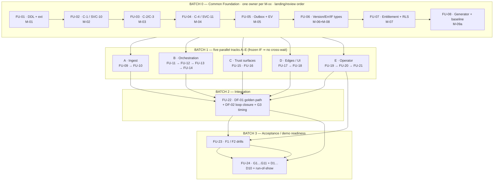

# Feature Unit Plan — RM Workbench MVP (Leadership Demo)

**Phase 4 deliverable · Author:** Chai Dexi (拆得细), Feature Planner, software-dev-team
**Frozen inputs:** `00_Shared_Design_Brief.md`; `01_Requirements_Specification.md` (MVP-FR-01…34, C-1…5, X-01…20, G1…G11, D1…D10, NFR-1…10, A1…A7, Q1…Q7, S1…S4, F1/F2); `02_Product_Design_Specification.md` (SCR-01…14, CMP-01…16, ST-…, §8 generator UX, §12 gate traceability); `03_Technical_Solution.md` — **THE FREEZE LINE** (ADR-01…08, SVC-01…18, DF-01…06, IF-01…22, EV-01…20, NFR-1…18, OD-1…11, AS-1…11, M-01…09, §12 coverage, **§13 build-order dependency note**).
**Consumers (verbatim hand-off):** Qi Huolin (team lead) → Phase N assembly → *a future, separately-authorised build lead*.
**Language:** English. **Status:** PLAN ONLY.

---

## 0. HARD BOUNDARY — READ BEFORE ANY CARD

> **Alan asked for design first and said, verbatim, "i dont want you do write code yet".**
> **Nothing in Phases 1–4 has been implemented. No application code, no schema executed, no scripts, no project scaffold, no build commands exist.**
> **Every card in this document is a PLAN FOR A FUTURE BUILD. No card authorises writing code in this engagement.** A card's "Paths" are proposed landing places in a project that does not exist; no directory is to be created now. A card's "Self-test" describes how a *future* developer would verify the unit; no test is to be written or run now. Any future build requires a **new PRD-level decision** (Phase 1 A3; Phase 3 §1.6).

This plan's only product is **24 self-contained, independently assignable task cards**. Its value is that a developer who has read *nothing but one card plus the frozen document IDs it cites* can execute that unit without asking anyone "what is the interface?" or "which table?".

### 0.1 How to read a card

| Field | Meaning |
|---|---|
| `FU-xx` | Feature Unit ID, sequential across batches. `FU` never collides with `M-`, `SVC-`, `CMP-`, `SCR-`, `IF-`, `EV-`, `C-`, `X-`, `G`, `NFR-`, `OD-`, `AS-`, `ADR-`, `DF-`. |
| Track | `F` = Foundation (Batch 0); `A` ingest; `B` orchestration; `C` trust surfaces; `D` edges/UI; `E` operator surfaces; `INT` integration; `ACC` acceptance. Matches Phase 3 §13 tracks A–E. |
| Batch | 0 / 1 / 2 / 3. |
| Priority | **P0** = on the loop, a gate, or a precondition. **P1** = flag-off / range beat / rehearsal polish. |
| Size | **S / M / L** — a *relative* comparability estimate (one unit = one committable change), **not a time promise and not a calendar estimate**. No dates appear anywhere in this plan. |
| Frozen inputs | Exact IDs only. **Never a re-definition.** |
| Depends | Upstream `FU-xx` + why. Runtime-only dependencies do not block build-start (that is the point of the freeze). |
| Freeze note | Which frozen artefacts are consumed, and the standing rule: **consume, never alter**. |

### 0.2 The frozen-contract rule (applies to every card)

Phase 3 §1.7 / §8 is the contract-freeze line: **DDL (§4, 8 schemas / 40 tables), `IF-01…22` (§8.1), `EV-01…20` (§8.5), `manifest v1.3 / schema v1.3` (§7.5), the extension set = {TimescaleDB, file_fdw} (§5), `NFR-1…18` (§9), `feed.contract/v1` (§6.6), and the four structural contracts (§8.3/8.4) are FROZEN.** A card **cites an ID; it does not restate a payload, a column, a state transition, or a target**. Any change must be authored by the Solution Architect, version-bumped, and synced to Phase 2 and Phase 4 before any build work. No oral overrides. A card that appears to contradict a frozen ID is a defect in this plan, not a licence to deviate.

### 0.3 ID disambiguation (do not confuse these on day one)

| Collision | Resolution |
|---|---|
| `D1…D10` | Phase 1 **demo success criteria** (no hyphen). |
| `D-1…D-5` | Ratified **lead decisions** (hyphenated): dual-output, R/Y/G scope, feed source OPEN, extensions, generator = repeatable tool. Unrelated set. |
| `SVC-01…18` | Phase 3 **system** components (own state, write DB rows). |
| `CMP-01…16` | Phase 2 **UI** components (render projections, capture input). No overlap (Phase 3 §2.3). |
| `M-01…09` | Phase 3 §13 **Batch 0 public modules** (shared capabilities). |
| `FU-01…24` | **This document's** feature units. `M-xx` → `FU-xx` is a many-to-one mapping, not an equality. |
| `C-1…5` | Phase 1 logical contracts; **`CMP-01…16`** are UI components; **`CMP-01`** specifically is `EvidenceChip`. |
| `NFR-1…10` | Phase 1 *inputs* (a feed, not a spec). **`NFR-1…18`** = Phase 3 architect-owned **final spec**. Cards cite the Phase 3 set. |
| `Q1…Q7` | Phase 1 open questions. **`OD-1…11`** = Phase 3 §14.1 open decisions (superset, renumbered). **`AS-1…11`** = Phase 3 §14.2 assumptions. |
| `mode` | Three distinct concepts (Phase 3 §4.1 / AS-1): audience `demo_mode_state.mode`, `demo_run.generator_mode`, and the C-1 `mode` column on every fact. **Do not collapse them.** |

---

## 1. Splitting rationale

**Derivation.** I started from the Phase 3 §13 dependency note rather than from the 34 FRs, because §13 already states the parallelisation precondition: *any capability referenced by ≥2 units must be a public module landed first*. Batch 0 therefore maps `M-01…09` into `FU-01…08` (8 cards). Tracks A–E then split by **system-component ownership**, not by FR, so that each card is one committable change with one owner of one set of tables. Batch 2 is a single integration card because the golden path is one indivisible observable; Batch 3 splits rehearsal from acceptance because F1/F2 can be drilled before G1…G11 sign-off.

**Why Batch 0 exists.** Each `M-xx` is referenced by ≥2 units, verified against §13's own "Referenced by" column: `M-01` (every unit), `M-02` (SVC-02/03/06/08/12/16 + all artefacts), `M-03` (SVC-07/08/09/14/16), `M-04` (every component, both BFFs), `M-05` (SVC-01/02/03/07/09/12/15), `M-06` (SVC-08/09/10/13/17), `M-07` (SVC-07/08/16/24 — **G7 depends on it before any artefact exists**), `M-08` (every IF consumer), `M-09` (every runnable scenario). Leaving any of these to individual developers would produce 8+ duplicate implementations of provenance/approval/audit and violate global rule 1. **Each Batch 0 module has exactly one named owner-card.**

**Why tracks A–E parallelise.** The `IF-01…22` contracts are frozen with field-level sketches, and every request/event carries the uniform `{schema_version, correlation_id, mode, version_stamp}` envelope plus the uniform error contract (§8). A developer on Track B codes against `IF-07/08/10/11/12` *specs* with stub neighbours; no one waits for another team's implementation. This is precisely the hand-off value §13 claims. The only true build-blocking prerequisite is `FU-01` (the tables must exist); all other cross-track links are **runtime** dependencies satisfied by a frozen contract.

**Combinations I made, and why.**

| Combined | Justification |
|---|---|
| `M-06 + M-08` → **FU-06** | Both are shared metadata/wire types in one schema (`version_registry`, `config_version`, error codes, IF payload types). One owner, one versioning mechanism; splitting would duplicate it (echoes SVC-13's own merge rationale). |
| `M-09` → **FU-08** (core + flat files + manifest + load + integrity + X-20) and **FU-21** (reset/archive + re-validate) | The generator is **one deterministic one-transaction pipeline** (§7.4); splitting emission from validation would put two owners on one transaction boundary. Reset is separated because it must `TRUNCATE` mutable tables owned by *later* units (workflow/artefact/audit), so it cannot be fully verified in Batch 0 — it lands in Track E as §13 prescribes ("SVC-12 validation/reset"). Two generator cards, as permitted. |
| `SVC-14 + SVC-15` → **FU-15** | Two small L5 trust components, both local-write/read-model, no mutual dependency. Two tiny cards would add handoff overhead with zero parallel gain. |
| `SVC-10` → **FU-02**, `SVC-11` → **FU-04**, `SVC-04` → **FU-05** | Phase 3 §2.2 states these are **in-process libraries / read models, not deployed services**. Their Batch 0 landing *is* the whole reusable component. I deliberately did **not** create duplicate "Track C trust service" cards for them; instead FU-02/FU-04/FU-05 carry the provenance/evidence, audit, and outbox coverage, and Track C hosts only their consumers' surfaces (sink, health, compliance viewer). This is stated explicitly to avoid double-implementation. |
| `SVC-09` split → **FU-03** (DB primitives) + **FU-14** (service) | `M-03` freezes the C-2/C-3 *DB functions*; the *runtime policy evaluation* (DNC/consent/suitability/disclosure/Shariah/entitlement checks + C-3 issuance on the single Approve) is Track B behaviour. Distinct tables, distinct test fixtures, distinct owners. |

**What I deliberately did NOT split.**

- **The 12 skills into 12 units.** SVC-08 is one dispatcher + one skill registry (§2.2 merging (v)); 12 services would be 12 duplicate dispatchers. All 12 live in FU-13 with per-skill ACs.
- **The 7 `CMP-01` EvidenceChip variants into 7 units.** One component with a `variant` prop (Phase 2 §6.1/§7), one mapping table in `SVC-10`. Variants are data, not code branches owned by different people.
- **The 14 `SCR-*` screens into 14 cards.** They are state/role renderings of **one** read model in one window-A shell (Phase 2 §2.1, global rule 1); split cards would each re-implement the frame, the honesty chrome and the 8 `ST-` states.
- **The 40 DDL tables, 20 EV topics, 22 IF contracts, 8 states, or the 4 scenarios into separate cards.** Each set is one coherent contract or one seed overlay.
- **Observer/compliance views into duplicate screens.** Role-switched renderings (Phase 3 §1.5), not new surfaces.
- **The two BFFs merged.** Deliberately *split* (FU-17 / FU-20) because the read/write split is the structural basis of G8 and separation of duties (ADR-04). This is the one place where adding a boundary is correct.
- **pgvector / pg_cron / BI plugin.** DEFER/REJECT (§5); no cards exist for them.

**Critical note on over-splitting.** The temptation in a 40-table, 22-interface design is to produce one card per artefact so every card is trivially green. That would be actively harmful here: the demo's acceptance is *end-to-end* (G3 is a single `correlation_id` across tick → brief → review → approval → re-rank), so locally-green units say nothing about the loop. Each extra card adds a handoff surface, a "who owns this row?" ambiguity, and a contract-conformance check; 60 cards would spend more effort on integration than on the product. Conversely, under-splitting is a real risk in my two `L`+ foundation/UI cards (`FU-01`, `FU-18`): they are kept whole because splitting a single transaction boundary (DDL) or a single projected frame (UI shell) creates worse seams, but the build lead should treat their self-tests as multi-part checklists, not one assertion. **The 24-card count is a deliberate balance, not a minimisation.**

### 1.1 Proposed minimal directory layout (PLAN ONLY — create nothing now)

Filenames below are illustrative placeholders; Phase 3 §1.4 deliberately leaves runtime/framework **unfrozen**, so extensions are omitted (`*`). No directory exists today.

| Path | Landing for |
|---|---|
| `db/` | `00_extensions`, `01_schemas_enums`, `02_tables_<schema>` ×8, `03_hypertable_ca_indexes_mv`, `04_rls`, `05_functions_{audit,approval,state}`, `06_roles_grants` — FU-01, FU-03, FU-04, FU-07 |
| `contracts/` | `if_types/`, `error_contract.json`, `event_catalogue.json`, **`schema_contract.json` v1.3 FROZEN**, **`manifest.template.json` v1.3 FROZEN** — FU-02, FU-05, FU-06, FU-08 |
| `generator/` | `seed_world.*`, `emit_flat_files.*`, `load_one_tx.*`, `validate_integrity.*`, `no_real_data_guard.*`, `reset_archive.*`, `out/` (CSV/JSON/Parquet + `manifest.json` + `checksums.sha256` + `replay_stream.parquet`) — FU-08, FU-21 |
| `services/ingest/` | `feed_adapter/`, `normaliser/`, `signal_detector/` — FU-09, FU-10 |
| `services/core/` | `orchestrator/`, `outbox_consumer/`, `skill_runtime/`, `policy_gate/` — FU-12, FU-13, FU-14 |
| `services/memory/` | `context_assembly/`, `entitlement/`, `graph/` — FU-07, FU-11 |
| `services/trust/` | `provenance/`, `audit/`, `demo_sink/`, `health/` — FU-02, FU-04, FU-15, FU-16 |
| `services/bff/` | `presenter/`, `operator/` — FU-17, FU-20 |
| `ui/window_a/` | `frame/`, `screens/` (SCR-01…10, 14), `components/` (CMP-01…16), `states/` (ST-…), `projection.*` — FU-18 |
| `ui/window_b/` | `console/` (SCR-11), `manifest_report/` (SCR-13), `compliance_view/` (SCR-12) — FU-16, FU-20 |
| `config/` | versioned config values, `scenario/` (S1…S4), `flags/`, `kill_switch/` — FU-06, FU-19 |
| `rehearsal/` | **documents only**: run-of-show, gate checklist, F1/F2 scripts, Q&A card — FU-23, FU-24 |

---

## 2. Batch & dependency plan

> The B0 chain above is a **landing/review order, not a strict serial dependency**: only `FU-01` is a true prerequisite for the other seven; `FU-02…FU-08` are mutually independent but **collectively** prerequisite for every B1 track. Edges `B0 → A…E` mean "all eight modules present".

| Batch | Units | Parallel? | Hard gate to exit | What it blocks downstream |
|---|---|---|---|---|
| **0** | FU-01…08 (8) | **No** as a batch; `FU-01` first, then `FU-02…08` may proceed concurrently but all must land | §4 DDL matches the frozen spec byte-for-schema; `ck_mode_binding`, `grant_approval()`, `assert_token()`, `append_event()` all pass **negative** tests; entitlement leakage test passes on an empty world; frozen baseline loaded with `integrity_report.verdict = VERIFIED` and checksum recorded | **Every** B1 unit: no tables, no contracts, no entitlement filter, no seeded data ⇒ nothing runnable |
| **1** | FU-09…21 (13), tracks A–E | **Yes across tracks**; within B: `FU-11→FU-12→FU-13→FU-14` sequential by `artefact.*` table ownership; within D: `FU-17→FU-18`; within E: `FU-19→FU-20→FU-21` | Each track passes its `IF-*` contract-conformance self-test in isolation with **stub neighbours**; no unresolved shared-table write conflict (§5); every unit emits its C-4 events | FU-22 integration |
| **2** | FU-22 (1) | **No** | DF-01 completes end-to-end with **one** `correlation_id` within NFR-1; DF-02 loop closes; zero auto actions (G2); replay sequence bit-identical (G3) | FU-23 / FU-24 rehearsal |
| **3** | FU-23…24 (2) | **Partially** — FU-23 can begin once B1's mode/feed units land; FU-24 requires FU-22 | G1…G11 all pass; D1…D10 observable; F1/F2 drilled; reset ×3 ≤ NFR-9; executive Q&A card signed off | **Demo go/no-go** (OD-1…11, §6f) |

**Critical path (explicit):** `FU-01 → FU-08 → FU-09 → FU-10 → FU-12 → FU-13 → FU-14 → FU-17 → FU-18 → FU-22 → FU-24`. This is the golden-path chain: the DDL must exist, the baseline must be loaded, a tick must be ingested and detected, the orchestrator and skills must produce an artefact, the approval gate must allow the single tap, the presenter BFF/UI must render it, and only then can integration and gate rehearsal run. **Batch 0 is the longest serial prefix and the only place where compression is possible** (parallelise `FU-02…08` behind `FU-01`). Nothing on the critical path can be shortened by adding developers; it can only be shortened by reducing scope (§8 "first to cut").

---

## 3. Feature unit cards

> **Standing rule for all 24 cards:** these describe work in a **future, separately-authorised build**. No card authorises code, a scaffold, a migration, a test run, or a build command in this engagement. `Paths` are proposals. `Self-test` is a future procedure. No frozen contract may be altered.

### Batch 0 — Foundation (Track F)

#### 【FU-01】DDL + extension bootstrap + security baseline · F · Batch 0 · P0 · L
- **Goal.** Land the entire frozen physical model as one atomic, reviewable migration set: 8 schemas, 40 tables, enums, keys/indexes, `market.market_tick` hypertable + `tick_1m` continuous aggregate + policies, `health_snapshot_mv`, `file_fdw` server, RLS *enablement*, DB roles and the `REVOKE`/`GRANT` baseline. Done = a clean PG16 instance reaches `SELECT`-ready state with the singleton `demo_mode_state` row in `PREP`.
- **Frozen inputs.** `03 §4.3–4.9`, `§5.3`, `§7.5`; extension set {TimescaleDB, file_fdw}; tables = **all 40** across `demo_meta / market / client / graph / workflow / artefact / audit / staging`; `C-1…C-5`; `SVC-05`; `NFR-6/16/17`.
- **Scope.** Implements schema/extension/privilege **structure only**. Does **not** implement any function body (`FU-03/04`), any RLS *policy* predicate (`FU-07`), any seed row (`FU-08`), or any service.
- **Paths.** `db/` (all files), `db/06_roles_grants.sql`.
- **ACs.** ① All 8 schemas + 40 tables + enums present, no drift vs §4 (`NFR-17`). ② `timescaledb_information.hypertables` contains `market.market_tick` and `...continuous_aggregates` contains `market.tick_1m`; `pg_foreign_table` reachable (`G5`, `NFR-17`). ③ `ck_mode_binding` rejects `LIVE` with `ingest_binding='replay_stream'` (`G8`). ④ `audit.audit_event` and `artefact.approval_token` have UPDATE/DELETE/TRUNCATE revoked for all non-service roles (`G2`, `NFR-6`). ⑤ Deferrable FKs declared for generator load (`NFR-17`).
- **Self-test.** Apply the migration set to an empty PG16 + TimescaleDB + file_fdw instance; assert AC ①–⑤ by catalog query. **Negative:** attempt `INSERT` into `audit.audit_event` as `rm_role` and `UPDATE demo_mode_state` as `service_role` — both must be denied; attempt a `LIVE`/`replay_stream` row — must be rejected by CHECK.
- **Depends.** None — first card. **Freeze note.** This card **is** the frozen DDL/extension set (§1.7 items 1 & 5). It may not add, rename or drop a column; any change routes through the architect.

#### 【FU-02】C-1 provenance envelope / evidence-chip service (SVC-10) · F · Batch 0 · P0 · M
- **Goal.** Land the shared in-process library that stamps, resolves and suppresses the 7-column C-1 envelope, maps `source_kind`+`feed age`+section status to the 7 `CMP-01` variants, and applies version stamps. Done = any writer can call `stamp()`/`resolve()` and a missing envelope produces `insufficient evidence`, never bare text.
- **Frozen inputs.** `C-1`; `IF-13`; `CMP-01`; `SVC-10` ↔ `SVC-02/03/06/08/12/16`; `artefact_version.evidence_set`; `demo_meta.version_registry`; `DF-05`; `FR-26/27/28/31`; `NFR-5/14/17`; `G1`.
- **Scope.** Implements stamping, resolution, variant mapping, suppression + C-4 logging, version-stamp reads. Does **not** render the chip (FU-18), own `version_registry` writes (FU-06), or generate explanations (FU-13).
- **Paths.** `services/trust/provenance/`, `contracts/if_types/IF-13.*`.
- **ACs.** ① Every `stamp()` output has all 7 columns non-null (`FR-31`, `NFR-17`). ② `live_feed`+LIVE→`LIVE`; `replay`→`REPLAY`; `seeded`→`SEEDED`; `rm_manual`→`RM_MANUAL`; `derived`→`DERIVED`; age>warn→`STALE`; `unavailable`→`UNAVAILABLE` (`FR-26`, `G1`). ③ Unresolvable envelope → statement suppressed + `insufficient evidence` + C-4, never bare/placeholder (`FR-26 boundary`, `G1`). ④ Low-confidence fact labelled, excluded from client-facing assertions (`X-10`).
- **Self-test.** Call `stamp()` with each of the 5 `source_kind` values on a stub row and assert the exact variant string; call `resolve()` on a statement whose `source_id` is NULL. **Negative:** assert zero rendered text, one suppression C-4 event, and no placeholder source.
- **Depends.** FU-01 (tables), FU-04 (C-4 append fn), FU-06 (registry). **Freeze note.** Consumes `C-1` (§8.2), `IF-13`, the CMP-01 variant contract (§8.4). Must not add an 8th variant.

#### 【FU-03】C-2/C-3 state machine + token/immutability functions · F · Batch 0 · P0 · L
- **Goal.** Land `artefact.grant_approval()`, `artefact.assert_token()`, `trg_artefact_state`, the immutable `approval_token` privileges and the deferred circular FKs. Done = no artefact can leave `pending_review` without an immutable C-3 token, and no sink/CRM row can be written without one.
- **Frozen inputs.** `C-2`, `C-3`; `IF-11`, `IF-12`; tables `artefact.artefact`, `artefact.artefact_version`, `artefact.approval_token`, `artefact.demo_sink_message`, `client.crm_record`; `SVC-09` primitives, `SVC-14`; `FR-18/19/20/23`; `G2`; `NFR-6/18`; `X-16/19`.
- **Scope.** Implements DB-level transitions/tokens/privileges only. Does **not** evaluate DNC/consent/suitability policy (FU-14) or expose an HTTP approve endpoint (FU-17).
- **Paths.** `db/05_functions_approval.sql`, `db/05_functions_state.sql`, `db/06_roles_grants.sql`.
- **ACs.** ① `grant_approval()` rejects any state ≠ `pending_review` (`FR-18`, `G2`). ② One artefact → exactly one token via `UNIQUE(artefact_id)`; token UPDATE/DELETE denied (`D3`, `NFR-18`). ③ `assert_token()` blocks a `crm_record` insert with no valid token (`X-16`, `G2`). ④ Retrying one approval yields exactly one CRM change (`FR-19`, `NFR-18`). ⑤ Illegal C-2 transition raises (`C-2`).
- **Self-test.** Insert an artefact in `draft`, attempt `grant_approval()` (must fail), transition to `pending_review`, approve, then retry approval and a sink insert twice. **Negative:** insert into `demo_sink_message` with a fabricated `token_id` — must raise `C-3 required`; attempt `UPDATE` on `approval_token` — must be denied and logged.
- **Depends.** FU-01, FU-04 (audit fn). **Freeze note.** Consumes `C-2/C-3` physical mapping (§8.2), `IF-11/IF-12`, the transition guard (§4.9). No new state may be added to `artefact_state_enum`.

#### 【FU-04】C-4 audit append + hash chain / read-access (SVC-11) · F · Batch 0 · P0 · M
- **Goal.** Land `audit.append_event()` (SECURITY DEFINER, `row_hash = sha256(prev_hash || canonical_event)`), the append-only/immutability grants, read-access event emission, and archive-by-`run_id` scaffolding. Done = every component can append one C-4 event and the chain verifies with zero breaks.
- **Frozen inputs.** `C-4`; `IF-14`; `EV-01…20` common envelope; tables `audit.audit_event`, `audit.audit_archive`, `demo_meta.demo_run`; `SVC-11`; `FR-27/32`, `§3.3`; `NFR-5`; `G1/G2/G6/G10`; `X-16`.
- **Scope.** Implements append, chain, read-access events, archive query support. Does **not** render SCR-12 (FU-16) or decide which actions are auditable (each producing card does).
- **Paths.** `db/05_functions_audit.sql`, `services/trust/audit/`.
- **ACs.** ① Approvals, mode switches, config changes, blocked attempts, generated artefacts **and observer/compliance reads** all produce matching C-4 events (`FR-27`, `NFR-5`). ② Recomputed SHA-256 chain has 0 breaks (`NFR-5`). ③ Modification attempt denied **and** logged (`FR-27 AC-3`). ④ Archive by `run_id` never deletes events (`FR-32`, `G10`).
- **Self-test.** Append 5 synthetic C-4 events via the function and recompute the chain. **Negative:** attempt `UPDATE`/`DELETE` on `audit_event` as `compliance_role`, and append a duplicate `event_key` — assert denial + logged attempt and no chain break.
- **Depends.** FU-01, FU-06 (version stamps). **Freeze note.** Consumes `C-4` (§8.2), `IF-14`, the uniform event envelope (§8.5). No second audit mechanism may be introduced (global rule 1).

#### 【FU-05】Event catalogue + transactional outbox + idempotency (SVC-04) · F · Batch 0 · P0 · M
- **Goal.** Land `EV-01…20` catalogue, `workflow.outbox_event/outbox_consumer`, `event_key` dedup, at-least-once delivery loop and the shared `{event_key, topic, correlation_id, mode, version_stamp, emitted_at, run_id}` envelope. Done = a producer can atomically write a row + event in one transaction and a consumer sees each event exactly once.
- **Frozen inputs.** `IF-03/04/05/06`; `EV-01…20`; tables `workflow.outbox_event`, `workflow.outbox_consumer`; `SVC-04`; `ADR-02`; `FR-08/09/21/27`; `X-12`; `NFR-18`; `G3`.
- **Scope.** Implements outbox primitives + catalogue. Does **not** implement the *consumer handlers* (FU-12) or signal/stage event production (FU-10/FU-12/FU-14).
- **Paths.** `contracts/event_catalogue.json`, `services/core/outbox_consumer/` (primitives only).
- **ACs.** ① Row + outbox event are atomic in one transaction (`ADR-02`, `X-12`). ② Duplicate `event_key` → no duplicate delivery; `outbox_consumer` PK dedups at-least-once (`FR-09`, `NFR-18`). ③ All 20 topics present with the common envelope incl. C-1 (`EV-01…20`). ④ Partial commit surfaces as `failed`, never `complete` (`X-12`).
- **Self-test.** Insert a tick row + `EV-01` in one transaction, poll twice with two consumer IDs, assert one delivery each. **Negative:** replay the same `event_key` and force a mid-transaction failure — assert zero duplicate events and zero orphan outbox rows.
- **Depends.** FU-01, FU-02, FU-04, FU-06. **Freeze note.** Consumes `EV-01…20` (§8.5) and `IF-03/04/05/06`. New topics are **C-4 audit actions**, not bus topics (§8.5 closing note); do not add one.

#### 【FU-06】Version registry + config apply/validate + uniform error contract + shared IF types · F · Batch 0 · P0 · M
- **Goal.** Land `version_registry` / `config_version` accessors (partial-unique active version), the uniform error contract with its fixed error-code set, and the shared `IF-01…22` payload types. Done = any unit can validate+apply a config with no redeploy and any IF consumer gets one canonical type definition.
- **Frozen inputs.** `IF-01…22` (types), `§8` uniform conventions; tables `demo_meta.version_registry`, `demo_meta.config_version`; `SVC-08/09/10/13/17`; `FR-27/33`; `NFR-15`; `G11`.
- **Scope.** Implements registry/config **primitives**, error codes, IF types. Does **not** build the operator config UI (FU-20), own mode/scenario state (FU-19), or accept the non-negotiable labels as config keys (they are **not** config keys — `G11`).
- **Paths.** `contracts/if_types/`, `contracts/error_contract.json`, `services/trust/../config_primitives.*`, `config/`.
- **ACs.** ① Config change applies with 0 redeploys; old + new both queryable (`FR-33`, `NFR-15`). ② Invalid config rejected, previous version stays active (`FR-33 AC-4`, `G11`). ③ Exactly one active version per key (`uq_config_active`). ④ Every generated artefact carries all five version stamps (`FR-27`). ⑤ Error codes match the frozen set incl. `MISSING_C3_TOKEN`, `SCHEMA_MISMATCH`, `INSUFFICIENT_EVIDENCE`.
- **Self-test.** Apply a threshold change, query both versions, then apply an invalid value. **Negative:** attempt to register `provenance_chips = off` — assert rejection + `BLOCKED · non-negotiable (FR-33)` + C-4 (`G11`).
- **Depends.** FU-01, FU-04. **Freeze note.** Consumes §8 uniform conventions, `IF-01…22` schemas, `NFR-15`. Error codes are frozen; do not invent a new one.

#### 【FU-07】Entitlement assembly filter (SVC-06 core) + RLS policies · F · Batch 0 · P0 · L
- **Goal.** Land the single `entitlement_rule` resolution used by **both** the SVC-06 context-assembly filter and the RLS policies, plus `graph.entitlement_decision` + C-4 write. Done = an unentitled node's facts never reach a skill's working set, a `jsonb` evidence blob, or a direct table read.
- **Frozen inputs.** `IF-07`; `C-4`; tables `graph.entitlement_rule`, `graph.entitlement_decision`, `graph.graph_node`, `graph.memory_fact`, `client.rm_book`; `SVC-06` (filter), `SVC-07/08/16/24`; `FR-05/06/24`; `X-11`; `NFR-6/13`; **`G7`**.
- **Scope.** Implements the filter primitive + `p_client_book`, `p_graph_node`, `p_memory_fact` policies. Does **not** assemble full canonical context or handle RM corrections (FU-11), or render the graph (FU-18).
- **Paths.** `db/04_rls.sql`, `services/memory/entitlement/`.
- **ACs.** ① Filter runs **before any skill sees context**; `entitlement_decision` + C-4 written per node (`FR-06`, `G7`). ② Two attendee classes produce artefacts differing exactly on the boundary, both citing matrix version (`FR-24`, `NFR-13`). ③ Direct unentitled read denied + C-4 (`X-11`). ④ Book revocation via `valid_from/valid_to` takes effect promptly (`NFR-6`). ⑤ Matrix change → versioned C-4, prior packs `superseded` (`FR-06 AC-3`).
- **Self-test.** Seed a 6-node household with two attendee classes, request context as each, diff the returned `context_refs`. **Negative:** plant a fact from an excluded node inside a `jsonb` evidence blob — assert it is filtered in assembly (RLS alone would miss it) and 0 cross-node facts appear.
- **Depends.** FU-01, FU-02, FU-04, FU-06. **Freeze note.** Consumes `IF-07`, RLS shape (§4.8), the dual-enforcement note (§4.8 / §10.2). **RLS is defence-in-depth only — never the sole enforcement point.**

#### 【FU-08】Generator core: seed → flat files → manifest → one-transaction load → integrity → frozen baseline (SVC-12, M-09a) · F · Batch 0 · P0 · L
- **Goal.** Land the deterministic demo data fabric: `splitmix64` namespaced sub-seeds, parent-derived FK-clean keys, deterministic `as_of`, CSV/JSON/Parquet emission with CSV twins, `manifest.json` + `schema_contract.json` + `checksums.sha256` + `replay_stream.parquet`, `file_fdw` foreign tables, `SET CONSTRAINTS ALL DEFERRED` one-transaction load, `integrity_report`, X-20 fail-loud, the no-real-data guard, and S1…S4 scenario overlays. Done = one seed produces a `VERIFIED` frozen baseline with `READY` health state.
- **Frozen inputs.** `IF-15`, `IF-16`; `EV-16`, `EV-17`; `C-1`; all 40 tables + `staging.load_batch`, `staging.f_*`; `SVC-12` → `SVC-05`/flat files; `SCR-11/13` (data only), `CMP-14`; `DF-03`; `FR-29/30/31`; `X-20`; `NFR-3/17`; `G4/G5/G6`; `manifest v1.3 / schema v1.3 FROZEN`.
- **Scope.** Implements generation, emission, load, validation, fail-loud, guard, baseline. Does **not** implement reset/archive (FU-21), the operator console screens (FU-20), or the live feed binding (FU-09).
- **Paths.** `generator/` (all except `reset_archive.*`), `generator/out/`, `contracts/schema_contract.json`, `contracts/manifest.template.json`.
- **ACs.** ① Same seed + schema version twice → identical `dataset_checksum` / manifest checksum (`FR-29`, `G4`, `NFR-3`). ② Manifest declares every file/table + row count and matches output (`FR-29`). ③ Flat-file and Postgres views agree on row counts + key checksums via bidirectional `EXCEPT`; ≥1 extension with stated purpose `G4/G5/G6` (`FR-30/31`, `NFR-17`). ④ 0 orphan FKs, 0 facts lacking provenance, 0 missing `as_of` (`FR-31`, `G6`). ⑤ `replay` ticks keep original `as_of`, `live` provenance points at external `source_id` (`FR-30`). ⑥ Broken fixture → `SCHEMA MISMATCH`, offending record named, ROLLBACK, no auto-repair, demo start blocked (`X-20`).
- **Self-test.** Run `seed` twice to two scratch schemas and diff checksums; run the FDW `EXCEPT` both ways. **Negative:** inject `holdings.csv` row with an unknown `client_id` — assert loud failure, named record, zero partial rows, `FAILED` verdict; point the guard at a non-`demo_*` DSN — assert `BLOCKED · generator targets synthetic demo data only`.
- **Depends.** FU-01, FU-02, FU-04, FU-05, FU-06. **Freeze note.** Consumes `manifest v1.3 / schema_contract v1.3` (§7.5), `IF-15/16`, extension set (§5), `DF-03`. A schema-version change routes through the architect **before** any artefact is regenerated.

### Batch 1 — Track A · Ingest

#### 【FU-09】Live Feed Adapter + Normaliser + Staleness (SVC-01/02) · A · Batch 1 · P0 · L
- **Goal.** Turn an entitled `feed.contract/v1` frame (or recorded replay frame) into a C-1-stamped, deduplicated `market.market_tick` row + outbox event, with warn/stale/outage derived **on read**. Done = DF-01 steps ①–④ complete within NFR-1's ingest budget in both `live` and `replay`.
- **Frozen inputs.** `IF-22`, `IF-01/02/03`; `EV-01/02/03/05/06/07/15/18`; `C-1`; tables `market.instrument`, `market.market_tick`, `demo_meta.feed_status`, `demo_meta.config_version`, `workflow.outbox_event`; `SVC-01/02` → `SVC-03/04/15`; `SCR-04`, `SCR-10`, `CMP-01` (LIVE/STALE/UNAVAILABLE), `CMP-08`; `DF-01`, `DF-04`; `NFR-1/2/6/12/18`.
- **Scope.** Implements pluggable adapter (WS/REST/SDK behind one IF-22), entitlement/licence check, canonical mapping, currency/unit conversion, clock-skew gate, `tick_key` dedup, staleness derived from `max(as_of)`, recorded-stream capture + replay binding read. Does **not** detect signals (FU-10), decide mode (FU-19), render chips (FU-18).
- **Paths.** `services/ingest/feed_adapter/`, `services/ingest/normaliser/`, `config/feed.*`.
- **ACs.** ① Entitled tick → all C-1 fields non-null and match payload (`FR-01`). ② Unlicensed/unmapped tick → `EV-02` + C-4, absent from every SCR (`FR-01`, `X-02`). ③ Age>warn→amber `STALE`; >stale→`unavailable`, no numeric, stale row retained labelled (`FR-02`, `X-03`, `NFR-2`). ④ Skew beyond tolerance → `EV-15`, tick withheld from signal detection (`X-04`). ⑤ Duplicate `tick_key` → `retained_duplicate`, never silently dropped (`X-12`, `NFR-18`). ⑥ Outage → `EV-05`, unrelated sections intact, no invented tick (`X-01/06`, `NFR-12`).
- **Self-test.** Drive a fixture `feed.contract/v1` frame through the adapter against a stub DB role; assert exactly one tick row + one `EV-01`. **Negative:** replay the identical frame twice and inject a clock-skewed frame — assert one `retained_duplicate`, zero `signal.raised`, one `clock.skew`; then run `replay` binding offline and assert 0 network calls (`NFR-4`).
- **Depends.** FU-01, FU-02, FU-05, FU-06, FU-08 (instrument map + replay stream). **Runtime-only, not build-blocking:** FU-19 `demo_mode_state` via `IF-18`. **Freeze note.** Consumes `IF-22` (`feed.contract/v1`, §6.6), `IF-01…03`, `market_tick` DDL + `tick_key` rule, `NFR-1/2`. `<source>` remains a versioned config placeholder until Q1/OD-1 clears — **the contract is buildable now, the config value is not required to start**.

#### 【FU-10】Signal Detector (SVC-03) · A · Batch 1 · P0 · M
- **Goal.** Consume `EV-01` via `IF-04`, compute drift/threshold/shock/volatility against seeded `allocation_target` using the `tick_1m` continuous aggregate, attach an entitled news item, classify Risk/Opportunity/Retention, and emit exactly one `EV-04` per threshold window with full C-1 provenance. Done = "Wong drifted 6% from target" appears once with the triggering tick `as_of` and rule-pack version.
- **Frozen inputs.** `IF-04`, `IF-05`; `EV-01`, `EV-04`; `C-1`; tables `market.market_signal`, `market.news_item`, `client.holding`, `client.allocation_target`, `market.tick_1m`; `SVC-02` → `SVC-04/07`; `SCR-04`, `CMP-10`, `CMP-01` DERIVED; `DF-01`; `FR-03/11/26/28`; `X-06`; `NFR-1`.
- **Scope.** Implements detection + classification + news attachment. Does **not** rank clients or generate briefs (FU-13), publish client-facing text (gated later), or read unentitled context.
- **Paths.** `services/ingest/signal_detector/`.
- **ACs.** ① Threshold breach → exactly one `EV-04` with tick `as_of` + rule-pack version (`FR-03`). ② Entitled news renders with headline/source/timestamp; unlicensed item excluded (`FR-03`). ③ No threshold crossed → **no signal**, no noise (`FR-03 AC-3`). ④ Two consecutive crossing ticks → one signal with an updated evidence set, not two ranks (`FR-03 AC-4`, `X-06`). ⑤ Missing allocation → signal suppressed with `insufficient evidence`, never guessed (`FR-03 boundary`, `X-02`).
- **Self-test.** Feed two crossing ticks plus one non-crossing tick over a stub `allocation_target`/`tick_1m`. **Negative:** remove the allocation row and attach an unlicensed news item — assert zero signals, zero invented numbers, and an `insufficient evidence` status.
- **Depends.** FU-01, FU-02, FU-05, FU-08 (seeded targets/thresholds), FU-09 (`EV-01` at build time as a stub contract). **Freeze note.** Consumes `IF-04/IF-05`, `market_signal` DDL + `UNIQUE(instrument_id, tick_as_of, client_id, classification)`, `DF-01` timing budget.

### Batch 1 — Track B · Orchestration

#### 【FU-11】D5 Client Memory + Relationship Graph + context assembly + RM correction (SVC-06) · B · Batch 1 · P0 · L
- **Goal.** Assemble **one canonical evidence-backed context per client** from entitled nodes, expose `context_refs` (pointers, never copies), enforce the FU-07 filter before any skill, support RM inspection/correction/deletion with version retention, and write back accepted transcript facts. Done = two skills in one workflow resolve the *same* fact ID with the same `as_of`.
- **Frozen inputs.** `IF-07`; `C-1`, `C-4`; tables `graph.memory_fact`, `graph.graph_node`, `graph.graph_edge`, `graph.entitlement_rule`, `graph.entitlement_decision`, `client.consent_state`, `client.suitability_state`; `SVC-07` ↔ `SVC-06` → `SVC-08`; `SCR-03`, `SCR-09`, `CMP-02` (`correctable`), `CMP-11`; `DF-01/DF-02/DF-06`; `FR-05/06/07/17/24`; `X-08/10/11`; `NFR-13`; `G7`.
- **Scope.** Implements context assembly, graph node/edge reads, memory versioning/correction, consent/suitability state reads, family-pack assembly input. Does **not** own the entitlement predicate (FU-07), split packs into versions (FU-13), or render the graph (FU-18).
- **Paths.** `services/memory/context_assembly/`, `services/memory/graph/`.
- **ACs.** ① Two skills → same fact ID + same `as_of`, no re-query (`FR-05`, `FR-09`). ② Low-confidence fact labelled + excluded from client-facing assertions (`FR-05`, `X-10`). ③ Conflicting records → both sources linked, suitability/ticket handoff blocked (`FR-05`, `X-08`). ④ RM correction → old + new queryable with distinct timestamps, old `superseded`, `source_kind=rm_manual` (`FR-07`). ⑤ Unentitled client → denial + C-4, **no partial context** (`FR-05`, `X-11`).
- **Self-test.** Assemble context twice for one client and compare `context_refs`; apply a correction and a deletion. **Negative:** inject two current facts for one attribute and request context for an RM whose mandate excludes a daughter's trust — assert both sources linked, handoff blocked, and zero excluded-node facts in the returned `jsonb`.
- **Depends.** FU-01, FU-02, FU-04, FU-07 (filter), FU-08 (seeded graph/memory). **Freeze note.** Consumes `IF-07`, RLS + dual-enforcement note (§4.8/§10.2), `C-1`. Node topology is **not** frozen (§9); do not invent a canonical node list.

#### 【FU-12】Copilot Core Orchestrator + workflow state + outbox consumers (SVC-07) · B · Batch 1 · P0 · L
- **Goal.** Implement bounded-intent orchestration: decompose into an ordered skill sequence, open/persist a C-5 instance after each transition, reuse `context_refs`, `pause at each approval gate`, run `IF-10` policy checks, verify result, honour `kill_mask`, resume after interruption, and drive the `EV-13 → re-rank` loop. Done = the full stage sequence is inspectable under one `correlation_id`.
- **Frozen inputs.** `IF-06`, `IF-07`, `IF-08`, `IF-10`; `EV-04`, `EV-06`, `EV-10`, `EV-11`, `EV-13`, `EV-19`; `C-5`; tables `workflow.workflow_instance`, `workflow.workflow_stage`, `workflow.skill_invocation`, `workflow.outbox_event/outbox_consumer`; `SVC-04` → `SVC-06/08/09`; `SCR-01/02/06/10`, `CMP-09`; `DF-01/DF-02`; `FR-08/09/10/21`; `X-09/12/14`; `NFR-8/18`; `G3`.
- **Scope.** Implements orchestration + state + consumer handlers. Does **not** implement the 12 skills (FU-13), the token primitives (FU-03), or policy *evaluation* (FU-14).
- **Paths.** `services/core/orchestrator/`, `services/core/outbox_consumer/` (handlers).
- **ACs.** ① Live signal → end-to-end inspectable sequence under one `correlation_id` (`FR-08`, `G3`). ② Client-facing stage sits in `pending_review`, no write/send before C-3 (`FR-08`, `G2`). ③ Policy failure → stage `blocked` with reason, downstream skipped (`FR-08`). ④ Verify mismatch → workflow `failed`, no false success (`FR-08`, `X-12`). ⑤ ≥2 stages cite the same `context_refs` fact ID; resume in `replay` does not regenerate stage 1 (`FR-09`, `X-12`). ⑥ Killed stage → `manual_fallback`, no fabricated text; clearing never auto-releases (`FR-10`, `X-14`).
- **Self-test.** Drive a stub `EV-04` through a 3-stage sequence with stub skills; interrupt at stage 2 and resume. **Negative:** force a policy failure and a partial write — assert `blocked`/`failed` (never `complete`), zero duplicate stage artefacts, and an editable blank `manual_fallback` draft.
- **Depends.** FU-01, FU-02, FU-04, FU-05, FU-06, FU-07, FU-11 (context at runtime / IF-07 stub at build). **Freeze note.** Consumes `C-5` (§8.2), `IF-06/07/08/10`, `EV-10/11/13`, `NFR-8`. No free-form chat surface may be added (`FR-10`).

#### 【FU-13】Skill Runtime — 12 typed skills in one dispatcher (SVC-08) · B · Batch 1 · P0 · L
- **Goal.** Implement one dispatcher + skill registry with deterministic, version-stamped outputs for all 12 skills: `brief.generate`, `rank.clients`, `outreach.draft`, `meeting.capture` (stub), `crm.write`, `suitability.check` (boundary-only), `household.consolidate` (thin), `shariah.screen` (flag-off), `actions.extract`, `family.pack.split`, `memory.writeback`, `ticket.handoff`. Done = every artefact is `pending_review` with C-1 evidence + version stamps and no per-skill service exists.
- **Frozen inputs.** `IF-08`, `IF-09`, `IF-07`; `C-1`, `C-2`; `EV-19`; tables `artefact.artefact`, `artefact.artefact_version`, `artefact.extraction_item`, `client.product`, `client.suitability_state`, `graph.memory_fact`; `SVC-07` → `SVC-09/10/12`; `SCR-02/03/06/07/08/09`, `CMP-04/10/11/15`; `DF-01/DF-02/DF-06`; `FR-11…25`; `X-10/13/17/18/19`; `NFR-3/14/18`.
- **Scope.** Implements all 12 skills and their artefact writes. Does **not** implement `product.search`, `zakat.calculate`, `purify.income` (absent by scope), a screening engine, or any trade execution path.
- **Paths.** `services/core/skill_runtime/`.
- **ACs.** ① `rank.clients` → ≤10 unique clients, ≥1 reason each, DNC excluded, no padding, empty state with criteria (`FR-11/13`, `X-13`). ② `brief.generate` → 5 sections, every material fact chipped, agenda `PROPOSED`/`AI-GENERATED`, ambiguous attendee requires RM selection (`FR-14/15`). ③ `outreach.draft` → 3 required elements, every factual statement linked, missing fact omitted not invented (`FR-22`). ④ `meeting.capture`/`actions.extract` → `Family: daughter added · preference noted` with transcript evidence; unspoken owner/due **blank**; low-confidence suppressed (`FR-16/17`, `X-15`). ⑤ `ticket.handoff` pre-fill only, `execution disabled`, missing/expired suitability or conflicts → `blocked` (`FR-20`, `X-19`). ⑥ `family.pack.split` two entitled versions + matrix version; `shariah.screen` flag OFF renders no surface and excludes non-compliant candidates when ON (`FR-24/25`, `X-18`).
- **Self-test.** Invoke each skill directly with a stub `context_refs` and assert its artefact shape/state. **Negative:** request an absent skill name, invoke `shariah.screen` with the flag OFF, and attempt a `ticket.handoff` with expired suitability — assert bounded-intent rejection, zero Shariah output, and a `blocked` handoff with **no submit/execute action present**.
- **Depends.** FU-01, FU-02, FU-03, FU-06, FU-07, FU-11 (assembly), FU-12 (dispatch). **Freeze note.** Consumes `IF-08/09`, `C-2` enum, `artefact_kind_enum` (10 kinds — no new kind), `NFR-3/14`. Deterministic stubs only (ADR-03); no real LLM call path.

#### 【FU-14】Policy & Approval Gate (SVC-09) · B · Batch 1 · P0 · L
- **Goal.** Evaluate DNC / channel-consent / disclosure / suitability-hard-stop / Shariah-flag / entitlement checks, drive C-2 transitions, and issue the immutable C-3 token on the **single Approve** tap, then dispatch idempotent CRM/sink writes and `EV-13` re-rank. Done = before the tap there are zero CRM writes, zero sends, zero ticket submissions.
- **Frozen inputs.** `IF-10`, `IF-11`, `IF-12`; `EV-08/09/12/13`; `C-2`, `C-3`; tables `artefact.approval_token`, `artefact.artefact`, `client.crm_record`, `artefact.demo_sink_message`, `client.consent_state`, `client.suitability_state`; `SVC-07` → `SVC-14`; `SCR-06/08/09`, `CMP-03`; `DF-02`; `FR-18/19/20/23`; `X-08/09/16/17/19`; `NFR-6/18`; `G2`.
- **Scope.** Implements runtime policy evaluation + Approve + dispatch. Does **not** implement the DB token/transition functions (FU-03), the sink itself (FU-15), or the compliance viewer (FU-16).
- **Paths.** `services/core/policy_gate/`.
- **ACs.** ① Before Approve: 0 CRM writes / 0 sends / 0 submissions (`FR-18`, `G2`). ② Any DNC/opt-out/disclosure failure → `blocked` with reason, no bypass control (`FR-23`, `X-17`). ③ Retry of one approval → exactly one CRM change, email stays `draft` (`FR-19`, `NFR-18`). ④ Sink failure → editable draft retained, `pending`/`failed`, safe retry, **never false success** (`FR-19`, `X-09`). ⑤ Any auto-send/auto-trade attempt → blocked + C-4 + counter increment (`X-16`, `G2`). ⑥ Approved final content + approver + template/model versions all auditable (`FR-23`, `NFR-5`).
- **Self-test.** Drive `approve{}` against a `pending_review` artefact with a stub sink; assert token + C-4 + one CRM row + `draft` email + `EV-13`. **Negative:** retry the same approval twice, set `dnc=true`, and fire a fabricated `execute` command — assert one CRM row, a `blocked` send, and a blocked-attempt C-4 with **no execute endpoint reachable**.
- **Depends.** FU-01, FU-02, FU-03, FU-04, FU-06, FU-12, FU-13. **Freeze note.** Consumes `IF-10/11/12`, `C-3`, the three-layer approval gate (§8.4), `NFR-18`. **Trade execution has no table, no endpoint, no code path — do not add one.**

### Batch 1 — Track C · Trust surfaces

#### 【FU-15】Demo Sink (SVC-14) + Health / Telemetry Aggregator (SVC-15) · C · Batch 1 · P0 · M
- **Goal.** Provide the zero-egress local CRM/email/SMS sink (exact final content + provider-style status + idempotent write) and the derived eight-field health read model incl. app-level NFR-1 latency measurement, one `correlation_id`/workflow and the blocked-attempt counter. Done = `DEMO SINK — not delivered` is a structural status and the health panel is 8/8 correct.
- **Frozen inputs.** `IF-12`, `IF-19`; `EV-09`, `EV-12`, `EV-20`; tables `artefact.demo_sink_message`, `client.crm_record`, `demo_meta.feed_status`, `demo_meta.health_snapshot_mv`, `demo_meta.demo_run`; `SVC-09` → `SVC-14`, `SVC-04/AUD` → `SVC-15` → `SVC-16`; `SCR-06/08/10`, `CMP-05/08/16`; `DF-02/DF-05`; `FR-02/09/19/23/27/34`; `X-09/16`; `NFR-1/6/8/10`.
- **Scope.** Implements sink writes + derived read model. Does **not** add an outbound adapter (forbidden), hold a second copy of mode state (`G8` drift), or render CMP-08 (FU-18).
- **Paths.** `services/trust/demo_sink/`, `services/trust/health/`.
- **ACs.** ① Sink has **no outbound adapter**; `provider_status` default literal `DEMO SINK — not delivered`; 0 egress packets (`FR-19/23`, `X-16`, `NFR-6`). ② `succeeded`/`pending`/`failed` states, never premature success (`FR-19`, `X-09`). ③ Eight health fields (`mode, source, last_tick_as_of, feed_age, scenario, workflow_stage, blocked_count, integrity`) accurate within one loop (`FR-34`, `NFR-8`). ④ Blocked-attempt counter increments and never silently resets (`FR-34`, `X-16`). ⑤ Health panel never shows `LIVE` while bound to `replay` (`G8`).
- **Self-test.** Write two sink messages with the same `idempotency_key` and query `health_snapshot_mv` after an F1-style stale injection. **Negative:** capture egress while writing; attempt a `sent`/`delivered` status — assert 0 packets and rejection (no such C-2 state exists for the sink).
- **Depends.** FU-01, FU-03, FU-04, FU-05, FU-06, FU-09 (`feed_status` at runtime), FU-14 (approvals at runtime). **Freeze note.** Consumes `IF-12/IF-19`, `health_snapshot_mv` DDL (§4.7), `NFR-8`. Health is a **derived read model, never a second state store** (AS-8).

#### 【FU-16】Compliance / Audit Viewer SCR-12 (read model over SVC-11) · C · Batch 1 · P0 · M
- **Goal.** Deliver the role-switched, read-only SCR-12: append-only C-4 log filtered by actor / time / `correlation_id` / target, consent records, policy & rule-pack versions, blocked attempts, leakage results, read-access events, archived run by `run_id`, and on-request hash-chain recompute. Done = an executive can open the approval entry and see approver + timestamp + `final_content_hash`.
- **Frozen inputs.** `IF-14`, `IF-20`; `C-4`; tables `audit.audit_event`, `audit.audit_archive`, `artefact.approval_token`, `demo_meta.version_registry`, `client.consent_state`; `SVC-11` → `SVC-16`; `SCR-12`, `CMP-02/12`; `DF-05`; `FR-06/16/23/27/28`; `NFR-5/7`; `D3`; `G1/G2/G10`.
- **Scope.** Implements SCR-12 as a **role-switched rendering of window A's read model** (no duplicate screen). Does **not** add an Approve control, modify audit, or create a second audit store.
- **Paths.** `ui/window_b/compliance_view/`, `services/bff/presenter/` (read model for SCR-12).
- **ACs.** ① Every approval/mode/config/blocked/artefact/read in a run has a matching C-4 event (`FR-27`, `NFR-5`). ② Modification attempt → DENIED + logged (`FR-27 AC-3`). ③ Archived run by `run_id` view-only; audit never deleted (`FR-32`, `G10`). ④ Text-first, keyboard-sortable, colour-independent (`NFR-7`). ⑤ Every compliance *view* emits a read-access C-4 (`FR-27`, `§3.3`).
- **Self-test.** Load a stub run of 20 events, filter by `correlation_id`, recompute the chain, open the approval entry. **Negative:** attempt to modify an audit row from this surface — assert denial + a logged attempt; verify a compliance read produced a read-access event.
- **Depends.** FU-01, FU-04, FU-06, FU-17 (read model projection at runtime / `IF-20` stub at build). **Freeze note.** Consumes `C-4`, `IF-14`, `IF-20`, `NFR-5/7`. Whether SCR-12 appears live on stage is **OD-10** — a run-of-show decision, not a card change.

### Batch 1 — Track D · Edges & UI

#### 【FU-17】Presenter BFF (SVC-16, READ-ONLY) · D · Batch 1 · P0 · L
- **Goal.** Build the sole read-model projection for window A: entitlement-scoped queries, `IF-13` evidence resolution, `IF-18` read-only `demo_mode_state` projection, `IF-19` health read model, `IF-20` read models for SCR-01…10/14, and a C-4 read-access event on **every** client-data read. Done = no UPDATE endpoint for `demo_mode_state` exists anywhere in this BFF.
- **Frozen inputs.** `IF-13`, `IF-18`, `IF-19`, `IF-20`; `C-1`, `C-4`; `SVC-05/10/15` → `SVC-18`; `SCR-01…10/14`; `CMP-01/02/07/08/09`; `DF-01/DF-05`; `FR-04/26/34`; `NFR-5/8`; **`G8`**.
- **Scope.** Implements read-only projections + command intents (no writes). Does **not** issue approvals (FU-14 handles; `IF-11` is a *pass-through* to SVC-09), write mode, or render components (FU-18).
- **Paths.** `services/bff/presenter/`.
- **ACs.** ① No mode/generate/reset/flag write endpoint exists; `demo_mode_state` is readable only (`ADR-04/05`, `G8`). ② Every read of client data emits a C-4 read-access event incl. observer/compliance (`FR-27`, `NFR-5`). ③ `rm_role`/`observer_role`/`compliance_role` scoping enforced transaction-locally (`NFR-6`). ④ `IF-13` resolution suppresses unresolvable statements (`G1`). ⑤ `ModeChip` is a pure read-only projection of the single row (`G8`).
- **Self-test.** Query every `IF-20` read model as each of the three roles with stub data. **Negative:** attempt a POST to a mode-write path and an unentitled client read — assert 404/no-route for the former, denial + C-4 for the latter, and `LIVE` never returned while `ingest_binding='replay_stream'`.
- **Depends.** FU-01, FU-02, FU-04, FU-07, FU-15 (health at runtime / `IF-19` stub at build), FU-19 (`IF-18` stub at build). **Freeze note.** Consumes `IF-13/18/19/20`, the sole-writer/read-only contract (§8.3). **This BFF must never be merged with FU-20** (ADR-04).

#### 【FU-18】UI Shell window A + CMP-01…16 + SCR-01…10/14 + ST states + projection a11y (SVC-18) · D · Batch 1 · P0 · L
- **Goal.** Build the **single** 16:9 projected frame: persistent SCR-01 chrome, all SCR-02…10 and SCR-14 screens, all 16 CMPs (incl. the 7 CMP-01 variants and the single CMP-03 ApprovalBar), the 8 `ST-` states with exact copy, permanent honesty chrome, causal motion that **stops at the approval gate**, and WCAG 2.1 AA. Done = every AI statement shows a resolvable chip and no frame drops `SYNTHETIC DEMO DATA`.
- **Frozen inputs.** `IF-20`, `IF-11`; `C-1`; `SVC-16/17` → `SVC-18`; `SCR-01…10`, `SCR-14`; `CMP-01…16`; `ST-LOAD/OK/EMPTY/PART/ERR/BLOCK/REPLAY/SUPER`; Phase 2 §1/§5/§6/§9/§10/§11; `FR-04/26/33/34`; `NFR-7`; `G1/G8/G11`.
- **Scope.** Implements window A + the window B shell host (console content is FU-20). Does **not** implement business logic, hold authoritative state in the browser, expose a mode control, or auto-advance past a gate.
- **Paths.** `ui/window_a/` (all), `ui/window_b/` (host only), `ui/projection.*`.
- **ACs.** ① Sample 10 AI statements → 10/10 non-empty chips; chip click opens originating record with `as_of` (`FR-26`, `G1`). ② `REPLAY — recorded <time>` on every chip, no `LIVE` claim, in `ST-REPLAY` (`FR-04`, `G8`). ③ Non-negotiable labels (`SYNTHETIC DEMO DATA`, `DEMO SINK — not delivered`, consent banner, `Estimate for discussion`, `execution disabled`, `insufficient evidence`) cannot be disabled by config (`FR-33`, `G11`). ④ Empty = `N/A — no data` / criteria + last-evaluated, never `0` or blank; blocked/error states never auto-dismiss (`X-13`, Phase 2 §9). ⑤ Keyboard-only single Approve reachable/activatable, ≥4.5:1 contrast, non-colour-only status (`NFR-7`). ⑥ Motion stops at SCR-06; no pulsing "thinking"/typewriter/auto-scroll (Phase 2 §9.2, P7).
- **Self-test.** Render each SCR with a stub `IF-20` payload and walk all 8 ST states. **Negative:** remove a statement's `source_id`, set `ST-BLOCK`, and switch to replay — assert `insufficient evidence` (never bare text), a persistent blocked banner, and `LIVE` absent; verify a keyboard-only Approve works.
- **Depends.** FU-01, FU-02, FU-17 (read models), FU-20 (sole writer, **runtime only** — `IF-20` contract suffices at build). **Freeze note.** Consumes Phase 2 screen/component/state/copy specs, `IF-20`, `NFR-7`, `G11`. Dual vs single output is **OD-6**; the presenter-safe overlay fallback is a topology choice, not a new screen.

### Batch 1 — Track E · Operator surfaces

#### 【FU-19】Mode / Scenario / Config / Flags / Kill Switch Manager (SVC-13) + DF-04 · E · Batch 1 · P0 · L
- **Goal.** Own the **sole writer** of `demo_meta.demo_mode_state`, scenario library S1…S4, versioned config apply, feature flags, source attribution, kill-switch registry, `EV-14 mode.changed`, the on-camera `CMP-16` announcement, and the F1 auto-fallback rule. Done = a mode switch is announced ≥2.5s before the next artefact and preserves C-5 state, approvals and RM edits.
- **Frozen inputs.** `IF-17`, `IF-18`; `EV-05`, `EV-14`; `C-5`; tables `demo_meta.demo_mode_state`, `demo_meta.scenario`, `demo_meta.config_version`, `demo_meta.version_registry`, `demo_meta.feed_status`; `SVC-17` → `SVC-16` (read-only); `SCR-10/11`, `CMP-07/13/16`; `DF-04`; `FR-04/10/25/33/34`; `X-01/07`; `NFR-8/15`; `G8/G9/G11`.
- **Scope.** Implements state manager + bindings + announcement. Does **not** ingest ticks (FU-09), render the console (FU-20), or reset the world (FU-21).
- **Paths.** `services/bff/operator/` (manager logic), `config/scenario/`, `config/flags/`, `config/kill_switch/`.
- **ACs.** ① `LIVE` never stored while `ingest_binding='replay_stream'`; label updates before next artefact (`FR-04`, `X-07`, `G8`). ② Every switch → `EV-14` + C-4 + ≥2.5s `StatusBanner`, never silent (`FR-04`, `DF-04`). ③ Mid-workflow switch preserves C-5, approvals, RM edits; no artefact invalidated (`X-07`, `G9`). ④ ≥3 named scenarios each declare a triggering market event (`FR-34`). ⑤ Shariah flag OFF → no Shariah surface; clearing kill switch never auto-releases a queued artefact (`FR-25/10/33`, `G11`). ⑥ Locked controls are **not** config keys (`FR-33`, `G11`).
- **Self-test.** Switch `LIVE→REPLAY` mid-workflow with a stub C-5 instance; load S1…S4; toggle the Shariah flag and a kill switch. **Negative:** attempt to write `LIVE` while bound to `replay_stream` (DB CHECK must reject), disable provenance chips (`BLOCKED · non-negotiable`), and clear a kill switch with a queued artefact — assert no auto-release.
- **Depends.** FU-01, FU-04, FU-05, FU-06, FU-08 (scenario seeds). **Freeze note.** Consumes §8.3 sole-writer/read-only contract, `IF-17/18`, `ck_mode_binding`, `EV-14`, `NFR-15`. **The three distinct "mode" concepts (AS-1) are owned here — do not collapse them.**

#### 【FU-20】Operator Console BFF (SVC-17, SOLE WRITER) + SCR-11 + SCR-13 · E · Batch 1 · P0 · L
- **Goal.** Build the off-camera operator surface and its write path: `IF-17` commands (`mode.set / scenario.load / config.apply / flag.set / kill.set / generate / validate / reset`), `IF-21` console state, SCR-11 (13 regions incl. seed, locked controls, what-is-real legend, no-real-data guard display, extension-in-use read-only field) and SCR-13 manifest/integrity report. Done = the console has **no Approve control** and the window B never appears on the projector.
- **Frozen inputs.** `IF-17`, `IF-21`, `IF-15/16` (report data); `C-4`; `EV-16/17/20`; tables `demo_meta.generator_manifest`, `demo_meta.integrity_report`, `demo_meta.config_version`; `SVC-18(window B)` → `SVC-12/13/05`; `SCR-11`, `SCR-13`, `CMP-13/14/16`; `DF-03/DF-04`; `FR-10/29…34`; `X-20`; `NFR-8/15`; `G5/G8/G10/G11`.
- **Scope.** Implements console + write endpoints + report view. Does **not** act as RM approver, generate data (FU-08), or execute reset (FU-21) — it *invokes* them.
- **Paths.** `services/bff/operator/`, `ui/window_b/console/`, `ui/window_b/manifest_report/`.
- **ACs.** ① **No Approve endpoint exists** in SVC-17; separation of duties structural (`§3.1`, `ADR-04`). ② `schema v1.3 · manifest v1.3 · FROZEN` shown read-only; a change routes to the architect (`FR-29 AC-4`, global rule 3). ③ SCR-13 shows file listing, Postgres status, `Orphan foreign keys: 0 · facts without provenance: 0 · VERIFIED`, checksum, extension(s) with stated purpose (`FR-30/31`, `G5`). ④ `SCHEMA MISMATCH` → `FAILED · no auto-repair`, offending record linkable (`X-20`). ⑤ `operator_role` only; every command emits C-4 (`FR-27/33`). ⑥ Reset requires the archive-audit confirmation dialog (`FR-32`, `G10`).
- **Self-test.** Issue all eight `IF-17` commands against stub managers and render SCR-11/13 in `ST-OK` and `ST-BLOCK`. **Negative:** call an `approve` path (must not exist), edit the schema version field, and attempt to move window B onto output A — assert route absence, read-only field, and topology guard.
- **Depends.** FU-01, FU-04, FU-06, FU-08, FU-19, FU-21 (reset at runtime). **Freeze note.** Consumes `IF-17/21`, `manifest v1.3`, `G5/G8/G11`. Extension-in-use field is a **display of the frozen set** (§5.2), not a technology decision.

#### 【FU-21】Reset / archive + operator re-validate (SVC-12, M-09b) · E · Batch 1 · P0 · M
- **Goal.** Implement one-click reset: archive-audit confirmation dialog, `audit_archive` by `run_id`, new `demo_run` row, `TRUNCATE` of mutable tables only (audit/manifest/report/registry/config **excluded**), reload frozen baseline flat files in one transaction, clear workflow/approvals/drafts/`kill_mask`, re-verify checksum + integrity, `EV-20`, `READY`. Done = reset ≤ NFR-9 and reproducibility survives repeated resets.
- **Frozen inputs.** `IF-16`, `IF-17`; `EV-20`; `C-4`; tables `demo_meta.demo_run`, `audit.audit_archive`, `audit.audit_event`, `demo_meta.generator_manifest/integrity_report`, all mutable `workflow.*`/`artefact.*`/`market.market_signal`/`client.crm_record`/`graph.memory_fact`/`demo_meta.feed_status`/`demo_mode_state`; `SVC-12/11/17`; `SCR-10/11/12/13`, `CMP-14/16`; `DF-03` steps ⑬⑭; `FR-31/32`; `NFR-3/9`; `G4/G10`.
- **Scope.** Implements reset + re-validate. Does **not** re-generate from a new seed (FU-08), delete audit, or invent a second archive store.
- **Paths.** `generator/reset_archive.*`, `generator/validate_integrity.*` (re-validate entry).
- **ACs.** ① Post-reset checksum equals seeded baseline; no prior artefact queryable except archived audit (`FR-32`, `G10`). ② Reset completes within `NFR-9` (`≤60s`) ×3 (`FR-32`, `G10`). ③ Compliance archive never deleted; prior run still queryable (`FR-32`, `NFR-5`). ④ Every artefact/UI label identifiable as demo data; no-real-data guard still armed (`FR-32 AC-3/4`). ⑤ `READY · integrity verified` on SCR-10 and `EV-20` emitted (`FR-34`, `G10`).
- **Self-test.** Run a stub workflow, reset, re-verify, repeat three times. **Negative:** attempt reset while pointing at a non-`demo_*` DSN and attempt to read an archived audit row after truncation — assert `BLOCKED` guard and that the archived event remains queryable by `run_id`.
- **Depends.** FU-01, FU-03, FU-04, FU-05, FU-08 (load path + baseline), FU-12/FU-13/FU-14 (mutable tables exist), FU-19, FU-20. **Freeze note.** Consumes ADR-08 truncate-and-reload, `DF-03` ⑬⑭, `NFR-9`, `G10`. Do **not** substitute `pg_dump`/template-database without an architect re-freeze (§7.9).

### Batch 2 — Integration

#### 【FU-22】DF-01 golden path + DF-02 loop closure + G3 timing · INT · Batch 2 · P0 · L
- **Goal.** Wire the real units end-to-end (no stubs): tick → signal → workflow → entitled context → rank + brief → chips → visible re-rank within NFR-1; then the single Approve → token → idempotent CRM write / `draft` email / blocked-or-ready ticket / memory write-back → `EV-13` → new priority list + tomorrow's brief, all under one `correlation_id`. Done = DF-01/DF-02 complete with identical sequence in `replay`.
- **Frozen inputs.** `DF-01` (§3.1 timing budget), `DF-02` (§3.2 + sequence diagram), `DF-04/05/06`; `IF-01…22` (all); `EV-01/04/08/09/10/11/13/19`; `C-1…C-5`; `SVC-01…18`; `SCR-02/03/06/07/10`; `NFR-1/3/4/11/18`; `G1/G2/G3`; `D1/D2/D3/D4/D5`.
- **Scope.** Implements wiring, timing instrumentation, retry/verify paths, replay parity. Does **not** implement any new component or relax any gate; no new tables/contracts.
- **Paths.** `services/core/orchestrator/` (integration wiring), `rehearsal/` (timing log, document only).
- **ACs.** ① Live tick → visible re-rank ≤ NFR-1 p95; ingest-to-store ≤2s p95 (`G3`, `NFR-1`). ② Identical artefact sequence in `replay`, bit-reproducible (`G3`, `NFR-3/4`). ③ One `correlation_id` links tick → signal → brief → review → approval → re-rank (`FR-08/09/21`, `D4`). ④ 0 auto-sends / 0 auto-trades / 0 submissions without C-3 (`G2`). ⑤ Approved "daughter to join" appears in re-ranked list **and** tomorrow's brief in the same session (`FR-21`, `D4`). ⑥ Full golden path completes with network physically disabled in `replay` (`NFR-4/16`).
- **Self-test.** Run S1 20× in `live` and 20× in `replay` reading C-4/outbox timestamp deltas keyed by `correlation_id`. **Negative:** cut the network at the live tick and inject an F1 outage — assert the announced replay fallback still completes the loop with identical sequence, no fabricated tick, and RM edits preserved.
- **Depends.** **All** FU-01…FU-21. **Freeze note.** Consumes `DF-01` timing budget (§3.1), `DF-02`, `NFR-1/3/4`, `G3`. The 0.5s slack and external-feed-latency-reported-separately rule are frozen; no re-budgeting.

### Batch 3 — Acceptance / demo readiness

#### 【FU-23】F1 / F2 fallback rehearsal (S4, X-01/02/05/15) · ACC · Batch 3 · P0 · M
- **Goal.** Rehearse and document the two honest-degradation beats: F1 feed outage → amber `STALE`, market `unavailable`, portfolio/agenda intact, announced `REPLAY — recorded 09:58`, loop completes; F2 consent declined/withdrawn → no indicator, no audio, `MANUAL NOTES`, low-confidence facts requiring explicit review, loop still closes on approved facts only. Done = both drills pass `G9`.
- **Frozen inputs.** `DF-04`, `DF-06`, `DF-02`; `X-01/02/03/05/07/15`; `S4`, `F1`, `F2`; `SCR-04/03/07/06/10`; `CMP-01/06/16`; `FR-02/04/15/16/17/21/34`; `NFR-2/12`; `G8/G9`; `D9`.
- **Scope.** Rehearsal scripts, injected scenarios, pass/fail observation records. Does **not** change any component; a failing drill routes back to the owning FU, never to a spec waiver.
- **Paths.** `rehearsal/` (F1/F2 scripts, observation sheets — **documents only**).
- **ACs.** ① F1: stale/unavailable labels on affected facts, **0 fabricated numbers**, portfolio/agenda unaffected, fallback announced ≥2.5s (`X-01/02`, `G9`, `NFR-12`). ② F1: `LIVE` never shown while bound to replay (`G8`). ③ F2: no recording indicator, no capture, `MANUAL NOTES`, consent audit with method + timestamp (`X-05/15`). ④ F2: derived facts low-confidence, explicit review before propagation; loop closes on approved facts only (`FR-17/21`, `G9`). ⑤ Both complete with workflow state + RM edits preserved (`X-07`, `FR-04`).
- **Self-test.** Inject `EV-05` at T+3s, then a withdrawn consent at +00:10, observe every screen state. **Negative:** confirm no invented tick, no last-price substitution, no auto-advance past the approval gate, and no unapproved fact in the re-ranked list.
- **Depends.** FU-09, FU-13, FU-15, FU-18, FU-19, FU-22 (for loop closure). **Freeze note.** Consumes F1/F2 narratives (Phase 1 §5.2), `DF-04/06`, `G9`. Scripted transcript is a **declared stub** (`X-15`) — the narrative must say so.

#### 【FU-24】G1…G11 acceptance rehearsal + D1…D10 + run-of-show · ACC · Batch 3 · P0 · M
- **Goal.** Execute and record the eleven binary gates, the ten demo success criteria, the timed run-of-show, reset ×3, keyboard-only walkthrough, 6-session rehearsal, and the executive Q&A card. Done = every gate has a recorded pass with the exact observation, and the go/no-go list (§6f) is signed.
- **Frozen inputs.** `G1…G11` (Phase 1 §7.2, Phase 2 §12.1, Phase 3 §12.2), `D1…D10` (Phase 1 §7.1), `NFR-1…18` verification plan (§9.3), `S1…S4`, `F1/F2`, `OD-1…11`, `SCR-10/11/12/13`, Phase 1 §5.1 timed walkthrough, Phase 2 §10 copy standard.
- **Scope.** Rehearsal, observation records, gate sign-off, Q&A card, go/no-go decision. Does **not** waive a gate or relax a frozen NFR; a fail is a fail.
- **Paths.** `rehearsal/` (run-of-show, gate checklist, Q&A card — **documents only**).
- **ACs.** ① G1…G11 all pass with the exact observation recorded (§6d) (`NFR` verification plan §9.3). ② D1…D10 observable on stage; "what is real?" answer matches §1.1 exactly (`D10`). ③ Reset ×3 ≤ `NFR-9`; checksum = baseline; archived audit queryable (`G10`, `D7`). ④ 20 timed `live` + 20 `replay` runs, p95 ≤ `NFR-1`, identical sequence (`G3`). ⑤ Keyboard-only single Approve, 0 critical AA violations (`NFR-7`). ⑥ Production-grade claims (§7.3/§9.2) **absent** from every script and answer.
- **Self-test.** Dry-run the full 20-minute show with 6 read sessions and one projector, then repeat with the network unplugged. **Negative:** deliberately attempt an unlicensed tick, an unentitled pack read, an auto-send, and an audit modification — assert all four are blocked/logged and that no gate is marked pass on a claim.
- **Depends.** FU-22, FU-23, and (for sign-off) all FU-01…21. **Freeze note.** Consumes `G1…G11`, `D1…D10`, `NFR-1…18`, `OD-1…11`. Gates are binary; no partial pass.

---

## 4. Parallel schedule

**Ordering and dependency facts only — no calendar dates, no time estimates.** "Starts after B0" means "may be assigned the moment all eight `FU-01…08` modules have passed the Batch 0 exit gate".

| Track | Units | Prerequisites (B0 modules) | Starts immediately after B0 | Resource contention |
|---|---|---|---|---|
| **A · Ingest** | FU-09 → FU-10 | M-01, M-02, M-05, M-06, M-08, M-09 | **FU-09** (with `<source>` placeholder) and, once `IF-04` is stubbed, FU-10 | `market.market_tick` append shared with FU-08's replay baseline load — **sequence baseline load before first ingest**; `demo_meta.feed_status` read by FU-15/FU-19 |
| **B · Orchestration** | FU-11 → FU-12 → FU-13 → FU-14 | M-01…M-07, M-09 | **FU-11** (against `IF-07` stub) | **Highest contention**: `artefact.*` written by FU-13 (INSERT artefact/version), FU-14 (`state` UPDATE + `approval_token`), FU-15 (`demo_sink_message`/`crm_record`), FU-03 (functions). **Sequenced FU-13 → FU-14** and split by table ownership (see below). `graph.memory_fact` written by FU-11 and FU-13 → FU-11 is sole owner, FU-13 writes only via `IF-07` |
| **C · Trust surfaces** | FU-15 · FU-16 | M-01, M-04, M-05, M-06, M-08 | **Both** — FU-15 against `IF-12/19` stubs, FU-16 against `IF-14/20` stubs | `demo_meta.health_snapshot_mv` refresh vs FU-07/FU-19 config reads (read-only, no conflict); `audit.audit_event` is **single-writer** FU-04 — all C cards are callers only |
| **D · Edges / UI** | FU-17 → FU-18 | M-01, M-02, M-04, M-06, M-07, M-08 | **FU-17**; FU-18 can start against a frozen `IF-20` mock **before** FU-17 lands | `ui/window_b/` host (FU-18) vs console content (FU-20) — split by directory ownership; no shared write |
| **E · Operator** | FU-19 → FU-20 → FU-21 | M-01, M-04, M-05, M-06, M-09 | **FU-19** (state manager) and FU-20 (against `IF-17` stubs); **FU-21 waits** — it `TRUNCATE`s tables owned by B/C units | `demo_meta.*` written by FU-06 (registry/config), FU-19 (mode/scenario/flags), FU-08 (manifest/report), FU-21 (`demo_run`), FU-09 (`feed_status`), FU-15 (health MV) — **split by table, see below** |
| **INT** | FU-22 | all | **No** — waits for A–E | Holds no tables; read-only instrumentation |
| **ACC** | FU-23 → FU-24 | all | FU-23 may start once A/E mode+feed units land; FU-24 requires FU-22 | Documents only |

**Table-ownership rule (mandatory sequencing for write-heavy units).** Two units must never hold `INSERT`/`UPDATE` on the same table. Where the DDL gives several writers, ownership is assigned here:

| Table / group | Sole writer | Readers / callers |
|---|---|---|
| `demo_meta.demo_mode_state` | **FU-19** (via FU-20 / SVC-17) | FU-09, FU-15, FU-17, FU-18 (`IF-18` read-only) |
| `demo_meta.config_version`, `version_registry` | **FU-06** primitives; **FU-19** applies versions | all |
| `demo_meta.generator_manifest`, `integrity_report`, `demo_run` | **FU-08** (create), **FU-21** (new run on reset) | FU-15/16/17/20 |
| `demo_meta.feed_status` | **FU-09** | FU-15, FU-19 |
| `market.market_tick` | **FU-09** (live/replay ingest); **FU-08** (baseline load, sequenced first) | FU-10, FU-15 |
| `market.market_signal`, `news_item` | **FU-10** | FU-13, FU-16 |
| `graph.memory_fact` | **FU-11** (incl. `memory.writeback` from FU-13 via `IF-07`) | FU-13, FU-17 |
| `graph.entitlement_decision` | **FU-07** | FU-16 |
| `workflow.workflow_instance / stage / skill_invocation` | **FU-12** | FU-15, FU-16 |
| `workflow.outbox_event / outbox_consumer` | **FU-05** (producers append) | FU-10/FU-12/FU-14 (consumers) |
| `artefact.artefact`, `artefact_version`, `extraction_item` | **FU-13** | FU-14, FU-16, FU-17 |
| `artefact.approval_token`, `artefact.state` | **FU-14** (via FU-03 functions) | FU-16, FU-17 |
| `artefact.demo_sink_message`, `client.crm_record` | **FU-15** (via `assert_token()`) | FU-16, FU-17 |
| `audit.audit_event`, `audit_archive` | **FU-04** (`append_event()` only) | all (callers) |

---

## 5. Demo readiness & rehearsal checklist

### (a) Pre-flight

| # | Check | Pass condition | Source |
|---|---|---|---|
| P1 | Generator: **one** seed for S1; `schema v1.3 · manifest v1.3 · FROZEN` shown read-only; `dataset_checksum` recorded; `checksums.sha256` matches | `READY · integrity verified` on SCR-10 | FR-29/31, G4/G6 |
| P2 | Extension verification **on the target host**: `timescaledb_information.hypertables` → `market.market_tick`; `...continuous_aggregates` → `market.tick_1m`; `pg_foreign_table` reachable; PG16 compatibility | both extensions present with stated purpose | §5.2, G5, AS-4/AS-5 |
| P3 | Feed: written entitlement + on-screen attribution clearance; `source_attribution` matches entitled source; TLS 1.2+ handshake; **`<source>` placeholder replaced only if cleared**; three-bar test applied | three-bar test (i)+(ii)+(iii) satisfied, or an explicitly-labelled degraded bar is ratified | OD-1/5/7/8, §6.4 |
| P4 | Dual-output: projector = window A **only**; console on non-projected output; if single output, presenter-safe hotkey overlay armed | audience never sees a control | D-1, OD-6, §1.5 |
| P5 | Global labels: `SYNTHETIC DEMO DATA`, `DEMO SINK — not delivered`, ModeChip accurate, footer disclaimer; **locked controls ON** | G8 + G11 hold; no config can disable them | FR-33, G8/G11 |
| P6 | `replay_stream.parquet` + CSV twin + original `as_of` preserved; F1/F2 scripts loaded; one-click reset rehearsed ×3 ≤ `NFR-9` | `READY` after each reset, audit archived | FR-32, G10, NFR-4/9 |
| P7 | No-real-data guard armed; 0 secrets in repo; egress capture 0 packets; `synthetic_marker` scan clean | NFR-6 | §7.8/§10.3, A1 |
| P8 | Health panel 8/8 fields correct; blocked-attempt counter `0`; exactly one `correlation_id` per workflow | NFR-8 | FR-34, SCR-10 |
| P9 | Executive Q&A card (§6e) printed for the operator; "what is real?" legend visible on SCR-11 | D10 answer matches §1.1 verbatim | Phase 2 §8.3 |

### (b) Golden path S1 — step-by-step (Phase 1 §5.1 / Phase 2 §3.1)

| T | Step | On-screen evidence expected | Human gate | FR / G / FU |
|---|---|---|---|---|
| −00:30 | Operator loads S1, `LIVE`, one seed | `READY · LIVE · integrity verified`; ModeChip; scenario name | — | FR-30/31/34 · FU-08/19/20 |
| **+00:00** | Genuine live tick (Wong holding) | `MARKET EVENT · <instrument> · <source> · as-of 09:58:14 SGT` + `LIVE` chip, held ≥2.5s | — | FR-01/02 · FU-09 |
| **+00:02** | Signal detection | `Wong portfolio drifted 6% from target · Risk/Opportunity · tick as-of 09:58:14 · rule-pack v1` | — | FR-03/26 · FU-10 |
| **+00:04** | Copilot Core opens workflow | `CMP-09` stage trace with **one** `correlation_id`; `context_refs` reused from D5 | — | FR-08/09/05 · FU-12/11 |
| **+00:06** | **My Day re-ranks** | Wong 4→1, `↑ 3 (from 4)`, reason `Opportunity — rebalancing`, rank-change explanation, 2 retention-risk clients, **no padding** | — | FR-11/12/13 · FU-13/18 |
| **+00:08** | RM opens Wong's brief | Five sections, each with source chips; live drift chip; one section honestly `portfolio as-of prior close`; agenda `PROPOSED` | **Gate 1** — RM edits one agenda line + **Approve brief** | FR-14/15/26 · FU-13/18/14 |
| **+00:10** | 10:00 meeting (compressed) | Consent banner → client agrees → persistent `● RECORDING (scripted)` + `STUB · declared`; `Family: daughter added · preference noted` memory chip with transcript evidence + confidence | **Gate 2 — consent is the first human gate** | FR-16/17 · FU-13/18 |
| **+00:14** | Meeting ends → **one review screen** | Notes, CRM old→new, follow-up email `draft`, rebalancing proposal, ticket `suitability current · execution disabled`, tomorrow's re-ranked priorities — all on SCR-06 | — | FR-18/19/20 · FU-13/18 |
| **+00:16** | RM edits two lines, taps **Approve** | `Approved by Sarah (RM) · 10:14:32`; CRM `succeeded` (sink, idempotent); email stays `draft · DEMO SINK — not delivered`; **zero sends, zero trades**; blocked-attempt counter unchanged | **Gate 3 — the single decisive human approval** | FR-18/19/27 · FU-14/15/16 |
| **+00:18** | **Loop closes** | Approved preference → new `priority_list` with changed-rank explanation → tomorrow's brief already carries "daughter to join"; live signal → brief → review → approval → re-rank all linked by **one** `correlation_id` | — | FR-21/07/27 · FU-12/13/22 |
| **+00:20** | Range beat (optional 30s) | Tan entity graph → two entitled pack versions (`Mr. Tan` / `Next-gen`); leakage test `PASS`; if S2 enabled `Estimate for discussion · Not a fatwa` and 0 non-compliant candidates | **Gate 4** — pack versions approved before presentation | FR-24/25 · FU-11/13/18 |
| End | Tagline card | `AI orchestrates the workflow. You orchestrate the relationship. / Human-approved. Always.` + honesty chrome persists to last frame | — | SCR-14 · FU-18 |

### (c) Fallback drills

| Drill | Trigger | Pass condition | IDs |
|---|---|---|---|
| **F1 — feed outage** | Cut feed / inject `EV-05` at +00:03 | Amber `FEED STALE · last tick 09:58:14 · age 47s` on every affected fact; brief's market section `unavailable` while portfolio/agenda still render; **no invented tick, no last-price substitution**; health `feed age` climbing; RM pending edits preserved; `Switching to REPLAY — recorded 09:58` announced ≥2.5s + C-4 + spoken line; `REPLAY — recorded 09:58` chip permanent; loop completes deterministically; `LIVE` never shown while bound to replay | X-01/02/03, F1, G8/G9, D9, NFR-2/12 |
| **F2 — consent declined/withdrawn** | Client declines at +00:10 or withdraws mid-meeting | Consent banner; `Declined`/`Withdrawn` with method + timestamp; **no recording indicator, no audio captured**; immediate `MANUAL NOTES`; no transcript evidence; memory write-back only from `rm_manual` notes; SCR-06 still assembles; every derived fact `low-confidence` + explicit review; loop closes **on approved facts only**; `X-15` stub declared in narrative | X-05/15, F2, G9, FR-16/17/21 |

### (d) G1…G11 — the exact thing to observe

| Gate | Exact observation |
|---|---|
| **G1** | Sample 10 AI statements on the golden path → **10/10** show a non-empty chip; each click opens an originating record with `as_of`; delete one `source_id` → statement is replaced by `insufficient evidence`, never bare text, and a C-4 suppression event appears |
| **G2** | Before Gate 3: `SELECT` shows 0 CRM writes / 0 sends / 0 ticket submissions; after: exactly one `approval_token` with approver + timestamp; email `state='draft'`; fire a fabricated `execute` → `BLOCKED`, C-4, SCR-10 blocked counter `0→1` |
| **G3** | Tick chip `as_of` matches a wall clock; Wong 4→1 appears within `NFR-1`; the SCR-13/telemetry log shows 20 `live` + 20 `replay` runs with p95 ≤10s and **identical EV sequence** |
| **G4** | SCR-13 shows two `dataset_checksum` values from one seed side by side — **identical** |
| **G5** | SCR-13 file listing vs Postgres status: row counts + key checksums match; bidirectional `EXCEPT` returns **0 rows**; `timescaledb_information.hypertables` → `market.market_tick`, `pg_foreign_table` present, both purposes stated |
| **G6** | `Orphan foreign keys: 0 · facts without provenance: 0 · VERIFIED`; inject a broken `holdings.csv` row → offending record named, `FAILED`, start blocked, no auto-repair |
| **G7** | Generate both Tan pack versions and diff **including hidden/draft `jsonb` text** → 0 cross-node facts; a direct unentitled read is denied with C-4 |
| **G8** | Bind `replay_stream` and scan every screen: `LIVE` appears **nowhere**; CMP-07 is read-only on window A; a switch is announced ≥2.5s before the next artefact |
| **G9** | Run F1 and F2 (§6c): all labelled states present, 0 fabricated numbers, `MANUAL NOTES`, fallback announced, loop completes |
| **G10** | One-click reset → archive-audit dialog → `READY · integrity verified`, checksum = baseline, ≤60s ×3; SCR-12 "View archived run" still shows the prior run |
| **G11** | Attempt to toggle provenance chips / approval gates / consent banner / mode chip / `Estimate for discussion` in SCR-11 → `BLOCKED · non-negotiable (FR-33)` + C-4; with the flag ON, `Estimate for discussion` and `Not a fatwa` are both present |

### (e) Executive Q&A — honest, sourced answers

| # | Awkward question | Honest answer (drawn from frozen specs) |
|---|---|---|
| 1 | **"Is that live?"** | In `LIVE`, **only the market tick** is genuinely live: one real external `source_id`, a cross-checkable wall-clock `as_of` in SGT, real attribution, and the three-bar test (§6.4). Everything else is labelled: all client data is `SYNTHETIC DEMO DATA`; `REPLAY — recorded <time>` appears when the recorded stream is bound. `G8` is a DB `CHECK` constraint — the system **cannot** show `LIVE` while bound to replay. (Phase 1 §1.1/A6; Phase 3 §6.4/§8.3; OD-5) |
| 2 | **"Did the email actually send?"** | **No, by design.** It went to `DEMO SINK — not delivered`. SVC-14 has no outbound adapter and zero external egress (`NFR-6`); the email stays `draft` in C-2. Every outbound action stops at a human Approve. That is the point of the demo, not a limitation being hidden. (FR-19 AC-2, FR-23, X-16; Phase 3 §10.3; SCR-08) |
| 3 | **"Is that real AI?"** | **No.** The LLM / multi-model router is **STUBBED** — deterministic outputs with fixed model/prompt/rule-pack version stamps (ADR-03; Phase 1 §1.1). What is genuinely real is the orchestration, the provenance chips, the audit writes, the approval gates and the re-rank. We make no claim about model quality, hallucination rates or an eval harness (Phase 3 §9.2). |
| 4 | **"Can it trade?"** | **No.** Trade execution is **HARD-BLOCKED**: no table, no endpoint, no code path (§8.4; ADR-06; FR-20). The ticket is a pre-filled `ready_for_manual_handoff` / `blocked` handoff with `execution disabled`; missing or expired suitability blocks it (`X-19`). (Phase 1 §2.3/§7.3) |
| 5 | **"Is any of my client data in there?"** | **No.** 100% synthetic, deterministic from one seed (A1; FR-29/30). `SYNTHETIC DEMO DATA` is permanent chrome that `G11` prevents anyone disabling. A DB-level no-real-data guard refuses any non-`demo_*` target and any row lacking the `synthetic_marker` (§7.8). This generator is a **demo data tool, not a production migration tool**. |
| 6 | **"Is this SOC 2 / production-grade?"** | **No — explicitly not claimed** (Phase 1 §7.3; Phase 3 §9.2). No attestation, no certified enterprise RBAC, no 1,000 users, no 99.5% uptime, no residency/DR, no retention-lift or "hours saved" outcome. This is a single-host demonstrable design slice for 1 presenter + ≤5 observers (`NFR-10`, `A2`, `§1.6`). |
| 7 | **"What happens when the feed dies?"** | F1: amber `FEED STALE · last tick … · age 47s`, the brief's market section becomes `unavailable` while portfolio and agenda stay intact, **no invented tick and no last-price substitution**, pending RM edits preserved, the operator **announces** the switch to `REPLAY — recorded 09:58` on the projected frame with a C-4 event, and the loop completes deterministically. Arguably the stronger trust proof. (X-01/02/03; DF-04; G9; Phase 1 §5.2) |
| 8 | **"Who approved that?"** | `Approved by Sarah (RM) · 10:14:32` on stage; in SCR-12 the immutable `artefact.approval_token` (`approver_role`, `approver_id`, `approved_at`, `artefact_id`, `final_content_hash`) plus the C-4 `approval.granted` event. UPDATE/DELETE are revoked at the DB privilege layer, so the record cannot be altered by the application (C-3; ADR-06; D3; §4.9). |
| 9 | **"Is that a real Postgres plugin, or a slide claim?"** | **Real and verifiable.** `TimescaleDB` (hypertable `market.market_tick` + `tick_1m` continuous aggregate — purpose: `G3`/`NFR-1`) and `file_fdw` (flat-file ↔ Postgres `EXCEPT` cross-view checksum — purpose: `G5`). Ask us to run `SELECT * FROM timescaledb_information.hypertables;` and the FDW `EXCEPT` returning 0 rows. pgvector is DEFER, the other seven candidates REJECT — nothing adopted "for completeness" (§5). |
| 10 | **"Can it recommend products? Is that real transcription?"** | **No to both.** Product recommendation (E3) is out of MVP scope; only the *hard-stop suitability boundary* is retained so the ticket moment cannot mislead (Phase 1 §2.3 decision 1; D-2). Transcription is a **declared scripted stub** — no microphone, no real ASR (`X-15`, A5/OD-4). We will say so on stage rather than imply either capability. (Phase 3 §12.1 partial-by-scope) |

### (f) Go / no-go — which `OD-1…11` must close before a demo date can be set

| OD | Decision | Must close before | Why / fallback |
|---|---|---|---|
| **OD-1** (Q1 feed source + entitlement + attribution) | **Demo date** | The `<source>` string, `as_of` and attribution chip are on stage in front of the client's executives; unlicensed display is a real legal exposure; sets NFR-1/2. Fallback 1 = recorded `replay`; Fallback 2 = explicitly-labelled delayed feed |
| **OD-5** (Q6 "live" bar) | **Demo date** | Defines the headline claim itself; a delayed feed must be explicitly labelled or the claim collapses |
| **OD-7** (`<source>` placeholder → real string) | **Demo date** | Freezing a vendor name prematurely invents a decided vendor (D-3) |
| **OD-8** (may any licensed vendor name appear on stage) | **Demo date** | Even a sandbox licence may prohibit public display; written clearance or generic "licensed demo feed" |
| **OD-6** (dual-output hardware) | **Demo date** (and FU-18 windowing tests) | D-1 baseline requires two outputs; single output forces the presenter-safe hotkey overlay (degraded topology) |
| **OD-2** (Q2 "postgres plugin" reading) | **FU-01 start** (already ratified primary = (a) by D-4) | If Alan meant (b) IDE connector or (c) BI plugin, §5 + §1.7 + SCR-13's extension field change — **but not the DDL or IF contracts**; no card is blocked today |
| **OD-3** (Q4 real client data ever?) | **Any card start** (resolved = **No**, A1) | A "yes" rewrites NFR-6, §7.8 and the honesty posture; Phase 1 would have to be reopened. Default No ⇒ all cards may proceed |
| **OD-4** (Q5 consent wording / ASR posture) | **FU-13 copy + FU-23 F2 drill** (not FU-13's contract) | Scripted gate + injected transcript can be built now; only the illustrative wording string and its signer are open |
| **OD-9** (does FR-24 range beat survive?) | **Run-of-show freeze**, not a card | FU-13/FU-18 already cover it; cutting it is a show-length decision and FR-25 remains first-to-cut |
| **OD-10** (compliance view live or on request) | **Run-of-show freeze**, not a card | SCR-12 exists (FU-16) either way; only the ~20s "open the approval entry" moment changes |
| **OD-11** (`final_content_hash` on projector) | **Run-of-show freeze**, not a card | Design already shows approver + timestamp on stage and hash in SCR-12; confirm only |

**Critical nuance:** `OD-1` (Q1 feed source) **blocks FU-09's config *values*, not FU-09's contract**. `IF-22` / `feed.contract/v1` is frozen with `<source>` as a versioned placeholder, so the adapter card **can start immediately after Batch 0** with the placeholder. What cannot happen until OD-1/7/8 close is a *stage rehearsal in genuine `live`* and therefore a demo date. Confusing "config value open" with "card blocked" would needlessly stall the entire Track A.

---

## 6. Traceability & coverage check

### 6.1 `MVP-FR-01…34` → `FU-xx`

| FR | FU | FR | FU | FR | FU |
|---|---|---|---|---|---|
| 01 | FU-09, FU-01, FU-05 | 13 | FU-13, FU-18 | 25 | FU-13, FU-19 *(P1, flag OFF)* |
| 02 | FU-09, FU-15 | 14 | FU-13, FU-18 | 26 | FU-02, FU-17, FU-18 |
| 03 | FU-10 | 15 | FU-13, FU-02 | 27 | FU-04, FU-06, FU-16 |
| 04 | FU-19, FU-09, FU-17, FU-18 | 16 | FU-13, FU-18 *(ASR stub)* | 28 | FU-02, FU-13 |
| 05 | FU-11, FU-07 | 17 | FU-13, FU-11 *(scripted transcript)* | 29 | FU-08 |
| 06 | FU-07, FU-11, FU-13 | 18 | FU-13, FU-14, FU-18 | 30 | FU-01, FU-08, FU-20 |
| 07 | FU-11, FU-02 | 19 | FU-03, FU-14, FU-15 | 31 | FU-08, FU-21 |
| 08 | FU-12, FU-14 | 20 | FU-13, FU-14 *(no execution path)* | 32 | FU-21, FU-04, FU-20 |
| 09 | FU-12, FU-05 | 21 | FU-12, FU-13, FU-22 | 33 | FU-06, FU-19, FU-20 |
| 10 | FU-12, FU-13, FU-19 | 22 | FU-13 | 34 | FU-15, FU-19, FU-20, FU-18 |
| 11 | FU-13, FU-18 | 23 | FU-14, FU-15 | | |
| 12 | FU-13, FU-02, FU-17 | 24 | FU-11, FU-13, FU-18 *(optional 30s beat)* | | |

**Coverage: 34/34 = 100% at the ID level.** Honest partial-by-scope, carried forward verbatim from Phase 3 §12.1 (not gaps): **FR-16/17** — consent gate/extraction/write-back fully carded, ASR a declared stub (`X-15`); **FR-20** — pre-fill + hard blocks carded, execution path deliberately absent; **FR-24** — fully carded but an optional 30s beat at +00:20 (OD-9); **FR-25** — P1 / flag OFF, no screening engine, not in the golden path.

### 6.2 `G1…G11` → `FU-xx` / rehearsal step

| Gate | Primary FU | Rehearsal step | Gate | Primary FU | Rehearsal step |
|---|---|---|---|---|---|
| G1 | FU-02, FU-17, FU-18 | §5(d) G1 | G7 | FU-07, FU-11, FU-13 | §5(d) G7 |
| G2 | FU-03, FU-14, FU-15 | §5(b) Gate 3; §5(d) G2 | G8 | FU-19, FU-17, FU-20 | §5(c) F1; §5(d) G8 |
| G3 | FU-22, FU-24 | §5(d) G3 | G9 | FU-23, FU-24 | §5(c) F1/F2 |
| G4 | FU-08, FU-24 | §5(d) G4 | G10 | FU-21, FU-24 | §5(a) P6; §5(d) G10 |
| G5 | FU-01, FU-08, FU-20 | §5(a) P2; §5(d) G5 | G11 | FU-19, FU-20, FU-18 | §5(d) G11 |
| G6 | FU-08, FU-21 | §5(d) G6 | | | |

**11/11 = 100%.**

### 6.3 `SVC-01…18` → `FU-xx`

| SVC | FU | SVC | FU | SVC | FU |
|---|---|---|---|---|---|
| 01 | FU-09 | 07 | FU-12 | 13 | FU-19 |
| 02 | FU-09 | 08 | FU-13 | 14 | FU-15 |
| 03 | FU-10 | 09 | FU-03 (primitives) + FU-14 (service) | 15 | FU-15 |
| 04 | FU-05 (+FU-12 consumers) | 10 | FU-02 | 16 | FU-17 |
| 05 | FU-01 | 11 | FU-04 (+FU-16 viewer) | 17 | FU-20 |
| 06 | FU-07 (filter) + FU-11 (service) | 12 | FU-08 + FU-21 | 18 | FU-18 (+FU-16/FU-20 window-B content) |

**18/18 = 100%.** No SVC lacks a card; no card duplicates another SVC's implementation (§1).

### 6.4 `SCR-01…14` → `FU-xx`

| SCR | FU | SCR | FU | SCR | FU |
|---|---|---|---|---|---|
| 01 | FU-18 | 06 | FU-18 | 11 | FU-20 |
| 02 | FU-18 | 07 | FU-18 | 12 | FU-16 |
| 03 | FU-18 | 08 | FU-18 | 13 | FU-20 |
| 04 | FU-18 | 09 | FU-18 | 14 | FU-18 |
| 05 | FU-18 | 10 | FU-18 (+FU-15 data) | | |

**14/14 = 100%.** SCR-01…10/14 share one shell (FU-18) by design; SCR-12 is a role-switched read model (FU-16), SCR-11/13 the console (FU-20). No 15th screen.

### 6.5 `IF-01…22` → producing / consuming `FU-xx`

| IF | Producer → Consumer | IF | Producer → Consumer |
|---|---|---|---|
| 01 | FU-09 → FU-09 | 12 | FU-14 → FU-15 (via FU-03) |
| 02 | FU-09 → FU-01 (DB) | 13 | FU-02 → FU-17 |
| 03 | FU-09 → FU-05 | 14 | all → FU-04 |
| 04 | FU-05 → FU-10 | 15 | FU-08 → flat files |
| 05 | FU-10 → FU-05 | 16 | FU-08 / FU-21 → FU-01 (DB) |
| 06 | FU-05 → FU-12 | 17 | FU-20 → FU-19 / FU-08 / FU-21 |
| 07 | FU-12 ↔ FU-11 (via FU-07) | 18 | FU-19 → FU-17 (read-only) |
| 08 | FU-12 → FU-13 | 19 | FU-15 → FU-17 |
| 09 | FU-13 → FU-01 / FU-03 (DB) | 20 | FU-17 ↔ FU-18 (and FU-16) |
| 10 | FU-12 → FU-14 | 21 | FU-20 ↔ FU-18 (window B host) |
| 11 | FU-18 → FU-14 (via FU-17 → FU-03) | 22 | FEED → FU-09 |

**22/22 = 100%.** Also: `EV-01…20` all land in FU-05 (catalogue) with producers in FU-09/10/12/14/15/19/20/21; `DF-01…06` map to FU-22 (DF-01/02), FU-08/21 (DF-03), FU-19 (DF-04), FU-02/04 (DF-05), FU-13/23 (DF-06); `NFR-1…18` are cited in the relevant cards and verified in FU-24.

**Honest coverage statement.** Coverage here is **plan-level, not implementation-level**: 100% means every frozen ID has a named owning/ consuming card, **not** that anything is built — nothing is. Not individually tabulated (present in cards, not tables): `CMP-01…16` (all FU-18/FU-20), `X-01…20`, `ADR-01…08`, `OD-1…11`, `AS-1…11`, `S1…S4`, `ST-…`, and the 40 table names (listed in §4 ownership table and in card "Frozen inputs" lines). **Nothing is uncovered at the required ID level.** The one deliberate non-coverage is **pgvector / pg_cron / BI plugin / a second archive store / a trade-execution path** — all DEFER/REJECT/absent by frozen design (§5, §8.4, AS-7), correctly not carded.

---

## 7. Risk & rollback register

| # | Risk (per-track) | Early indicator | Mitigation | Rollback to previous demo-safe state |
|---|---|---|---|---|
| R1 | **A** — feed entitlement / attribution clearance lead time (OD-1/7/8) | No written display clearance; `<source>` still unreplaced near rehearsal | Start legal work now; keep `<source>` versioned config; build FU-09 against `IF-22` regardless | **`replay` mode** (Fallback 1, fully designed, itself a trust proof) or explicitly-labelled delayed feed (Fallback 2) |
| R2 | **A/INT** — real-feed jitter breaks `NFR-1` | Per-step C-4 deltas approaching the 10s budget in `live` | 0.5s slack; TimescaleDB CA; external latency reported separately; per-step timing on SCR-10 | **`replay` mode** — bit-identical sequence, no network dependency (`NFR-4`) |
| R3 | **F** — TimescaleDB 2.x / `file_fdw` unavailable or version-incompatible on the target host (AS-4/AS-5) | Pre-flight P2 fails; `by_range` API missing | Verify on the actual demo laptop at P2; plain-partitioned-table fallback **documented** | **Freeze G5 verification** to the FDW `EXCEPT` alone and have the architect re-freeze §4.7/§5 before any claim; never claim a plugin that is not installed |
| R4 | **D/E** — dual-output hardware unavailable (OD-6) | Only one physical output in the room | Presenter-safe operator-only hotkey overlay, auto-hiding on RM interaction (§1.5) | **Single-output degraded topology**; separation of duties preserved via SVC-17 auth boundary, not physical separation |
| R5 | **ACC** — 20-minute overrun (loop + F1 + F2 + range + Q&A + tagline) | Rehearsed show exceeds the window | One-click jumps for FR-24 and SCR-12; pre-script Q&A; hold times enforced | **Cut the range beat, then the on-stage audit moment** — see "first to cut" below |
| R6 | **ALL** — over-claiming "live" | A script says "the AI decided", or `LIVE` appears in `replay` | Three-bar test, permanent ModeChip, `G8` DB constraint, what-is-real legend, §5(e) Q&A card | **`replay` mode + announced label**; correct the script; never edit the mode state silently |
| R7 | **B** — RLS and assembly-layer filters drift apart (`G7`) | Leakage test finds a cross-node fact in a `jsonb` blob | Single `entitlement_rule` source consulted by both FU-07 and FU-11; leakage test is a hard gate | **Withhold the pack** (`ST-BLOCK`, `X-11`); no artefact released until the filter is fixed — no UI-only hiding |
| R8 | **F/C** — hash-chain bypass (a writer inserts directly) | Chain recompute in SCR-12 shows a break | All INSERT grants revoked except `audit.append_event()` SECURITY DEFINER (FU-04) | **Reset to baseline** (FU-21, audit archived) and re-run; never silently repair a chain |
| R9 | **E** — audit growth across many rehearsals | Audit row count rising per reset | Archive by `run_id`, never delete; ~10⁴ rows is negligible (§4.9 volume estimate) | **Reset** (archives, does not grow the mutable working set); monitor only |
| R10 | **ALL** — extension licensing (TimescaleDB community vs Timescale License; vendor name on stage) | Legal query on display rights; enterprise feature used inadvertently | Use only Apache-2.0-covered hypertable/CA/compression/retention; no vendor name on stage without OD-8 clearance | **Generic "licensed demo feed" wording**; if the extension itself is unavailable, R3 rollback |
| R11 | **F** — three "mode" concepts confused during build (AS-1) | A `seeded` row renders a `LIVE` chip, or `generator_mode` leaks into `demo_mode_state` | FU-19 owns the distinction; `ck_mode_binding` + `schema_contract.json` document it; Batch 0 M-02/M-06 land first | **Reset + re-load baseline**; fix the C-1 `mode` stamping in FU-02 before any further artefact |
| R12 | **B** — `artefact.*` write contention between FU-13 and FU-14 | Duplicate artefact versions or a state-transition exception in integration | §4 table-ownership split; sequence FU-13 → FU-14 within Track B | **Reset** and re-run the affected workflow under one `correlation_id`; never relax `trg_artefact_state` |

**Explicit "first to cut" list if the demo window tightens** (Phase 1 §2.2 / A7 / OD-9):

1. **FR-25 Shariah beat** — P1, feature-flag **OFF by default**; first to cut, zero impact on the loop. (FU-13/FU-19)
2. **FR-24 family-graph range beat** — the optional 30s beat at +00:20; keep it reachable by one-click jump for later. (FU-11/FU-13/FU-18)
3. **On-stage compliance/audit live view** — keep SCR-12 **on request** with one deliberate ~20s "open the approval entry" moment for D3 (OD-10). (FU-16)
4. **F2 rehearsal on the day** — keep F1 (the stronger trust proof) and the Q&A card; F2 remains a documented drill. (FU-23)
5. **Never cut:** provenance chips, the consent banner, the single Approve, the mode chip, `Estimate for discussion` when enabled, `DEMO SINK — not delivered`, `SYNTHETIC DEMO DATA`, or the tagline (`G11`, Phase 2 §6 "non-negotiable UI rules").

---

## 8. Hand-off notes & open decisions

**What the future build lead must know on day one.**

1. **This is a plan, not a mandate.** Alan's "no code yet" still stands. A new PRD-level decision (A3/§1.6) is required before any card may be executed. Do not create the layout in §1.1 until then.
2. **Batch 0 is not optional and not parallel-in-full.** `FU-01` must land first; `FU-02…08` then may proceed in parallel with one owner each. **No Track A–E card may start until all eight have passed the exit gate.**
3. **Cards are self-contained by construction.** A developer needs only their card plus the frozen document IDs it cites. If a card seems to require a conversation, that is a defect to escalate to the architect — **not** an invitation to re-specify a contract in the card.
4. **Runtime/framework is deliberately NOT frozen** (§1.4). A card must not pick a language, ORM or build tool as if it were a contract; only `IF-*` / DDL / manifest / extensions / NFRs are binding.
5. **The three "mode" concepts (AS-1)** are the single most likely design-changing misinterpretation; FU-19 owns them.
6. **Two BFFs are never merged** (ADR-04): the read/write split is the structural basis of G8 and separation of duties.
7. **No trade-execution path may ever be added** (§8.4), and no second audit/archive mechanism (global rule 1).

**Frozen artefacts to read first (in this order):** `03_Technical_Solution.md` §8.1 (`IF-01…22`), §4 (DDL), §8.5 (`EV-01…20`), §7.5 (`manifest v1.3 / schema v1.3`), §5 (extension set), §8.2–8.4 (C-1…C-5 + four structural contracts), §9 (`NFR-1…18`), §11 (`X-01…20`), §13 (build order) — then `01` §4.0 (C-1…5), §5.1 (golden path), §7.2 (gates) and `02` §6.1 (CMP-01 suppression rule), §8 (generator UX), §9 (states), §10 (copy), §12 (traceability).

**Which `OD-1…11` must be resolved before any card can start — specific answer.** Only **OD-3** (Q4 real client data) is a true global blocker, and it is already resolved **No** by A1; **OD-2** is ratified by D-4 (extensions primary), so **no card is blocked today**. All other ODs block *values, rehearsals or a demo date*, not build contracts:

| OD | Blocks | Does **not** block |
|---|---|---|
| OD-1 / OD-7 / OD-8 | A genuine-`live` stage rehearsal and the **demo date**; FU-09's `source_id` / `source_attribution` / `licence_tag` config values | **FU-09's `IF-22` contract** — start now with `<source>` placeholder |
| OD-5 | How the headline claim is worded; demo date | Any card |
| OD-6 | FU-18 windowing tests and P4 pre-flight | `IF-18` read-only projection contract |
| OD-4 | FU-13's consent-language copy string and FU-23's F2 wording | FU-13's consent state machine / `X-15` stub |
| OD-9 / OD-10 / OD-11 | FU-24 run-of-show timing only | FU-13, FU-16, FU-18 cards |
| OD-2 | §5 / §1.7 / SCR-13 extension field **if** overridden to (b)/(c) | DDL, `IF-01…22`, all cards (ratified as (a)) |

**Critical note — where Phases 1–3 are under-specified for a build card (be honest, do not invent):**

- **Entity graph topology** (Phase 2 §13.5(b)): A7 says "seeded 4–6 nodes" but **no node list or topology is frozen**. FU-08/FU-11 need a concrete seeded node/edge set from the architect/operator. Neither card may invent "the Tan family structure". This is the clearest gap between design and a buildable card.
- **Seeded numeric values** are explicitly **NOT frozen** (§1.7): drift 6%, `N=10`, 30s/120s thresholds, and the exact S1…S4 overlays are versioned `config_version` values. FU-08 must treat them as inputs, not literals in a card.
- **Consent wording** is illustrative (A5/OD-4); no legal sign-off. FU-13 uses a placeholder string.
- **"Estimate" beat** (Phase 2 §13.5(c), FR-25): no numeric giving summary is specified; adding computed numbers would require excluded methodology sign-off. FU-13 must render labels only.
- **Projection baseline** 1920×1080 / 3–8 m is a `[DESIGN PROPOSAL]` (AS-11); FU-18's type sizes scale from it and must be confirmed against the real room.
- **`final_content_hash` on the projector** (OD-11) and **compliance view on stage** (OD-10) are unconfirmed presentation choices, already handled as run-of-show decisions.
- **AS-4/AS-5** (TimescaleDB version, `file_fdw` Parquet/JSON limitation) are host-dependent inferences; FU-08 must emit a CSV twin for every relational table and must **not** claim Parquet is read by a Postgres plugin.
- **`market_signal → market_tick` is a logical FK via `tick_key`** (AS-6, §4.7 note 4), not a declared FK. FU-10 must not assume a physical FK exists.
- **C-4 read-access events** are a Phase 1 `[INFERENCE]` extension beyond PRD §7 (§3.3); FU-04/FU-16/FU-17 must implement them because "who saw what" is exactly what a banking executive asks.

---

## 9. Global-rules compliance note

**Rule 1 — Simplicity over redundancy.** 24 cards, no duplicate implementations. `M-01…09` map to 8 foundation cards (two justified combines: `M-06+M-08`; the generator split into `FU-08`/`FU-21`). `SVC-10/11/04` are in-process libraries landed **once** in Batch 0 rather than duplicated as Track C "services" (§1). The 12 skills, 7 chip variants, 14 screens, 40 tables, 20 events and 22 interfaces are **deliberately not split**. One dispatcher, one outbox, one audit mechanism, one approval function, one version registry, one generator load path reused by reset. Two BFFs are the only intentional added boundary (G8). Over-splitting risk is argued explicitly in §1.

**Rule 2 — Annotation discipline.** This document explains WHY only at non-obvious points: why Batch 0 exists (≥2 referencers), why the generator is one transaction, why the two BFFs split, why `SVC-10/11/04` are not duplicated, why the critical path cannot be compressed, why OD-1 does not block FU-09's contract, and why RLS is not the sole enforcement point. No per-card filler. **When a future build writes code, comments must be in Chinese** (Phase 3 §4.3 already demonstrates this); no code comments are written here.

**Rule 3 — Contract freeze.** Every card's "Frozen inputs" cites IDs; **no card restates a payload, column, state transition or NFR target**. §0.2 names the eight frozen artefact groups. §9 hand-off lists the exact reading order. Any change routes through the Solution Architect and syncs to Phase 2 and Phase 4 before any build. `<source>` remains a placeholder; no vendor is invented.

**Rule 4 — On-disk delivery.** This deliverable is persisted at `deliverables/04_Feature_Unit_Plan.md`. It contains **no application code, no runnable scripts, no executed DDL, no scaffold, no test files** — only tables, a Mermaid diagram, and prose task cards. All design work stops before any build.

---

*End of Phase 4 deliverable. Hand-off: full verbatim text to team-lead for Phase N assembly. Stable IDs introduced here: `FU-01…24` (tracks F/A/B/C/D/E/INT/ACC; batches 0–3). All Phase 1/2/3 IDs are referenced, never re-derived or renumbered. **Plan only — no code, no build.***
