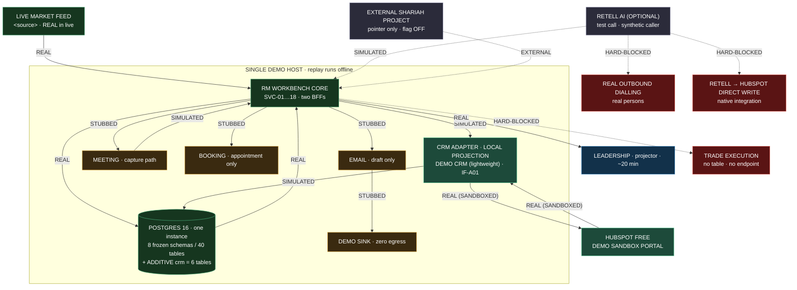
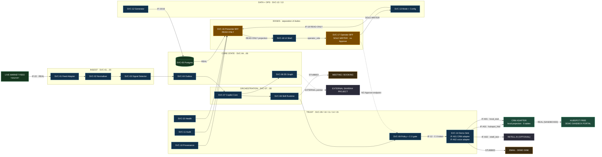
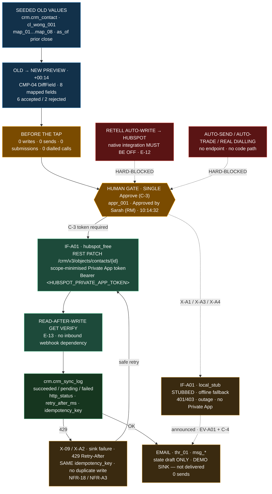
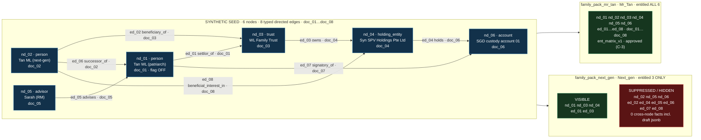
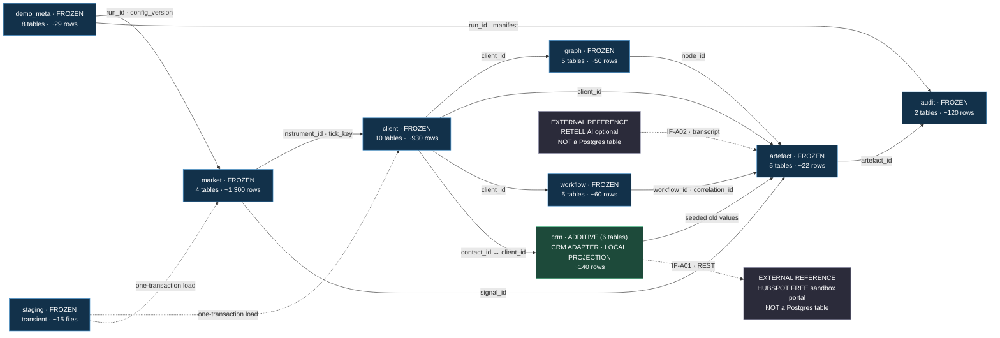
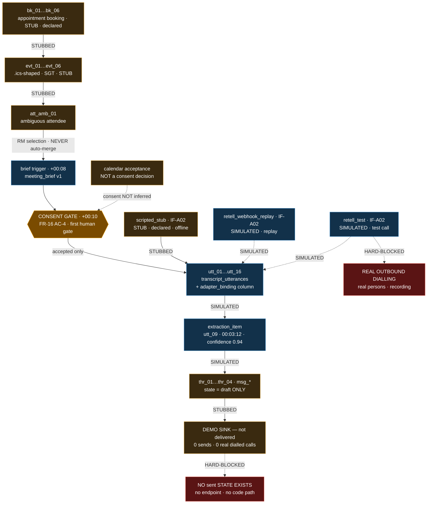
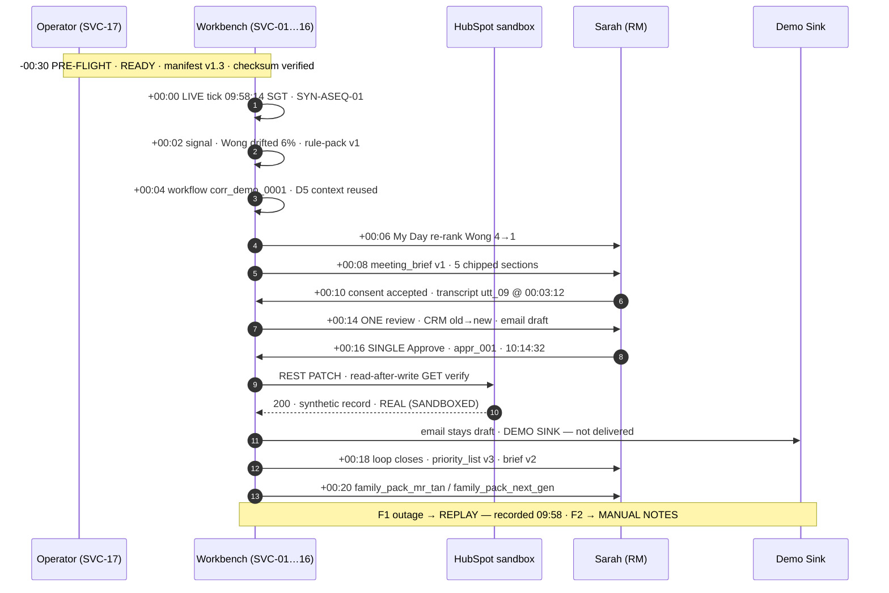
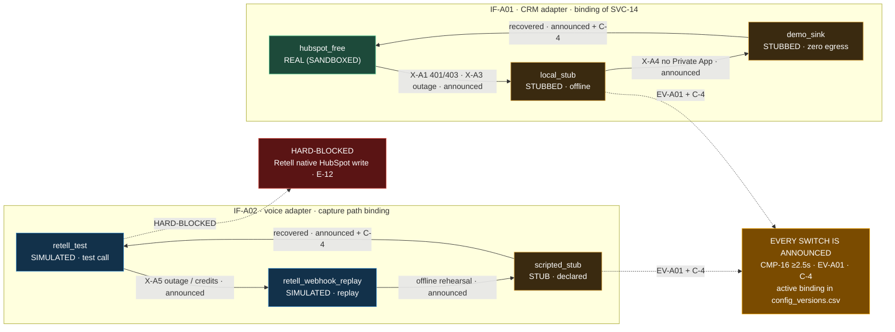

# Demo Data & Systems Architecture Enhancement — RM Workbench MVP (Leadership Journey Demo)

**Phase B deliverable (addendum) · Author:** Gao Jianyuan (高见远), Solution Architect, software-dev-team
**Consumer:** Qi Huolin (team lead) → Phase C assembly. English throughout.
**Status:** **DESIGN ONLY.** No application code, no runnable generator, no scaffold, no build commands, no executed DDL, no vendor account opened, no credentials created. DDL text, CSV/JSON sample rows, Mermaid diagrams and config examples in this document are **specification and data artefacts** (H1, H2) — they are the *specified output shape* of the generator, not a running generator and not a production migration.

---

## 1. Purpose, scope, evidence base and tags

### 1.1 Why this document exists

`[PRD]` The frozen design package specifies the fake-data **generator as a mechanism** (`03_Technical_Solution.md` §7) but never shows the fake **data**. Alan's verbatim request (`10_Data_Enhancement_Brief.md` §1) asks for the data world and the surrounding systems to be made *visible* to company senior leadership during a ~20-minute demo of an "envisioned journey". This document closes that gap by making concrete: six diagram families, a six-table CRM adapter, a six-node sampled relationship graph, meeting / booking / email datasets, the external Shariah boundary, a journey→data map, and the generator seed-pack specification.

A ratified amendment (`14_Vendor_Adapter_Ruling_HubSpot_Retell.md`, E-9…E-14; `10_Data_Enhancement_Brief.md` §8) adds a **real external CRM sandbox (HubSpot Free)** and an **optional voice agent (Retell AI)**. This is designed against, not re-litigated. §14 records the evidence, governance and conflicts resolved.

### 1.2 Boundary — what this does NOT do

- `[PRD]` No new product-design phase, no new screens/components, no re-run of Phase 2 (E-1). Frozen SCR-01…14 / CMP-01…16 / ST states are untouched.
- `[PRD]` Frozen artefacts stay frozen (E-7): **8 schemas / 40 tables**, `IF-01…22`, `EV-01…20`, `SVC-01…18`, `DF-01…06`, `NFR-1…18`, `ADR-01…08`, extension set {TimescaleDB, `file_fdw`}, `schema v1.3`, **`manifest v1.3`**, G8 DB `CHECK`, honesty taxonomy. The `crm` schema is **additive, architect-authored, flagged as syncing to Phase 4**. `manifest v1.3` is **NOT** bumped; any change that must enter it requires an explicit re-freeze note (§12).
- `[PRD]` Frozen IDs are **cited, never re-derived or renumbered**. Additive IDs use `IF-Axx` / `EV-Axx` / `NFR-Axx` / `X-Axx` / `D-H` (E-11).
- `[PRD]` This document creates **one** file only: `12_Demo_Data_and_Systems_Architecture_Enhancement.md`. The parallel deliverable `13_Demo_Seed_Pack.md` and the `demo_data/` directory belong to `seed-pack-author` and are **not created here** (§10).
- `[PRD]` Trade execution remains **HARD-BLOCKED**: no table, no endpoint, no code path (FR-20, G2, frozen §8.4).

### 1.3 Evidence base read in full

| Source | What is cited |
|---|---|
| `10_Data_Enhancement_Brief.md` | Alan's verbatim request (§1), gap analysis (§2), H1–H6 (§3), E-1…E-8 (§4), global rules (§7), **E-9…E-14 amendment (§8)** |
| `11_Demo_Data_Requirements_and_Intake.md` | Phase A: DDR-01…26 (§3), beat map (§2), surrounding systems + three booking readings (§4, §4.1), graph ACs (§5), DI-01…17 (§6), sensitivity rules (§7), traceability (§8), OQ-1…8 (§9) |
| `03_Technical_Solution.md` | **THE FREEZE LINE**: §1.4/§1.7, §2.2 (SVC-01…18), §3.1/§3.2/§3.6 (DF-01…06), §4.1 (8 schemas / 40 tables), §4.3 (C-1 7-column convention), §4.5/§4.6 DDL, §5 (extension set), §7 (generator), §8 (IF-01…22, C-1…C-5), §9 (NFR-1…18) |
| `RM_Workbench_MVP_Design_Package.md` | Executive entry point, honesty posture (§2), golden path / run-of-show (§2) |
| `04_Feature_Unit_Plan.md` | §9 "entity graph topology is the clearest gap"; FU-01 / FU-08 / FU-17 / FU-18 / FU-19…21 |
| `02_Product_Design_Specification.md` | §13.5(b) entity-graph topology gap; SCR-09 illustrative pack display copy |
| `01_Requirements_Specification.md` | FR-14 AC-3, FR-16 AC-4, FR-18/19/20/23, X-09, G1/G2/G7/G8/G11, C-1…C-5 |
| `14_Vendor_Adapter_Ruling_HubSpot_Retell.md` | **Authoritative**: H-1…H-7, R-1…R-6, G-1…G-7, **E-9…E-16** (§5 now includes the E-15/E-16 precedence note), §6 architecture delta, §7 Phase A amendments, §8 DI-18…25 / OQ-9…13, §9 go/no-go, §10 freeze note |

### 1.4 Tag legend

| Tag | Meaning |
|---|---|
| `[PRD]` | Verifiable in the frozen package or in a ratified lead ruling. |
| `[INFERENCE]` | My reasoned derivation; challengeable, not a fact. |
| `[ASSUMPTION]` | Default adopted because not specified; needs Alan's confirmation. All sample values, volumes and synthetic names below are `[ASSUMPTION]` and demo-scale (E-6). |

`[EVIDENCE]` / `[EVIDENCE · first-party]` / `[EVIDENCE · vendor-adjacent]` / `[CONFLICTING]` / `[UNVERIFIED]` in §14 are the **evidence grades of the ruling** (`14_…` §11), used only where the vendor/regulatory evidence is being restated; they are additional to the three document tags above, not replacements for them.

---

## 2. Canonical synthetic seed world

### 2.1 Binding seed registry — restated verbatim

`[PRD]` Lead-authored. Reproduced verbatim; these EXACT keys are used in every diagram, DDL specification and example in this document, and must be identical in `13_Demo_Seed_Pack.md` / `demo_data/`.

| Item | Binding value |
| Seed | one numeric seed `20261105`; generator id `RM-WB-DEMO-v1.3`; `splitmix64` namespaced sub-seeds |
| World anchor | `world_as_of = 2026-11-05T17:00:00+08:00` (prior close, SGT) |
| Demo clock | live tick `2026-11-06 09:58:14 SGT`; single Approve `10:14:32 SGT` |
| Base | SGD / Singapore / SGT / English; minority HKD and USD |
| RM | `rm_sarah` → display "Sarah (RM)" |
| Primary client | `cl_wong_001` → synthetic HNWI "Wong" (matches frozen line "Wong portfolio drifted 6% from target") |
| Secondary clients | `cl_lim_002` (F2 consent-declined variant), `cl_tan_003` (+00:20 family-graph range beat) |
| Drift instrument | `ins_syn_asean_eq_01`, invented symbol `SYN-ASEQ-01`, SGD; its tick breaches the 6% drift threshold |
| Instrument universe | `ins_syn_*` × 30–60; NO real issuer, bank or vendor names anywhere |
| Market source | `<source>` versioned placeholder (OD-7/8); replay label `REPLAY — recorded 09:58`; never name a vendor |
| CRM schema | EXACTLY 6 tables in a distinct `crm` schema inside the single Postgres instance: `crm.crm_contact`, `crm.crm_interaction`, `crm.crm_task`, `crm.crm_opportunity`, `crm.crm_field_mapping`, `crm.crm_sync_log` |
| CRM join key | `crm.crm_contact.contact_id` ↔ `client.client.client_id`; Wong row = `cl_wong_001` |
| CRM write-back | 5–8 versioned field mappings `map_01…map_08`; `idempotency_key = approval_token + field_mapping_version`; `crm_sync_log` states `succeeded` / `pending` / `failed` |
| Booking | appointment booking only; `bk_01…bk_06`; readings (ii)/(iii) documented, no tables |
| Meeting | `evt_01…evt_06` (.ics-shaped, SGT); one Wong 10:00 meeting; ≥1 deliberately ambiguous attendee `att_amb_01` |
| Transcript | `utt_01…utt_16`, speaker-labelled, `timestamp_offset` HH:MM:SS; "daughter should join" fact at `00:03:12`, `confidence 0.94` |
| Email | `thr_01…thr_04`, messages `msg_*`; state `draft` ONLY — no `sent` state exists; `DEMO SINK — not delivered` |
| Graph | EXACTLY 6 nodes `nd_01…nd_06`; 8 edges `ed_01…ed_08`; ≥3 node classes from {person, trust, holding_entity, advisor, account}; ≥3 directed edge types; source-doc refs `doc_01…doc_08` |
| Graph entitlement | two attendee classes `Mr_Tan` (entitled all 6 nodes) and `Next_gen` (entitled `nd_01, nd_03, nd_04` only); matrix `ent_matrix_v1`; packs `family_pack_mr_tan` + `family_pack_next_gen` differing EXACTLY on the entitlement boundary; 0 cross-node facts incl. hidden/draft jsonb |
| Artefacts | `priority_list` v1→v3, `meeting_brief` v1→v2, `post_meeting_review`, `family_pack` ×2; one immutable C-3 token `appr_001` — "Approved by Sarah (RM) · 10:14:32" |
| Workflow | one `correlation_id = corr_demo_0001` spanning tick → signal → brief → review → approval → re-rank |
| Synthetic marker | every row `synthetic_marker = 'SYNTHETIC DEMO DATA'`; C-1 envelope (`source_id, source_kind, as_of, ingested_at, confidence, mode, version_stamp`) non-null on every stored fact |
| Honesty | REAL (live tick) / SIMULATED (scripted transcript, seeded world) / STUBBED (CRM, meeting, booking, email demo sink) / EXTERNAL (Shariah project) / HARD-BLOCKED (trade execution). No `sent`, no `LIVE` while bound to replay (G8 DB CHECK), 0 sends, 0 trades. |

**Ratified amendment to the registry (E-9/E-10, additive note, NOT a silent substitution).** The two CRM-related rows above remain verbatim. E-9 **re-purposes** the 6-table `crm` schema: it is now the **CRM ADAPTER · LOCAL PROJECTION**, not the CRM itself. `[PRD]` External CRM = `HUBSPOT FREE · DEMO SANDBOX PORTAL` holding 100% synthetic records; `DEMO CRM (lightweight)` now denotes the **adapter**. E-10 adds the qualifier **`REAL (SANDBOXED)`** (real vendor service + synthetic records + no real person contacted) **without creating a fifth top-level honesty category**, plus three measurable counters: **0 real dialled calls / 0 real client-facing sends / 0 real PII**. A post-Approve sandbox CRM write is permitted and must be declared on stage; it is **not** a "send". `[PRD]` Retell AI is OPTIONAL (E-14) with posture `SIMULATED (Retell test call · synthetic caller · 0 real dialled calls)`. OQ-8's "labelled stubs only" default is **superseded for CRM** but still applies to meeting / booking / email (`14_…` §7).

### 2.2 Why one seed + parent-derived keys keeps the demo honest and resettable

1. `[PRD]` One numeric seed `20261105` through `splitmix64(seed_hash, domain)` namespaced sub-seeds makes every entity family **order-independently derivable** (`03` §7.2): generation order can change without a single row changing, so G4 reproducibility and the `dataset_checksum` survive refactors (NFR-3).
2. `[PRD]` Parent-derived keys (`client_id → account.client_id → holding.account_id`) make referential integrity hold **by construction**; the generator never "invents a parent record" on a broken reference, which is exactly what X-20's fail-loud behaviour depends on (G6, NFR-17).
3. `[PRD]` Deterministic `as_of = world_as_of + det_offset(seed, domain, i)` with `ingested_at` excluded from checksums means two runs are byte-identical; a leader can ask for a regenerate-to-scratch comparison on SCR-13 and get the same checksum (G4/G5).
4. `[PRD]` Because the whole world is one deterministic FK-clean graph, Reset is truncate-and-reload from the frozen flat-file baseline inside **one transaction** with `SET CONSTRAINTS ALL DEFERRED`, comfortably inside **≤60s** (NFR-9/G10), with the append-only audit archive structurally excluded.
5. `[INFERENCE]` Honesty is the point, not just reproducibility: a single declared seed makes it impossible to quietly "top up" the demo world with a plausible-looking real record between rehearsals. Every row carries `synthetic_marker` + the 7-column C-1 envelope, so `0 real PII` is a queryable property, not a promise. Under E-9 the same discipline extends to the sandbox portal: reset re-seeds it **by external ID** (§10), so no stale real-looking record survives a run.

---

## 3. Diagram families (D-A … D-F, optional D-G, new D-H)

`[PRD]` Posture colours are consistent across all eight diagrams: green = REAL, teal = REAL (SANDBOXED), blue = SIMULATED, amber = STUBBED, purple = EXTERNAL, red = HARD-BLOCKED / suppressed. Labels are short and projector-legible; every diagram is followed by 2–4 lines stating what a leader should notice and which honesty label applies.

### D-A · System / context architecture



**What a leader should notice.** The Postgres box still says **8 frozen schemas / 40 tables** — the `crm` schema is drawn as an explicitly **additive** sixth-table projection, not a rewrite of the frozen data model. The only genuinely external runtime dependency on the primary path is the optional `LIVE` feed; everything else is labelled.
**Honesty label.** `REAL` for feed / Postgres / workbench; `REAL (SANDBOXED)` for the HubSpot sandbox portal (the E-10 qualifier, **not** a fifth category); `SIMULATED` for the seeded projection and the optional Retell test call; `STUBBED` for meeting / booking / email / demo sink; `EXTERNAL` for the Shariah pointer; `HARD-BLOCKED` in red for real dialling, Retell→HubSpot direct writes and trade execution.

### D-B · Component / systems view



**What a leader should notice.** There are **no new SVC IDs** (E-11): `IF-A01` / `IF-A02` are *bindings* of SVC-14 and the capture path, drawn inside the existing Demo Sink box. The separation-of-duties boundary is visually unbroken — SVC-16 is READ-ONLY, SVC-17 is SOLE WRITER, and the only edge to the C-3 gate from the operator side is a dashed **"NO Approve endpoint"** line.
**Honesty label.** External vendor edges are `REAL (SANDBOXED)` (HubSpot) and `SIMULATED` (Retell); meeting/booking/email remain `STUBBED`; the Shariah project is `EXTERNAL` and pointer-only. Frozen components stay `REAL`/`SIMULATED` exactly as in `03` §2.2.

### D-C · CRM interaction (rewritten for E-9 / E-12 / E-13)



**What a leader should notice.** Nothing leaves the workbench until the **one** Approve tap; then the write is a real REST PATCH into a sandbox portal, **verified by a read-after-write GET** (E-13) rather than trusted on a `200`. A `429` produces a retry with the **same** idempotency key, never a second write (NFR-18 / NFR-A3). The `local_stub` branch means the whole journey still runs offline.
**Honesty label.** `SIMULATED` for seeded old values and the preview; `REAL (SANDBOXED)` for the PATCH + GET verification — declared on stage as `CRM write-back → sandbox portal (synthetic records)`, explicitly **not** a "send"; `STUBBED` for `local_stub` and the email draft; `HARD-BLOCKED` in red for the Retell→HubSpot native write (E-12) and for auto-send / auto-trade / real dialling.

### D-D · Sampled relationship graph (SYNTHETIC SEED)



**What a leader should notice.** Exactly **6 nodes**, **8 typed directed edges**, five distinct node classes and eight distinct edge types, each with a `doc_*` reference. The two packs are generated from the **same** seed and differ **exactly** on the entitlement boundary — that is the whole G7 proof. This is a **SYNTHETIC SEED**, not research on a "canonical Tan family" (E-5).
**Honesty label.** `SIMULATED` throughout (100% synthetic, C-1 on every node/edge/doc). Hidden/suppressed nodes are drawn red so a leader can see the boundary being enforced rather than taking it on trust; enforcement is in **SVC-06 context assembly**, not in the UI (FR-06 / NFR-13).

### D-E · Demo-data entity landscape



**What a leader should notice.** Eight **blue frozen** schemas (40 tables) plus **one teal additive** `crm` schema — the freeze line is intact. HubSpot and Retell appear as **dashed purple EXTERNAL REFERENCES marked "NOT a Postgres table"**: no vendor object becomes a new table, and no extension beyond {TimescaleDB, `file_fdw`} is introduced (E-7, `14_…` §10).
**Honesty label.** `REAL` for the frozen Postgres state; `SIMULATED` for all seeded rows; `REAL (SANDBOXED)` / `SIMULATED` for the two dashed external references. Row counts are `[ASSUMPTION]` demo-scale values (E-6). The full table/entity map with approximate row counts follows.

| Schema | Tables (frozen names) | Approx. rows `[ASSUMPTION]` | FK highlights |
|---|---|---:|---|
| `demo_meta` | `version_registry`, `config_version`, `scenario`, `generator_manifest`, `integrity_report`, `demo_run`, `demo_mode_state`, `feed_status` | 10 / 10 / 4 / 1 / 1 / 1 / 1 / 1 | `run_id` → `audit`; `config_version` → market thresholds |
| `market` | `instrument`, `market_tick` (hypertable), `market_signal`, `news_item` | 48 / 1 200 + 1 live / 1 / 60 | `instrument_id` → `client.holding`; `tick_key` logical → signal |
| `client` | `client`, `rm_book`, `account`, `holding`, `allocation_target`, `product`, `interaction`, `consent_state`, `suitability_state`, `crm_record` | 42 / 42 / 110 / 310 / 200 / 30 / 120 / 42 / 42 / 8 | `client_id` → `graph` / `artefact` / `workflow` / `crm` |
| `graph` | `memory_fact`, `graph_node`, `graph_edge`, `entitlement_rule`, `entitlement_decision` | 18 / **6** / **8** / 12 / 8 | `node_id` → `artefact`; `client_id` → `client.client` |
| `workflow` | `workflow_instance`, `workflow_stage`, `skill_invocation`, `outbox_event`, `outbox_consumer` | 1 / 4 / 12 / 20 / 20 | `correlation_id = corr_demo_0001` spans the loop |
| `artefact` | `artefact`, `artefact_version`, `approval_token`, `extraction_item`, `demo_sink_message` | 5 / 8 / **1** / 6 / 2 | `artefact_id` → `audit`; `approval_token_id = appr_001` |
| `audit` | `audit_event`, `audit_archive` | ~120 / 1 | append-only; never truncated on reset |
| `staging` | `staging.*` (manifest-declared FDW foreign tables, dropped after commit) | ~15 files | `file_fdw` CSV twins for G5 `EXCEPT` checks |
| **`crm` (ADDITIVE)** | **`crm_contact`, `crm_interaction`, `crm_task`, `crm_opportunity`, `crm_field_mapping`, `crm_sync_log`** | 42 / 60 / 18 / 8 / 8 / 8 | `contact_id` ↔ `client.client.client_id`; `mapping_id` → `crm_sync_log` |

### D-F · Meeting / booking / email interaction



**What a leader should notice.** Booking → event → brief → **consent gate** → transcript → extraction → draft → sink. `att_amb_01` forces **RM selection, never auto-merge** (FR-14 AC-3), and calendar acceptance is explicitly drawn as **not** a consent decision (FR-16 AC-4). Three transcript bindings feed the same `utt_01…utt_16` shape, so the golden path runs with Retell OFF.
**Honesty label.** `STUBBED` for booking / events / email / sink (with `STUB · declared` on the scripted transcript); `SIMULATED` for the Retell test call / replay and the seeded utterances; `HARD-BLOCKED` for a `sent` state and for real outbound dialling. Posture chip at +00:10 is binding-dependent (§9).

### D-G · Journey sequence with beat timings (optional)



**What a leader should notice.** Exactly one `correlation_id`, exactly one Approve, and the vendor write is a **declared, verified** step rather than an invisible side effect. F1/F2 are rehearsed degradations, not alternative happy paths.
**Honesty label.** `REAL` for the live tick and Postgres loop; `REAL (SANDBOXED)` for the HubSpot PATCH/GET; `SIMULATED` for the seeded review content; `STUBBED` for the demo sink.

### D-H · Adapter binding state diagram (new, E-11)



**What a leader should notice.** Two adapters, three announced bindings each, and **no new SVC IDs**. The `local_stub` + `scripted_stub` pair is a first-class rehearsal target, not a panic button — the demo runs fully offline there (E-14, NFR-A3). The active binding is a versioned config row, never an operator's memory.
**Honesty label.** `REAL (SANDBOXED)` → `SIMULATED` → `STUBBED` as the bindings degrade; every arrow is an **announced BETWEEN-RUN switch** with an `EV-A01` + C-4 audit event (E-11), **never a mid-call switch** (E-15 — one call = one binding, all 16 utterances share one binding), and the Retell native write is `HARD-BLOCKED`.

---

## 4. Lightweight CRM specification — `CRM ADAPTER · LOCAL PROJECTION` (exactly 6 tables)

### 4.1 Boundary (E-9, E-4 amended)

`[PRD]` Every on-stage reference to the six tables below is visibly labelled **`DEMO CRM (lightweight)`**, which under E-9 means the **adapter**, not the external CRM. External system label = **`HUBSPOT FREE · DEMO SANDBOX PORTAL`**. The adapter lives in a **distinct `crm` schema inside the single Postgres 16 instance**; it is a **stand-in for the local projection + field mapping + idempotency/outbox ledger**, and **NOT a vendor integration**. The real CRM is an external sandbox; the email/SMS channel remains the frozen `artefact.demo_sink_message` **demo sink** with zero egress. `[PRD]` 8 frozen schemas / 40 tables are unchanged; `manifest v1.3` is NOT bumped (§12).

**Re-purposed role of each table (E-9):**

| Table | Re-purposed role |
|---|---|
| `crm.crm_contact` | **Local projection** of sandbox `contacts` — seeded old values for the old→new preview |
| `crm.crm_interaction` | **Local projection** of sandbox activities — seeded interaction history for the five-section brief |
| `crm.crm_task` | **Local projection** of sandbox `tasks` — post-Approve follow-up task |
| `crm.crm_opportunity` | **Local projection** of sandbox `deals` — reference history, single pipeline |
| `crm.crm_field_mapping` | **Local only** — versioned `map_01…map_08`, ≤10 custom properties, idempotency rule |
| `crm.crm_sync_log` | **Local only** — outbox / idempotency ledger, `succeeded` / `pending` / `failed` |

### 4.2 Object mapping (`14_…` §6.1) and the free-tier ceiling

| Local `crm` table | HubSpot object | Direction | Notes |
|---|---|---|---|
| `crm.crm_contact` | `contacts` | in (projection) / out (write-back) | `contact_id` ↔ `cl_wong_001`; synthetic `@demo.invalid` emails |
| `crm.crm_interaction` | activities: `notes`, `calls`, `emails`, `meetings` | in | Seeded interaction history for the brief |
| `crm.crm_task` | `tasks` | in / out | Post-Approve follow-up task |
| `crm.crm_opportunity` | `deals` (single pipeline) | in | 1 pipeline only on Free |
| `crm.crm_field_mapping` | **local only** | — | `map_01…map_08`, ≤10 custom properties, version-stamped |
| `crm.crm_sync_log` | **local only** | — | outbox, `idempotency_key`, `succeeded`/`pending`/`failed`, `http_status`, `retry_after_ms` |

`[PRD]` E-13 / H-5: **≤10 custom properties** on HubSpot Free; the eight mapped fields occupy slots 1–8, all remaining fields map to **standard** HubSpot properties. Free-tier caps robust across conflicting sources = 1 deal pipeline, 10 custom properties, limited/no automation, HubSpot branding; 30–50 synthetic contacts sit under every published contact cap. `[PRD]` All orchestration stays in the workbench — the free tier has no real automation. `[PRD]` No inbound HubSpot webhooks are used (H-4); workflow webhook actions require ~US$800/month Professional and are explicitly out of scope.

### 4.3 DDL preamble

```sql
-- 采用独立 crm schema：边界必须在图与 DDL 中同样可见（E-9 / E-7）
CREATE SCHEMA IF NOT EXISTS crm;

-- 约定：每个表都带 7 列 C-1 溯源封套 + synthetic_marker（G6 / FR-31 / A1）
-- WHY：不采用复合类型，NULL 复合值会隐藏"部分缺失"的封套，见 03 §4.3
```

`[PRD]` Types `demo_meta.source_kind_enum` and `demo_meta.mode_enum` are the frozen enum types from `03` §4.3; no new enum is introduced. **Physical-key clarification (additive, §4.10 deviation 1):** the binding registry names `crm.crm_contact.contact_id` ↔ `client.client.client_id` as the **logical join key**, with the Wong row = `cl_wong_001`. Because `03` §4.5 freezes `client.client.client_id` as `uuid`, `crm.crm_contact.contact_id` is specified as `text` (the human-legible, projector-visible registry key) and a `client_id_uuid uuid` column carries the physical `REFERENCES client.client(client_id) DEFERRABLE INITIALLY DEFERRED` FK. The seed pack derives the UUID from `splitmix64(20261105, 'cl_wong_001')`, so the two views of the join are 1:1 and deterministic.

All sample rows below carry `synthetic_marker = 'SYNTHETIC DEMO DATA'` and all seven C-1 columns non-null (omitted from the compact sample tables for legibility; present in every emitted file). C-1 values on seeded rows: `source_id = 'gen:20261105:crm.<table>:<pk>'`, `source_kind='seeded'`, `as_of = world_as_of`, `confidence=1.0`, `mode='seed'`, `version_stamp='schema v1.3'`.

### 4.4 `crm.crm_contact` — local projection of sandbox `contacts`

**PURPOSE.** Holds the seeded **old values** for `cl_wong_001` and the two secondary clients, so the +00:14 old→new preview has a real "before" state; also the local target of the post-Approve write-back projection.

```sql
CREATE TABLE crm.crm_contact (
  contact_id              text PRIMARY KEY,          -- binding registry key, e.g. 'cl_wong_001'
  client_id_uuid          uuid NOT NULL REFERENCES client.client(client_id) DEFERRABLE INITIALLY DEFERRED,
  hubspot_object_id       text,                      -- external ID for reset re-seed by external ID (§10)
  display_name            text NOT NULL,
  email                   text NOT NULL,             -- synthetic @demo.invalid only
  segment                 text NOT NULL,
  base_currency           text NOT NULL DEFAULT 'SGD',
  rm_id                   text NOT NULL DEFAULT 'rm_sarah',
  next_meeting_preference text,
  preferred_contact_channel text,
  risk_profile            text,
  next_review_date        date,
  last_meeting_summary    text,
  family_attendee_preference text,
  task_owner              text,
  email_consent           boolean NOT NULL DEFAULT true,
  source_id               text NOT NULL,
  source_kind             demo_meta.source_kind_enum NOT NULL,
  as_of                   timestamptz NOT NULL,
  ingested_at             timestamptz NOT NULL DEFAULT now(),
  confidence              numeric(4,3) CHECK (confidence BETWEEN 0 AND 1),
  mode                    demo_meta.mode_enum NOT NULL,
  version_stamp           text NOT NULL,
  synthetic_marker        text NOT NULL DEFAULT 'SYNTHETIC DEMO DATA',
  created_at              timestamptz NOT NULL DEFAULT now()
);
```

| contact_id | display_name | email | segment | base_currency | next_meeting_preference | preferred_contact_channel | hubspot_object_id |
|---|---|---|---|---|---|---|---|
| `cl_wong_001` | Wong | `wong@demo.invalid` | HNWI | SGD | Quarterly call | phone | `hs_ct_001` |
| `cl_lim_002` | Lim | `lim@demo.invalid` | Mass affluent | HKD | Semi-annual call | email | `hs_ct_002` |
| `cl_tan_003` | Tan | `tan@demo.invalid` | HNWI | SGD | Family review | email | `hs_ct_003` |

### 4.5 `crm.crm_interaction` — local projection of sandbox activities

**PURPOSE.** Seeded call/meeting/email/note history per contact; feeds the "recent interactions & open actions" section of `meeting_brief` v1 with ≥3 resolvable chips for Wong (DDR-05).

```sql
CREATE TABLE crm.crm_interaction (
  interaction_id   text PRIMARY KEY,
  contact_id       text NOT NULL REFERENCES crm.crm_contact(contact_id) DEFERRABLE INITIALLY DEFERRED,
  hubspot_activity_id text,
  kind             text NOT NULL CHECK (kind IN ('call','meeting','email','note')),
  subject          text NOT NULL,
  occurred_at      timestamptz NOT NULL,
  direction        text NOT NULL DEFAULT 'inbound',
  source_id        text NOT NULL,
  source_kind      demo_meta.source_kind_enum NOT NULL,
  as_of            timestamptz NOT NULL,
  ingested_at      timestamptz NOT NULL DEFAULT now(),
  confidence       numeric(4,3) CHECK (confidence BETWEEN 0 AND 1),
  mode             demo_meta.mode_enum NOT NULL,
  version_stamp    text NOT NULL,
  synthetic_marker text NOT NULL DEFAULT 'SYNTHETIC DEMO DATA',
  created_at       timestamptz NOT NULL DEFAULT now()
);
```

| interaction_id | contact_id | kind | subject | occurred_at | hubspot_activity_id |
|---|---|---|---|---|---|
| `cri_01` | `cl_wong_001` | meeting | Q3 portfolio review | 2026-11-03 10:00:00+08 | `hs_ac_01` |
| `cri_02` | `cl_wong_001` | call | Allocation check-in | 2026-10-21 15:30:00+08 | `hs_ac_02` |
| `cri_03` | `cl_lim_002` | email | Statement delivered | 2026-10-30 09:00:00+08 | `hs_ac_03` |
| `cri_04` | `cl_tan_003` | note | Family structure docs reviewed | 2026-11-04 16:00:00+08 | `hs_ac_04` |

### 4.6 `crm.crm_task` — local projection of sandbox `tasks`

**PURPOSE.** Holds the post-Approve follow-up task ("daughter to join next review") so the loop closure at +00:18 has a concrete CRM-side object; `status` never implies an outward send.

```sql
CREATE TABLE crm.crm_task (
  task_id          text PRIMARY KEY,
  contact_id       text NOT NULL REFERENCES crm.crm_contact(contact_id) DEFERRABLE INITIALLY DEFERRED,
  hubspot_task_id  text,
  subject          text NOT NULL,
  status           text NOT NULL DEFAULT 'open' CHECK (status IN ('open','done','cancelled')),
  due_at           timestamptz,
  owner_rm         text NOT NULL DEFAULT 'rm_sarah',
  source_id        text NOT NULL,
  source_kind      demo_meta.source_kind_enum NOT NULL,
  as_of            timestamptz NOT NULL,
  ingested_at      timestamptz NOT NULL DEFAULT now(),
  confidence       numeric(4,3) CHECK (confidence BETWEEN 0 AND 1),
  mode             demo_meta.mode_enum NOT NULL,
  version_stamp    text NOT NULL,
  synthetic_marker text NOT NULL DEFAULT 'SYNTHETIC DEMO DATA',
  created_at       timestamptz NOT NULL DEFAULT now()
);
```

| task_id | contact_id | subject | status | due_at | owner_rm |
|---|---|---|---|---|---|
| `crt_01` | `cl_wong_001` | Prepare Q4 rebalancing discussion | open | 2026-11-20 09:00:00+08 | `rm_sarah` |
| `crt_02` | `cl_wong_001` | Confirm next review date | open | 2026-11-10 09:00:00+08 | `rm_sarah` |
| `crt_03` | `cl_tan_003` | Assemble entitled family packs | open | 2026-11-06 13:00:00+08 | `rm_sarah` |

### 4.7 `crm.crm_opportunity` — local projection of sandbox `deals`

**PURPOSE.** A single-pipeline opportunity history for the "material changes" brief section. `stage` stops at `handoff_blocked`: there is **no** order, no submission and no execution path (FR-20, HARD-BLOCKED).

```sql
CREATE TABLE crm.crm_opportunity (
  opportunity_id   text PRIMARY KEY,
  contact_id       text NOT NULL REFERENCES crm.crm_contact(contact_id) DEFERRABLE INITIALLY DEFERRED,
  hubspot_deal_id  text,
  pipeline_id      text NOT NULL DEFAULT 'demo_pipeline_01',  -- Free tier: exactly 1 pipeline
  name             text NOT NULL,
  stage            text NOT NULL CHECK (stage IN ('discovery','review','handoff_blocked')),
  value_sgd        numeric(20,2),
  execution_note   text NOT NULL DEFAULT 'execution disabled',
  source_id        text NOT NULL,
  source_kind      demo_meta.source_kind_enum NOT NULL,
  as_of            timestamptz NOT NULL,
  ingested_at      timestamptz NOT NULL DEFAULT now(),
  confidence       numeric(4,3) CHECK (confidence BETWEEN 0 AND 1),
  mode             demo_meta.mode_enum NOT NULL,
  version_stamp    text NOT NULL,
  synthetic_marker text NOT NULL DEFAULT 'SYNTHETIC DEMO DATA',
  created_at       timestamptz NOT NULL DEFAULT now()
);
```

| opportunity_id | contact_id | name | stage | value_sgd | execution_note |
|---|---|---|---|---|---|
| `cro_01` | `cl_wong_001` | ASEAN equity sleeve review | review | 250000.00 | execution disabled |
| `cro_02` | `cl_tan_003` | Trust structure review | discovery | 1200000.00 | execution disabled |
| `cro_03` | `cl_lim_002` | HKD savings review | handoff_blocked | 80000.00 | execution disabled |

### 4.8 `crm.crm_field_mapping` — local only, versioned, ≤10 custom properties

**PURPOSE.** The versioned contract between workbench fields and HubSpot properties. `[PRD]` DI-06 is upgraded by `14_…` §7: each row names `hubspot_property`, `object_type`, `writable`, `custom_property_slot` (1–10), `idempotency_key`, `transform`, `version`. **Idempotency rule (binding registry, restated verbatim):** `idempotency_key = approval_token + field_mapping_version`. `[INFERENCE]` Physical disambiguation note: because one immutable token `appr_001` produces **6 accepted writes** at one `field_mapping_version`, the physical key appends `mapping_id` so each field has its own unique ledger entry — `idempotency_key = approval_token || ':' || field_mapping_version || ':' || mapping_id`. This is an additive physical clarification, not a change to the binding rule; without it all six writes would collapse into one (§4.10 deviation 2).

```sql
CREATE TABLE crm.crm_field_mapping (
  mapping_id           text PRIMARY KEY,           -- 'map_01' … 'map_08'
  source_field         text NOT NULL,
  hubspot_property     text NOT NULL,
  object_type          text NOT NULL DEFAULT 'contacts',
  writable             boolean NOT NULL DEFAULT true,
  custom_property_slot smallint CHECK (custom_property_slot BETWEEN 1 AND 10),
  idempotency_rule     text NOT NULL,
  transform            text NOT NULL,
  field_mapping_version text NOT NULL,
  active               boolean NOT NULL DEFAULT true,
  source_id            text NOT NULL,
  source_kind          demo_meta.source_kind_enum NOT NULL,
  as_of                timestamptz NOT NULL,
  ingested_at          timestamptz NOT NULL DEFAULT now(),
  confidence           numeric(4,3) CHECK (confidence BETWEEN 0 AND 1),
  mode                 demo_meta.mode_enum NOT NULL,
  version_stamp        text NOT NULL,
  synthetic_marker     text NOT NULL DEFAULT 'SYNTHETIC DEMO DATA',
  created_at           timestamptz NOT NULL DEFAULT now(),
  UNIQUE (field_mapping_version, mapping_id)
);
```

| mapping_id | source_field | hubspot_property | writable | custom_property_slot | field_mapping_version |
|---|---|---|---|---|---|
| `map_01` | `next_meeting_preference` | `next_meeting_preference` | true | 1 | `fmv_20261105_1` |
| `map_02` | `preferred_contact_channel` | `preferred_contact_channel` | true | 2 | `fmv_20261105_1` |
| `map_03` | `risk_profile` | `risk_profile` | true | 3 | `fmv_20261105_1` |
| `map_04` | `next_review_date` | `next_review_date` | true | 4 | `fmv_20261105_1` |
| `map_05` | `last_meeting_summary` | `last_meeting_summary` | true | 5 | `fmv_20261105_1` |
| `map_06` | `family_attendee_preference` | `family_attendee_preference` | true | 6 | `fmv_20261105_1` |
| `map_07` | `task_owner` | `task_owner` | true | 7 | `fmv_20261105_1` |
| `map_08` | `email_consent` | `email_consent` | false | 8 | `fmv_20261105_1` |

`idempotency_rule` value on every row: `approval_token + field_mapping_version (+ mapping_id disambiguator)`. Slots 9 and 10 are **reserved and unused**; any further field must map to a standard property (E-13 / H-5).

### 4.9 `crm.crm_sync_log` — local only, idempotency / outbox ledger

**PURPOSE.** Records every attempted external write, its HTTP outcome, retry state and immutable idempotency key. `[PRD]` Extended per `14_…` §6.1 with `http_status`, `retry_after_ms`, `idempotency_key`; states are exactly `succeeded` / `pending` / `failed` (no `sent`).

```sql
CREATE TABLE crm.crm_sync_log (
  sync_id              text PRIMARY KEY,
  mapping_id           text NOT NULL REFERENCES crm.crm_field_mapping(mapping_id) DEFERRABLE INITIALLY DEFERRED,
  contact_id           text NOT NULL REFERENCES crm.crm_contact(contact_id) DEFERRABLE INITIALLY DEFERRED,
  approval_token_ref   text NOT NULL,              -- immutable C-3 token 'appr_001'; logical ref to artefact.approval_token
  field_mapping_version text NOT NULL,
  idempotency_key      text NOT NULL UNIQUE,       -- NFR-18: retried approval = exactly one effect
  adapter_binding      text NOT NULL CHECK (adapter_binding IN ('hubspot_free','local_stub','demo_sink')),
  old_value            text,
  new_value            text,
  state                text NOT NULL CHECK (state IN ('succeeded','pending','failed')),
  http_status          integer,
  retry_after_ms       integer,
  attempt_no           integer NOT NULL DEFAULT 1,
  error_code           text,
  attempted_at         timestamptz NOT NULL DEFAULT now(),
  source_id            text NOT NULL,
  source_kind          demo_meta.source_kind_enum NOT NULL,
  as_of                timestamptz NOT NULL,
  ingested_at          timestamptz NOT NULL DEFAULT now(),
  confidence           numeric(4,3) CHECK (confidence BETWEEN 0 AND 1),
  mode                 demo_meta.mode_enum NOT NULL,
  version_stamp        text NOT NULL,
  synthetic_marker     text NOT NULL DEFAULT 'SYNTHETIC DEMO DATA',
  created_at           timestamptz NOT NULL DEFAULT now()
);
CREATE INDEX ix_sync_contact_state ON crm.crm_sync_log(contact_id, state, attempted_at DESC);
```

Sample rows — a **post-Approve replay snapshot at 10:14:32 SGT**, NOT the pre-flight state. `[PRD]` At −00:30 this table is **empty** and 0 external writes exist (G2).

| sync_id | mapping_id | idempotency_key | adapter_binding | state | http_status | retry_after_ms | attempt_no | error_code |
|---|---|---|---|---|---|---|---|---|
| `sync_01` | `map_01` | `appr_001:fmv_20261105_1:map_01` | `hubspot_free` | succeeded | 200 | NULL | 1 | NULL |
| `sync_02` | `map_02` | `appr_001:fmv_20261105_1:map_02` | `hubspot_free` | succeeded | 200 | NULL | 1 | NULL |
| `sync_03` | `map_03` | `appr_001:fmv_20261105_1:map_03` | `hubspot_free` | failed | 429 | 3000 | 1 | `429 Retry-After` |
| `sync_04` | `map_04` | `appr_001:fmv_20261105_1:map_04` | `hubspot_free` | pending | NULL | NULL | 1 | NULL |

`[PRD]` The X-A2 safe retry **UPDATEs the same `sync_03` row** (`attempt_no → 2`, `state → succeeded`, `http_status → 200`) keyed by the unchanged `idempotency_key`; it never INSERTs a second row. `crm_field_mapping` and `crm_sync_log` are **local only** and are never projected to HubSpot objects (§4.2).

### 4.10 Physical clarifications (explicit deviations, additive only)

Two places where a literally executable specification needs one more physical detail than the binding registry supplies. Both are **additive clarifications**, not changes to any frozen artefact or registry key; both are reported in the hand-off.

| # | Binding rule | Physical clarification | Why |
|---|---|---|---|
| 1 | `crm.crm_contact.contact_id` ↔ `client.client.client_id`; Wong row = `cl_wong_001` (§2) | `crm.crm_contact.contact_id` is `text` (the projector-visible registry key) and a `client_id_uuid uuid` column carries the `REFERENCES client.client(client_id) DEFERRABLE INITIALLY DEFERRED` FK | `03` §4.5 freezes `client.client.client_id` as **`uuid`**; a `text`→`uuid` FK would not execute. The seed pack derives the UUID from `splitmix64(20261105, 'cl_wong_001')`, so the logical and physical joins are 1:1 and deterministic. |
| 2 | `idempotency_key = approval_token + field_mapping_version` (§2) | Physical key = `approval_token \|\| ':' \|\| field_mapping_version \|\| ':' \|\| mapping_id`, e.g. `appr_001:fmv_20261105_1:map_01` | One immutable C-3 token produces **six accepted writes** at one mapping version. Without the per-field disambiguator all six would share one `UNIQUE` key and collapse into a single effect, breaking FR-19/NFR-18. The literal registry rule is restated verbatim in §2 and §4.8; this is its physical disambiguation. |

`[PRD]` Neither clarification adds a table, a column to a frozen table, an extension, an SVC ID, an IF/EV renumbering, or a `manifest v1.3` bump.

---

## 5. CRM interaction dataflow narrative (DF-01…06 / SVC IDs / C-3 / X-09 / NFR-18)

### 5.1 Binding to frozen flows and services

| Stage | Frozen / additive anchor | What happens to the data |
|---|---|---|
| Seed old values | `DF-03` → `SVC-12` → `SVC-05`; `IF-15/16` | `crm.crm_contact`, `crm.crm_field_mapping` and `client.crm_record` are populated in the one-transaction load with `as_of` prior close, `source_kind='seeded'` |
| Brief / review | `DF-01` → `DF-06` → `SVC-06/07/08` | `SVC-08` (`crm.write` skill) emits `post_meeting_review` in C-2 `pending_review`; CMP-04 renders old→new |
| Preview & gate | `DF-02` → `SVC-09` (`IF-11`), `SVC-16` (read-only projection) | Per-item accept/edit/reject = **edits**, not approvals; single C-3 `appr_001` on the one Approve tap |
| Write-back | `DF-02` → `SVC-14` (`IF-12`, **`IF-A01`**) | REST PATCH → read-after-write GET → `crm.crm_sync_log` |
| Evidence & audit | `DF-05` → `SVC-10` / `SVC-11` (`IF-13/14`) | C-1 on every fact; C-4 for approval, write, retry, fallback and every read |
| Loop closure | `DF-02` step 8 → `SVC-07` | `EV-13 outcome.approved` → new `workflow_instance` → `priority_list` v3 + tomorrow's brief v2 |

`[PRD]` SVC-17 (Operator BFF, SOLE WRITER) has **no Approve endpoint** and never participates in this write path; separation of duties survives the vendor amendment (D-B, E-12).

### 5.2 Old → new preview at +00:14 (8 fields, exact values)

`cl_wong_001` · `field_mapping_version = fmv_20261105_1` · `as_of` prior close · evidence linked per item (FR-18 AC-2). All values are `[ASSUMPTION]` synthetic.

| # | mapping | CRM field (`hubspot_property`) | EXACT old value (seeded) | EXACT new value (proposed) | Evidence | Disposition |
|---|---|---|---|---|---|---|
| 1 | `map_01` | `next_meeting_preference` | `Quarterly call` | `Quarterly review with daughter present` | `utt_09` @ `00:03:12` | **accepted** |
| 2 | `map_02` | `preferred_contact_channel` | `phone` | `email` | `utt_11` @ `00:03:55` | **accepted** |
| 3 | `map_03` | `risk_profile` | `Balanced` | `Balanced — reviewed 2026-11-06` | `post_meeting_review` | **accepted** |
| 4 | `map_04` | `next_review_date` | `2027-02-05` | `2026-12-04` | `utt_13`/`utt_14` | **accepted** |
| 5 | `map_05` | `last_meeting_summary` | `Q3 portfolio review` | `6% drift discussed; daughter to join next review` | `utt_04`, `utt_09` | **accepted** |
| 6 | `map_06` | `family_attendee_preference` | `not recorded` | `Daughter to join` (`confidence 0.94`) | `utt_09` @ `00:03:12` | **accepted** |
| 7 | `map_07` | `task_owner` | `rm_sarah` | `rm_sarah` | no change | **rejected — unchanged** |
| 8 | `map_08` | `email_consent` | `true` | `true` | FR-16 AC-4, consent not inferred | **rejected — unchanged** |

`[PRD]` Six accepted writes; two rejected items generate **no** external write. `[PRD]` `map_08` is `writable=false`: consent is never inferred from calendar acceptance (FR-16 AC-4) and never auto-written by the adapter.

### 5.3 The single Approve and the idempotency rule

- `[PRD]` **One immutable C-3 token `appr_001`** — "Approved by Sarah (RM) · 10:14:32" — issued only by `artefact.grant_approval()` (`IF-11`, `UNIQUE(artefact_id)`, UPDATE/DELETE revoked, `assert_token()` gating every sink/CRM insert). `final_content_hash` is shown in SCR-12 only (OD-11).
- `[PRD]` **Before Approve: 0 writes / 0 sends / 0 submissions** (G2, FR-18 AC-1, DDR-21 AC-4), and under E-10 additionally **0 real dialled calls**. The preview is a read-only projection of DB records via SVC-16, not UI state.
- `[PRD]` `idempotency_key = approval_token + field_mapping_version` (registry) with the `mapping_id` disambiguator (§4.8): e.g. `appr_001:fmv_20261105_1:map_01`. One token → six unique keys → six writes, each exactly once (**NFR-18**, FR-19 AC-1).
- `[PRD]` A retried approval, a duplicate event, or a `429` retry produces **exactly one effect**; inconsistent state is shown as `failed`, never `complete` or `succeeded` prematurely (X-09, X-12, X-A2).

### 5.4 `crm.crm_sync_log` state transitions and X-09 / X-A2 safe retry

| From | To | Trigger | Ledger action | On-stage status |
|---|---|---|---|---|
| *(absent)* | `pending` | C-3 `appr_001` issued | INSERT one row per accepted mapping with `idempotency_key UNIQUE` | `CRM sync pending` |
| `pending` | `succeeded` | REST PATCH 200 + **read-after-write GET** match (E-13) | UPDATE `http_status=200`, `attempt_no` unchanged | `CRM write-back → sandbox portal succeeded` |
| `pending` | `failed` | `429` / `401/403` / network / sink outage | UPDATE `http_status`, `retry_after_ms`, `error_code`; **editable draft retained** | `CRM sync FAILED` — never false success |
| `failed` | `pending` → `succeeded` | **X-09 / X-A2 safe retry** after `Retry-After` | UPDATE the **same row**, `attempt_no+1`, key unchanged — **no second INSERT** | `retry succeeded · exactly one change` |
| any | `local_stub` | X-A1/X-A3/X-A4 | announce switch (EV-A01 + C-4); write stays local | `DEMO CRM (lightweight) · local_stub` |

`[PRD]` The `429 Retry-After` path uses HubSpot Free's documented 100 req/10 s and 250,000/day limits (H-3). `[PRD]` No inbound webhook is involved; verification is the workbench's own outbound GET. `[PRD]` Email remains `draft` in `DEMO SINK — not delivered`; there is no `sent` state and 0 sends (FR-19 AC-2, §7 rule 6 extended by `14_…` §7 to also mean **no real dialled call**).

---

## 6. Sampled relationship graph — SYNTHETIC SEED (exactly 6 nodes)

`[PRD]` This section closes the gap flagged at `02_Product_Design_Specification.md` §13.5(b) and `04_Feature_Unit_Plan.md` §9 ("entity graph topology is the clearest gap"). It is a **SYNTHETIC SEED**, not research on a "canonical Tan family" (E-5). Exactly **6 nodes `nd_01…nd_06`**, **8 typed directed edges `ed_01…ed_08`**, source-doc refs `doc_01…doc_08`. All names are invented; no real issuer, bank, trust or person appears.

**Node-count reconciliation (OQ-6, lead ruling 1 — stated explicitly as an additive note, NOT a silent choice).** `[PRD]` A7 says "seeded 4–6 nodes"; E-5 says "6–7 nodes". **EXACTLY 6** sits inside both ranges, so no frozen statement is reopened and no range is renegotiated. `[INFERENCE]` Phase 2 SCR-09's illustrative display copy "One family · 6 nodes / matrix v3" is consistent with the count; the concrete matrix key bound here is **`ent_matrix_v1`** (registry), the "v3" in SCR-09 being illustrative copy, not a frozen identifier.

### 6.1 NODE table (exact)

| id | class | label | synthetic name | key attributes | doc ref |
|---|---|---|---|---|---|
| `nd_01` | person | Patriarch | `Tan_WL` | `role=patriarch`; `client_ref=cl_tan_003`; `base_ccy=SGD`; **`shariah_preference_flag=OFF`**, `external_ref=shariah_project_ext` (E-3 pointer, seed-level attribute only) | `doc_01` |
| `nd_02` | person | Next-gen family member | `Tan_ML` | `attendee_class=Next_gen`; `role=successor`; `jurisdiction=SG` | `doc_02` |
| `nd_03` | trust | Family trust | `Trust_WL` | `type=discretionary`; `settled=2024-02-01` (synthetic); `as_of` prior close | `doc_03` |
| `nd_04` | holding_entity | Holding company | `SPV_SYN_01` | `ownership_pct=100`; `jurisdiction=SG`; `currency=SGD` | `doc_04` |
| `nd_05` | advisor | Relationship manager | `rm_sarah` | `display="Sarah (RM)"`; `role=relationship_manager` | `doc_05` |
| `nd_06` | account | Custody account | `acc_syn_sgd_01` | `currency=SGD`; `account_ref=SYN-CUST-01`; `as_of` prior close | `doc_06` |

Five distinct classes drawn from {person, trust, holding_entity, advisor, account} — ≥3 required (DDR-11 AC-1).

### 6.2 EDGE table (exact, 8 typed directed edges)

| id | type | from | to | meaning | doc ref | as_of |
|---|---|---|---|---|---|---|
| `ed_01` | `settlor_of` | `nd_01` | `nd_03` | Patriarch settled the family trust | `doc_01` | `2026-11-05T17:00:00+08:00` |
| `ed_02` | `beneficiary_of` | `nd_02` | `nd_03` | Named beneficiary class | `doc_03` | `2026-11-05T17:00:00+08:00` |
| `ed_03` | `owns` | `nd_03` | `nd_04` | Trust owns the holding company | `doc_04` | `2026-11-05T17:00:00+08:00` |
| `ed_04` | `holds` | `nd_04` | `nd_06` | Holding company holds the custody account | `doc_06` | `2026-11-05T17:00:00+08:00` |
| `ed_05` | `advises` | `nd_05` | `nd_01` | RM advisory relationship | `doc_05` | `2026-11-05T17:00:00+08:00` |
| `ed_06` | `successor_of` | `nd_02` | `nd_01` | Documented succession intent | `doc_02` | `2026-11-05T17:00:00+08:00` |
| `ed_07` | `signatory_of` | `nd_01` | `nd_06` | Account mandate signatory | `doc_07` | `2026-11-05T17:00:00+08:00` |
| `ed_08` | `beneficial_interest_in` | `nd_02` | `nd_04` | Declared beneficial interest | `doc_08` | `2026-11-05T17:00:00+08:00` |

Eight distinct directed types — ≥3 required. `[INFERENCE]` Because `Next_gen` is entitled only to `nd_01, nd_03, nd_04`, the only edges that survive into that pack are `ed_01` (nd_01→nd_03) and `ed_03` (nd_03→nd_04); every edge with an unentitled endpoint is suppressed. A person node (`nd_02`) can therefore be hidden from the class that names it — entitlement is a **matrix decision**, not an identity inference, which is precisely why enforcement must sit in SVC-06 context assembly.

### 6.3 SOURCE-DOC table (`doc_01…doc_08`)

| doc id | type | excerpt (synthetic) | reviewed_by | as_of |
|---|---|---|---|---|
| `doc_01` | Trust deed extract | "The Settlor is Tan WL; the trust is a discretionary family trust." | Sarah (RM) | `2026-11-05T17:00:00+08:00` |
| `doc_02` | Family structure memo | "Tan ML is recorded as successor and next-generation attendee." | Sarah (RM) | `2026-11-05T17:00:00+08:00` |
| `doc_03` | Beneficiary schedule | "Beneficiary class includes the next-generation family member." | Sarah (RM) | `2026-11-05T17:00:00+08:00` |
| `doc_04` | Incorporation extract | "SPV_SYN_01 is wholly owned by the family trust." | Sarah (RM) | `2026-11-05T17:00:00+08:00` |
| `doc_05` | RM engagement letter | "Sarah (RM) is the designated relationship manager." | Sarah (RM) | `2026-11-05T17:00:00+08:00` |
| `doc_06` | Account opening record | "Account SYN-CUST-01 is denominated in SGD." | Sarah (RM) | `2026-11-05T17:00:00+08:00` |
| `doc_07` | Account mandate | "Tan WL is the sole signatory on the mandate." | Sarah (RM) | `2026-11-05T17:00:00+08:00` |
| `doc_08` | Beneficial ownership declaration | "A beneficial interest is declared in SPV_SYN_01." | Sarah (RM) | `2026-11-05T17:00:00+08:00` |

Every node and every edge has ≥1 `doc_*` ref (DDR-11 AC-2). All documents are invented, 100% synthetic, C-1 stamped, `SYNTHETIC DEMO DATA`.

### 6.4 ENTITLEMENT MATRIX `ent_matrix_v1` (node × attendee class)

| Node | class | `Mr_Tan` | `Next_gen` |
|---|---|---|---|
| `nd_01` | person | ✅ entitled | ✅ entitled |
| `nd_02` | person | ✅ entitled | ⛔ suppressed |
| `nd_03` | trust | ✅ entitled | ✅ entitled |
| `nd_04` | holding_entity | ✅ entitled | ✅ entitled |
| `nd_05` | advisor | ✅ entitled | ⛔ suppressed |
| `nd_06` | account | ✅ entitled | ⛔ suppressed |

`[PRD]` Exactly as bound in the registry: `Mr_Tan` entitled all 6; `Next_gen` entitled `nd_01, nd_03, nd_04` only. On-stage display labels may read "Mr. Tan" and "Next-gen"; the **matrix keys are `Mr_Tan` / `Next_gen` / `ent_matrix_v1`** everywhere in data and DDL. `[PRD]` The matrix is the single source of truth for both SVC-06 assembly filtering (FR-06 / IF-07) and the RLS defence-in-depth layer, and is versioned on every pack (DDR-12).

### 6.5 TWO entitled pack views

| | `family_pack_mr_tan` | `family_pack_next_gen` |
|---|---|---|
| Attendee class | `Mr_Tan` | `Next_gen` |
| Node set | `nd_01…nd_06` (all 6) | `nd_01`, `nd_03`, `nd_04` |
| Edge set | `ed_01…ed_08` (all 8) | `ed_01`, `ed_03` |
| Doc refs | `doc_01…doc_08` | `doc_01`, `doc_03`, `doc_04` |
| Suppressed | none | `nd_02`, `nd_05`, `nd_06`; `ed_02`, `ed_04`, `ed_05`, `ed_06`, `ed_07`, `ed_08`; `doc_02`, `doc_05`, `doc_06`, `doc_07`, `doc_08` |
| Common header (identical in both) | `ent_matrix_v1` · `as_of` world anchor · `SYNTHETIC DEMO DATA` · `PROPOSED / AI-GENERATED` · C-3 approved before presentation · `corr_demo_0001` | same |

`[PRD]` The packs differ **EXACTLY on the entitlement boundary** — title, header, matrix version, `as_of`, synthetic marker, approver line and disclaimers are byte-identical (DDR-13, G7). Both reach C-2 `approved` (C-3) before presentation (Gate 4).

### 6.6 Leakage-test statement

`[PRD]` Expected result: **0 cross-node facts** in either pack, including hidden/draft `jsonb` text, `explanation` blocks, `evidence_set`, and any suppressed node label appearing as a string (G7, NFR-13, FR-24 AC-1/AC-2). Enforcement is in **SVC-06 context assembly (`IF-07`), not in the UI**; RLS is defence-in-depth only. A direct unentitled read is denied with a C-4 event (X-11, DDR-13 AC-4). `[INFERENCE]` Test method at acceptance: generate both packs, diff the full `artefact_version.content` + `evidence_set` + `explanation` jsonb, then scan for any suppressed node/edge/doc key or synthetic name; a non-zero count fails G7 and blocks presentation.

---

## 7. Meeting / booking / email system context

### 7.1 The three readings of "booking" — E-2, not silently resolved

`[PRD]` OQ-1 / DI-01 remain **open**. Primary design = **(i) appointment / meeting booking** because it sits on the meeting journey.

| Reading | Status | Tables | Execution path | On-stage statement |
|---|---|---|---|---|
| **(i) Appointment / meeting booking (calendar) — PRIMARY** | Designed; datasets below | **No new Postgres tables** — data artefacts only | `bk_* → evt_* → brief trigger → consent gate` | `Appointment booking (DEMO) · synthetic` |
| **(ii) Trade / order booking (back office)** | **REFERENCE-ONLY alternate**, documented in prose | **NO tables** | **NO execution path**; FR-20 keeps trade execution HARD-BLOCKED — no table, no endpoint, no code path | If ever confirmed, only a `ready_for_manual_handoff` / `blocked` artefact with `execution disabled`; requires an architect-authored additive change + explicit re-freeze note |
| **(iii) Booking entity / booking centre** | **REFERENCE-ONLY alternate**, documented in prose | **NO tables** | **NO execution path**; inbound-only reference (`centre_code`, jurisdiction, currency); would add one attribute on `client.account` | Changes no beat or gate; cheap to add if confirmed (DI-08) |

`[PRD]` Trade execution stays **HARD-BLOCKED** with no table, no endpoint and no code path; `0 trades` is a structural property, not a promise.

### 7.2 Appointment booking dataset shape (`bk_01…bk_06`)

Fields: `booking_id`, `client_ref`, `start` / `end` (SGT), `channel`, `status`, `attendee_refs`, `source`, `evt_ref`, `synthetic_marker`, C-1. `[ASSUMPTION]` values.

| booking_id | client_ref | start / end (SGT, 2026-11-06) | channel | status | attendee_refs | evt_ref |
|---|---|---|---|---|---|---|
| `bk_01` | `cl_wong_001` | 10:00–10:45 | RM desk | confirmed | `att_sarah`, `att_wong`, `att_amb_01` | `evt_01` |
| `bk_02` | `cl_lim_002` | 11:30–12:00 | Video | confirmed | `att_sarah`, `att_lim` | `evt_02` |
| `bk_03` | `cl_tan_003` | 14:00–14:30 | RM desk | confirmed | `att_sarah`, `att_tan` | `evt_03` |
| `bk_04` | `cl_wong_001` | 15:00–15:30 | Phone | tentative | `att_sarah` | `evt_04` |
| `bk_05` | `cl_lim_002` | 16:00–16:30 | RM desk | rescheduled | `att_sarah`, `att_lim` | `evt_05` |
| `bk_06` | `cl_tan_003` | 17:00–17:30 | Video | cancelled | `att_tan` | `evt_06` |

### 7.3 `.ics`-shaped events (`evt_01…evt_06`) and the ambiguous attendee

One Wong 10:00 meeting. `.ics` shape (specification data artefact, not a runnable calendar):

```text
BEGIN:VCALENDAR
VERSION:2.0
PRODID:-//RM-WB-DEMO-v1.3//SYNTHETIC DEMO DATA//EN
BEGIN:VEVENT
UID:evt_01@demo.invalid
DTSTART;TZID=Asia/Singapore:20261106T100000
DTEND;TZID=Asia/Singapore:20261106T104500
SUMMARY:SYNTHETIC · Portfolio review — Wong
ORGANIZER;CN=Sarah (RM):mailto:sarah@demo.invalid
ATTENDEE;CN=Sarah (RM):mailto:sarah@demo.invalid
ATTENDEE;CN=Wong:mailto:wong@demo.invalid
ATTENDEE;CN=A. Tan;ROLE=OPT-PARTICIPANT:mailto:att_amb_01@demo.invalid
X-DEMO-BOOKING:bk_01
X-DEMO-MARKER:SYNTHETIC DEMO DATA
END:VEVENT
END:VCALENDAR
```

`[PRD]` `att_amb_01` ("A. Tan") resolves ambiguously against two synthetic client candidates (`cl_tan_003` and `cl_wong_001`). Behaviour: **RM selection is required, identities are NEVER auto-merged** (FR-14 AC-3); the brief section is suppressed until the RM picks one. `[PRD]` **Consent is never inferred from calendar acceptance** (FR-16 AC-4); the consent banner is a separate, non-configurable gate (CMP-06, G11).

### 7.4 Scripted transcript (`utt_01…utt_16`) — `STUB · declared`

`[PRD]` Speaker-labelled, `timestamp_offset` HH:MM:SS, 100% synthetic, **no real microphone / no real ASR** (X-15, A5). `[PRD]` Under E-11/E-14 the same utterance shape is emitted by three bindings — `retell_test`, `retell_webhook_replay`, `scripted_stub` — recorded in an `adapter_binding` column (`14_…` §6.3). `[PRD]` **One call = one binding:** all 16 utterances of a given run carry the SAME `adapter_binding`; the three bindings are demonstrated as **complete run variants**, never as mid-call switches, because every switch must be announced with `EV-A01` + C-4 (E-11, D-H) and the +00:10 chip is per-run (§9). The table below shows the golden-path `scripted_stub` run; the other two variants are evidenced in `adapter_bindings.csv` / `retell_call.json`. Default chip: `STUB · declared (scripted transcript)`; if Retell is enabled: `SIMULATED (Retell test call · synthetic caller · 0 real dialled calls)`.

| id | timestamp_offset | speaker | text | adapter_binding (golden-path run) |
|---|---|---|---|---|
| `utt_01` | 00:00:04 | RM | "Good morning. Before we start, I need your consent to capture notes." | `scripted_stub` |
| `utt_02` | 00:00:19 | Client | "Yes, please go ahead — notes only." | `scripted_stub` |
| `utt_03` | 00:00:31 | RM | "Noted: consent accepted, notes only. This is a scripted demo transcript." | `scripted_stub` |
| `utt_04` | 00:00:52 | RM | "Your ASEAN equity sleeve has drifted about six percent from target." | `scripted_stub` |
| `utt_05` | 00:01:18 | Client | "Six percent? I thought we rebalanced last quarter." | `scripted_stub` |
| `utt_06` | 00:01:44 | RM | "The move is in SYN-ASEQ-01 since the prior close. No action today." | `scripted_stub` |
| `utt_07` | 00:02:10 | Client | "Understood. Keep it as a discussion point, not a trade." | `scripted_stub` |
| `utt_08` | 00:02:37 | RM | "Agreed. Anything you would change about how we review this?" | `scripted_stub` |
| **`utt_09`** | **`00:03:12`** | Client | **"My daughter should join the next review — she'll be taking a bigger interest."** | `scripted_stub` |
| `utt_10` | 00:03:29 | RM | "Noted. I'll record that as a preference, subject to your approval." | `scripted_stub` |
| `utt_11` | 00:03:55 | Client | "And email is better than phone for follow-ups." | `scripted_stub` |
| `utt_12` | 00:04:16 | RM | "Understood — preferred channel email." | `scripted_stub` |
| `utt_13` | 00:04:41 | Client | "Can we bring the next review forward?" | `scripted_stub` |
| `utt_14` | 00:05:02 | RM | "I can propose a date; nothing is booked until you approve the summary." | `scripted_stub` |
| `utt_15` | 00:05:28 | Client | "Fine. And nothing goes to anyone without my approval." | `scripted_stub` |
| `utt_16` | 00:05:47 | RM | "Agreed. The review shows every old and new value before the single Approve." | `scripted_stub` |

`[PRD]` `utt_09` at `00:03:12` is the "daughter should join" fact with **`confidence 0.94`**, evidence-linked to `map_01` / `map_06` and to the `Family: daughter added · preference noted` memory chip (FR-17 AC-1). `[PRD]` Owner/due dates stay blank unless spoken (FR-17 AC-2). `[PRD]` Retell produces **transcript + extraction candidates only** — never a CRM write (E-12).

### 7.5 Email threads, template/disclosure and the "no sent state" stop

`[PRD]` `thr_01…thr_04`, messages `msg_*`, state **`draft` ONLY — no `sent` state exists** (`CHECK (state = 'draft')` in the seed-pack shape). Every draft is stamped with `template_version` + `disclosure_version` (FR-22/23); a missing fact is omitted, never invented. All addresses are `@demo.invalid`.

| thread | message | from / to | state | subject | template_version / disclosure |
|---|---|---|---|---|---|
| `thr_01` | `msg_01` | `sarah@demo.invalid` → `wong@demo.invalid` | `draft` | Q3 review notes | `tpl_v1` / `disc_v1` |
| `thr_02` | `msg_02` | `sarah@demo.invalid` → `wong@demo.invalid` | `draft` | Follow-up after 6 Nov review | `tpl_v2` / `disc_v1` |
| `thr_03` | `msg_03` | `sarah@demo.invalid` → `tan@demo.invalid` | `draft` | Family pack distribution | `tpl_v2` / `disc_v1` |
| `thr_04` | `msg_04` | `sarah@demo.invalid` → `lim@demo.invalid` | `draft` | Consent wording (illustrative) | `tpl_v1` / `disc_v1` |

`[PRD]` Final status on every message: **`DEMO SINK — not delivered · 0 sends`**, and under E-10 additionally **`0 real client-facing sends`**. `[PRD]` Consent / AI-disclosure wording is illustrative and not legally approved (A5/OD-4/DI-10); real-call wording is a DI-24 item and **no real calls are made**.

---

## 8. External Shariah project boundary (E-3, FR-25 P1 / flag OFF)

`[PRD]` **This MVP does not rebuild that project.** No screening engine, no zakat calculation, no purification, no SSB rule packs, no on-stage Shariah surface by default. FR-25 remains P1 and **flag OFF**.

**What the external project COULD expose (inbound-only optional boundary, API/file schema — no implementation here):**

| Field | Shape | Status in this MVP |
|---|---|---|
| `screening_status` per instrument | `{instrument_ref, status, or "not available"}` | **Not consumed**; 0 rows generated |
| `rule_pack_version` | versioned string | **Not consumed**; 0 rows generated |
| `preference_flag` | boolean on client / node attribute | **Pointer only**, flag OFF |
| API / file schema | JSON schema or flat file declared by that project | **Not built**; DI-14 / OQ-2 remain open |

**Inbound-only pointer.** `[PRD]` (a) `client.client.shariah_sensitive` — a **frozen existing column** (`03` §4.5) — is `false` on `cl_wong_001`; no DDL change is required. (b) One graph node, **`nd_01`**, carries a **seed-level logical attribute** `shariah_preference_flag = OFF` with `external_ref = shariah_project_ext` and `as_of = world_as_of`, recorded in the seed pack's `graph_nodes` record and in `doc_01`. `[INFERENCE]` This is **sample data**, not a new column on frozen `graph.graph_node`; a dedicated physical column would be an architect-authored additive change requiring an explicit re-freeze note, and is deliberately **not** done here (E-7).

`[PRD]` With the flag OFF, **zero** screening / zakat / SSB records exist anywhere in the seed pack, the `crm` schema, the sandbox portal or any artefact (DDR-14 AC-3). `[PRD]` If the beat is ever enabled, **`Estimate for discussion`** and **`Not a fatwa`** are **non-removable labels** (G11, FR-25), and every numeric estimate remains absent (`02` §13.5(c)). `[PRD]` DI-14 / OQ-2 are pointers only; OQ-13 confirms the external project needs **no** HubSpot/Retell pointer.

---

## 9. JOURNEY → CONCRETE DATA MAP (centrepiece, H5)

`[PRD]` Every beat maps to **EXACT registry row keys**, **exact source chip text**, and a posture label. Chip copy is the Phase A §2 display copy with registry placeholders substituted; postures follow E-10 (four frozen categories + `REAL (SANDBOXED)` qualifier). `corr_demo_0001`, `appr_001`, `cl_wong_001`, `ins_syn_asean_eq_01`, `00:03:12` and `confidence 0.94` are unchanged by the vendor amendment.

| Beat | EXACT registry row keys | EXACT source chip text | Posture |
|---|---|---|---|
| **−00:30 pre-flight** | `20261105`, `RM-WB-DEMO-v1.3`, `world_as_of`, `manifest v1.3`, `schema v1.3`, `demo_meta.scenario` (4), `generator_manifest`, `integrity_report`, `demo_mode_state`, `config_version` (active binding per adapter), `crm.crm_field_mapping` (`map_01…map_08`), `HUBSPOT FREE · DEMO SANDBOX PORTAL` reachable check | `READY · LIVE · integrity verified · SYNTHETIC DEMO DATA · manifest v1.3 · checksum 9f3a…` | `REAL` (Postgres / generator) + `SIMULATED` (seeded world) |
| **+00:00 real tick** | `ins_syn_asean_eq_01`, `SYN-ASEQ-01`, `<source>`, `2026-11-06 09:58:14 SGT`, `market.market_tick` (1 arriving + `replay_stream.parquet`) | `MARKET EVENT · SYN-ASEQ-01 · <source> · as-of 09:58:14 SGT` + `LIVE` | `REAL` |
| **+00:02 signal** | `cl_wong_001`, `market.market_signal` (1), `client.holding` (Wong ~8–15), `client.allocation_target`, rule-pack v1 / 6% threshold | `Wong portfolio drifted 6% from target · Risk/Opportunity · tick as-of 09:58:14 · rule-pack v1` | `REAL` (derived from live tick) + `SIMULATED` (seeded holdings) |
| **+00:04 workflow** | `corr_demo_0001`, `workflow.workflow_instance` (1), `workflow_stage` (3–5), `graph.memory_fact` (~10–20), `context_refs` | `context reused from D5 · fact <id> · as-of prior close` | `REAL` (orchestration) + `SIMULATED` (memory) |
| **+00:06 re-rank** | `priority_list` v1→v2, `client.client` (book ~42; ≤10 rendered), `market.market_signal`, ranking-policy version | `Opportunity — rebalancing · as-of 09:58:14 · ↑3 (from 4)` | `SIMULATED` (derived artefact) |
| **+00:08 brief** | `meeting_brief` v1, `client.account`, `client.holding`, `client.interaction`, `market.news_item`, `bk_01`, `evt_01`, `att_amb_01`, 5 sections | `Portfolio, as of prior close` / `Client preference, verified` / `Market · <source> · as-of …` | `SIMULATED` + `STUBBED` (calendar) |
| **+00:10 consent + capture** | `client.consent_state` (1 accept), `utt_01…utt_16` (**one binding per complete run** — E-15; golden-path run = `scripted_stub`), `utt_09` @ `00:03:12`, `confidence 0.94`, `artefact.extraction_item`, `graph.memory_fact` (new) | `SIMULATED (Retell test call · synthetic caller · 0 real dialled calls)` **OR** `STUB · declared (scripted transcript)`; plus `Family: daughter added · preference noted · transcript 00:03:12 · confidence 0.94` | `SIMULATED` **or** `STUBBED` (binding-dependent, E-14); `HARD-BLOCKED` real dialling |
| **+00:14 one review** | `post_meeting_review`, `crm.crm_contact` (`cl_wong_001` old values), `map_01…map_08`, `crm.crm_field_mapping` (`fmv_20261105_1`), `thr_02` / `msg_02`, `client.suitability_state`, `client.product`, next `priority_list` | `ticket · suitability current · execution disabled` / `CRM old → new` | `SIMULATED` (preview) + `STUBBED` (draft) |
| **+00:16 single Approve** | `appr_001` — `Approved by Sarah (RM) · 10:14:32`, `rm_sarah`, `IF-A01` (`hubspot_free` \| `local_stub`), `crm.crm_sync_log` (`sync_01…`, `succeeded`/`pending`/`failed`, `http_status`, `retry_after_ms`, `idempotency_key`), `msg_02` (`draft`), `audit.audit_event`, `corr_demo_0001` | `Approved by Sarah (RM) · 10:14:32 · CRM write-back → sandbox portal succeeded · draft · DEMO SINK — not delivered · 0 sends, 0 trades, 0 real dialled calls` | `REAL (SANDBOXED)` (declared write-back, read-after-write verified) + `STUBBED` (email) + `HARD-BLOCKED` (auto-send / auto-trade) |
| **+00:18 loop closes** | `priority_list` v3, `meeting_brief` v2, `graph.memory_fact` (approved preference canonical), `workflow.workflow_instance` (new), one `corr_demo_0001` | `Client preference, verified · approved 10:14:32` | `SIMULATED` (derived artefacts on approved facts only, FR-21) |
| **+00:20 range beat** | `nd_01…nd_06`, `ed_01…ed_08`, `doc_01…doc_08`, `ent_matrix_v1`, `family_pack_mr_tan`, `family_pack_next_gen`, `cl_tan_003`, `client.client.shariah_sensitive` (OFF pointer) | `Trust deed, reviewed by Sarah · family_pack_mr_tan / family_pack_next_gen · ent_matrix_v1 · as-of prior close` | `SIMULATED` (SYNTHETIC SEED; `EXTERNAL` pointer flag OFF) |
| **F1 feed outage** | `demo_meta.feed_status`, `market.market_tick` (last tick `09:58:14`, age 47s, **no new tick**), `replay_stream.parquet` + CSV twin, `artefact.section_status` (market `unavailable`), `REPLAY — recorded 09:58` | `FEED STALE · last tick 09:58:14 · age 47s` → `REPLAY — recorded 09:58` | `SIMULATED` (replay) — never `LIVE` (G8 DB `CHECK`) |
| **F2 consent declined** | `cl_lim_002`, `client.consent_state` (declined/withdrawn), **no** transcript, `rm_manual` notes (3–5) | `rm_manual · low-confidence · review required` / `STUB · declared` | `STUBBED` + `HARD-BLOCKED` (no capture, no inference) |
| **End card** | honesty chrome only: `SYNTHETIC DEMO DATA`, `DEMO SINK — not delivered`, `0 real dialled calls`, `0 real client-facing sends`, `0 real PII`, `0 sends`, `0 trades` | `SYNTHETIC DEMO DATA · DEMO SINK — not delivered · ModeChip` | Four frozen categories + `REAL (SANDBOXED)` qualifier; permanent to the last frame (G11) |

`[PRD]` Every chip resolves through SVC-10 to a C-1 envelope; a missing envelope causes **suppression as `insufficient evidence`**, never bare text (G1, FR-26). `[PRD]` All F1/F2 rows are labelled; no invented tick, no last-price substitution, no inferred consent.

---

## 10. Generator seed pack specification

### 10.1 One seed → namespaced sub-seeds → parent-derived FK-clean keys

`[PRD]` `03` §7.2 algorithm, unchanged. Seed `20261105`; generator id `RM-WB-DEMO-v1.3`; `splitmix64(seed_hash, domain)` per entity family.

| Namespace | Sub-seed derivation | Emits (exact keys) |
|---|---|---|
| `client` | `splitmix64(20261105, 'client')` | `cl_wong_001`, `cl_lim_002`, `cl_tan_003`, + ~39 synthetic clients |
| `instrument` | `splitmix64(20261105, 'instrument')` | `ins_syn_asean_eq_01` (`SYN-ASEQ-01`) + `ins_syn_*` × 48 |
| `graph_node` / `graph_edge` / `doc` | namespaced sub-seeds | `nd_01…nd_06`, `ed_01…ed_08`, `doc_01…doc_08` |
| `crm` | `splitmix64(20261105, 'crm')` | `crm_contact` (42), `map_01…map_08`, `sync_01…` (post-Approve snapshot) |
| `booking` / `meeting` | namespaced sub-seeds | `bk_01…bk_06`, `evt_01…evt_06`, `att_amb_01` |
| `utterance` | `splitmix64(20261105, 'utterance')` | `utt_01…utt_16` (+ `adapter_binding` column) |
| `email` | namespaced sub-seed | `thr_01…thr_04`, `msg_01…msg_04`, state `draft` only |
| `tick` | namespaced sub-seed | ~1 200 replay frames + one live-tick slot |
| `hubspot` / `adapter` | namespaced sub-seeds | `hs_ct_*` external IDs, `hubspot_free`/`local_stub`/`demo_sink`, `retell_test`/`retell_webhook_replay`/`scripted_stub` |

`[PRD]` Child PKs/FKs derive from parent stable keys → **FK-clean by construction**; `as_of = world_as_of + det_offset`; `ingested_at` excluded from checksums; every emitted row stamped `source_kind='seeded'`, `source_id='gen:<seed>:<table>:<pk>'`, `confidence=1.0`, `mode='seed'`, `version_stamp='schema v1.3'`, `synthetic_marker='SYNTHETIC DEMO DATA'`.

### 10.2 Emission order and files

`[PRD]` Naming `<NN>_<schema>_<table>.<ext>` (`03` §7.4); `NN` fixes the FK-safe load order. Order: `demo_meta.version_registry` / `config_version` / `scenario` → `market.instrument` → `client.client` + `rm_book` → `graph.graph_node` → `graph.graph_edge` → `entitlement_rule` → `client.account` → `client.holding` → `allocation_target` → `graph.memory_fact` → `client.interaction` / `consent_state` / `suitability_state` / `crm_record` / `product` → **`crm.crm_contact` → `crm.crm_interaction` → `crm.crm_task` → `crm.crm_opportunity` → `crm.crm_field_mapping` → `crm.crm_sync_log`** (additive) → `market.news_item` → `market.market_tick` → `artefact.*` / `workflow.*` / `audit.*` → booking / event / attendee / utterance / thread / message / adapter / vendor-health external-reference files → manifest & control files.

`[PRD]` **Naming scope (clarification).** The frozen `<NN>_<schema>_<table>.<ext>` convention applies to files declared by the READ-ONLY `manifest v1.3` (the 8 frozen schemas); those names must not change, because `file_fdw` foreign tables and the G5 `EXCEPT` check are bound to them. **Additive** files — the six `crm` tables and the vendor external-reference artefacts named in `14_…` §6.3 — use the names declared in `manifest_addendum_crm.json`, with the FK-safe sequence recorded in `load_order` / `schema_contract.json`. `[INFERENCE]` This split is why a legible additive filename is acceptable while a frozen-manifest filename is not renamed.

Control files (frozen): **`manifest v1.3` (READ-ONLY)**, `schema_contract.json`, `checksums.sha256`, `replay_stream.parquet` **+ CSV twin** (`file_fdw` reads CSV only — the honest limitation from `03` §5.3). `[PRD]` The six additive `crm` tables and vendor external-reference files are declared in a **separate architect-authored `manifest_addendum_crm.json`** (Phase-4 sync), **NOT inside `manifest v1.3`**. **`manifest v1.3` is NOT bumped** (E-7, `14_…` §10); any future change that must enter the frozen manifest requires an explicit re-freeze note.

### 10.3 Load, verification, fail-loud, reset

```sql
BEGIN;
SET CONSTRAINTS ALL DEFERRED;
-- (1) staging: COPY / file_fdw per manifest file, row_count + checksum in staging.load_batch
-- (2) validate staging: NOT NULL of all 7 C-1 columns, enum domains, duplicate PKs, synthetic_marker
-- (3) INSERT ... SELECT into core tables in NN order (hypertable insert included)
-- (4) validate core; on ANY failure -> ROLLBACK (no half-loaded world, FR-30 AC-4)
COMMIT;   -- deferred FKs validated here; a broken reference aborts the whole load
```

- `[PRD]` **Flat-file ↔ Postgres SQL `EXCEPT` check** (G5): `SELECT … FROM staging.f_x EXCEPT SELECT … FROM <core>` in **both directions**, plus row-count and key-checksum agreement; expected **0 rows both ways**.
- `[PRD]` **Fail-loud X-20**: `SCHEMA MISMATCH · <offending file/table/record> · demo start BLOCKED · no auto-repair`; ROLLBACK, SCR-13 `FAILED`, C-4 written, no invented parent row, no half-ready world.
- `[PRD]` **Reset ≤60s** (NFR-9/G10): archive audit by `run_id` (never delete) → TRUNCATE mutable tables only → reload frozen baseline flat files in one transaction → re-verify checksum + integrity → `READY`.
- `[PRD]` **New under E-9/E-13 (`14_…` §6.4, NFR-A3):** Reset must **also re-seed the HubSpot sandbox portal by external ID** (`hs_ct_001`, `hs_ct_002`, `hs_ct_003`, activity/task/deal IDs), so no stale vendor-side record survives a run; the local `crm_sync_log` is cleared to the empty pre-Approve state.
- `[PRD]` **Offline guarantee (`14_…` §9):** the demo runs **fully offline on `local_stub` + `scripted_stub`**; the journey is unchanged, only the honesty chip changes. `[PRD]` `retell_webhook_replay` is a labelled recorded payload, not a live call.
- `[PRD]` No paid tier is assumed (US$0); Data/Operations Hub Professional (~US$800/month) is out of scope.

### 10.4 Cross-reference to the parallel seed-pack deliverable

`[PRD]` `13_Demo_Seed_Pack.md` and `demo_data/` are owned by `seed-pack-author` and are **NOT created by this document**. **Every sample row there MUST match the §2 binding registry verbatim** and the concrete keys in §4, §5, §6, §7 and §9 of this document. The vendor artefacts listed in `14_…` §6.3 are external-reference data artefacts (`hubspot_portal_seed.json`, `hubspot_api_exchange.json`, `crm_old_new_preview.csv`, `retell_call.json`, `transcript_utterances.csv`, `adapter_bindings.csv`, `vendor_health.csv`, `demo_sink_messages.csv`, `config_versions.csv`) and create **no new Postgres tables**. `[PRD]` `hubspot_api_exchange.json` must show **only** the placeholder `<HUBSPOT_PRIVATE_APP_TOKEN>` — never a real credential (DI-19).

---

## 11. Data intake addendum (short pointers)

`[PRD]` Phase A `11_…` §6 owns the full DI-01…17 table; this section does **not** duplicate it. **Priority-A (send FIRST):** `DI-01` booking reading, `DI-02` feed entitlement/attribution clearance, `DI-03` no real client data, `DI-04` SGD/Singapore baseline, `DI-05` synthetic transcript, `DI-06` CRM field mapping (now upgraded per `14_…` §7). If Alan provides **nothing**, the demo still runs entirely on generated synthetic data: the +00:00 tick cannot claim a licensed `LIVE` source (so D1 leans on `REPLAY — recorded 09:58`), wording sounds generic, no real-screen echo, jurisdiction may be wrong, "booking" shows appointments only, and the Shariah beat stays a pointer — **none of these block the loop** (Phase A §6.2). What he should send **FIRST**: DI-01 and DI-02 (longest lead time), then DI-18/DI-19/DI-20 below.

**Vendor amendment additions (`14_…` §8) — DI-18…25 / OQ-9…13, short pointer only:**

| ID | Item | Priority | Default if absent |
|---|---|---|---|
| `DI-18` | HubSpot Free sandbox portal confirmation (portal/cohort/region, Private App availability, ≤2 seats) | **A** | Assume available; else run entirely on `local_stub` — **do not purchase** |
| `DI-19` | Private App token + scope list, **out of band** | **A** | Placeholder `<HUBSPOT_PRIVATE_APP_TOKEN>` in ALL artefacts; `local_stub` binding |
| `DI-20` | HubSpot object/property map incl. which of the ≤10 custom properties | **A** | Synthetic `map_01…map_08`, contacts-only write-back |
| `DI-21` | Permission to show HubSpot branding / logo on stage | B | No real branding; generic framing |
| `DI-22` | **Retell go / no-go** + agent config (simulation suite, EN/Cantonese) | **A (conditional)** | Retell **OFF**; `scripted_stub` transcript |
| `DI-23` | Retell post-call webhook payload sample | B | Synthesise a labelled `REPLAY` payload |
| `DI-24` | Consent / AI-disclosure wording, retention & residency **for any real call** | **A (conditional)** | **No real calls** — synthetic test calls only |
| `DI-25` | Confirm the `0 real dialled calls` hard stop | **A** | **Yes** — enforced |

`[PRD]` **`DI-19` token must NEVER appear in any sample artefact, diagram, DDL, CSV, JSON or document — placeholder `<HUBSPOT_PRIVATE_APP_TOKEN>` only.** `[PRD]` `OQ-9` (external sandbox write acceptable?), `OQ-10` (Retell optional?), `OQ-11` (**HubSpot branding must NOT appear on stage by default**), `OQ-12` (jurisdiction for any real call — out of MVP scope), `OQ-13` (no HubSpot/Retell pointer needed for the Shariah project) remain open; `OQ-1…8` also remain open, with **OQ-8's CRM default superseded** by E-9 (`14_…` §7).

---

## 12. Additive change note / Phase 4 sync + traceability

### 12.1 `crm` schema and vendor adapters are ADDITIVE

`[PRD]` The `crm` schema is **additive, architect-authored, flagged as syncing to Phase 4** (E-7, global rule 3). The 8 frozen schemas / 40 tables, `IF-01…22`, `EV-01…20`, `SVC-01…18`, `DF-01…06`, `NFR-1…18`, `ADR-01…08`, extension set {TimescaleDB, `file_fdw`}, `schema v1.3` and **`manifest v1.3`** are **unchanged**. **`manifest v1.3` is NOT bumped** — the additive file list lives in `manifest_addendum_crm.json` (§10.2); any future bump needs an explicit re-freeze note. `[PRD]` HubSpot/Retell introduce **no new Postgres tables** (D-E, `14_…` §10) and **no new SVC IDs** (E-11).

### 12.2 Additive register to sync to Phase 4

| Additive ID | What it is | Where specified |
|---|---|---|
| `IF-A01` | CRM adapter contract; bindings `hubspot_free` → `local_stub` → `demo_sink`; outbound REST + read-after-write GET; scope-minimised Private App | D-B, D-C, D-H, §4, §5 |
| `IF-A02` | Voice/transcript adapter contract; bindings `retell_test` → `retell_webhook_replay` → `scripted_stub`; transcript + extraction candidates only | D-B, D-F, D-H, §7.4 |
| `EV-A01` | `adapter.binding.changed` — every announced switch, C-4 | D-H, §5.4 |
| `EV-A02` | `crm.writeback.succeeded` | §5.4 |
| `EV-A03` | `crm.writeback.retry` (`429 Retry-After`, same key) | §5.4 |
| `EV-A04` | `voice.transcript.received` | §7.4 |
| `EV-A05` | `governance_breach.native_crm_write` (X-A6 hard stop) | §14.3 |
| `EV-A06` | `adapter.fallback.engaged` | D-H |
| `NFR-A1` | Announced binding switch within one beat (CMP-16 ≥2.5s + C-4) | D-H |
| `NFR-A2` | ≤1 write per mapping per approval token under `429` retry (idempotent) | §5.3, §5.4 |
| `NFR-A3` | Full offline run on `local_stub` + `scripted_stub`; reset ≤60s **including sandbox re-seed by external ID** | §10.3 |
| `NFR-A4` | Measurable zero counters: 0 real dialled calls / 0 real client-facing sends / 0 real PII | §13 |
| `NFR-A5` | ≤10 custom properties, ≤2 seats, contacts under any published free-tier cap; all orchestration in the workbench | §4.2 |
| `X-A1` | `401/403` scope failure → `local_stub`, announced | D-H |
| `X-A2` | `429` → `Retry-After` backoff, no duplicate write | D-C, §5.4 |
| `X-A3` | Network / HubSpot outage → `local_stub` | D-H |
| `X-A4` | Private App unavailable on Free account → `local_stub`; **no purchase mid-demo** | D-H |
| `X-A5` | Retell outage / credits exhausted → `retell_webhook_replay` → `scripted_stub` | D-H |
| `X-A6` | Native Retell→HubSpot integration detected **enabled** → **hard stop + C-4 governance-breach event** | D-C, §14.3 |
| `X-A7` | Any real dialling attempt → HARD-BLOCKED, no code path | D-A, D-F, §13 |
| `D-H` | New adapter binding state diagram | §3 |
| `DI-18…25`, `OQ-9…13` | Vendor intake items / open questions | §11 |
| **E-9…E-14** | Ratified vendor amendment decisions | §1.1, §14 |
| `REAL (SANDBOXED)` | Honesty **qualifier**, not a 5th category; +3 counters | §2.1, §13 |

`[PRD]` `IF-01…22` and `EV-01…20` are **NOT renumbered**; the additive IDs use `IF-Axx` / `EV-Axx` (E-11).

### 12.3 FU cards needing a delta (`14_…` §10)

| FU card | Delta |
|---|---|
| **FU-01** (DDL + extension bootstrap) | Add the additive `crm` schema / 6 projection tables **without touching the 40 frozen tables**; no new extension |
| **FU-08** (generator + frozen baseline) | Emit vendor seed / replay / exchange artefacts (`14_…` §6.3), `adapter_binding` column, sandbox re-seed by external ID; `manifest v1.3` stays READ-ONLY |
| **FU-17 / FU-18** (BFF edges / UI) | Binding chips, `REAL (SANDBOXED)` qualifier, announced-switch banner, zero counters — **no new screen/component** (E-1) |
| **FU-19…21** (mode/config/operator console) | Active binding as a versioned config row, announced switch + C-4, go/no-go checklist, offline rehearsal binding |
| Integrity note | SVC-16 stays READ-ONLY and SVC-17 SOLE WRITER; **no Approve endpoint** on the operator console (D-B) |

### 12.4 DDR-01…26 → diagram / section traceability (extended for vendor deltas)

| DDR | Primary diagram(s) | Section(s) here | DDR | Primary diagram(s) | Section(s) here |
|---|---|---|---|---|---|
| 01 | D-E | §2, §10.1 | 14 | D-D, D-A | §6.1, §8 |
| 02 | D-E, D-A | §2, §9 (+00:02) | 15 | D-A, D-B, D-E | §4, §12 |
| 03 | D-E, D-F | §7.3, §9 (F2) | 16 | D-C | §4.8, §4.9, §5 |
| 04 | D-E, D-A | §8 | 17 | D-F | §7.2, §7.3 |
| 05 | D-E | §4.5, §9 (+00:08) | 18 | D-F | §7.4 |
| 06 | D-E, D-A | §2, §10.1 | 19 | D-F, D-C | §7.5 |
| 07 | D-A, D-G | §2, §9 (F1), §10.2 | 20 | D-G, D-E | §2, §9 |
| 08 | D-E | §9 (+00:08) | 21 | D-G, D-E | §2, §9 (+00:16) |
| 09 | D-E | §2, §10.2 | 22 | D-A, D-B | §5.1, §13 |
| 10 | D-D, D-E | §6, §9 (+00:18) | 23 | D-G, D-E | §2.1, §10.2, §12 |
| 11 | **D-D**, D-E | **§6.1, §6.2, §6.3** | 24 | D-E | §4.3, §10.3 |
| 12 | **D-D** | **§6.4, §6.6** | 25 | — | §2.2, §10.1, §13 |
| 13 | **D-D** | **§6.5, §6.6** | 26 | D-G | §10.3, §13 |

**Vendor-delta coverage (additive rows):** `E-9` → D-A, D-B, D-C, D-E, §4.1, §4.2, §12; `E-10` → D-A, §2.1, §9 (+00:16), §13; `E-11` → D-B, **D-H**, §12.2; `E-12` → D-C (crossed-out path), D-H, §5.1, §13, §14.3; `E-13` → D-C (PATCH + GET), §4.8, §4.9, §5.4, §10.3; `E-14` → D-A, D-F, D-H, §7.4, §9 (+00:10), §10.3; `IF-A01/A02` → D-B, D-C, D-F, D-H; `NFR-A1…5` / `X-A1…7` → D-H, §12.2, §13; `DI-18…25` / `OQ-9…13` → §11; `E-3/OQ-2/DI-14` → §8. `[PRD]` OQ-1…8 **remain open** (with OQ-8's CRM default superseded); OQ-6 is reconciled by the explicit additive note in §6, not by reopening A7 or E-5.

---

## 13. Compliance note

`[PRD]` **H1/H2.** No application code, no runnable generator, no scaffold, no build commands, no executed DDL, no vendor account opened, no credentials created. All SQL, JSON/CSV rows, `.ics` text and Mermaid here are **specification and data artefacts** (H1, H2).

`[PRD]` **100% synthetic.** Every row carries `synthetic_marker = 'SYNTHETIC DEMO DATA'` and the full 7-column C-1 envelope non-null (`source_id`, `source_kind`, `as_of`, `ingested_at`, `confidence`, `mode`, `version_stamp`). **0 real PII**: no real client, issuer, bank, vendor, trust, address, position or document; all emails are `@demo.invalid`; the instrument universe is `ins_syn_*` with invented symbol `SYN-ASEQ-01`. No bare statements — a missing envelope is suppressed as `insufficient evidence` with a C-4 event (G1, FR-26).

`[PRD]` **No `sent` state.** Email threads and `msg_*` are `draft` ONLY; `DEMO SINK — not delivered`; **0 sends**. `[PRD]` **No execution path.** Trade execution has no table, no endpoint and no code path; ticket handoff only, `execution disabled`; **0 trades**. `[PRD]` **No silent `LIVE` on replay** — G8's DB `CHECK` makes `LIVE` impossible while bound to `replay_stream`.

`[PRD]` **E-10 qualifier, not a fifth category.** The four frozen honesty categories REAL / SIMULATED / STUBBED / HARD-BLOCKED (plus EXTERNAL for the Shariah pointer) are unchanged; `REAL (SANDBOXED)` = real vendor service + synthetic records + no real person contacted. A post-Approve sandbox CRM write is permitted, **declared on stage**, and is **not** a "send".

`[PRD]` **Three measurable zero counters (E-10):** **0 real dialled calls · 0 real client-facing sends · 0 real PII.** Together with **0 sends · 0 trades** they are verifiable on the last frame.

`[PRD]` **No credentials in artefacts.** `<HUBSPOT_PRIVATE_APP_TOKEN>` is a **placeholder only**; the real token (DI-19) is delivered out of band, never in the repo, never in sample data, never in a diagram. `[PRD]` **No paid tier is required or assumed** (US$0); Data/Operations Hub Professional (~US$800/month) is out of scope. `[PRD]` **HubSpot branding does NOT appear on stage by default** (OQ-11 / DI-21); external references use the text label `HUBSPOT FREE · DEMO SANDBOX PORTAL`.

`[PRD]` **Retell hard stops (E-12/E-14):** native HubSpot integration **OFF**; Retell produces transcript + extraction candidates only; all external writes route through the single human Approve / `appr_001`; real outbound dialling, recording real persons and direct Retell→HubSpot writes are **HARD-BLOCKED** with no code path (`X-A6`, `X-A7`). `[PRD]` Any move from simulated/test calls to real calls requires an explicit regulatory review and a new decision (`14_…` §4 boundary); this document is not legal advice and makes no compliance claim.

`[PRD]` **Go/no-go before the leadership demo** (`14_…` §9): (1) sandbox portal reachable + Private App token valid; (2) ≤10-property mapping loaded; (3) read-after-write verification passes; (4) `local_stub` + `scripted_stub` offline rehearsal passes with reset ≤60s; (5) native Retell→HubSpot integration confirmed OFF; (6) zero counters verified; (7) `SYNTHETIC DEMO DATA` visible to the last frame. **If any of 1–3 fail, run the entire demo on the offline bindings — the journey is unchanged, only the honesty chip changes.**

Design only — no code has been written.

---

## 14. Vendor adapter amendment (E-9…E-14) — evidence, governance and conflicts resolved

`[PRD]` Trigger (Alan, 6 Nov 2026, verbatim): *"for CRM, i plan to use hubspot free as the demo, i may use retell.ai as an agent , please plan this in"*. Authority: `14_Vendor_Adapter_Ruling_HubSpot_Retell.md` (read in full) and `10_Data_Enhancement_Brief.md` §8. **Designed against, not re-litigated.** E-9 **amends E-4**; E-1, E-2, E-3, E-5, E-6, E-7, E-8 remain in force (`10` §8). `[PRD]` **Post-Phase-B clarifications E-15 / E-16** are *not* vendor decisions: they fix binding granularity (**§7.4**, one call = one binding) and frozen filename scope (**§10.2**), and are written back with a precedence note in `14_…` §5 and `15_…` §7.

### 14.1 Four material conflicts and how they are resolved

| # | Conflict in the evidence | Resolution designed here |
|---|---|---|
| **1** | **H-4 — webhook availability on Free is `[CONFLICTING]`.** One source says "Webhooks API available on all plans including Free"; another says subscriptions require a public app, not a Private App. All agree workflow webhook actions require Operations/Data Hub Professional (~US$800/month). | `[PRD]` Treat inbound webhooks as **unavailable** (E-13). **No dependency on inbound HubSpot webhooks**: outbound REST `/crm/v3/objects/...` with a scope-minimised Private App token, then **read-after-write `GET` verification** (D-C). `crm.crm_sync_log` + `idempotency_key` handle retries and `429 Retry-After`. Webhooks are documented as future-optional and off the critical path. |
| **2** | **H-5 — free-tier limits are `[CONFLICTING]` and cohort/region-dependent.** Sources disagree on contacts (1,000 vs 1,000,000 vs 3,000 for new EMEA), users, workflows and custom properties. Robust across all: **1 deal pipeline, 10 custom properties, limited/no automation, HubSpot branding**. | `[PRD]` **Design to the intersection**: **≤10 custom properties** (`map_01…map_08` occupy slots 1–8, slots 9–10 reserved; remainder map to standard properties), **1 pipeline** (`demo_pipeline_01`), **≤2 seats**, 30–50 synthetic contacts (under every published cap), **all orchestration in the workbench** because Free has no real automation (§4.2, NFR-A5). The cohort conflict is immaterial at demo volume. |
| **3** | **R-5 / G-6 — Retell lists a native HubSpot integration** that can read/write CRM mid-call. `[INFERENCE]` That creates a **workflow-level control gap**: the human approval gate exists in the workbench but the vendor path bypasses it — precisely the "formal governance principles vs operational practice" gap Alan researches. | `[PRD]` **E-12: native integration MUST BE OFF.** Retell produces **transcript + extraction candidates only** (D-C crossed-out path, D-F, D-H). All external writes — CRM properties, calendar/booking, email drafts — route through the single human Approve / C-3 `appr_001` (G2/G3, FR-18/19/23). Detection of the integration enabled → **X-A6 hard stop + `EV-A05` governance-breach C-4 event**. No real outbound dialling, no recording real persons (`X-A7`). |
| **4** | **R-2 / G-7 — US$10 free credits and 20 concurrent calls are finite, vendor-dependent resources.** `[INFERENCE]` A leadership demo must therefore have an offline replay binding **on the critical path**, not as an afterthought. | `[PRD]` **E-14: Retell is OPTIONAL and off the critical path.** Three announced bindings (`retell_test` → `retell_webhook_replay` → `scripted_stub`), golden path runs end-to-end on `scripted_stub` / `retell_webhook_replay`; demo runs **fully offline on `local_stub` + `scripted_stub`** (§10.3, NFR-A3); reset ≤60s including sandbox re-seed by external ID. Finite credits, network dependence and per-minute billing never gate the demo. |

### 14.2 HK / Singapore governance evidence — EVIDENCE vs INFERENCE (grades as in `14_…` §4)

| ID | Statement | Grade |
|---|---|---|
| G-1 | **PDPO (Cap. 486)** DPP1 requires lawful purpose + notification of purpose/use of collection; one-party-consent interception analysis does **not** discharge collection/notification/retention/security duties. Transcripts and AI summaries carry the same privacy obligations as audio; every copy counts. | `[EVIDENCE · legal commentary]` |
| G-2 | Outbound AI dialling in HK additionally engages **UEMO (Cap. 593) / OFCA** (AI/pre-recorded messages, do-not-call register, no concealed caller ID) and **PDPO Part 6A** consent for personal data in direct marketing; PCPD guidance expects a spoken PICS-like disclosure **before** recording begins. | `[EVIDENCE · legal commentary]` |
| G-3 | PCPD's 2021 *Guidance on the Ethical Development and Use of AI*: accountability, human oversight, transparency/interpretability, data privacy, fairness, beneficial AI, reliability/robustness/security. Non-binding, but the interpretive lens for PDPO enforcement. | `[EVIDENCE · secondary analysis]` |
| G-4 | **HKMA** guidance on consumer protection for big-data analytics/AI extended to generative AI; **SFC** circular on generative-AI language models requiring **senior management to remain accountable** for AI-assisted research, advice and client communications. Operates through existing supervisory powers, not a standalone AI statute. | `[EVIDENCE · secondary analysis]` |
| G-5 | Third-party survey: HK PDPO requires notification before recording; SFC-regulated firms must record telephone conversations relating to regulated activities; Singapore (MAS) recorded-call minimum retention 5 years; AI transcription of live calls is treated as call recording in virtually all jurisdictions. | `[EVIDENCE · third-party survey — verify with primary regulator before any real call]` |
| G-6 | A vendor-native agent writing to CRM **mid-call** creates a workflow-level control gap bypassing the human approval gate; a demo showing an ungated auto-write would demonstrate the wrong thing. | **`[INFERENCE]`** (lead analysis, from R-5 + G-3/G-4 + frozen G2/G3) |
| G-7 | US$10 free credits and the 20-concurrent-call allowance are finite, vendor-dependent; an offline replay binding must be on the critical path. | **`[INFERENCE]`** (from R-2 + frozen F1/NFR replay requirement) |

`[PRD]` **Boundary (`14_…` §4):** none of the above is legal advice, and none is a claim that this MVP is compliant. It is the evidence base for the HARD-BLOCKED decisions. `[INFERENCE]` Design consequence: because G-1/G-2/G-5 turn *transcripts* into regulated records, this MVP uses only a **scripted / simulated synthetic caller** and never records a real person; because G-3/G-4 put accountability on senior management, every external write carries the immutable C-3 `appr_001` + C-4 audit trail, which is exactly what a banking executive will probe on stage.

### 14.3 Governance control closure

`[PRD]` **G-6 is closed at the workflow level, not by a UI convention**: (1) Retell native integration OFF (E-12); (2) no write path from the capture/context path to SVC-14 without a valid C-3 token (`assert_token()` at the DB privilege layer, frozen §8.4); (3) `IF-A01` / `IF-A02` are additive bindings with **no new SVC IDs** and every switch announced + C-4 (E-11); (4) `X-A6` hard-stops the demo and emits `EV-A05` if the native integration is ever detected enabled; (5) `0 real dialled calls` is a measurable, on-stage counter (E-10/NFR-A4). `[PRD]` Separation of duties is intact: SVC-16 READ-ONLY, SVC-17 SOLE WRITER with **no Approve endpoint** (D-B).

### 14.4 Phase A amendments by reference (`14_…` §7)

- **§4 surrounding systems, row (a) Lightweight CRM:** posture changes from `STUBBED` to **`REAL (SANDBOXED)` with `STUBBED` `local_stub` fallback**; flow becomes **bidirectional** (inbound projection + post-Approve write-back). Meeting / booking / email rows (b)(c)(d) remain `STUBBED`.
- **OQ-8 default superseded:** Alan chose a real external CRM sandbox; the "labelled stubs only" default no longer applies to CRM, but **still applies** to meeting / booking / email.
- **DI-06 upgraded:** the field mapping must now name `hubspot_property`, `object_type`, `writable`, `custom_property_slot` (1–10), `idempotency_key`, `transform`, `version` — implemented in `crm.crm_field_mapping` (§4.8).
- **§7 rule 6 extended:** "no `sent` state" now also means **no real dialled call**, and a sandbox CRM write is explicitly **not** a send (§5.4, §7.5, §13).

### 14.5 Cost and freeze posture

`[PRD]` HubSpot Free = US$0; Retell = US$10 free credits then ~US$0.07–0.31/min (all-in ~US$0.11–0.15/min with LLM+TTS); **no paid tier required or assumed**; Data/Operations Hub Professional (~US$800/month) is out of scope (`14_…` §9). `[PRD]` Contract-freeze compliance (`14_…` §10): unchanged = 8 schemas / 40 tables, `IF-01…22`, `EV-01…20`, `SVC-01…18`, `DF-01…06`, `NFR-1…18`, `ADR-01…08`, extension set, `manifest v1.3` / `schema v1.3`, honesty taxonomy, 0 sends / 0 trades, no trade-execution path, G8 DB `CHECK`. Additive = `IF-A01/A02`, `EV-A01…06`, `NFR-A1…5`, `X-A1…7`, `D-H`, `DI-18…25`, `OQ-9…13`, E-9…E-14, all architect-authored and synced to Phase 4 (§12).

---

*End of Phase B deliverable. Frozen IDs cited, never renumbered. One file written: `12_Demo_Data_and_Systems_Architecture_Enhancement.md`. `13_Demo_Seed_Pack.md` and `demo_data/` are owned by `seed-pack-author` and were not created here.*

Design only — no code has been written.
